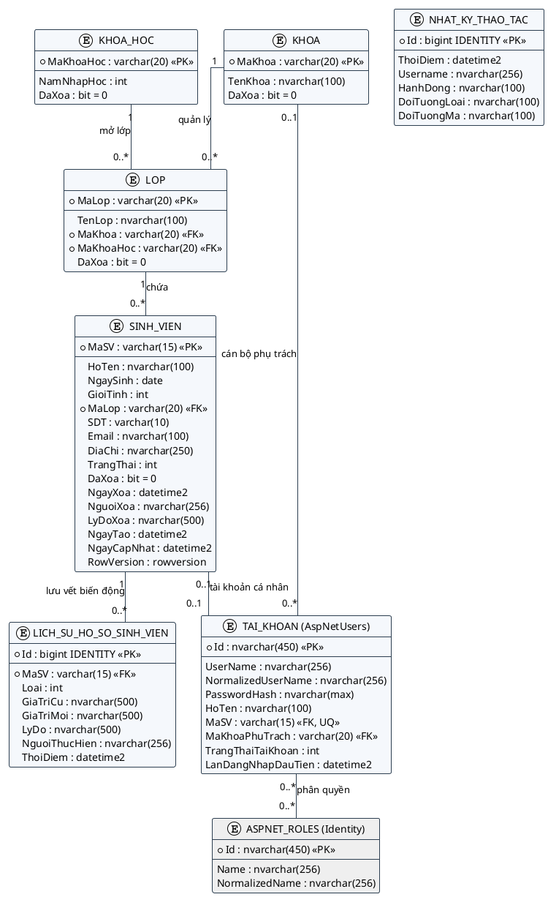
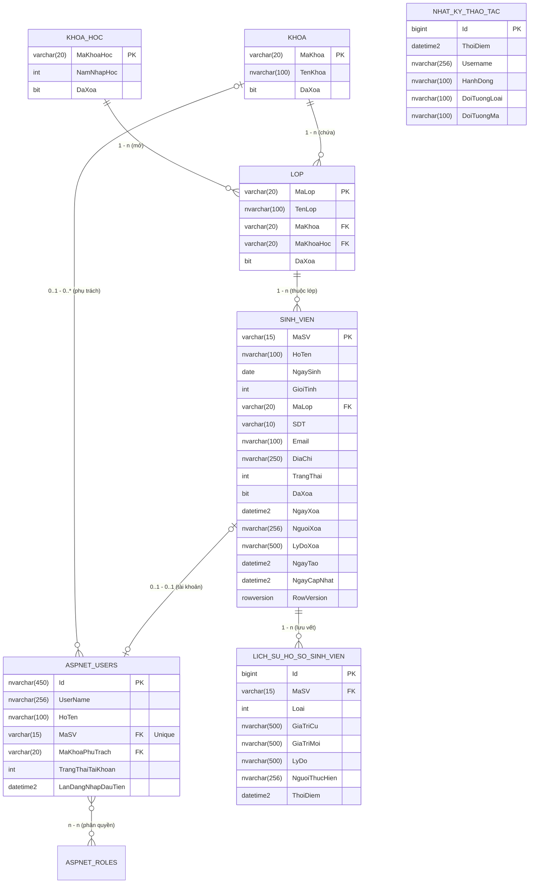

# BÁO CÁO THỰC HÀNH BUỔI 6: THIẾT KẾ DATA LAYER VỚI EF CORE
## HỌC PHẦN: LẬP TRÌNH WEB NÂNG CAO (ASP.NET CORE MVC)
### ĐỀ TÀI BTL: HỆ THỐNG QUẢN LÝ SINH VIÊN (STUDENT PORTAL)
**Phạm vi thực hiện:** Báo cáo nhóm BTL (Hoàn thành toàn diện Mục 1 đến Mục 8 & Phần Mở rộng lý thuyết)

---

# I. YÊU CẦU THỰC HIỆN NHÓM

## 1. Xác định thực thể hệ thống
Dựa trên tài liệu Đặc tả yêu cầu phần mềm (SRS) của đề tài *Hệ thống Quản lý sinh viên - Student Portal*, nhóm xác định **7 thực thể nghiệp vụ cốt lõi** phục vụ chuỗi Data Layer của hệ thống:

### Bảng 1.1: Danh sách các thực thể hệ thống và vai trò nghiệp vụ

| STT | Entity (Thực thể) | Tên bảng CSDL | Vai trò trong hệ thống |
| :---: | :--- | :--- | :--- |
| 1 | **Khoa** | `KHOA` | Quản lý danh mục khoa đào tạo chuyên môn; một khoa có nhiều lớp học và phân công nhiều cán bộ phụ trách. Hỗ trợ xóa mềm (`DaXoa`). |
| 2 | **KhoaHoc** | `KHOA_HOC` | Quản lý danh mục niên khóa tuyển sinh (ví dụ: K20, K21, K22); lưu trữ năm nhập học và hỗ trợ xóa mềm. |
| 3 | **Lop** | `LOP` | Quản lý lớp sinh hoạt hành chính. Mỗi lớp trực thuộc duy nhất một Khoa và một Khóa học. |
| 4 | **SinhVien** | `SINH_VIEN` | Thực thể trung tâm lưu trữ thông tin hồ sơ lý lịch cá nhân của sinh viên; quản lý trạng thái học tập, hỗ trợ xóa mềm (Soft Delete) và xử lý cập nhật đồng thời (Concurrency Control qua `RowVersion`). |
| 5 | **TaiKhoan** (`ApplicationUser`) | `AspNetUsers` | Quản lý tài khoản đăng nhập hệ thống, kế thừa từ `IdentityUser`. Liên kết 1 - 1 với sinh viên (nếu là sinh viên) hoặc liên kết N - 1 với khoa phụ trách (nếu là cán bộ/giáo vụ khoa). |
| 6 | **LichSuHoSoSinhVien** | `LICH_SU_HO_SO_SINH_VIEN` | Lưu vết toàn bộ biến động dữ liệu quan trọng của hồ sơ: đổi trạng thái học tập, chuyển lớp, khóa và mở khóa tài khoản, người thực hiện và lý do. |
| 7 | **NhatKyThaoTac** | `NHAT_KY_THAO_TAC` | Bảng nhật ký thao tác (Audit Log) độc lập toàn hệ thống; ghi nhận các hành vi nhạy cảm (thêm, sửa, xóa, phân quyền) phục vụ truy vết an ninh. |

---

### Bảng 1.2: Mô tả chi tiết thuộc tính từng thực thể (Entity Attributes & Data Types)

#### 1. Thực thể `Khoa` (Bảng `KHOA`)
| Thuộc tính | Kiểu dữ liệu C# | Kiểu dữ liệu SQL Server | Ràng buộc / Ghi chú nghiệp vụ |
| :--- | :--- | :--- | :--- |
| `MaKhoa` | `string` | `varchar(20)` | **PK**; Mã khoa (chữ và số không dấu, ví dụ `CNTT`, `KTE`); bất biến. |
| `TenKhoa` | `string` | `nvarchar(100)` | Bắt buộc (`Required`); Tên khoa chuyên môn đầy đủ. |
| `DaXoa` | `bool` | `bit` | Cờ xóa mềm (Soft delete); mặc định `false`. |

#### 2. Thực thể `KhoaHoc` (Bảng `KHOA_HOC`)
| Thuộc tính | Kiểu dữ liệu C# | Kiểu dữ liệu SQL Server | Ràng buộc / Ghi chú nghiệp vụ |
| :--- | :--- | :--- | :--- |
| `MaKhoaHoc` | `string` | `varchar(20)` | **PK**; Mã niên khóa (ví dụ `K20`, `K21`). |
| `NamNhapHoc` | `int` | `int` | Bắt buộc; Giá trị hợp lệ từ 1900 đến 2200. |
| `DaXoa` | `bool` | `bit` | Cờ xóa mềm; mặc định `false`. |

#### 3. Thực thể `Lop` (Bảng `LOP`)
| Thuộc tính | Kiểu dữ liệu C# | Kiểu dữ liệu SQL Server | Ràng buộc / Ghi chú nghiệp vụ |
| :--- | :--- | :--- | :--- |
| `MaLop` | `string` | `varchar(20)` | **PK**; Mã lớp hành chính (ví dụ `CNTT1-K20`). |
| `TenLop` | `string` | `nvarchar(100)` | Bắt buộc; Tên hiển thị của lớp; duy nhất trong cùng Khoa và Khóa học. |
| `MaKhoa` | `string` | `varchar(20)` | **FK** → `KHOA.MaKhoa`; Bắt buộc; Không cho xóa đệ quy (`Restrict`). |
| `MaKhoaHoc` | `string` | `varchar(20)` | **FK** → `KHOA_HOC.MaKhoaHoc`; Bắt buộc; Không cho xóa đệ quy (`Restrict`). |
| `DaXoa` | `bool` | `bit` | Cờ xóa mềm; mặc định `false`. |

#### 4. Thực thể `SinhVien` (Bảng `SINH_VIEN`)
| Thuộc tính | Kiểu dữ liệu C# | Kiểu dữ liệu SQL Server | Ràng buộc / Ghi chú nghiệp vụ |
| :--- | :--- | :--- | :--- |
| `MaSV` | `string` | `varchar(15)` | **PK**; Từ 6–15 ký tự chữ và số; Chuẩn hóa in hoa; Không tái sử dụng mã. |
| `HoTen` | `string` | `nvarchar(100)` | Bắt buộc; Từ 2–100 ký tự; Không chứa số. |
| `NgaySinh` | `DateTime` | `date` | Bắt buộc; Ngày sinh không ở tương lai; Đủ 15 tuổi tại thời điểm tạo. |
| `GioiTinh` | `GioiTinh` (enum) | `int` | `Nam = 0`, `Nu = 1`, `Khac = 2`. |
| `MaLop` | `string` | `varchar(20)` | **FK** → `LOP.MaLop`; Bắt buộc; Xác định lớp hành chính của sinh viên. |
| `SDT` | `string?` | `varchar(10)` | Tùy chọn; 10 chữ số bắt đầu bằng số `0`. |
| `Email` | `string?` | `nvarchar(100)` | Tùy chọn; Định dạng email chuẩn; Đánh chỉ mục Unique có điều kiện. |
| `DiaChi` | `string?` | `nvarchar(250)` | Tùy chọn; Địa chỉ thường trú / liên hệ. |
| `TrangThai` | `TrangThaiSinhVien` (enum) | `int` | `DangHoc = 0`, `BaoLuu = 1`, `DaTotNghiep = 2`, `ThoiHoc = 3`. |
| `DaXoa` | `bool` | `bit` | Cờ đánh dấu xóa mềm; mặc định `false`. |
| `NgayXoa` | `DateTime?` | `datetime2` | Thời điểm UTC khi thực hiện xóa mềm (nếu có). |
| `NguoiXoa` | `string?` | `nvarchar(256)` | Tên tài khoản người thực hiện xóa mềm. |
| `LyDoXoa` | `string?` | `nvarchar(500)` | Bắt buộc nhập lý do khi thực hiện xóa mềm (`DaXoa = true`). |
| `NgayTao` | `DateTime` | `datetime2` | Thời điểm UTC khởi tạo hồ sơ; Tự động gán `GETUTCDATE()`. |
| `NgayCapNhat` | `DateTime` | `datetime2` | Thời điểm UTC cập nhật lần cuối; Tự động cập nhật qua `SaveChangesAsync`. |
| `RowVersion` | `byte[]?` | `rowversion` | Token kiểm soát đồng thời (Optimistic Concurrency Control) do SQL Server tự tăng. |

#### 5. Thực thể `TaiKhoan` (`ApplicationUser` - Bảng `AspNetUsers`)
| Thuộc tính | Kiểu dữ liệu C# | Kiểu dữ liệu SQL Server | Ràng buộc / Ghi chú nghiệp vụ |
| :--- | :--- | :--- | :--- |
| `Id` | `string` | `nvarchar(450)` | **PK**; GUID do ASP.NET Core Identity quản lý. |
| `UserName` | `string` | `nvarchar(256)` | Tên đăng nhập (đối với sinh viên: `UserName` = `MaSV`). |
| `NormalizedUserName` | `string` | `nvarchar(256)` | Tên chuẩn hóa in hoa; Unique Index mặc định của Identity. |
| `PasswordHash` | `string` | `nvarchar(max)` | Chuỗi băm mật khẩu chuẩn PBKDF2/HMAC-SHA256 của Identity. |
| `HoTen` | `string?` | `nvarchar(100)` | Họ tên của Admin hoặc Cán bộ (với Sinh viên lấy từ `SinhVien.HoTen`). |
| `MaSV` | `string?` | `varchar(15)` | **FK, Unique có điều kiện** → `SINH_VIEN.MaSV`; Nullable đối với Admin/Cán bộ. |
| `MaKhoaPhuTrach` | `string?` | `varchar(20)` | **FK** → `KHOA.MaKhoa`; Dành riêng cho tài khoản Cán bộ khoa (Staff). |
| `TrangThaiTaiKhoan`| `TrangThaiTaiKhoan` (enum) | `int` | `HoatDong = 0`, `BiKhoa = 1`. |
| `LanDangNhapDauTien`| `DateTime?` | `datetime2` | Thời điểm lần đầu đăng nhập hệ thống; Null nếu chưa đăng nhập. |
| Các cột Identity | Đa dạng | Đa dạng | Kế thừa: `Email`, `PhoneNumber`, `LockoutEnd`, `AccessFailedCount`, v.v. |

#### 6. Thực thể `LichSuHoSoSinhVien` (Bảng `LICH_SU_HO_SO_SINH_VIEN`)
| Thuộc tính | Kiểu dữ liệu C# | Kiểu dữ liệu SQL Server | Ràng buộc / Ghi chú nghiệp vụ |
| :--- | :--- | :--- | :--- |
| `Id` | `long` | `bigint IDENTITY` | **PK**; Khóa chính tự tăng. |
| `MaSV` | `string` | `varchar(15)` | **FK** → `SINH_VIEN.MaSV`; Mã sinh viên phát sinh sự kiện thay đổi. |
| `Loai` | `LoaiLichSuHoSo` (enum) | `int` | `DoiTrangThai = 0`, `ChuyenLop = 1`, `KhoaTaiKhoan = 2`, `MoKhoaTaiKhoan = 3`. |
| `GiaTriCu` | `string?` | `nvarchar(500)` | Giá trị trước khi thao tác (ví dụ: Lớp cũ, trạng thái cũ). |
| `GiaTriMoi` | `string?` | `nvarchar(500)` | Giá trị sau khi thao tác (ví dụ: Lớp mới, trạng thái mới). |
| `LyDo` | `string?` | `nvarchar(500)` | Lý do thực hiện nghiệp vụ (quyết định chuyển lớp, tạm dừng học...). |
| `NguoiThucHien` | `string` | `nvarchar(256)` | Tên tài khoản thực hiện thao tác. |
| `ThoiDiem` | `DateTime` | `datetime2` | Thời điểm UTC ghi nhận sự kiện; Tự động gán `GETUTCDATE()`. |

#### 7. Thực thể `NhatKyThaoTac` (Bảng `NHAT_KY_THAO_TAC`)
| Thuộc tính | Kiểu dữ liệu C# | Kiểu dữ liệu SQL Server | Ràng buộc / Ghi chú nghiệp vụ |
| :--- | :--- | :--- | :--- |
| `Id` | `long` | `bigint IDENTITY` | **PK**; Khóa chính tự tăng. |
| `ThoiDiem` | `DateTime` | `datetime2` | Thời điểm UTC phát sinh thao tác (`GETUTCDATE()`). |
| `Username` | `string` | `nvarchar(256)` | Tên đăng nhập của người thực hiện hành động. |
| `HanhDong` | `string` | `nvarchar(100)` | Tên hành động: `TaoHoSo`, `SuaHoSo`, `XoaMem`, `KhoaTaiKhoan`, `PhanQuyen`... |
| `DoiTuongLoai` | `string` | `nvarchar(100)` | Tên đối tượng tác động (ví dụ: `SinhVien`, `TaiKhoan`, `Lop`). |
| `DoiTuongMa` | `string` | `nvarchar(100)` | Định danh khóa của đối tượng tác động (ví dụ: `SV20200001`). |

---

## 2. Thiết kế quan hệ dữ liệu & Sơ đồ ERD

### 2.1. Phân tích các mối quan hệ giữa các thực thể

| Thực thể 1 | Thực thể 2 | Loại quan hệ | Bội số (Cardinality) | Diễn giải quy tắc nghiệp vụ |
| :--- | :--- | :---: | :---: | :--- |
| **Khoa** | **Lop** | 1 — n | `1` đến `0..*` | Một khoa đào tạo có thể mở 0 hoặc nhiều lớp hành chính. Mỗi lớp bắt buộc thuộc đúng một khoa (`FK Lop.MaKhoa`). Hành vi xóa: `Restrict` (không xóa khoa nếu đang có lớp). |
| **KhoaHoc** | **Lop** | 1 — n | `1` đến `0..*` | Một khóa học tuyển sinh có 0 hoặc nhiều lớp hành chính. Mỗi lớp bắt buộc gắn với một niên khóa (`FK Lop.MaKhoaHoc`). Hành vi xóa: `Restrict`. |
| **Lop** | **SinhVien** | 1 — n | `1` đến `0..*` | Một lớp hành chính có 0 hoặc nhiều sinh viên. Mỗi sinh viên bắt buộc thuộc về đúng một lớp (`FK SinhVien.MaLop`). Hành vi xóa: `Restrict`. |
| **SinhVien** | **TaiKhoan** | 1 — 1 (opt) | `0..1` đến `0..1` | Mỗi sinh viên có tối đa một tài khoản đăng nhập tương ứng (`FK TaiKhoan.MaSV`). Mã SV trên bảng tài khoản có chỉ mục Unique có điều kiện (`[MaSV] IS NOT NULL`). Hành vi xóa: `SetNull`. |
| **Khoa** | **TaiKhoan** | 1 — n (opt) | `0..1` đến `0..*` | Một khoa có thể có nhiều cán bộ/giáo vụ phụ trách (`FK TaiKhoan.MaKhoaPhuTrach`). Đối với Admin và Sinh viên trường này nhận giá trị `NULL`. Hành vi xóa: `Restrict`. |
| **SinhVien** | **LichSuHoSo** | 1 — n | `1` đến `0..*` | Một sinh viên có thể có 0 hoặc nhiều bản ghi lịch sử hồ sơ. Mỗi bản ghi tham chiếu chính xác đến 1 sinh viên (`FK LichSuHoSoSinhVien.MaSV`). Hành vi xóa: `Cascade`. |
| **TaiKhoan** | **AspNetRoles** | n — n | `0..*` đến `0..*` | Quản lý phân quyền vai trò (Admin, CanBo, SinhVien) thông qua bảng trung gian `AspNetUserRoles` của ASP.NET Core Identity. |
| **NhatKyThaoTac**| *(Độc lập)* | N/A | Không FK | Bảng Audit Log độc lập không tạo ràng buộc khóa ngoại đa hình nhằm tối ưu tốc độ ghi log và tránh phụ thuộc chặt chẽ vào vòng đời bản ghi. |

---

### 2.2. Sơ đồ ERD dạng PlantText / PlantUML (Trích xuất chuẩn từ File 1 & File 2)



---

### 2.3. Sơ đồ ERD dạng Mermaid Visual



---

## 3. Tạo Domain Models (C# Classes với Data Annotations)

Toàn bộ các file Domain Models được tổ chức trong thư mục `Models/` của project, tuân thủ nghiêm ngặt các quy tắc:
* Khóa chính **Primary Key** (`[Key]`).
* Thuộc tính điều hướng **Navigation Property** với từ khóa `virtual` hỗ trợ Lazy Loading/Eager Loading.
* **Data Annotations** kiểm tra tính hợp lệ (`[Required]`, `[StringLength]`, `[Range]`, `[EmailAddress]`, `[RegularExpression]`, `[Timestamp]`, `[ForeignKey]`, `[Table]`).

### 3.1. File `Models/Enums.cs`
```csharp
namespace StudentPortal.Models
{
    public enum GioiTinh
    {
        Nam = 0,
        Nu = 1,
        Khac = 2
    }

    public enum TrangThaiSinhVien
    {
        DangHoc = 0,
        BaoLuu = 1,
        DaTotNghiep = 2,
        ThoiHoc = 3
    }

    public enum TrangThaiTaiKhoan
    {
        HoatDong = 0,
        BiKhoa = 1
    }

    public enum LoaiLichSuHoSo
    {
        DoiTrangThai = 0,
        ChuyenLop = 1,
        KhoaTaiKhoan = 2,
        MoKhoaTaiKhoan = 3
    }
}
```

### 3.2. File `Models/Khoa.cs`
```csharp
using System.ComponentModel.DataAnnotations;
using System.ComponentModel.DataAnnotations.Schema;

namespace StudentPortal.Models
{
    [Table("KHOA")]
    public class Khoa
    {
        [Key]
        [StringLength(20, ErrorMessage = "Mã khoa tối đa 20 ký tự")]
        [Display(Name = "Mã Khoa")]
        public string MaKhoa { get; set; } = string.Empty;

        [Required(ErrorMessage = "Tên khoa không được để trống")]
        [StringLength(100, ErrorMessage = "Tên khoa tối đa 100 ký tự")]
        [Display(Name = "Tên Khoa")]
        public string TenKhoa { get; set; } = string.Empty;

        [Display(Name = "Đã Xóa")]
        public bool DaXoa { get; set; } = false;

        // Navigation Properties
        public virtual ICollection<Lop> Lops { get; set; } = new List<Lop>();
        public virtual ICollection<ApplicationUser> CanBoPhuTrachs { get; set; } = new List<ApplicationUser>();
    }
}
```

### 3.3. File `Models/KhoaHoc.cs`
```csharp
using System.ComponentModel.DataAnnotations;
using System.ComponentModel.DataAnnotations.Schema;

namespace StudentPortal.Models
{
    [Table("KHOA_HOC")]
    public class KhoaHoc
    {
        [Key]
        [StringLength(20, ErrorMessage = "Mã khóa học tối đa 20 ký tự")]
        [Display(Name = "Mã Khóa Học")]
        public string MaKhoaHoc { get; set; } = string.Empty;

        [Required(ErrorMessage = "Năm nhập học không được để trống")]
        [Range(1900, 2200, ErrorMessage = "Năm nhập học phải trong khoảng 1900 - 2200")]
        [Display(Name = "Năm Nhập Học")]
        public int NamNhapHoc { get; set; }

        [Display(Name = "Đã Xóa")]
        public bool DaXoa { get; set; } = false;

        // Navigation Properties
        public virtual ICollection<Lop> Lops { get; set; } = new List<Lop>();
    }
}
```

### 3.4. File `Models/Lop.cs`
```csharp
using System.ComponentModel.DataAnnotations;
using System.ComponentModel.DataAnnotations.Schema;

namespace StudentPortal.Models
{
    [Table("LOP")]
    public class Lop
    {
        [Key]
        [StringLength(20, ErrorMessage = "Mã lớp tối đa 20 ký tự")]
        [Display(Name = "Mã Lớp")]
        public string MaLop { get; set; } = string.Empty;

        [Required(ErrorMessage = "Tên lớp không được để trống")]
        [StringLength(100, ErrorMessage = "Tên lớp tối đa 100 ký tự")]
        [Display(Name = "Tên Lớp")]
        public string TenLop { get; set; } = string.Empty;

        [Required(ErrorMessage = "Khoa không được để trống")]
        [StringLength(20)]
        [Display(Name = "Mã Khoa")]
        public string MaKhoa { get; set; } = string.Empty;

        [Required(ErrorMessage = "Khóa học không được để trống")]
        [StringLength(20)]
        [Display(Name = "Mã Khóa Học")]
        public string MaKhoaHoc { get; set; } = string.Empty;

        [Display(Name = "Đã Xóa")]
        public bool DaXoa { get; set; } = false;

        // Navigation Properties
        [ForeignKey(nameof(MaKhoa))]
        public virtual Khoa? Khoa { get; set; }

        [ForeignKey(nameof(MaKhoaHoc))]
        public virtual KhoaHoc? KhoaHoc { get; set; }

        public virtual ICollection<SinhVien> SinhViens { get; set; } = new List<SinhVien>();
    }
}
```

### 3.5. File `Models/SinhVien.cs`
```csharp
using System.ComponentModel.DataAnnotations;
using System.ComponentModel.DataAnnotations.Schema;

namespace StudentPortal.Models
{
    [Table("SINH_VIEN")]
    public class SinhVien
    {
        [Key]
        [StringLength(15, MinimumLength = 6, ErrorMessage = "Mã sinh viên phải từ 6 đến 15 ký tự")]
        [RegularExpression(@"^[a-zA-Z0-9]+$", ErrorMessage = "Mã sinh viên chỉ chứa chữ và số không dấu")]
        [Display(Name = "Mã Sinh Viên")]
        public string MaSV { get; set; } = string.Empty;

        [Required(ErrorMessage = "Họ tên không được để trống")]
        [StringLength(100, MinimumLength = 2, ErrorMessage = "Họ tên từ 2 đến 100 ký tự")]
        [Display(Name = "Họ và Tên")]
        public string HoTen { get; set; } = string.Empty;

        [Required(ErrorMessage = "Ngày sinh không được để trống")]
        [DataType(DataType.Date)]
        [Display(Name = "Ngày Sinh")]
        public DateTime NgaySinh { get; set; }

        [Required]
        [Display(Name = "Giới Tính")]
        public GioiTinh GioiTinh { get; set; } = GioiTinh.Nam;

        [Required(ErrorMessage = "Lớp không được để trống")]
        [StringLength(20)]
        [Display(Name = "Mã Lớp")]
        public string MaLop { get; set; } = string.Empty;

        [StringLength(10)]
        [RegularExpression(@"^0\d{9}$", ErrorMessage = "Số điện thoại gồm 10 chữ số bắt đầu bằng 0")]
        [Display(Name = "Số Điện Thoại")]
        public string? SDT { get; set; }

        [StringLength(100)]
        [EmailAddress(ErrorMessage = "Email không đúng định dạng")]
        [Display(Name = "Email Liên Hệ")]
        public string? Email { get; set; }

        [StringLength(250)]
        [Display(Name = "Địa Chỉ Thường Trú")]
        public string? DiaChi { get; set; }

        [Required]
        [Display(Name = "Trạng Thái Học Tập")]
        public TrangThaiSinhVien TrangThai { get; set; } = TrangThaiSinhVien.DangHoc;

        [Display(Name = "Đã Xóa")]
        public bool DaXoa { get; set; } = false;

        [Display(Name = "Thời Điểm Xóa")]
        public DateTime? NgayXoa { get; set; }

        [StringLength(256)]
        [Display(Name = "Người Thực Hiện Xóa")]
        public string? NguoiXoa { get; set; }

        [StringLength(500)]
        [Display(Name = "Lý Do Xóa")]
        public string? LyDoXoa { get; set; }

        [Display(Name = "Thời Điểm Khởi Tạo")]
        public DateTime NgayTao { get; set; } = DateTime.UtcNow;

        [Display(Name = "Thời Điểm Cập Nhật Cuối")]
        public DateTime NgayCapNhat { get; set; } = DateTime.UtcNow;

        [Timestamp]
        public byte[]? RowVersion { get; set; }

        // Navigation Properties
        [ForeignKey(nameof(MaLop))]
        public virtual Lop? Lop { get; set; }

        public virtual ApplicationUser? TaiKhoan { get; set; }

        public virtual ICollection<LichSuHoSoSinhVien> LichSuHoSos { get; set; } = new List<LichSuHoSoSinhVien>();
    }
}
```

### 3.6. File `Models/ApplicationUser.cs` (`TAI_KHOAN`)
```csharp
using Microsoft.AspNetCore.Identity;
using System.ComponentModel.DataAnnotations;
using System.ComponentModel.DataAnnotations.Schema;

namespace StudentPortal.Models
{
    public class ApplicationUser : IdentityUser
    {
        [StringLength(100, ErrorMessage = "Họ tên tối đa 100 ký tự")]
        [Display(Name = "Họ và Tên")]
        public string? HoTen { get; set; }

        [StringLength(15)]
        [Display(Name = "Mã Sinh Viên")]
        public string? MaSV { get; set; }

        [StringLength(20)]
        [Display(Name = "Mã Khoa Phụ Trách")]
        public string? MaKhoaPhuTrach { get; set; }

        [Display(Name = "Trạng Thái Tài Khoản")]
        public TrangThaiTaiKhoan TrangThaiTaiKhoan { get; set; } = TrangThaiTaiKhoan.HoatDong;

        [Display(Name = "Lần Đăng Nhập Đầu Tiên")]
        public DateTime? LanDangNhapDauTien { get; set; }

        // Navigation Properties
        [ForeignKey(nameof(MaSV))]
        public virtual SinhVien? SinhVien { get; set; }

        [ForeignKey(nameof(MaKhoaPhuTrach))]
        public virtual Khoa? KhoaPhuTrach { get; set; }
    }
}
```

### 3.7. File `Models/LichSuHoSoSinhVien.cs`
```csharp
using System.ComponentModel.DataAnnotations;
using System.ComponentModel.DataAnnotations.Schema;

namespace StudentPortal.Models
{
    [Table("LICH_SU_HO_SO_SINH_VIEN")]
    public class LichSuHoSoSinhVien
    {
        [Key]
        [DatabaseGenerated(DatabaseGeneratedOption.Identity)]
        public long Id { get; set; }

        [Required(ErrorMessage = "Mã sinh viên không được để trống")]
        [StringLength(15)]
        [Display(Name = "Mã Sinh Viên")]
        public string MaSV { get; set; } = string.Empty;

        [Required]
        [Display(Name = "Loại Thao Tác")]
        public LoaiLichSuHoSo Loai { get; set; }

        [StringLength(500)]
        [Display(Name = "Giá Trị Cũ")]
        public string? GiaTriCu { get; set; }

        [StringLength(500)]
        [Display(Name = "Giá Trị Mới")]
        public string? GiaTriMoi { get; set; }

        [StringLength(500)]
        [Display(Name = "Lý Do Thực Hiện")]
        public string? LyDo { get; set; }

        [Required(ErrorMessage = "Người thực hiện không được để trống")]
        [StringLength(256)]
        [Display(Name = "Người Thực Hiện")]
        public string NguoiThucHien { get; set; } = string.Empty;

        [Display(Name = "Thời Điểm Ghi Nhận")]
        public DateTime ThoiDiem { get; set; } = DateTime.UtcNow;

        // Navigation Properties
        [ForeignKey(nameof(MaSV))]
        public virtual SinhVien? SinhVien { get; set; }
    }
}
```

### 3.8. File `Models/NhatKyThaoTac.cs`
```csharp
using System.ComponentModel.DataAnnotations;
using System.ComponentModel.DataAnnotations.Schema;

namespace StudentPortal.Models
{
    [Table("NHAT_KY_THAO_TAC")]
    public class NhatKyThaoTac
    {
        [Key]
        [DatabaseGenerated(DatabaseGeneratedOption.Identity)]
        public long Id { get; set; }

        [Display(Name = "Thời Điểm")]
        public DateTime ThoiDiem { get; set; } = DateTime.UtcNow;

        [Required(ErrorMessage = "Tên tài khoản không được để trống")]
        [StringLength(256)]
        [Display(Name = "Tài Khoản")]
        public string Username { get; set; } = string.Empty;

        [Required(ErrorMessage = "Hành động không được để trống")]
        [StringLength(100)]
        [Display(Name = "Hành Động")]
        public string HanhDong { get; set; } = string.Empty;

        [Required(ErrorMessage = "Loại đối tượng không được để trống")]
        [StringLength(100)]
        [Display(Name = "Loại Đối Tượng")]
        public string DoiTuongLoai { get; set; } = string.Empty;

        [Required(ErrorMessage = "Mã đối tượng không được để trống")]
        [StringLength(100)]
        [Display(Name = "Mã Đối Tượng")]
        public string DoiTuongMa { get; set; } = string.Empty;
    }
}
```

---

## 4. Tạo DbContext (`Data/ApplicationDbContext.cs`)

Lớp `ApplicationDbContext` kế thừa từ `IdentityDbContext<ApplicationUser>`, khai báo đầy đủ các tập hợp `DbSet<T>` và ghi đè phương thức `OnModelCreating` bằng Fluent API nhằm thiết lập các ràng buộc toàn vẹn dữ liệu, các quan hệ 1-1, 1-N, cơ chế **Soft Delete Global Query Filter**, và tự động cập nhật thời gian (`NgayCapNhat`):

```csharp
using Microsoft.AspNetCore.Identity.EntityFrameworkCore;
using Microsoft.EntityFrameworkCore;
using StudentPortal.Models;

namespace StudentPortal.Data
{
    public class ApplicationDbContext : IdentityDbContext<ApplicationUser>
    {
        public ApplicationDbContext(DbContextOptions<ApplicationDbContext> options)
            : base(options)
        {
        }

        // 1. Khai báo các DbSet nghiệp vụ
        public DbSet<Khoa> Khoas { get; set; } = null!;
        public DbSet<KhoaHoc> KhoaHocs { get; set; } = null!;
        public DbSet<Lop> Lops { get; set; } = null!;
        public DbSet<SinhVien> SinhViens { get; set; } = null!;
        public DbSet<LichSuHoSoSinhVien> LichSuHoSoSinhViens { get; set; } = null!;
        public DbSet<NhatKyThaoTac> NhatKyThaoTacs { get; set; } = null!;

        protected override void OnModelCreating(ModelBuilder builder)
        {
            base.OnModelCreating(builder);

            // 2. Cấu hình bảng KHOA
            builder.Entity<Khoa>(b =>
            {
                b.HasKey(k => k.MaKhoa);
                b.Property(k => k.MaKhoa).HasMaxLength(20).IsUnicode(false);
                b.Property(k => k.TenKhoa).HasMaxLength(100).IsRequired();
                b.Property(k => k.DaXoa).HasDefaultValue(false);

                // Global Query Filter: Tự động lọc bỏ bản ghi đã xóa mềm
                b.HasQueryFilter(k => !k.DaXoa);
            });

            // 3. Cấu hình bảng KHOA_HOC
            builder.Entity<KhoaHoc>(b =>
            {
                b.HasKey(kh => kh.MaKhoaHoc);
                b.Property(kh => kh.MaKhoaHoc).HasMaxLength(20).IsUnicode(false);
                b.Property(kh => kh.NamNhapHoc).IsRequired();
                b.Property(kh => kh.DaXoa).HasDefaultValue(false);

                b.HasQueryFilter(kh => !kh.DaXoa);
            });

            // 4. Cấu hình bảng LOP
            builder.Entity<Lop>(b =>
            {
                b.HasKey(l => l.MaLop);
                b.Property(l => l.MaLop).HasMaxLength(20).IsUnicode(false);
                b.Property(l => l.TenLop).HasMaxLength(100).IsRequired();
                b.Property(l => l.MaKhoa).HasMaxLength(20).IsUnicode(false).IsRequired();
                b.Property(l => l.MaKhoaHoc).HasMaxLength(20).IsUnicode(false).IsRequired();
                b.Property(l => l.DaXoa).HasDefaultValue(false);

                // Quan hệ N - 1 với Khoa (Không cho xóa cascade)
                b.HasOne(l => l.Khoa)
                 .WithMany(k => k.Lops)
                 .HasForeignKey(l => l.MaKhoa)
                 .OnDelete(DeleteBehavior.Restrict);

                // Quan hệ N - 1 với KhoaHoc
                b.HasOne(l => l.KhoaHoc)
                 .WithMany(kh => kh.Lops)
                 .HasForeignKey(l => l.MaKhoaHoc)
                 .OnDelete(DeleteBehavior.Restrict);

                // Ràng buộc duy nhất tên lớp trong cùng một khoa và khóa
                b.HasIndex(l => new { l.MaKhoa, l.MaKhoaHoc, l.TenLop }).IsUnique();

                b.HasQueryFilter(l => !l.DaXoa);
            });

            // 5. Cấu hình bảng SINH_VIEN
            builder.Entity<SinhVien>(b =>
            {
                b.HasKey(s => s.MaSV);
                b.Property(s => s.MaSV).HasMaxLength(15).IsUnicode(false);
                b.Property(s => s.HoTen).HasMaxLength(100).IsRequired();
                b.Property(s => s.NgaySinh).HasColumnType("date").IsRequired();
                b.Property(s => s.GioiTinh).IsRequired();
                b.Property(s => s.MaLop).HasMaxLength(20).IsUnicode(false).IsRequired();
                b.Property(s => s.SDT).HasMaxLength(10).IsUnicode(false);
                b.Property(s => s.Email).HasMaxLength(100);
                b.Property(s => s.DiaChi).HasMaxLength(250);
                b.Property(s => s.TrangThai).IsRequired();
                b.Property(s => s.DaXoa).HasDefaultValue(false);
                b.Property(s => s.LyDoXoa).HasMaxLength(500);
                b.Property(s => s.NguoiXoa).HasMaxLength(256);
                b.Property(s => s.NgayTao).HasDefaultValueSql("GETUTCDATE()");
                b.Property(s => s.NgayCapNhat).HasDefaultValueSql("GETUTCDATE()");

                // Concurrency Token phát hiện cập nhật cạnh tranh
                b.Property(s => s.RowVersion).IsRowVersion();

                // Quan hệ N - 1 với Lop
                b.HasOne(s => s.Lop)
                 .WithMany(l => l.SinhViens)
                 .HasForeignKey(s => s.MaLop)
                 .OnDelete(DeleteBehavior.Restrict);

                // Index phục vụ tìm kiếm nhanh
                b.HasIndex(s => s.MaLop);
                b.HasIndex(s => s.HoTen);
                b.HasIndex(s => s.TrangThai);
                b.HasIndex(s => s.Email).IsUnique().HasFilter("[Email] IS NOT NULL");

                b.HasQueryFilter(s => !s.DaXoa);
            });

            // 6. Cấu hình bảng TAI_KHOAN (AspNetUsers mở rộng)
            builder.Entity<ApplicationUser>(b =>
            {
                b.Property(u => u.HoTen).HasMaxLength(100);
                b.Property(u => u.MaSV).HasMaxLength(15).IsUnicode(false);
                b.Property(u => u.MaKhoaPhuTrach).HasMaxLength(20).IsUnicode(false);

                // Quan hệ 0..1 - 0..1 với SinhVien
                b.HasOne(u => u.SinhVien)
                 .WithOne(s => s.TaiKhoan)
                 .HasForeignKey<ApplicationUser>(u => u.MaSV)
                 .OnDelete(DeleteBehavior.SetNull);

                // Index Unique có điều kiện cho MaSV (chỉ kiểm tra khi khác NULL)
                b.HasIndex(u => u.MaSV).IsUnique().HasFilter("[MaSV] IS NOT NULL");

                // Quan hệ N - 1 với Khoa (Khoa phụ trách của Cán bộ)
                b.HasOne(u => u.KhoaPhuTrach)
                 .WithMany(k => k.CanBoPhuTrachs)
                 .HasForeignKey(u => u.MaKhoaPhuTrach)
                 .OnDelete(DeleteBehavior.Restrict);
            });

            // 7. Cấu hình bảng LICH_SU_HO_SO_SINH_VIEN
            builder.Entity<LichSuHoSoSinhVien>(b =>
            {
                b.HasKey(h => h.Id);
                b.Property(h => h.MaSV).HasMaxLength(15).IsUnicode(false).IsRequired();
                b.Property(h => h.Loai).IsRequired();
                b.Property(h => h.GiaTriCu).HasMaxLength(500);
                b.Property(h => h.GiaTriMoi).HasMaxLength(500);
                b.Property(h => h.LyDo).HasMaxLength(500);
                b.Property(h => h.NguoiThucHien).HasMaxLength(256).IsRequired();
                b.Property(h => h.ThoiDiem).HasDefaultValueSql("GETUTCDATE()");

                b.HasOne(h => h.SinhVien)
                 .WithMany(s => s.LichSuHoSos)
                 .HasForeignKey(h => h.MaSV)
                 .IsRequired(false)
                 .OnDelete(DeleteBehavior.Cascade);

                b.HasIndex(h => h.MaSV);
                b.HasIndex(h => h.ThoiDiem);
            });

            // 8. Cấu hình bảng NHAT_KY_THAO_TAC (Audit Log độc lập)
            builder.Entity<NhatKyThaoTac>(b =>
            {
                b.HasKey(n => n.Id);
                b.Property(n => n.ThoiDiem).HasDefaultValueSql("GETUTCDATE()");
                b.Property(n => n.Username).HasMaxLength(256).IsRequired();
                b.Property(n => n.HanhDong).HasMaxLength(100).IsRequired();
                b.Property(n => n.DoiTuongLoai).HasMaxLength(100).IsRequired();
                b.Property(n => n.DoiTuongMa).HasMaxLength(100).IsRequired();

                b.HasIndex(n => n.ThoiDiem);
                b.HasIndex(n => n.Username);
                b.HasIndex(n => new { n.DoiTuongLoai, n.DoiTuongMa });
            });
        }

        // Tự động gán thời điểm cập nhật cuối (NgayCapNhat) khi Modified
        public override Task<int> SaveChangesAsync(CancellationToken cancellationToken = default)
        {
            var entries = ChangeTracker.Entries<SinhVien>();
            foreach (var entry in entries)
            {
                if (entry.State == EntityState.Modified)
                {
                    entry.Entity.NgayCapNhat = DateTime.UtcNow;
                }
            }
            return base.SaveChangesAsync(cancellationToken);
        }
    }
}
```

---

## 5. Cấu hình kết nối Database (`appsettings.json`)

Chuỗi kết nối cơ sở dữ liệu Microsoft SQL Server được thiết lập trong tệp cấu hình `appsettings.json`:

```json
{
  "ConnectionStrings": {
    "DefaultConnection": "Server=(localdb)\\MSSQLLocalDB;Database=StudentPortalDb;Trusted_Connection=True;MultipleActiveResultSets=true;TrustServerCertificate=True"
  },
  "Logging": {
    "LogLevel": {
      "Default": "Information",
      "Microsoft.AspNetCore": "Warning"
    }
  },
  "AllowedHosts": "*"
}
```

### Giải thích các tham số trong chuỗi kết nối:
* `Server=(localdb)\MSSQLLocalDB`: Sử dụng SQL Server LocalDB tích hợp sẵn trong môi trường phát triển Visual Studio / .NET.
* `Database=StudentPortalDb`: Tên CSDL hệ thống quản lý sinh viên.
* `Trusted_Connection=True`: Xác thực người dùng bằng Windows Authentication an toàn.
* `MultipleActiveResultSets=true` (MARS): Cho phép thực thi nhiều truy vấn đồng thời trên cùng một kết nối logic.
* `TrustServerCertificate=True`: Chấp nhận chứng chỉ tự ký của môi trường dev local.

---

## 6. Đăng ký DbContext và Cấu hình Dependency Injection (`Program.cs`)

Trong tệp `Program.cs`, nhóm thực hiện đăng ký DbContext với DI container, tích hợp nhà cung cấp SQL Server (`options.UseSqlServer`), cấu hình ASP.NET Core Identity và kích hoạt các middleware xác thực / phân quyền:

```csharp
using Microsoft.AspNetCore.Identity;
using Microsoft.EntityFrameworkCore;
using StudentPortal.Data;
using StudentPortal.Models;

var builder = WebApplication.CreateBuilder(args);

// 1. Cấu hình chuỗi kết nối Database và đăng ký DbContext
var connectionString = builder.Configuration.GetConnectionString("DefaultConnection") 
    ?? throw new InvalidOperationException("Connection string 'DefaultConnection' not found.");

builder.Services.AddDbContext<ApplicationDbContext>(options =>
    options.UseSqlServer(connectionString));

// 2. Cấu hình ASP.NET Core Identity cho ApplicationUser và IdentityRole
builder.Services.AddIdentity<ApplicationUser, IdentityRole>(options =>
{
    // Cấu hình quy tắc mật khẩu an toàn
    options.Password.RequireDigit = true;
    options.Password.RequireLowercase = true;
    options.Password.RequireNonAlphanumeric = true;
    options.Password.RequireUppercase = true;
    options.Password.RequiredLength = 6;

    // Cấu hình chống brute-force đăng nhập
    options.Lockout.DefaultLockoutTimeSpan = TimeSpan.FromMinutes(15);
    options.Lockout.MaxFailedAccessAttempts = 5;
    options.Lockout.AllowedForNewUsers = true;

    options.User.RequireUniqueEmail = true;
})
.AddEntityFrameworkStores<ApplicationDbContext>()
.AddDefaultTokenProviders();

// 3. Đăng ký MVC Controllers & Views
builder.Services.AddControllersWithViews();

var app = builder.Build();

// 4. Tự động Seed dữ liệu mẫu khi khởi chạy ứng dụng
using (var scope = app.Services.CreateScope())
{
    var services = scope.ServiceProvider;
    try
    {
        await SeedData.InitializeAsync(services);
    }
    catch (Exception ex)
    {
        var logger = services.GetRequiredService<ILogger<Program>>();
        logger.LogError(ex, "Lỗi xảy ra trong quá trình khởi tạo dữ liệu mẫu (Seed Data).");
    }
}

// 5. Cấu hình HTTP Request Pipeline
if (!app.Environment.IsDevelopment())
{
    app.UseExceptionHandler("/Home/Error");
    app.UseHsts();
}

app.UseHttpsRedirection();
app.UseStaticFiles();

app.UseRouting();

// Thứ tự Middleware bắt buộc: Xác thực (Authentication) -> Phân quyền (Authorization)
app.UseAuthentication();
app.UseAuthorization();

app.MapControllerRoute(
    name: "default",
    pattern: "{controller=Home}/{action=Index}/{id?}");

app.Run();
```

---

## 7. Thực hiện Migration

### 7.1. Các câu lệnh Migration

Nhóm có thể sử dụng một trong hai công cụ tương đương sau:

#### Cách 1: Sử dụng Package Manager Console (trong Visual Studio)
```powershell
# Tạo mã migration từ các Domain Models và cấu hình Fluent API
Add-Migration InitialCreate

# Cập nhật và áp dụng toàn bộ schema vào cơ sở dữ liệu SQL Server
Update-Database
```

#### Cách 2: Sử dụng .NET CLI (trong Terminal / VS Code / PowerShell)
```powershell
# Cài đặt công cụ dotnet-ef (nếu chưa có)
dotnet tool install --global dotnet-ef

# Tạo mã migration
dotnet ef migrations add InitialCreate

# Áp dụng migration vào CSDL
dotnet ef database update

# Xuất file script SQL DDL độc lập (để nộp hoặc chạy trực tiếp trên Server)
dotnet ef migrations script -o Migrations/database_script.sql
```

---

### 7.2. Minh chứng kết quả Migration
Sau khi lệnh hoàn thành, thư mục `Migrations/` được sinh ra tự động trong dự án gồm 3 tệp tin:
1. `20261014132133_InitialCreate.cs`: Chứa hai phương thức `Up()` (tạo các bảng, khóa chính, khóa ngoại, chỉ mục) và `Down()` (rollback khi cần).
2. `20261014132133_InitialCreate.Designer.cs`: Metadata định danh phiên bản migration và cấu hình mapping.
3. `ApplicationDbContextModelSnapshot.cs`: Snapshot lưu giữ trạng thái schema hiện tại của toàn bộ Model.

---

### 7.3. Minh chứng cấu trúc bảng và SQL DDL sinh ra trong SQL Server
Dưới đây là mã SQL DDL thực tế trích xuất từ file migration đã sinh ra thành công:

```sql
-- 1. Bảng lưu trữ lịch sử Migration của EF Core
IF OBJECT_ID(N'[__EFMigrationsHistory]') IS NULL
BEGIN
    CREATE TABLE [__EFMigrationsHistory] (
        [MigrationId] nvarchar(150) NOT NULL,
        [ProductVersion] nvarchar(32) NOT NULL,
        CONSTRAINT [PK___EFMigrationsHistory] PRIMARY KEY ([MigrationId])
    );
END;
GO

BEGIN TRANSACTION;
GO

-- 2. Bảng KHOA
CREATE TABLE [KHOA] (
    [MaKhoa] varchar(20) NOT NULL,
    [TenKhoa] nvarchar(100) NOT NULL,
    [DaXoa] bit NOT NULL DEFAULT CAST(0 AS bit),
    CONSTRAINT [PK_KHOA] PRIMARY KEY ([MaKhoa])
);
GO

-- 3. Bảng KHOA_HOC
CREATE TABLE [KHOA_HOC] (
    [MaKhoaHoc] varchar(20) NOT NULL,
    [NamNhapHoc] int NOT NULL,
    [DaXoa] bit NOT NULL DEFAULT CAST(0 AS bit),
    CONSTRAINT [PK_KHOA_HOC] PRIMARY KEY ([MaKhoaHoc])
);
GO

-- 4. Bảng LOP
CREATE TABLE [LOP] (
    [MaLop] varchar(20) NOT NULL,
    [TenLop] nvarchar(100) NOT NULL,
    [MaKhoa] varchar(20) NOT NULL,
    [MaKhoaHoc] varchar(20) NOT NULL,
    [DaXoa] bit NOT NULL DEFAULT CAST(0 AS bit),
    CONSTRAINT [PK_LOP] PRIMARY KEY ([MaLop]),
    CONSTRAINT [FK_LOP_KHOA_HOC_MaKhoaHoc] FOREIGN KEY ([MaKhoaHoc]) REFERENCES [KHOA_HOC] ([MaKhoaHoc]) ON DELETE NO ACTION,
    CONSTRAINT [FK_LOP_KHOA_MaKhoa] FOREIGN KEY ([MaKhoa]) REFERENCES [KHOA] ([MaKhoa]) ON DELETE NO ACTION
);
GO

-- 5. Bảng SINH_VIEN
CREATE TABLE [SINH_VIEN] (
    [MaSV] varchar(15) NOT NULL,
    [HoTen] nvarchar(100) NOT NULL,
    [NgaySinh] date NOT NULL,
    [GioiTinh] int NOT NULL,
    [MaLop] varchar(20) NOT NULL,
    [SDT] varchar(10) NULL,
    [Email] nvarchar(100) NULL,
    [DiaChi] nvarchar(250) NULL,
    [TrangThai] int NOT NULL,
    [DaXoa] bit NOT NULL DEFAULT CAST(0 AS bit),
    [NgayXoa] datetime2 NULL,
    [NguoiXoa] nvarchar(256) NULL,
    [LyDoXoa] nvarchar(500) NULL,
    [NgayTao] datetime2 NOT NULL DEFAULT (GETUTCDATE()),
    [NgayCapNhat] datetime2 NOT NULL DEFAULT (GETUTCDATE()),
    [RowVersion] rowversion NULL,
    CONSTRAINT [PK_SINH_VIEN] PRIMARY KEY ([MaSV]),
    CONSTRAINT [FK_SINH_VIEN_LOP_MaLop] FOREIGN KEY ([MaLop]) REFERENCES [LOP] ([MaLop]) ON DELETE NO ACTION
);
GO

-- 6. Bảng AspNetUsers (TAI_KHOAN)
CREATE TABLE [AspNetUsers] (
    [Id] nvarchar(450) NOT NULL,
    [HoTen] nvarchar(100) NULL,
    [MaSV] varchar(15) NULL,
    [MaKhoaPhuTrach] varchar(20) NULL,
    [TrangThaiTaiKhoan] int NOT NULL,
    [LanDangNhapDauTien] datetime2 NULL,
    [UserName] nvarchar(256) NULL,
    [NormalizedUserName] nvarchar(256) NULL,
    [Email] nvarchar(256) NULL,
    [NormalizedEmail] nvarchar(256) NULL,
    [EmailConfirmed] bit NOT NULL,
    [PasswordHash] nvarchar(max) NULL,
    [SecurityStamp] nvarchar(max) NULL,
    [ConcurrencyStamp] nvarchar(max) NULL,
    [PhoneNumber] nvarchar(max) NULL,
    [PhoneNumberConfirmed] bit NOT NULL,
    [TwoFactorEnabled] bit NOT NULL,
    [LockoutEnd] datetimeoffset NULL,
    [LockoutEnabled] bit NOT NULL,
    [AccessFailedCount] int NOT NULL,
    CONSTRAINT [PK_AspNetUsers] PRIMARY KEY ([Id]),
    CONSTRAINT [FK_AspNetUsers_KHOA_MaKhoaPhuTrach] FOREIGN KEY ([MaKhoaPhuTrach]) REFERENCES [KHOA] ([MaKhoa]) ON DELETE NO ACTION,
    CONSTRAINT [FK_AspNetUsers_SINH_VIEN_MaSV] FOREIGN KEY ([MaSV]) REFERENCES [SINH_VIEN] ([MaSV]) ON DELETE SET NULL
);
GO

-- 7. Bảng LICH_SU_HO_SO_SINH_VIEN
CREATE TABLE [LICH_SU_HO_SO_SINH_VIEN] (
    [Id] bigint NOT NULL IDENTITY,
    [MaSV] varchar(15) NOT NULL,
    [Loai] int NOT NULL,
    [GiaTriCu] nvarchar(500) NULL,
    [GiaTriMoi] nvarchar(500) NULL,
    [LyDo] nvarchar(500) NULL,
    [NguoiThucHien] nvarchar(256) NOT NULL,
    [ThoiDiem] datetime2 NOT NULL DEFAULT (GETUTCDATE()),
    CONSTRAINT [PK_LICH_SU_HO_SO_SINH_VIEN] PRIMARY KEY ([Id]),
    CONSTRAINT [FK_LICH_SU_HO_SO_SINH_VIEN_SINH_VIEN_MaSV] FOREIGN KEY ([MaSV]) REFERENCES [SINH_VIEN] ([MaSV]) ON DELETE CASCADE
);
GO

-- 8. Bảng NHAT_KY_THAO_TAC (Audit Log)
CREATE TABLE [NHAT_KY_THAO_TAC] (
    [Id] bigint NOT NULL IDENTITY,
    [ThoiDiem] datetime2 NOT NULL DEFAULT (GETUTCDATE()),
    [Username] nvarchar(256) NOT NULL,
    [HanhDong] nvarchar(100) NOT NULL,
    [DoiTuongLoai] nvarchar(100) NOT NULL,
    [DoiTuongMa] nvarchar(100) NOT NULL,
    CONSTRAINT [PK_NHAT_KY_THAO_TAC] PRIMARY KEY ([Id])
);
GO

-- 9. Tạo các Unique Index và Index tối ưu truy vấn
CREATE UNIQUE INDEX [IX_AspNetUsers_MaSV] ON [AspNetUsers] ([MaSV]) WHERE [MaSV] IS NOT NULL;
CREATE UNIQUE INDEX [IX_LOP_MaKhoa_MaKhoaHoc_TenLop] ON [LOP] ([MaKhoa], [MaKhoaHoc], [TenLop]);
CREATE UNIQUE INDEX [IX_SINH_VIEN_Email] ON [SINH_VIEN] ([Email]) WHERE [Email] IS NOT NULL;
CREATE INDEX [IX_SINH_VIEN_MaLop] ON [SINH_VIEN] ([MaLop]);
CREATE INDEX [IX_SINH_VIEN_HoTen] ON [SINH_VIEN] ([HoTen]);
CREATE INDEX [IX_SINH_VIEN_TrangThai] ON [SINH_VIEN] ([TrangThai]);
CREATE INDEX [IX_LICH_SU_HO_SO_SINH_VIEN_MaSV] ON [LICH_SU_HO_SO_SINH_VIEN] ([MaSV]);
CREATE INDEX [IX_NHAT_KY_THAO_TAC_ThoiDiem] ON [NHAT_KY_THAO_TAC] ([ThoiDiem]);
CREATE INDEX [IX_NHAT_KY_THAO_TAC_Username] ON [NHAT_KY_THAO_TAC] ([Username]);
GO

INSERT INTO [__EFMigrationsHistory] ([MigrationId], [ProductVersion])
VALUES (N'20261014132133_InitialCreate', N'8.0.10');
GO

COMMIT;
GO
```

---

## 8. Seed Data (`Data/SeedData.cs`)

Lớp `SeedData` thực hiện khởi tạo bộ dữ liệu mẫu quy mô lớn, chân thực và đồng bộ hoàn toàn với kịch bản CSDL của hệ thống Quản lý sinh viên:
* **Quy mô dữ liệu mẫu:** **200 sinh viên**, **22 lớp hành chính**, **5 khoa**, **5 khóa học**, **206 tài khoản đăng nhập** (1 Admin, 5 Giáo vụ khoa, 200 Sinh viên), cùng hàng chục bản ghi **Lịch sử hồ sơ sinh viên** và **Nhật ký thao tác (Audit Log)**.
* **Quy ước chuẩn mã hóa dữ liệu:**
  * **Giới tính (`GioiTinh`):** `0 = Nữ`, `1 = Nam`.
  * **Trạng thái học tập (`TrangThai`):** `0 = Đang học`, `1 = Bảo lưu`, `2 = Thôi học`, `3 = Đã tốt nghiệp`.
  * **Trạng thái tài khoản (`TrangThaiTaiKhoan`):** `0 = Khóa`, `1 = Hoạt động`.
  * **Loại lịch sử hồ sơ (`Loai`):** `1 = SĐT`, `2 = Email`, `3 = Địa chỉ`, `4 = Đổi trạng thái`.
* **Danh sách tài khoản & Mật khẩu chuẩn:**
  * **Quản trị viên (`admin`):** `admin@sv.edu.vn` (Mật khẩu: `Admin@123`, Vai trò: `Admin`).
  * **Giáo vụ khoa CNTT (`gv.cntt`):** `gv_cntt@sv.edu.vn` (Mật khẩu: `GiaoVu@123`, Khoa: `CNTT`, Vai trò: `GiaoVu`).
  * **Giáo vụ khoa QTKD (`gv.qtkd`):** `gv_qtkd@sv.edu.vn` (Mật khẩu: `GiaoVu@123`, Khoa: `QTKD`, Vai trò: `GiaoVu`).
  * **Giáo vụ khoa Kế toán (`gv.kt`):** `gv_kt@sv.edu.vn` (Mật khẩu: `GiaoVu@123`, Khoa: `KT`, Vai trò: `GiaoVu`).
  * **Giáo vụ khoa Ngôn ngữ Anh (`gv.nna`):** `gv_nna@sv.edu.vn` (Mật khẩu: `GiaoVu@123`, Khoa: `NNA`, Vai trò: `GiaoVu`).
  * **Giáo vụ khoa Luật (`gv.luat`):** `gv_luat@sv.edu.vn` (Mật khẩu: `GiaoVu@123`, Khoa: `LUAT`, Vai trò: `GiaoVu`).
  * **Tài khoản Sinh viên (200 tài khoản):** `UserName = MaSV` (Mật khẩu: `Student@123`, Vai trò: `SinhVien`).
* **Cơ chế hoạt động:**
  * Phương thức `SeedData.InitializeAsync(app.Services)` tự động gọi `await db.Database.MigrateAsync()` để đồng bộ CSDL nếu chưa có bảng.
  * Tự động kiểm tra `if (await db.SinhVien.AnyAsync()) return;` để ngăn chặn việc seed lặp dữ liệu.
  * Mật khẩu được băm trực tiếp qua `UserManager<ApplicationUser>` lúc runtime nên đảm bảo tính bảo mật và đúng chuẩn ASP.NET Core Identity.

```csharp
// Cấu trúc triển khai trong Data/SeedData.cs
using System.Globalization;
using Microsoft.AspNetCore.Identity;
using Microsoft.EntityFrameworkCore;
using Microsoft.Extensions.DependencyInjection;
using StudentPortal.Models;
using StudentPortal.Data;

public static class SeedData
{
    private static DateTime T(string s) => DateTime.ParseExact(s, "yyyy-MM-ddTHH:mm:ss", CultureInfo.InvariantCulture);
    private static DateTime? Tn(string? s) => s is null ? null : T(s);

    public static async Task InitializeAsync(IServiceProvider services)
    {
        using var scope = services.CreateScope();
        var db = scope.ServiceProvider.GetRequiredService<ApplicationDbContext>();
        var userManager = scope.ServiceProvider.GetRequiredService<UserManager<ApplicationUser>>();
        var roleManager = scope.ServiceProvider.GetRequiredService<RoleManager<IdentityRole>>();

        // 1. Tự động áp dụng Migration
        await db.Database.MigrateAsync();
        if (await db.SinhVien.AnyAsync()) return; // Đã có dữ liệu thì bỏ qua

        // 2. Seed 5 Danh mục Khoa
        db.Khoa.AddRange(
            new Khoa { MaKhoa = "CNTT", TenKhoa = "Công nghệ thông tin", DaXoa = false },
            new Khoa { MaKhoa = "QTKD", TenKhoa = "Quản trị kinh doanh", DaXoa = false },
            new Khoa { MaKhoa = "KT", TenKhoa = "Kế toán", DaXoa = false },
            new Khoa { MaKhoa = "NNA", TenKhoa = "Ngôn ngữ Anh", DaXoa = false },
            new Khoa { MaKhoa = "LUAT", TenKhoa = "Luật", DaXoa = false });

        // 3. Seed 5 Danh mục Khóa học
        db.KhoaHoc.AddRange(
            new KhoaHoc { MaKhoaHoc = "K22", NamNhapHoc = 2022, DaXoa = false },
            new KhoaHoc { MaKhoaHoc = "K23", NamNhapHoc = 2023, DaXoa = false },
            new KhoaHoc { MaKhoaHoc = "K24", NamNhapHoc = 2024, DaXoa = false },
            new KhoaHoc { MaKhoaHoc = "K25", NamNhapHoc = 2025, DaXoa = false },
            new KhoaHoc { MaKhoaHoc = "K26", NamNhapHoc = 2026, DaXoa = false });

        // 4. Seed 22 Lớp hành chính
        db.Lop.AddRange(
            new Lop { MaLop = "CNTT-K22A", TenLop = "Công nghệ thông tin K22A", MaKhoa = "CNTT", MaKhoaHoc = "K22", DaXoa = false },
            new Lop { MaLop = "CNTT-K23A", TenLop = "Công nghệ thông tin K23A", MaKhoa = "CNTT", MaKhoaHoc = "K23", DaXoa = false },
            // ... 20 lớp tiếp theo thuộc các khoa QTKD, KT, NNA, LUAT
        );
        await db.SaveChangesAsync();

        // 5. Seed 200 Sinh viên thực tế
        foreach (var r in SinhVienRows)
        {
            db.SinhVien.Add(new SinhVien
            {
                MaSV = r.MaSV, HoTen = r.HoTen, NgaySinh = DateTime.Parse(r.NgaySinh, CultureInfo.InvariantCulture),
                GioiTinh = r.GioiTinh, MaLop = r.MaLop, SDT = r.Sdt, Email = r.Email, DiaChi = r.DiaChi,
                TrangThai = r.TrangThai, DaXoa = r.DaXoa, NgayXoa = Tn(r.NgayXoa), NguoiXoa = r.NguoiXoa, LyDoXoa = r.LyDoXoa,
                NgayTao = T(r.NgayTao), NgayCapNhat = T(r.NgayCapNhat)
            });
        }
        await db.SaveChangesAsync();

        // 6. Seed Vai trò (Roles: Admin, GiaoVu, SinhVien)
        foreach (var role in new[] { "Admin", "GiaoVu", "SinhVien" })
            if (!await roleManager.RoleExistsAsync(role))
                await roleManager.CreateAsync(new IdentityRole(role));

        // 7. Seed 206 Tài khoản (Admin, 5 Giáo vụ, 200 Sinh viên)
        foreach (var a in TaiKhoanRows)
        {
            var user = new ApplicationUser
            {
                UserName = a.UserName, Email = a.Email, EmailConfirmed = true,
                PhoneNumber = a.Phone, HoTen = a.HoTen, MaSV = a.MaSV, MaKhoaPhuTrach = a.MaKhoaPhuTrach,
                TrangThaiTaiKhoan = a.HoatDong ? 1 : 0, LanDangNhapDauTien = Tn(a.LanDauDangNhap),
                LockoutEnabled = true,
                LockoutEnd = a.HoatDong ? null : new DateTimeOffset(2099, 1, 1, 0, 0, 0, TimeSpan.Zero)
            };
            var pw = a.Role switch { "Admin" => "Admin@123", "GiaoVu" => "GiaoVu@123", _ => "Student@123" };
            var result = await userManager.CreateAsync(user, pw);
            if (!result.Succeeded)
                throw new InvalidOperationException($"Seed tài khoản {a.UserName} lỗi: " + string.Join("; ", result.Errors.Select(e => e.Description)));
            await userManager.AddToRoleAsync(user, a.Role);
        }

        // 8. Seed Lịch sử hồ sơ & Nhật ký thao tác
        foreach (var h in LichSuRows)
            db.LichSuHoSoSinhVien.Add(new LichSuHoSoSinhVien
            {
                MaSV = h.MaSV, Loai = h.Loai, GiaTriCu = h.Cu, GiaTriMoi = h.Moi,
                LyDo = h.LyDo, NguoiThucHien = h.Nguoi, ThoiDiem = T(h.ThoiDiem)
            });

        foreach (var n in NhatKyRows)
            db.NhatKyThaoTac.Add(new NhatKyThaoTac
            {
                ThoiDiem = T(n.ThoiDiem), Username = n.Username, HanhDong = n.HanhDong,
                DoiTuongLoai = n.Loai, DoiTuongMa = n.Ma
            });
        await db.SaveChangesAsync();
    }
}
```

---

# II. PHẦN MỞ RỘNG LÝ THUYẾT (TRẢ LỜI 5 CÂU HỎI)

### Câu 1: EF Core là gì?
**Trả lời:**
* **Khái niệm:** EF Core (Entity Framework Core) là một thư viện **ORM (Object-Relational Mapping)** mã nguồn mở, đa nền tảng và hiện đại được phát triển bởi Microsoft dành cho nền tảng .NET (.NET Core, .NET 6/7/8).
* **Bản chất hoạt động:** EF Core đóng vai trò cầu nối trung gian giữa mã hướng đối tượng (C# Domain Classes/Objects) và hệ quản trị cơ sở dữ liệu quan hệ (RDBMS như SQL Server, PostgreSQL, MySQL).
* **Lợi ích chính:**
  * Lập trình viên tương tác với dữ liệu thông qua các đối tượng C# và biểu thức **LINQ (Language Integrated Query)** thay vì phải tự viết các câu lệnh SQL thô phức tạp.
  * Hỗ trợ chiến lược tiếp cận **Code First** (viết mã C# trước, EF Core tự sinh và đồng bộ CSDL qua Migration).
  * Giảm thiểu mã lặp lại (boilerplate code) của ADO.NET truyền thống (`SqlConnection`, `SqlCommand`, `SqlDataReader`).
  * Tích hợp cơ chế Change Tracker, Lazy/Eager Loading, Global Query Filter và tự động bảo vệ chống lỗi bảo mật SQL Injection.

---

### Câu 2: DbContext có vai trò gì?
**Trả lời:**
Lớp `DbContext` là thành phần quan trọng nhất trong kiến trúc EF Core, đại diện cho một phiên làm việc (Session) kết nối với cơ sở dữ liệu. `DbContext` đóng các vai trò cốt lõi sau:
1. **Mô hình hóa dữ liệu (Data Modeling):** Định nghĩa cấu trúc lược đồ CSDL thông qua các thuộc tính `DbSet<TEntity>` và cấu hình quan hệ bằng Fluent API trong phương thức `OnModelCreating`.
2. **Triển khai mẫu thiết kế Unit of Work & Repository:** Mỗi thuộc tính `DbSet<T>` đóng vai trò như một Repository đại diện cho một bảng CSDL; `DbContext` đóng vai trò là Unit of Work quản lý và điều phối một nhóm các thay đổi trong một giao dịch (Transaction) duy nhất khi gọi `SaveChanges()` / `SaveChangesAsync()`.
3. **Theo dõi sự thay đổi (Change Tracking):** Bộ theo dõi `ChangeTracker` tự động ghi nhận trạng thái của từng thực thể (`Unchanged`, `Added`, `Modified`, `Deleted`) từ lúc truy vấn ra cho đến khi lưu dữ liệu.
4. **Dịch truy vấn (Query Translation):** Chuyển đổi các biểu thức LINQ viết bằng C# thành các câu lệnh SQL tương ứng phù hợp với từng hệ quản trị CSDL.
5. **Quản lý kết nối & Giao dịch (Connection & Transaction Management):** Quản lý vòng đời mở, đóng kết nối vật lý và cam kết (Commit) hoặc hoàn tác (Rollback) transaction khi phát sinh lỗi.

---

### Câu 3: Migration dùng để làm gì?
**Trả lời:**
Trong phương pháp tiếp cận Code First, **Migration** là công cụ quản lý phiên bản cơ sở dữ liệu (Database Schema Versioning) theo thời gian song hành với mã nguồn:
1. **Đồng bộ hóa Schema:** Khi lập trình viên thay đổi Domain Model trong C# (thêm cột, đổi kiểu dữ liệu, tạo bảng mới, đổi quan hệ), Migration sẽ so sánh mã nguồn hiện tại với snapshot trước đó và tự động sinh ra mã C# (chứa phương thức `Up()` và `Down()`) để áp dụng thay đổi vào CSDL mà **không làm mất dữ liệu hiện có**.
2. **Khả năng Rollback (Hoàn tác an toàn):** Nhờ phương thức `Down()`, hệ thống cho phép dễ dàng hoàn tác (rollback) về phiên bản database trước đó nếu phiên bản mới gặp sự cố.
3. **Lưu vết lịch sử:** Bảng hệ thống `__EFMigrationsHistory` được tạo tự động trong CSDL để lưu lại danh sách các mã migration đã áp dụng thành công.
4. **Tích hợp CI/CD & Môi trường Production:** Cho phép xuất mã SQL Script dạng idempotent (`dotnet ef migrations script`) để bộ phận DevOps hoặc DBA kiểm tra và thực thi an toàn trên môi trường Production mà không cần quyền chạy lệnh trực tiếp từ ứng dụng.

---

### Câu 4: Vì sao nên dùng các phương thức `async/await` trong EF Core?
**Trả lời:**
Nên dùng các phương thức bất đồng bộ (`ToListAsync()`, `FirstOrDefaultAsync()`, `SaveChangesAsync()`, `CountAsync()`,...) trong các ứng dụng web ASP.NET Core vì các lý do sống còn sau:
1. **Không chặn luồng xử lý (Non-blocking I/O):** Thao tác truy vấn cơ sở dữ liệu là tác vụ I/O-bound (phụ thuộc vào tốc độ mạng và tốc độ ổ cứng của Database Server). Khi gọi phương thức async, luồng (Thread) của web server sẽ được **giải phóng ngay lập tức** để quay trở lại ThreadPool phục vụ các HTTP Request khác từ người dùng thay vì ngồi chờ cơ sở dữ liệu trả lời.
2. **Tăng mạnh khả năng chịu tải và thông lượng (Throughput & Scalability):** Bằng cách tái sử dụng luồng hiệu quả, hệ thống web server có thể phục vụ hàng nghìn người dùng đồng thời với số lượng luồng nhỏ, tránh hiện tượng nghẽn luồng (Thread Starvation) hoặc hết tài nguyên luồng dẫn đến lỗi `503 Service Unavailable`.
3. **Lưu ý:** `async/await` không làm cho một câu lệnh SQL chạy nhanh hơn trong CSDL, nhưng nó làm cho **toàn bộ hệ thống Web Server xử lý được nhiều yêu cầu hơn và hoạt động mượt mà hơn**.

---

### Câu 5: Khi nào nên sử dụng `AsNoTracking()`?
**Trả lời:**
1. **Bản chất của `AsNoTracking()`:** Mặc định, khi EF Core thực thi một câu truy vấn SELECT, nó sẽ lưu một bản sao của các thực thể trả về vào bộ nhớ cache của `ChangeTracker` để theo dõi xem sau đó bạn có sửa đổi thuộc tính nào để chuẩn bị UPDATE hay không. Khi gọi `.AsNoTracking()`, ta ra lệnh cho EF Core bỏ qua cơ chế theo dõi này.
2. **Khi nào NÊN dùng:**
   * **Các tác vụ chỉ đọc (Read-only queries):** Trang danh sách tìm kiếm, lọc dữ liệu (Search/Paging), trang xem chi tiết (Details View), xuất báo cáo thống kê ra Excel/PDF.
   * **Truy vấn trả về tập dữ liệu lớn:** Giúp tiết kiệm lượng lớn bộ nhớ RAM và chu kỳ CPU vì EF Core không phải khởi tạo đối tượng theo dõi trạng thái.
   * **Cải thiện đáng kể hiệu năng truy vấn:** Thời gian thực thi truy vấn nhanh hơn từ 20% - 40% so với truy vấn có tracking.
   * **API trả về DTO/ViewModel:** Dữ liệu sau khi truy vấn được ánh xạ trực tiếp sang JSON/DTO gửi về Client.
3. **Khi nào KHÔNG NÊN dùng:**
   * Khi bạn cần cập nhật hoặc xóa thực thể đó ngay trong cùng một request: Ví dụ tìm sinh viên theo Id, sửa thông tin và gọi `SaveChangesAsync()`. Nếu dùng `AsNoTracking()`, `ChangeTracker` không nhận biết được đối tượng đã thay đổi và lệnh `SaveChanges()` sẽ không sinh ra câu lệnh `UPDATE` tương ứng.

