TRƯỜNG ĐẠI HỌC MỞ HÀ NỘI

**KHOA CÔNG NGHỆ THÔNG TIN**


**BÁO CÁO BÀI TẬP LỚN**

**MÔN: LẬP TRÌNH WEB NÂNG CAO**

**Đề tài: Xây dựng ứng dụng quản lý sinh viên (Student Portal)**

***Giảng viên hướng dẫn:*** TS. Thái Thanh Tùng

***Sinh viên thực hiện:*** Nhóm 01

Lê Nam Khánh – lớp 2310A02

Từ Đức Anh – lớp 2310A02

Nguyễn Hoàng Quốc Duy – lớp 2310A02

Trần Văn Dũng – lớp 2310A02

Hà Nội – năm 2026

**MỤC LỤC**

- [DANH MỤC TỪ VIẾT TẮT VÀ KÝ HIỆU](#danh-mục-từ-viết-tắt-và-ký-hiệu)
- [CHƯƠNG 1: GIỚI THIỆU CHUNG](#chương-1-giới-thiệu-chung)
  - [1.1. Giới thiệu bài toán](#11-giới-thiệu-bài-toán)
    - [1.1.1. Bối cảnh và nhu cầu thực tế](#111-bối-cảnh-và-nhu-cầu-thực-tế)
    - [1.1.2. Thực trạng và vấn đề tồn tại](#112-thực-trạng-và-vấn-đề-tồn-tại)
    - [1.1.3. Cơ sở pháp lý](#113-cơ-sở-pháp-lý)
  - [1.2. Đánh giá các giải pháp liên quan](#12-đánh-giá-các-giải-pháp-liên-quan)
    - [1.2.1. Quản lý bằng bảng tính Excel và hồ sơ giấy](#121-quản-lý-bằng-bảng-tính-excel-và-hồ-sơ-giấy)
    - [1.2.2. Phần mềm quản lý đào tạo tổng thể (thương mại)](#122-phần-mềm-quản-lý-đào-tạo-tổng-thể-thương-mại)
    - [1.2.3. Cổng thông tin sinh viên của các trường](#123-cổng-thông-tin-sinh-viên-của-các-trường)
    - [1.2.4. Các ứng dụng quản lý sinh viên dạng đồ án, mã nguồn mở](#124-các-ứng-dụng-quản-lý-sinh-viên-dạng-đồ-án-mã-nguồn-mở)
  - [1.3. Mục tiêu của đề tài](#13-mục-tiêu-của-đề-tài)
  - [1.4. Phân công nhiệm vụ](#14-phân-công-nhiệm-vụ)
- [CHƯƠNG 2: KHẢO SÁT VÀ XÁC ĐỊNH YÊU CẦU](#chương-2-khảo-sát-và-xác-định-yêu-cầu)
  - [2.1. Các quy trình nghiệp vụ](#21-các-quy-trình-nghiệp-vụ)
    - [P01: Cấp và quản lý tài khoản Admin/Giáo vụ](#p01-cấp-và-quản-lý-tài-khoản-admingiáo-vụ)
    - [P02: Đăng nhập, phân quyền và đổi mật khẩu](#p02-đăng-nhập-phân-quyền-và-đổi-mật-khẩu)
    - [P03: Tiếp nhận hồ sơ sinh viên mới](#p03-tiếp-nhận-hồ-sơ-sinh-viên-mới)
    - [P04: Cập nhật và xử lý biến động hồ sơ](#p04-cập-nhật-và-xử-lý-biến-động-hồ-sơ)
    - [P05: Xóa mềm hồ sơ nhập sai](#p05-xóa-mềm-hồ-sơ-nhập-sai)
    - [P06: Hỗ trợ tài khoản sinh viên](#p06-hỗ-trợ-tài-khoản-sinh-viên)
    - [P07: Sinh viên xem và cập nhật thông tin liên hệ](#p07-sinh-viên-xem-và-cập-nhật-thông-tin-liên-hệ)
    - [P08: Nhập danh sách sinh viên từ Excel](#p08-nhập-danh-sách-sinh-viên-từ-excel)
    - [P09: Tra cứu, thống kê và xuất báo cáo](#p09-tra-cứu-thống-kê-và-xuất-báo-cáo)
    - [P10: Quản lý danh mục Khoa, Khóa, Lớp](#p10-quản-lý-danh-mục-khoa-khóa-lớp)
    - [P11: Tra cứu nhật ký thao tác](#p11-tra-cứu-nhật-ký-thao-tác)
  - [2.2. Các hồ sơ, biểu mẫu](#22-các-hồ-sơ-biểu-mẫu)
    - [BM01. Phiếu thông tin hồ sơ sinh viên](#bm01-phiếu-thông-tin-hồ-sơ-sinh-viên)
    - [BM02. Mẫu file Excel nhập danh sách sinh viên](#bm02-mẫu-file-excel-nhập-danh-sách-sinh-viên)
    - [BM03. Danh sách sinh viên (file xuất Excel/PDF)](#bm03-danh-sách-sinh-viên-file-xuất-excelpdf)
    - [BM04. Báo cáo thống kê sinh viên](#bm04-báo-cáo-thống-kê-sinh-viên)
    - [BM05. Báo cáo kết quả nhập Excel](#bm05-báo-cáo-kết-quả-nhập-excel)
    - [BM06. Phiếu đề nghị cấp/điều chỉnh tài khoản Admin/Giáo vụ](#bm06-phiếu-đề-nghị-cấpđiều-chỉnh-tài-khoản-admingiáo-vụ)
    - [BM07. Quyết định biến động học tập](#bm07-quyết-định-biến-động-học-tập)
  - [2.3. Các yêu cầu](#23-các-yêu-cầu)
    - [2.3.1. Yêu cầu chức năng](#231-yêu-cầu-chức-năng)
    - [2.3.2. Yêu cầu phi chức năng](#232-yêu-cầu-phi-chức-năng)
- [CHƯƠNG 3: PHÂN TÍCH VÀ THIẾT KẾ HỆ THỐNG](#chương-3-phân-tích-và-thiết-kế-hệ-thống)
  - [3.1. Phân tích hệ thống](#31-phân-tích-hệ-thống)
    - [3.1.1. Phân tích nghiệp vụ](#311-phân-tích-nghiệp-vụ)
    - [3.1.2. Chi tiết nghiệp vụ](#312-chi-tiết-nghiệp-vụ)
    - [3.1.3. Biểu đồ Use Case tổng quát](#313-biểu-đồ-use-case-tổng-quát)
    - [3.1.4. Danh sách và biểu đồ Use Case phân rã](#314-danh-sách-và-biểu-đồ-use-case-phân-rã)
    - [3.1.5. Đặc tả chi tiết các Use Case](#315-đặc-tả-chi-tiết-các-use-case)
  - [3.2. Thiết kế hệ thống](#32-thiết-kế-hệ-thống)
    - [3.2.1. Kiến trúc tổng thể](#321-kiến-trúc-tổng-thể)
    - [3.2.2. Thiết kế cơ sở dữ liệu](#322-thiết-kế-cơ-sở-dữ-liệu)
    - [3.2.3. Thiết kế giao diện](#323-thiết-kế-giao-diện)
- [CHƯƠNG 4: MỘT SỐ CHỨC NĂNG CHÍNH](#chương-4-một-số-chức-năng-chính)
  - [4.0. Môi trường cài đặt](#40-môi-trường-cài-đặt)
  - [4.1. Đăng nhập, phân quyền và phạm vi dữ liệu theo khoa – Lê Nam Khánh](#41-đăng-nhập-phân-quyền-và-phạm-vi-dữ-liệu-theo-khoa--lê-nam-khánh)
    - [4.1.1. Giao diện](#411-giao-diện)
    - [4.1.2. Mã HTML](#412-mã-html)
    - [4.1.3. Mã CSS](#413-mã-css)
    - [4.1.4. Mã ClientSide Script](#414-mã-clientside-script)
    - [4.1.5. Mã ServerSide Script](#415-mã-serverside-script)
    - [4.1.6. Đánh giá](#416-đánh-giá)
  - [4.2. Thêm hồ sơ sinh viên kèm tài khoản – Từ Đức Anh](#42-thêm-hồ-sơ-sinh-viên-kèm-tài-khoản--từ-đức-anh)
    - [4.2.1. Giao diện](#421-giao-diện)
    - [4.2.2. Mã HTML](#422-mã-html)
    - [4.2.3. Mã CSS](#423-mã-css)
    - [4.2.4. Mã ClientSide Script](#424-mã-clientside-script)
    - [4.2.5. Mã ServerSide Script](#425-mã-serverside-script)
    - [4.2.6. Đánh giá](#426-đánh-giá)
  - [4.3. Danh sách và tìm kiếm sinh viên không dấu bằng Ajax – Nguyễn Hoàng Quốc Duy](#43-danh-sách-và-tìm-kiếm-sinh-viên-không-dấu-bằng-ajax--nguyễn-hoàng-quốc-duy)
    - [4.3.1. Giao diện](#431-giao-diện)
    - [4.3.2. Mã HTML](#432-mã-html)
    - [4.3.3. Mã CSS](#433-mã-css)
    - [4.3.4. Mã ClientSide Script](#434-mã-clientside-script)
    - [4.3.5. Mã ServerSide Script](#435-mã-serverside-script)
    - [4.3.6. Đánh giá](#436-đánh-giá)
  - [4.4. Nhập danh sách từ Excel và xuất báo cáo – Trần Văn Dũng](#44-nhập-danh-sách-từ-excel-và-xuất-báo-cáo--trần-văn-dũng)
    - [4.4.1. Giao diện](#441-giao-diện)
    - [4.4.2. Mã HTML](#442-mã-html)
    - [4.4.3. Mã CSS](#443-mã-css)
    - [4.4.4. Mã ClientSide Script](#444-mã-clientside-script)
    - [4.4.5. Mã ServerSide Script](#445-mã-serverside-script)
    - [4.4.6. Đánh giá](#446-đánh-giá)
  - [4.5. Kiểm thử chức năng](#45-kiểm-thử-chức-năng)
  - [4.6. Đáp ứng các yêu cầu](#46-đáp-ứng-các-yêu-cầu)
- [CHƯƠNG 5: KẾT LUẬN](#chương-5-kết-luận)
  - [5.1. Đánh giá sản phẩm so với mục tiêu đã đề ra](#51-đánh-giá-sản-phẩm-so-với-mục-tiêu-đã-đề-ra)
  - [5.2. Kết quả đạt được](#52-kết-quả-đạt-được)
  - [5.3. Hạn chế của hệ thống](#53-hạn-chế-của-hệ-thống)
  - [5.4. Hướng phát triển](#54-hướng-phát-triển)
  - [5.5. Bài học kinh nghiệm](#55-bài-học-kinh-nghiệm)
- [TÀI LIỆU THAM KHẢO](#tài-liệu-tham-khảo)
- [PHỤ LỤC A: MA TRẬN TRUY VẾT YÊU CẦU](#phụ-lục-a-ma-trận-truy-vết-yêu-cầu)
- [PHỤ LỤC B: QUY ƯỚC PHÁT TRIỂN](#phụ-lục-b-quy-ước-phát-triển)
  - [B.1. Git](#b1-git)
  - [B.2. Định nghĩa hoàn thành (Definition of Done) cho mỗi FR](#b2-định-nghĩa-hoàn-thành-definition-of-done-cho-mỗi-fr)
  - [B.3. Quy ước mã nguồn](#b3-quy-ước-mã-nguồn)

# DANH MỤC TỪ VIẾT TẮT VÀ KÝ HIỆU

| **Từ viết tắt / ký hiệu** | **Ý nghĩa** |
|----|----|
| SRS | Software Requirements Specification – Tài liệu đặc tả yêu cầu phần mềm |
| FR-xx / NFR-xx | Mã yêu cầu chức năng / yêu cầu phi chức năng trong SRS |
| Pxx | Quy trình nghiệp vụ |
| BMxx | Hồ sơ, biểu mẫu |
| Rxx | Yêu cầu của hệ thống |
| NVxx | Nghiệp vụ |
| UCxx | Use Case |
| CSDL | Cơ sở dữ liệu |
| SV | Sinh viên |
| TK | Tài khoản |
| MK | Mật khẩu |
| MVC | Model – View – Controller |
| EF Core | Entity Framework Core |
| UML | Unified Modeling Language – Ngôn ngữ mô hình hóa thống nhất |
| Ajax | Asynchronous JavaScript and XML – kỹ thuật trao đổi dữ liệu không tải lại trang |
| JSON | JavaScript Object Notation – định dạng dữ liệu trao đổi giữa trình duyệt và server |
| CSRF / XSS | Cross-Site Request Forgery / Cross-Site Scripting – các dạng tấn công ứng dụng web |
| Xóa mềm | Đánh dấu bản ghi đã xóa (DaXoa = true), giữ trong CSDL và loại khỏi tra cứu, thống kê, báo cáo |

# CHƯƠNG 1: GIỚI THIỆU CHUNG

## 1.1. Giới thiệu bài toán

### 1.1.1. Bối cảnh và nhu cầu thực tế

Chuyển đổi số trong giáo dục đại học đang được đẩy mạnh, trong đó số hóa hồ sơ người học là nhiệm vụ nền tảng. Quyết định số 131/QĐ-TTg ngày 25/01/2022 của Thủ tướng Chính phủ phê duyệt Đề án "Tăng cường ứng dụng công nghệ thông tin và chuyển đổi số trong giáo dục và đào tạo giai đoạn 2022 – 2025, định hướng đến năm 2030" đặt mục tiêu xây dựng cơ sở dữ liệu ngành và quản trị cơ sở giáo dục trên môi trường số.

Tại một trường đại học, hồ sơ sinh viên được tổ chức theo ba cấp: Khoa chuyên môn, Khóa tuyển sinh và Lớp hành chính. Phòng Công tác sinh viên và giáo vụ các khoa thường xuyên phải tiếp nhận sinh viên mới, cập nhật thông tin, xử lý biến động học tập (bảo lưu, thôi học, tốt nghiệp, chuyển lớp), lập danh sách và báo cáo thống kê theo yêu cầu của nhà trường. Sinh viên cũng cần một kênh để tra cứu và tự cập nhật thông tin liên hệ của mình.

Đề tài "Xây dựng ứng dụng quản lý sinh viên – Student Portal" hướng tới một hệ thống web tập trung trên nền tảng ASP.NET Core MVC, phục vụ ba nhóm người dùng: Quản trị viên (Admin), Giáo vụ khoa và Sinh viên. Phạm vi gồm quản lý tài khoản – xác thực – phân quyền; quản lý hồ sơ kèm tài khoản sinh viên; tra cứu, thống kê, xuất/nhập dữ liệu; quản lý danh mục Khoa/Khóa/Lớp và nhật ký thao tác. Các nghiệp vụ đăng ký học phần, tính điểm và tuyển sinh nằm ngoài phạm vi.

### 1.1.2. Thực trạng và vấn đề tồn tại

Qua khảo sát cách quản lý hồ sơ sinh viên phổ biến hiện nay (mục 1.2), nhóm nhận thấy bốn vấn đề chính:

**Vấn đề 1: Dữ liệu phân tán, thiếu nhất quán.** Hồ sơ sinh viên nằm rải rác trong nhiều file Excel của từng khoa, từng khóa. Một sinh viên chuyển lớp hoặc bảo lưu phải sửa ở nhiều nơi; mã sinh viên có thể bị trùng hoặc bị dùng lại; xóa nhầm một dòng là mất dữ liệu vĩnh viễn, không có dấu vết.

**Vấn đề 2: Tra cứu, thống kê và báo cáo thủ công.** Muốn tìm một sinh viên phải mở nhiều file; tìm kiếm phụ thuộc chính xác dấu tiếng Việt; số liệu thống kê theo khoa, khóa, lớp, trạng thái phải tổng hợp tay, dễ sai lệch và chậm khi nhà trường yêu cầu gấp.

**Vấn đề 3: Phân quyền lỏng lẻo, rủi ro lộ dữ liệu cá nhân.** File Excel được gửi qua email, ai có file cũng xem được toàn bộ thông tin cá nhân của sinh viên các khoa khác; không ghi nhận ai đã sửa, xóa hay xuất dữ liệu – trái với yêu cầu bảo vệ dữ liệu cá nhân của Nghị định 13/2023/NĐ-CP.

**Vấn đề 4: Sinh viên khó tiếp cận và cập nhật thông tin của mình.** Sinh viên muốn kiểm tra hoặc sửa số điện thoại, email phải liên hệ trực tiếp giáo vụ; thông tin liên hệ vì vậy thường lỗi thời, gây khó khăn khi nhà trường cần liên lạc.

Các vấn đề trên cho thấy cần một hệ thống quản lý sinh viên tập trung, phân quyền chặt theo khoa, có truy vết và có cổng tự phục vụ cho sinh viên.

### 1.1.3. Cơ sở pháp lý

- **Thông tư 08/2021/TT-BGDĐT** ban hành Quy chế đào tạo trình độ đại học: quy định các tình huống nghỉ học tạm thời (bảo lưu), thôi học, công nhận tốt nghiệp – là căn cứ cho các trạng thái học tập Đang học, Bảo lưu, Thôi học, Đã tốt nghiệp và quy tắc chuyển trạng thái (FR-16).
- **Thông tư 10/2016/TT-BGDĐT** ban hành Quy chế công tác sinh viên đối với chương trình đào tạo đại học hệ chính quy: quy định trách nhiệm quản lý hồ sơ, thông tin sinh viên của nhà trường và các đơn vị (phòng công tác sinh viên, khoa).
- **Nghị định 13/2023/NĐ-CP** về bảo vệ dữ liệu cá nhân: yêu cầu xử lý dữ liệu cá nhân đúng mục đích, giới hạn người được truy cập, có biện pháp bảo vệ và lưu vết khi xử lý – là căn cứ cho phân quyền theo khoa (FR-09), nhật ký thao tác (NFR-07) và bảo vệ dữ liệu khi xuất file (NFR-08).
- **Quyết định 131/QĐ-TTg (2022)** về chuyển đổi số trong giáo dục và đào tạo: định hướng số hóa hồ sơ, quản trị cơ sở giáo dục trên môi trường số.

## 1.2. Đánh giá các giải pháp liên quan

Hệ thống quản lý sinh viên của các trường phần lớn là hệ thống nội bộ, vì vậy nhóm đánh giá theo bốn nhóm giải pháp đang được sử dụng phổ biến.

### 1.2.1. Quản lý bằng bảng tính Excel và hồ sơ giấy

**Ưu điểm:** chi phí bằng 0, quen thuộc, linh hoạt. **Nhược điểm:** dữ liệu phân tán theo file; không kiểm soát trùng mã; không phân quyền theo khoa; không lưu vết sửa/xóa; tìm kiếm phụ thuộc dấu tiếng Việt; thống kê phải làm tay.

### 1.2.2. Phần mềm quản lý đào tạo tổng thể (thương mại)

**Ưu điểm:** tích hợp nhiều phân hệ (tuyển sinh, học phần, điểm, học phí, hồ sơ). **Nhược điểm:** chi phí bản quyền và triển khai cao; giao diện phức tạp với nghiệp vụ hồ sơ đơn giản; tùy biến quy tắc riêng (phạm vi theo khoa, quy tắc xóa mềm) phụ thuộc nhà cung cấp.

### 1.2.3. Cổng thông tin sinh viên của các trường

**Ưu điểm:** sinh viên tự tra cứu thông tin, điểm, lịch học. **Nhược điểm:** nhiều cổng chỉ cho xem, không cho sinh viên tự cập nhật thông tin liên hệ; giao diện trên điện thoại chưa tối ưu; phần quản trị hồ sơ phía giáo vụ tách rời.

### 1.2.4. Các ứng dụng quản lý sinh viên dạng đồ án, mã nguồn mở

**Ưu điểm:** đơn giản, dễ học tập. **Nhược điểm:** thường chỉ dừng ở CRUD; xóa cứng dữ liệu; phân quyền một cấp (chỉ Admin); không có phạm vi dữ liệu theo khoa, không có nhật ký, không có quy tắc chuyển trạng thái học tập; tìm kiếm phải đúng dấu.

Từ đánh giá trên, Student Portal kế thừa ưu điểm tập trung dữ liệu và cổng sinh viên, đồng thời bổ sung những điểm các giải pháp đơn giản còn thiếu: phân quyền ba vai trò kèm phạm vi theo khoa, xóa mềm, quy tắc chuyển trạng thái, tìm kiếm không dấu, nhật ký thao tác và xuất/nhập Excel.

## 1.3. Mục tiêu của đề tài

| **Vấn đề** | **Mục tiêu cụ thể** |
|----|----|
| Vấn đề 1: Dữ liệu phân tán, thiếu nhất quán | MT1: Xây dựng CSDL tập trung tổ chức theo Khoa – Khóa – Lớp; mã sinh viên duy nhất và không dùng lại; hồ sơ và tài khoản sinh viên được tạo trong cùng một giao dịch; xóa mềm thay cho xóa cứng; quy tắc chuyển trạng thái học tập và chuyển lớp được kiểm soát ở tầng nghiệp vụ. |
| Vấn đề 2: Tra cứu, thống kê, báo cáo thủ công | MT2: Cung cấp danh sách, tìm kiếm không phân biệt hoa thường và dấu tiếng Việt bằng Ajax (không tải lại trang); thống kê theo Khoa/Khóa/Lớp/Trạng thái; xuất danh sách và báo cáo ra Excel/PDF; nhập danh sách sinh viên từ Excel có báo cáo lỗi từng dòng. |
| Vấn đề 3: Phân quyền lỏng lẻo, rủi ro lộ dữ liệu cá nhân | MT3: Xác thực bằng ASP.NET Core Identity, phân quyền ba vai trò Admin – Giáo vụ – Sinh viên; giới hạn phạm vi dữ liệu theo khoa phụ trách và quyền sở hữu hồ sơ ở mọi endpoint (kể cả Ajax, xuất, nhập file); ghi nhật ký mọi thao tác nhạy cảm; chống dò mật khẩu, CSRF, XSS, SQL Injection. |
| Vấn đề 4: Sinh viên khó tiếp cận thông tin của mình | MT4: Cổng sinh viên cho phép xem hồ sơ, tự cập nhật SĐT/Email/Địa chỉ và đổi mật khẩu; giao diện responsive, dùng tốt trên điện thoại; menu và chức năng hiển thị theo vai trò. |

Bên cạnh bốn mục tiêu nghiệp vụ, sản phẩm phải đáp ứng các yêu cầu kỹ thuật của bài tập lớn:

| **Yêu cầu của BTL** | **Cách đáp ứng trong Student Portal** |
|----|----|
| Công nghệ ASP.NET Core MVC, HTML, CSS | ASP.NET Core MVC (.NET 8 LTS), Razor View, Bootstrap 5, CSS dùng chung (mục 3.2.1). |
| Sử dụng các điều khiển Validator | Data Annotations + Custom Validation Attribute (MaSo, HoTen, NgaySinh, SoDienThoai, MatKhau) ở server; jQuery Validation Unobtrusive ở client (NFR-05, mục 3.2.2.4). |
| Khai thác CSDL và kết gán dữ liệu | EF Core + SQL Server; Tag Helper asp-for, asp-items cho form và dropdown phụ thuộc Khoa → Khóa → Lớp; bảng danh sách render từ JSON. |
| Xử lý bằng kỹ thuật AJAX | Tìm kiếm/lọc/phân trang danh sách, thêm – sửa – đổi trạng thái – chuyển lớp – xóa mềm qua modal, danh mục, thống kê, nhật ký đều dùng Ajax/Fetch trả JSON theo quy ước chung (mục 3.2.1.5). |
| Xác thực và phân quyền | Identity + \[Authorize(Roles)\] + bộ lọc phạm vi dữ liệu theo khoa (IScopeService, FR-08, FR-09). |
| An toàn thông tin | HTTPS, cookie HttpOnly/Secure, hash mật khẩu có salt, khóa tạm 15 phút sau 5 lần sai, anti-forgery token, mã hóa đầu ra Razor chống XSS, truy vấn tham số hóa qua EF Core, nhật ký thao tác (NFR-01, NFR-07, NFR-08). |
| Responsive, SEO | Bootstrap grid, menu thu gọn trên mobile, kiểm thử ≥ 2 kích thước màn hình. SEO cơ bản cho trang công khai (trang đăng nhập/giới thiệu): title, meta description, HTML5 ngữ nghĩa, URL thân thiện; các trang nội bộ chứa dữ liệu cá nhân đặt noindex để không bị lập chỉ mục. |

## 1.4. Phân công nhiệm vụ

Mỗi thành viên phụ trách trọn gói một phân hệ (giao diện, Controller, Service) theo tài liệu Phân công công việc và ma trận RACI của nhóm. Ký hiệu: **P** – phụ trách chính (Responsible); **S** – hỗ trợ, tích hợp hoặc kiểm thử chéo. Cặp kiểm thử chéo: Khánh ↔ Dũng, Đức Anh ↔ Duy.

<table>
<thead>
<tr>
<th><strong>STT</strong></th>
<th><strong>Luồng / Công việc</strong></th>
<th><strong>Khánh</strong></th>
<th><strong>Đức Anh</strong></th>
<th><strong>Duy</strong></th>
<th><strong>Dũng</strong></th>
</tr>
</thead>
<tbody>
<tr>
<td colspan="6"><strong>I. Tài khoản, xác thực và phân quyền (FR-01 – FR-12, NFR-01, NFR-08)</strong></td>
</tr>
<tr>
<td>1</td>
<td>Cấu hình ASP.NET Core Identity: ApplicationUser mở rộng, vai trò Admin/CanBo/SinhVien, chính sách mật khẩu, khóa tạm, cookie</td>
<td>P</td>
<td>S</td>
<td></td>
<td>S</td>
</tr>
<tr>
<td>2</td>
<td>IAccountService – dịch vụ tài khoản dùng chung (tạo TK sinh viên trong giao dịch của bên gọi, cấp lại MK, khóa/mở khóa)</td>
<td>P</td>
<td>S</td>
<td></td>
<td>S</td>
</tr>
<tr>
<td>3</td>
<td>IScopeService – bộ lọc phạm vi dữ liệu theo khoa và quyền sở hữu hồ sơ (FR-09)</td>
<td>P</td>
<td>S</td>
<td>S</td>
<td>S</td>
</tr>
<tr>
<td>4</td>
<td>AccountController: đăng nhập, đăng xuất, đổi mật khẩu, hồ sơ cá nhân, cập nhật liên hệ (FR-06, 07, 10, 11, 12)</td>
<td>P</td>
<td></td>
<td></td>
<td>S</td>
</tr>
<tr>
<td>5</td>
<td>UsersController + View: danh sách, tạo, cập nhật, cấp lại MK, khóa/mở khóa tài khoản Admin/Giáo vụ (FR-01 – FR-05)</td>
<td>P</td>
<td></td>
<td></td>
<td>S</td>
</tr>
<tr>
<td colspan="6"><strong>II. Hồ sơ sinh viên và dữ liệu (FR-13 – FR-20, NFR-02, NFR-04)</strong></td>
</tr>
<tr>
<td>6</td>
<td>Thiết kế ERD, entity, AppDbContext, cấu hình Fluent API, migration, dữ liệu mẫu ~1.000 sinh viên</td>
<td>S</td>
<td>P</td>
<td>S</td>
<td>S</td>
</tr>
<tr>
<td>7</td>
<td>IStudentService: thêm hồ sơ kèm tài khoản, cập nhật, đổi trạng thái, chuyển lớp, xóa mềm (quy tắc đặt ở Service để FR-30 dùng lại)</td>
<td>S</td>
<td>P</td>
<td>S</td>
<td></td>
</tr>
<tr>
<td>8</td>
<td>StudentsController + View chi tiết/modal: FR-13 – FR-20, cấp lại MK và khóa/mở khóa TK sinh viên</td>
<td>S</td>
<td>P</td>
<td>S</td>
<td></td>
</tr>
<tr>
<td>9</td>
<td>Chỉ mục CSDL, tối ưu truy vấn, đo thời gian phản hồi (NFR-02)</td>
<td></td>
<td>P</td>
<td>S</td>
<td></td>
</tr>
<tr>
<td colspan="6"><strong>III. Tra cứu, danh mục, nhật ký và giao diện chung (FR-21 – FR-26, FR-31, NFR-03, NFR-06)</strong></td>
</tr>
<tr>
<td>10</td>
<td>Layout chung, menu theo vai trò, CSS và thành phần dùng chung (modal, toast, bảng phân trang), quy ước Ajax/JSON (site.js)</td>
<td>S</td>
<td>S</td>
<td>P</td>
<td></td>
</tr>
<tr>
<td>11</td>
<td>Danh sách sinh viên, tìm kiếm không dấu, lọc Khoa/Khóa/Lớp/Trạng thái (FR-21, FR-22)</td>
<td></td>
<td>S</td>
<td>P</td>
<td>S</td>
</tr>
<tr>
<td>12</td>
<td>Faculties/Courses/ClassesController + View: danh mục Khoa, Khóa, Lớp (FR-23 – FR-26)</td>
<td></td>
<td>S</td>
<td>P</td>
<td></td>
</tr>
<tr>
<td>13</td>
<td>AuditLogsController + View: tra cứu nhật ký thao tác (FR-31)</td>
<td></td>
<td>S</td>
<td>P</td>
<td>S</td>
</tr>
<tr>
<td>14</td>
<td>Wireframe/mockup, kiểm thử responsive và tương thích trình duyệt</td>
<td>S</td>
<td>S</td>
<td>P</td>
<td>S</td>
</tr>
<tr>
<td colspan="6"><strong>IV. Thống kê, xuất/nhập dữ liệu (FR-27 – FR-30, NFR-05, NFR-07)</strong></td>
</tr>
<tr>
<td>15</td>
<td>IAuditLogService – dịch vụ ghi nhật ký dùng chung; ValidationRules + Custom Validation Attribute dùng chung</td>
<td>S</td>
<td>S</td>
<td>S</td>
<td>P</td>
</tr>
<tr>
<td>16</td>
<td>StatisticsController + View: thống kê sinh viên dạng bảng (FR-27)</td>
<td>S</td>
<td></td>
<td></td>
<td>P</td>
</tr>
<tr>
<td>17</td>
<td>IExportService: xuất danh sách và báo cáo thống kê ra Excel/PDF (FR-28, FR-29)</td>
<td>S</td>
<td></td>
<td>S</td>
<td>P</td>
</tr>
<tr>
<td>18</td>
<td>ImportController + IImportService: nhập danh sách sinh viên từ Excel, gọi IStudentService và IAccountService (FR-30)</td>
<td>S</td>
<td>S</td>
<td></td>
<td>P</td>
</tr>
<tr>
<td colspan="6"><strong>V. Công việc chung</strong></td>
</tr>
<tr>
<td>19</td>
<td>Kiểm thử chéo theo cặp; kiểm thử tích hợp (Dũng điều phối)</td>
<td>S</td>
<td>S</td>
<td>S</td>
<td>P</td>
</tr>
<tr>
<td>20</td>
<td>Quản lý Git, review Pull Request, tổng hợp báo cáo, slide, chủ trì demo</td>
<td>P</td>
<td>S</td>
<td>S</td>
<td>S</td>
</tr>
<tr>
<td>21</td>
<td>Hướng dẫn cài đặt + script CSDL (Đức Anh); hướng dẫn sử dụng + video demo (Duy)</td>
<td></td>
<td>P</td>
<td>P</td>
<td>S</td>
</tr>
</tbody>
</table>

# CHƯƠNG 2: KHẢO SÁT VÀ XÁC ĐỊNH YÊU CẦU

## 2.1. Các quy trình nghiệp vụ

Các quy trình dưới đây mô tả công việc thực tế của Phòng Công tác sinh viên, giáo vụ khoa và sinh viên khi dùng Student Portal. Mỗi quy trình ghi rõ yêu cầu chức năng (FR) trong SRS mà nó bao phủ.

### P01: Cấp và quản lý tài khoản Admin/Giáo vụ

*Yêu cầu SRS liên quan: FR-01 – FR-05.*

Quy trình do Admin thực hiện khi có cán bộ mới cần sử dụng hệ thống, hoặc khi cần điều chỉnh, khóa tài khoản. Tài khoản Admin đầu tiên được khởi tạo khi cài đặt (seed).

- Bước 1: Admin đăng nhập và mở chức năng "Quản lý tài khoản". Hệ thống kiểm tra vai trò Admin, hiển thị danh sách tài khoản Admin/Giáo vụ gồm tên đăng nhập, họ tên, vai trò, khoa phụ trách, trạng thái; cho phép lọc theo vai trò, khoa, trạng thái và phân trang (FR-01).
- Bước 2: Admin chọn "Tạo tài khoản", nhập họ tên, tên đăng nhập, vai trò (Admin hoặc Giáo vụ), khoa phụ trách (bắt buộc với Giáo vụ) và mật khẩu ban đầu theo phiếu BM06.
- Bước 3: Hệ thống kiểm tra tên đăng nhập duy nhất và đúng định dạng, khoa tồn tại và đang sử dụng, mật khẩu tối thiểu 8 ký tự gồm chữ và số.

  - Không hợp lệ: báo lỗi từng trường, giữ nguyên biểu mẫu, quay lại bước 2.

  - Hợp lệ: lưu tài khoản qua ASP.NET Core Identity với trạng thái HoatDong, ghi nhật ký TaoTaiKhoan.

- Bước 4: Admin bàn giao tên đăng nhập và mật khẩu ban đầu cho cán bộ (ngoài hệ thống); cán bộ đổi mật khẩu ở lần đăng nhập đầu tiên.
- Bước 5: Khi có thay đổi, Admin cập nhật họ tên/vai trò/khoa phụ trách (FR-03), cấp lại mật khẩu khi người dùng quên (FR-04), hoặc khóa/mở khóa tài khoản kèm lý do (FR-05).
- Bước 6: Hệ thống kiểm tra quy tắc "luôn còn ít nhất một Admin hoạt động"; thao tác làm mất Admin hoạt động cuối cùng bị từ chối.
- Bước 7: Hệ thống lưu thay đổi, cập nhật SecurityStamp để thay đổi quyền, khoa hoặc trạng thái khóa có hiệu lực từ yêu cầu truy cập kế tiếp, ghi nhật ký.

**Biểu đồ hoạt động (UML Activity Diagram, phân làn theo tác nhân):**

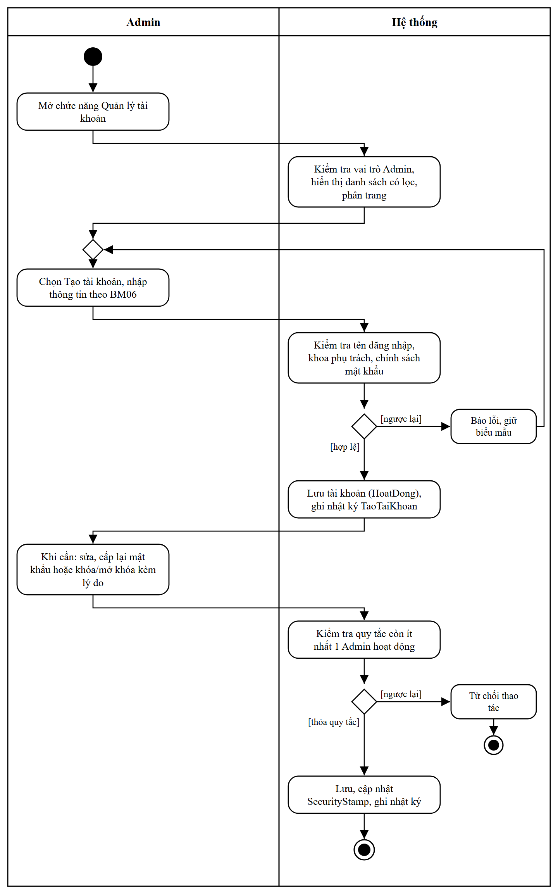

Hình 2.1. Biểu đồ hoạt động quy trình P01 – Cấp và quản lý tài khoản Admin/Giáo vụ

### P02: Đăng nhập, phân quyền và đổi mật khẩu

*Yêu cầu SRS liên quan: FR-06 – FR-10.*

Quy trình áp dụng cho cả ba vai trò. Tài khoản sinh viên dùng mã sinh viên làm tên đăng nhập.

- Bước 1: Người dùng mở trang đăng nhập, nhập tên đăng nhập và mật khẩu.
- Bước 2: Nếu tài khoản đang bị khóa tạm do đăng nhập sai 5 lần liên tiếp, hệ thống từ chối với thông báo chung; tài khoản tự mở lại sau 15 phút.
- Bước 3: Hệ thống kiểm tra thông tin xác thực và trạng thái tài khoản.

  - Sai thông tin hoặc tài khoản bị khóa: tăng bộ đếm sai, hiển thị thông báo chung "Tên đăng nhập hoặc mật khẩu không đúng", không tiết lộ tên đăng nhập có tồn tại hay không.

  - Đúng: tạo cookie xác thực (HttpOnly, Secure), đặt lại bộ đếm sai, ghi thời điểm đăng nhập cuối.

- Bước 4: Hệ thống chuyển đến trang chủ theo vai trò; menu chỉ hiển thị chức năng được phép (FR-08).
- Bước 5: Với mỗi yêu cầu tiếp theo (kể cả Ajax, xuất, nhập file), server kiểm tra trạng thái tài khoản, vai trò và phạm vi dữ liệu (FR-09); yêu cầu vượt quyền bị trả HTTP 403.
- Bước 6: Khi cần đổi mật khẩu, người dùng nhập mật khẩu hiện tại, mật khẩu mới và xác nhận. Hệ thống kiểm tra mật khẩu hiện tại đúng, mật khẩu mới đạt chính sách và khác mật khẩu hiện tại; lưu, làm mới phiên hiện tại và ghi nhật ký (FR-10).
- Bước 7: Người dùng chọn Đăng xuất; hệ thống hủy cookie và chuyển về trang đăng nhập (FR-07).

**Biểu đồ hoạt động (UML Activity Diagram, phân làn theo tác nhân):**

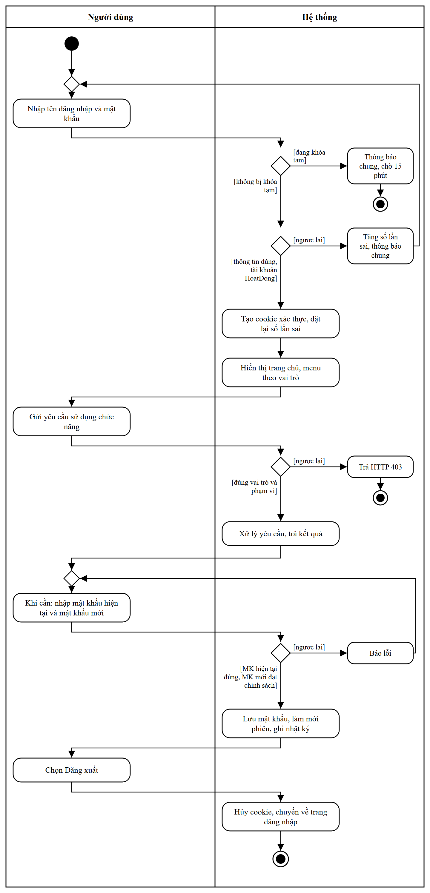

Hình 2.2. Biểu đồ hoạt động quy trình P02 – Đăng nhập, phân quyền và đổi mật khẩu

### P03: Tiếp nhận hồ sơ sinh viên mới

*Yêu cầu SRS liên quan: FR-13.*

Quy trình do Admin hoặc Giáo vụ thực hiện khi có sinh viên mới nhập học. Điều kiện: danh mục Khoa, Khóa, Lớp đã được khởi tạo (P10).

- Bước 1: Cán bộ chọn "Thêm sinh viên" trên màn hình danh sách.
- Bước 2: Cán bộ chọn lớp (Khoa và Khóa tự xác định theo lớp), nhập thông tin theo phiếu BM01: mã SV, họ tên, ngày sinh, giới tính, SĐT, email, địa chỉ, trạng thái ban đầu và mật khẩu ban đầu.
- Bước 3: Hệ thống kiểm tra lớp thuộc phạm vi được phép (Giáo vụ chỉ được chọn lớp thuộc khoa phụ trách); ngoài phạm vi thì từ chối.
- Bước 4: Hệ thống kiểm tra mã SV đúng định dạng (6 – 15 ký tự chữ số không dấu) và chưa từng tồn tại – kể cả hồ sơ đã xóa mềm; kiểm tra dữ liệu theo quy tắc mục 3.2.2.4 và chính sách mật khẩu. Không hợp lệ: báo lỗi theo từng trường.
- Bước 5: Hệ thống mở một giao dịch: lưu hồ sơ SinhVien, gọi dịch vụ tài khoản tạo tài khoản vai trò SinhVien với Username = MaSV, ghi nhật ký TaoHoSo. Nếu tạo tài khoản lỗi thì rollback cả hồ sơ.
- Bước 6: Hệ thống trả kết quả dạng JSON, cập nhật danh sách bằng Ajax; cán bộ bàn giao mã SV và mật khẩu ban đầu cho sinh viên.

**Biểu đồ hoạt động (UML Activity Diagram, phân làn theo tác nhân):**

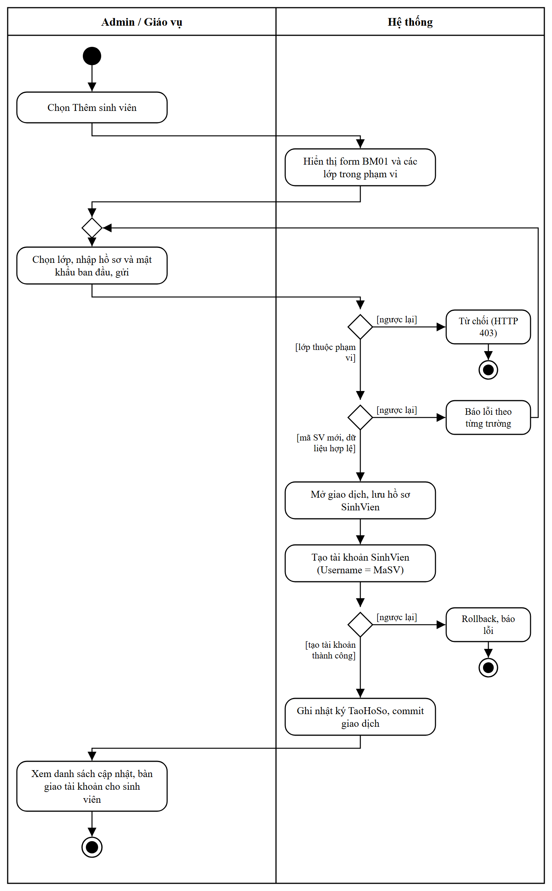

Hình 2.3. Biểu đồ hoạt động quy trình P03 – Tiếp nhận hồ sơ sinh viên mới

### P04: Cập nhật và xử lý biến động hồ sơ

*Yêu cầu SRS liên quan: FR-14 – FR-17.*

Quy trình xử lý khi thông tin sinh viên thay đổi hoặc có quyết định bảo lưu, thôi học, tốt nghiệp, chuyển lớp.

- Bước 1: Cán bộ tìm sinh viên (P09) và mở chi tiết hồ sơ (FR-14). Hồ sơ không tồn tại, đã xóa mềm hoặc ngoài phạm vi thì không cho thao tác.
- Bước 2: Cán bộ chọn một trong ba thao tác:

  - Sửa thông tin cá nhân (FR-15): họ tên, ngày sinh, giới tính, SĐT, email, địa chỉ; mã SV giữ cố định.

  - Đổi trạng thái học tập (FR-16) theo quyết định BM07: chọn trạng thái mới, nhập lý do (bắt buộc khi Admin sửa hồ sơ Đã tốt nghiệp).

  - Chuyển lớp (FR-17) theo quyết định BM07: chọn lớp đích đang sử dụng; Giáo vụ chỉ chọn lớp trong khoa phụ trách.

- Bước 3: Hệ thống kiểm tra quyền và quy tắc nghiệp vụ (bảng chuyển trạng thái mục 3.1.2; lớp đích hợp lệ). Vi phạm: chặn thao tác và nêu lý do.
- Bước 4: Hệ thống lưu thay đổi; nếu chuyển sang Thôi học thì khóa tài khoản sinh viên trong cùng giao dịch, nếu chuyển từ Thôi học về Đang học thì tài khoản vẫn giữ trạng thái khóa cho đến khi được mở thủ công (P06). Với đổi trạng thái và chuyển lớp, hệ thống đánh dấu hồ sơ đã phát sinh biến động (DaCoBienDong).
- Bước 5: Hệ thống ghi nhật ký (SuaHoSo, DoiTrangThai, ChuyenLop) và cập nhật giao diện bằng Ajax.

**Biểu đồ hoạt động (UML Activity Diagram, phân làn theo tác nhân):**

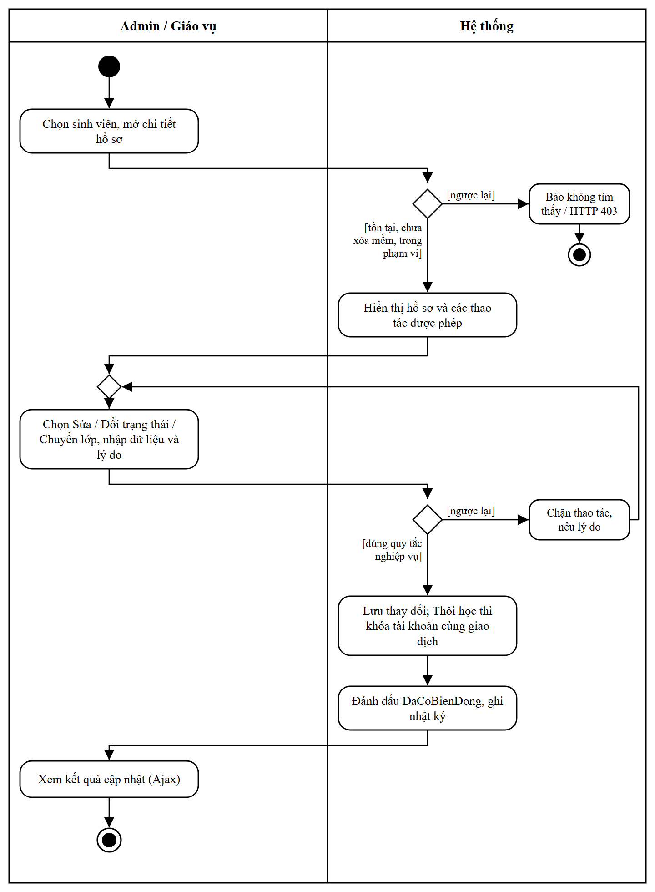

Hình 2.4. Biểu đồ hoạt động quy trình P04 – Cập nhật và xử lý biến động hồ sơ

### P05: Xóa mềm hồ sơ nhập sai

*Yêu cầu SRS liên quan: FR-18.*

Quy trình xử lý khi một hồ sơ bị nhập sai (thường là sai mã sinh viên – trường không được sửa). Hồ sơ không bị xóa khỏi CSDL mà được đánh dấu xóa mềm.

- Bước 1: Cán bộ mở chi tiết hồ sơ nhập sai, chọn "Xóa", nhập lý do (bắt buộc) và xác nhận.
- Bước 2: Hệ thống kiểm tra điều kiện xóa mềm:

  - Giáo vụ: chỉ xóa hồ sơ ở trạng thái Đang học, sinh viên chưa từng đăng nhập và chưa có thao tác đổi trạng thái/chuyển lớp.

  - Admin: được xóa cả hồ sơ đã phát sinh các thao tác trên, trừ hồ sơ Đã tốt nghiệp.

- Bước 3: Trong một giao dịch, hệ thống đặt DaXoa = true, ghi NgayXoa, NguoiXoa, LyDoXoa và khóa tài khoản sinh viên tương ứng; lỗi thì rollback toàn bộ.
- Bước 4: Hệ thống ghi nhật ký XoaMemHoSo; hồ sơ biến mất khỏi danh sách, tìm kiếm, thống kê, báo cáo.
- Bước 5: Cán bộ tạo lại hồ sơ với mã đúng theo P03. Mã đã xóa mềm không được dùng lại.

**Biểu đồ hoạt động (UML Activity Diagram, phân làn theo tác nhân):**

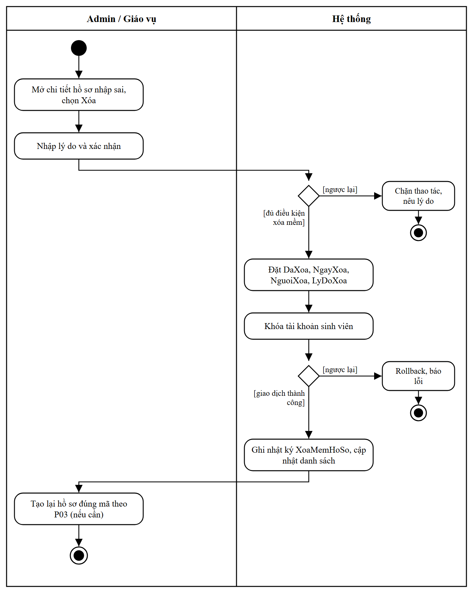

Hình 2.5. Biểu đồ hoạt động quy trình P05 – Xóa mềm hồ sơ nhập sai

### P06: Hỗ trợ tài khoản sinh viên

*Yêu cầu SRS liên quan: FR-19, FR-20.*

Quy trình khi sinh viên quên mật khẩu, hoặc nhà trường cần tạm khóa/mở khóa tài khoản sinh viên.

- Bước 1: Sinh viên liên hệ giáo vụ khoa (hoặc nhà trường có yêu cầu khóa tài khoản).
- Bước 2: Cán bộ tìm và mở chi tiết hồ sơ sinh viên trong phạm vi được phép.
- Bước 3: Cán bộ chọn "Cấp lại mật khẩu" (nhập mật khẩu mới và xác nhận – FR-19) hoặc "Khóa/Mở khóa" (nhập lý do – FR-20).
- Bước 4: Hệ thống kiểm tra mật khẩu đạt chính sách hoặc có lý do; kiểm tra điều kiện mở khóa: chỉ Admin được mở khóa tài khoản sinh viên Thôi học; tài khoản của hồ sơ đã xóa mềm không được mở khóa.
- Bước 5: Hệ thống cập nhật qua dịch vụ tài khoản dùng chung, cập nhật SecurityStamp (đăng xuất các phiên cũ), ghi nhật ký CapLaiMatKhau / KhoaTaiKhoan / MoKhoaTaiKhoan và thông báo kết quả.

**Biểu đồ hoạt động (UML Activity Diagram, phân làn theo tác nhân):**

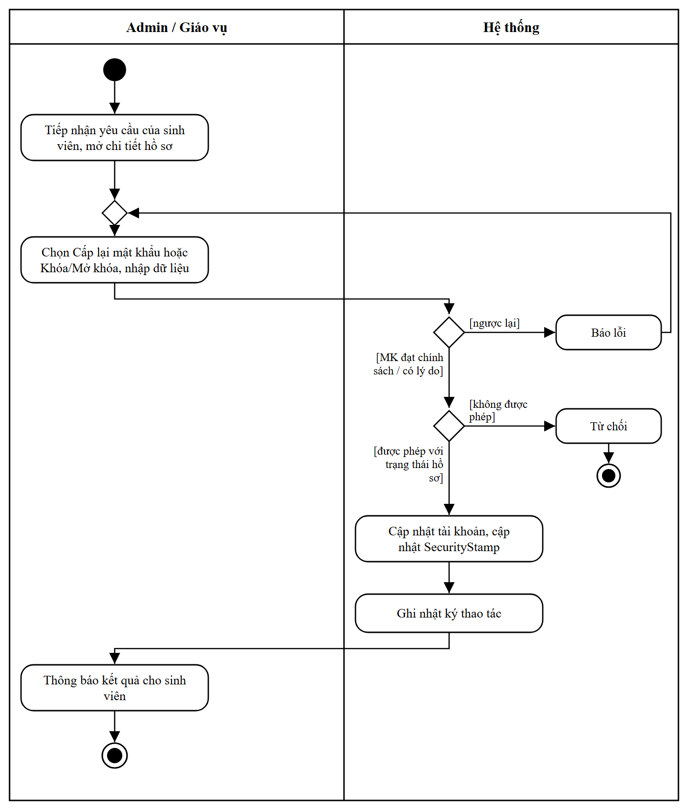

Hình 2.6. Biểu đồ hoạt động quy trình P06 – Hỗ trợ tài khoản sinh viên

### P07: Sinh viên xem và cập nhật thông tin liên hệ

*Yêu cầu SRS liên quan: FR-11, FR-12.*

Quy trình tự phục vụ của sinh viên.

- Bước 1: Sinh viên đăng nhập bằng mã SV và mở "Hồ sơ cá nhân" (FR-11).
- Bước 2: Server lấy MaSV từ tài khoản đang đăng nhập (không nhận MaSV từ URL hay form) và hiển thị hồ sơ: thông tin cá nhân, lớp, khoa, khóa, trạng thái học tập.
- Bước 3: Sinh viên chọn "Cập nhật", sửa SĐT, Email, Địa chỉ (FR-12).
- Bước 4: Hệ thống kiểm tra dữ liệu và chỉ chấp nhận ba trường trên; yêu cầu chứa trường khác hoặc định danh hồ sơ khác bị từ chối.
- Bước 5: Hệ thống lưu, ghi nhật ký CapNhatLienHe và thông báo kết quả bằng Ajax.

**Biểu đồ hoạt động (UML Activity Diagram, phân làn theo tác nhân):**

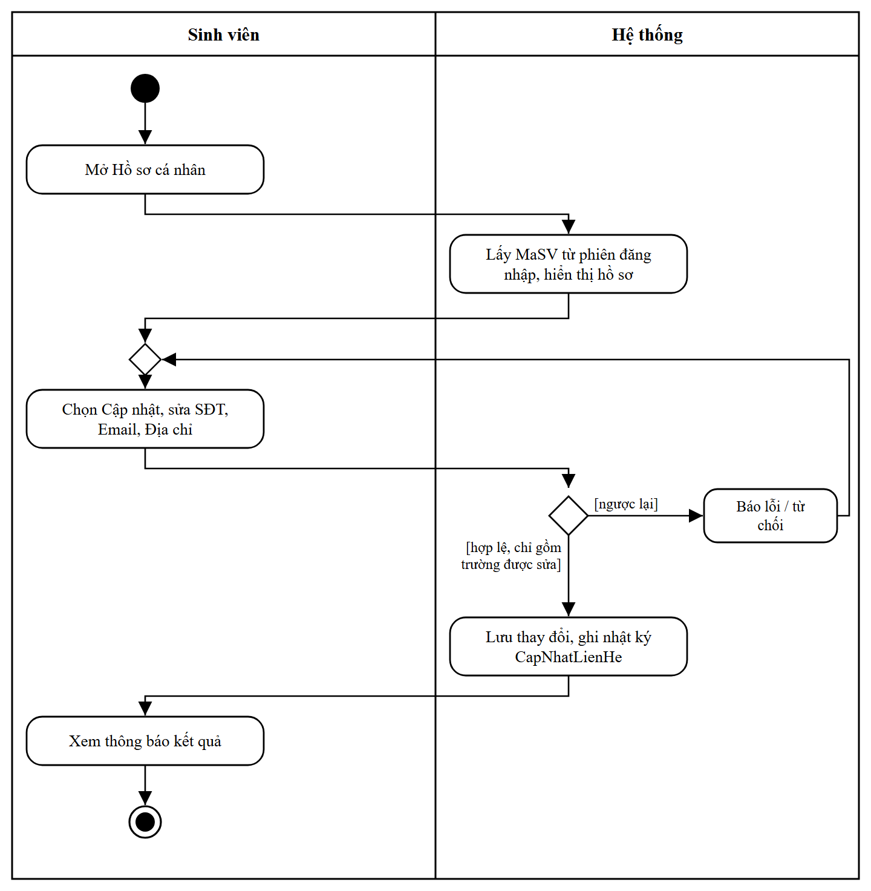

Hình 2.7. Biểu đồ hoạt động quy trình P07 – Sinh viên xem và cập nhật thông tin liên hệ

### P08: Nhập danh sách sinh viên từ Excel

*Yêu cầu SRS liên quan: FR-30.*

Quy trình dùng khi tiếp nhận sinh viên số lượng lớn (đầu khóa) hoặc cập nhật hàng loạt.

- Bước 1: Cán bộ tải file mẫu BM02 từ hệ thống và điền danh sách.
- Bước 2: Cán bộ chọn file .xlsx và tải lên. Hệ thống kiểm tra đúng mẫu (tên và thứ tự cột), định dạng .xlsx, dung lượng tối đa 5 MB; sai thì từ chối cả file.
- Bước 3: Hệ thống đọc file trong bộ nhớ (không lưu lâu dài trên server), đánh dấu lỗi tất cả các dòng có mã SV lặp trong file.
- Bước 4: Với từng dòng còn lại:

  - Kiểm tra trường bắt buộc, quy tắc dữ liệu, lớp tồn tại và thuộc phạm vi, quyền với hồ sơ hiện có.

  - Mã SV chưa có: tạo hồ sơ và tài khoản trong một giao dịch như P03 (bắt buộc có mật khẩu ban đầu).

  - Mã SV đã có: cập nhật hồ sơ theo quy tắc FR-15; nếu trạng thái hoặc lớp thay đổi thì áp dụng quy tắc FR-16, FR-17, FR-20; giữ nguyên tài khoản và mật khẩu; ô trống ở trường liên hệ tùy chọn giữ giá trị cũ.

  - Mã SV trùng hồ sơ đã xóa mềm: báo lỗi dòng.

  - Dòng lỗi được rollback riêng; các dòng hợp lệ khác vẫn được lưu.

- Bước 5: Hệ thống ghi nhật ký Import (số dòng thêm, cập nhật, lỗi), giải phóng file tạm và trả báo cáo kết quả BM05.

**Biểu đồ hoạt động (UML Activity Diagram, phân làn theo tác nhân):**

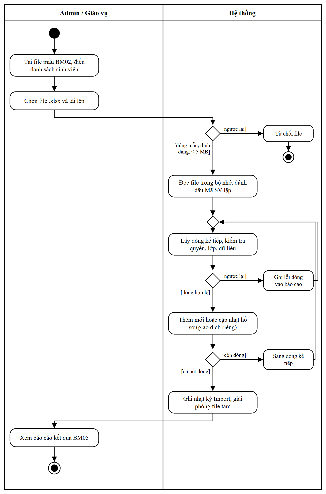

Hình 2.8. Biểu đồ hoạt động quy trình P08 – Nhập danh sách sinh viên từ Excel

### P09: Tra cứu, thống kê và xuất báo cáo

*Yêu cầu SRS liên quan: FR-21, FR-22, FR-27 – FR-29.*

Quy trình được dùng hằng ngày bởi Admin và Giáo vụ.

- Bước 1: Cán bộ mở "Danh sách sinh viên" (FR-21) hoặc "Thống kê" (FR-27).
- Bước 2: Cán bộ chọn tiêu chí Khoa/Khóa/Lớp/Trạng thái (Giáo vụ chỉ thấy lựa chọn trong khoa phụ trách) và/hoặc nhập từ khóa tên, mã SV (FR-22).
- Bước 3: Trình duyệt gửi yêu cầu Ajax (debounce 300 ms khi gõ).
- Bước 4: Server áp dụng bộ lọc phạm vi trước, sau đó lọc, tìm kiếm không dấu và phân trang/tổng hợp tại CSDL; hồ sơ đã xóa mềm bị loại.
- Bước 5: Server trả JSON; trình duyệt hiển thị bảng và tổng số. Không có dữ liệu: hiển thị "Không có dữ liệu".
- Bước 6: Cán bộ chọn "Xuất Excel" hoặc "Xuất PDF" (FR-28, FR-29). Server truy vấn lại theo đúng tiêu chí và phạm vi (không tin dữ liệu từ client), tạo file trong bộ nhớ theo BM03/BM04; dữ liệu rỗng thì không cho xuất.
- Bước 7: Server ghi nhật ký Xuat (người xuất, phạm vi, tiêu chí, thời điểm) và trả file cho trình duyệt; file không được lưu trên server.

**Biểu đồ hoạt động (UML Activity Diagram, phân làn theo tác nhân):**

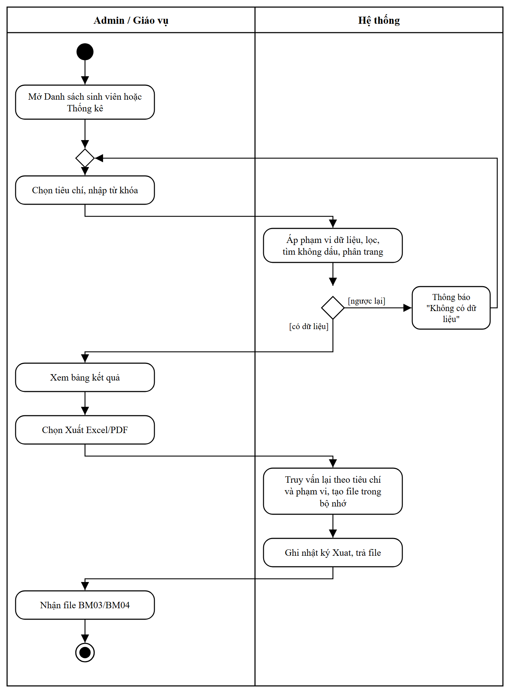

Hình 2.9. Biểu đồ hoạt động quy trình P09 – Tra cứu, thống kê và xuất báo cáo

### P10: Quản lý danh mục Khoa, Khóa, Lớp

*Yêu cầu SRS liên quan: FR-23 – FR-26.*

Danh mục là nền tảng cho mọi chức năng hồ sơ. Admin quản lý cả ba loại; Giáo vụ chỉ quản lý Lớp thuộc khoa phụ trách.

- Bước 1: Cán bộ mở "Danh mục", chọn loại Khoa, Khóa hoặc Lớp (FR-23).
- Bước 2: Cán bộ chọn Thêm (FR-24), Sửa (FR-25) hoặc Xóa mềm (FR-26).
- Bước 3: Hệ thống kiểm tra quyền: Giáo vụ thao tác Khoa/Khóa hoặc Lớp ngoài khoa bị từ chối.
- Bước 4: Hệ thống kiểm tra ràng buộc:

  - Mã Khoa/Khóa/Lớp duy nhất kể cả mã đã xóa mềm; tên Lớp duy nhất trong cùng Khoa và Khóa.

  - Khoa/Khóa đã có lớp chứa sinh viên: chỉ được sửa tên hiển thị, không sửa mã và năm nhập học.

  - Không xóa mềm Khoa còn Lớp chưa xóa hoặc còn Giáo vụ được gán; Khóa còn Lớp chưa xóa; Lớp còn hồ sơ sinh viên chưa xóa.

- Bước 5: Hệ thống lưu hoặc đánh dấu DaXoa, ghi nhật ký, cập nhật giao diện bằng Ajax. Danh mục đã xóa mềm không còn xuất hiện trong danh sách chọn.

**Biểu đồ hoạt động (UML Activity Diagram, phân làn theo tác nhân):**

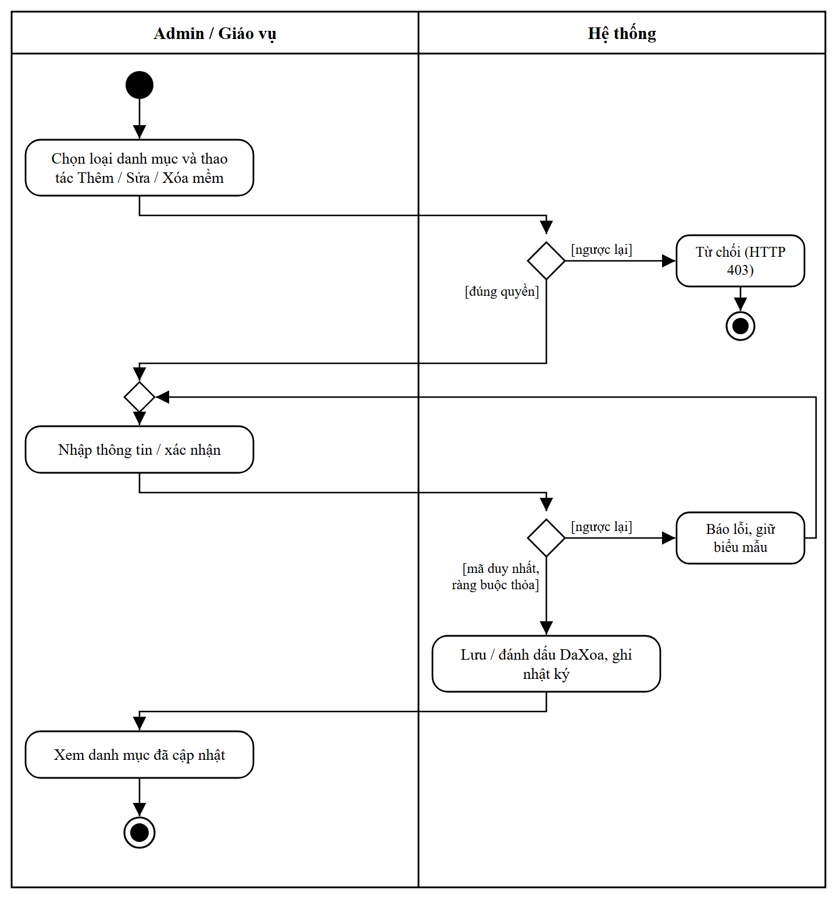

Hình 2.10. Biểu đồ hoạt động quy trình P10 – Quản lý danh mục Khoa, Khóa, Lớp

### P11: Tra cứu nhật ký thao tác

*Yêu cầu SRS liên quan: FR-31, NFR-07.*

Quy trình giám sát của Admin. Nhật ký do dịch vụ ghi nhật ký dùng chung tự sinh khi thực hiện các thao tác nhạy cảm (NFR-07) và chỉ đọc trên giao diện.

- Bước 1: Admin mở "Nhật ký thao tác".
- Bước 2: Admin chọn khoảng thời gian, người thực hiện, loại hành động, đối tượng (mã SV, mã lớp, tên đăng nhập).
- Bước 3: Trình duyệt gửi Ajax; server kiểm tra vai trò Admin (không phải Admin: HTTP 403).
- Bước 4: Server lọc, sắp xếp mới nhất trước và phân trang; trả JSON.
- Bước 5: Trình duyệt hiển thị bảng gồm thời điểm, người thực hiện, hành động, loại và mã đối tượng, chi tiết.

**Biểu đồ hoạt động (UML Activity Diagram, phân làn theo tác nhân):**

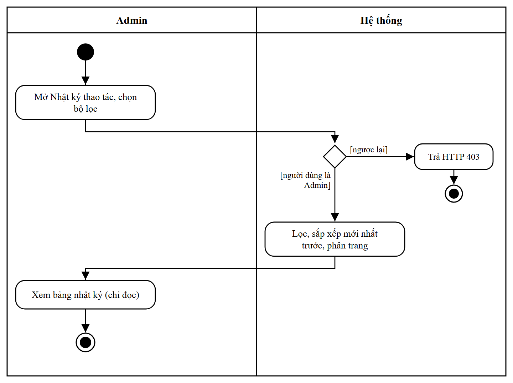

Hình 2.11. Biểu đồ hoạt động quy trình P11 – Tra cứu nhật ký thao tác

## 2.2. Các hồ sơ, biểu mẫu

Các biểu mẫu sau được xây dựng từ nghiệp vụ quản lý sinh viên và là căn cứ cho form nhập liệu, file mẫu Excel và file xuất của hệ thống.

### BM01. Phiếu thông tin hồ sơ sinh viên

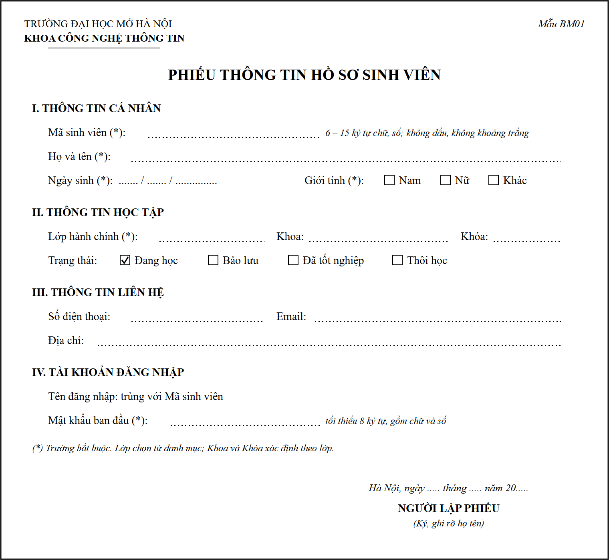

Hình 2.12. Mẫu BM01 – Phiếu thông tin hồ sơ sinh viên

### BM02. Mẫu file Excel nhập danh sách sinh viên

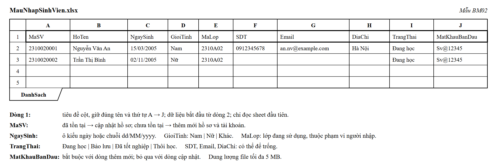

Hình 2.13. Mẫu BM02 – Mẫu file Excel nhập danh sách sinh viên

### BM03. Danh sách sinh viên (file xuất Excel/PDF)

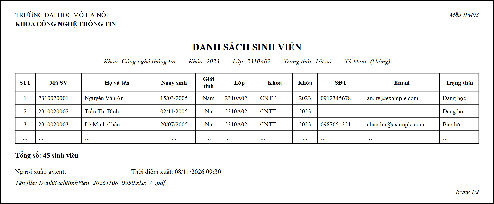

Hình 2.14. Mẫu BM03 – Danh sách sinh viên (file xuất Excel/PDF)

### BM04. Báo cáo thống kê sinh viên

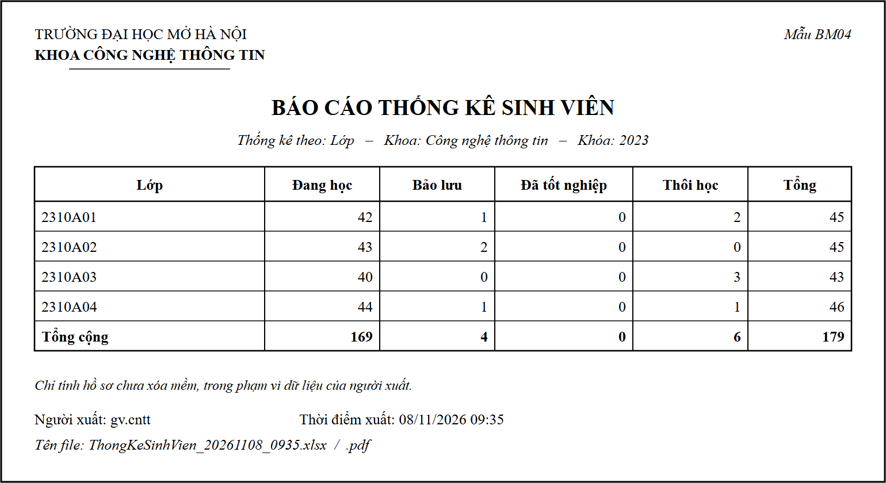

Hình 2.15. Mẫu BM04 – Báo cáo thống kê sinh viên

### BM05. Báo cáo kết quả nhập Excel

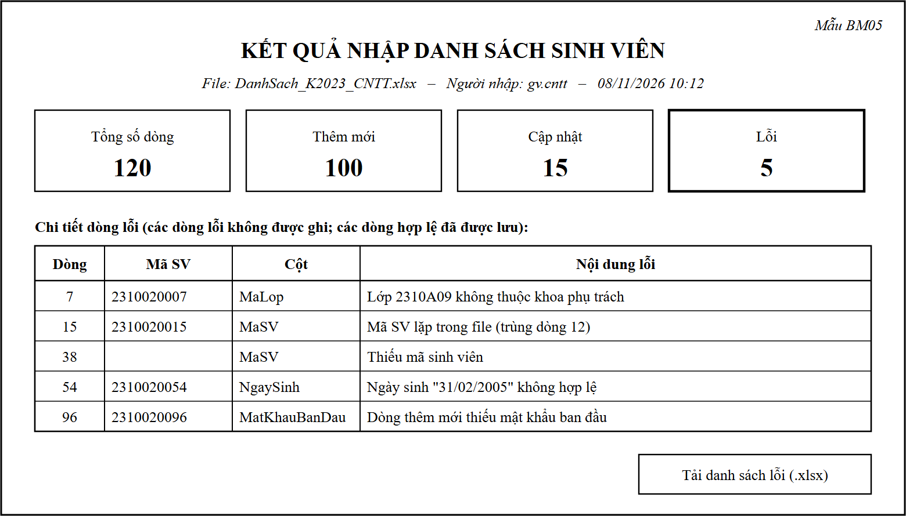

Hình 2.16. Mẫu BM05 – Báo cáo kết quả nhập Excel

### BM06. Phiếu đề nghị cấp/điều chỉnh tài khoản Admin/Giáo vụ

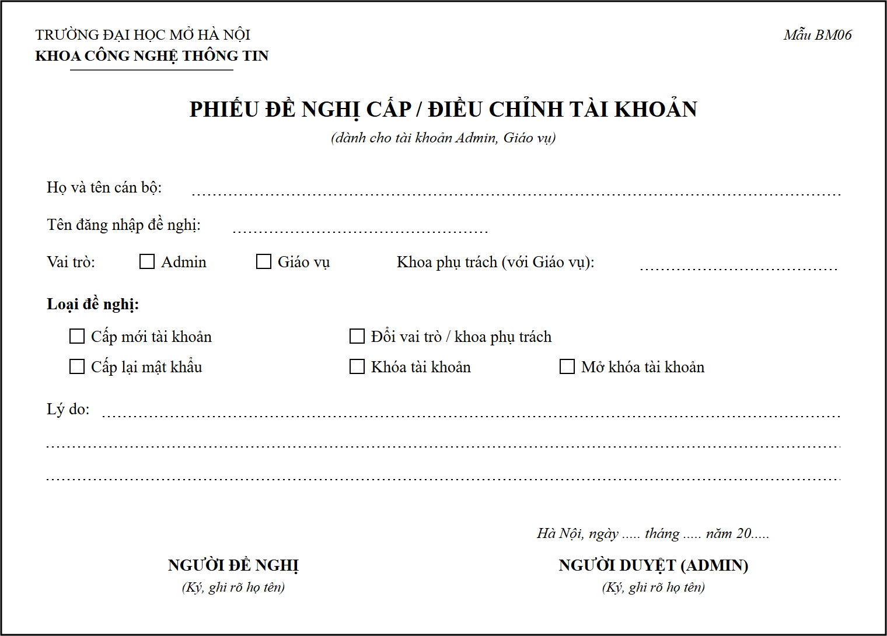

Hình 2.17. Mẫu BM06 – Phiếu đề nghị cấp/điều chỉnh tài khoản Admin/Giáo vụ

### BM07. Quyết định biến động học tập

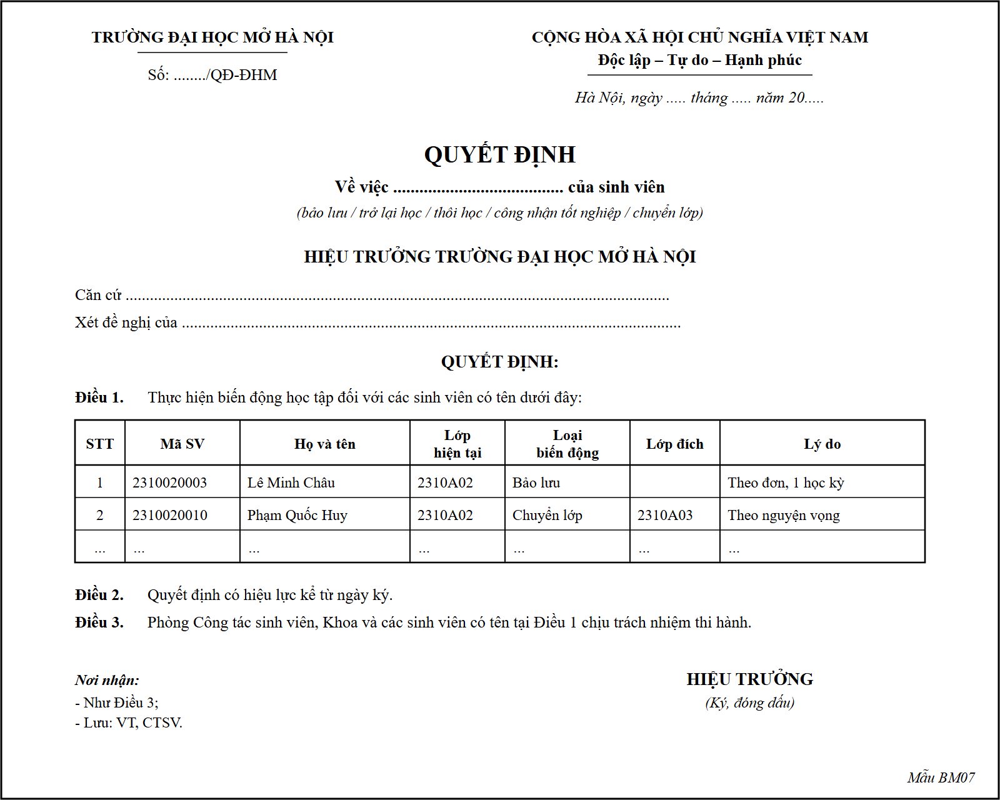

Hình 2.18. Mẫu BM07 – Quyết định biến động học tập

## 2.3. Các yêu cầu

### 2.3.1. Yêu cầu chức năng

**R01. Quản lý tài khoản Admin/Giáo vụ**

- Admin xem danh sách tài khoản Admin/Giáo vụ, lọc theo vai trò, khoa phụ trách, trạng thái, có phân trang.
- Admin tạo tài khoản Admin hoặc Giáo vụ; mỗi Giáo vụ gán đúng một khoa phụ trách.
- Admin cập nhật họ tên, vai trò, khoa phụ trách; thay đổi có hiệu lực từ yêu cầu kế tiếp.
- Admin cấp lại mật khẩu, khóa/mở khóa tài khoản kèm lý do; tài khoản không bị xóa; luôn còn ít nhất một Admin hoạt động.

**Dẫn chứng:** Thông tư 10/2016/TT-BGDĐT giao trách nhiệm quản lý thông tin sinh viên cho các đơn vị cụ thể trong trường; việc cấp quyền theo khoa thể hiện đúng phân cấp trách nhiệm đó.

*Ánh xạ SRS: FR-01 – FR-05*

**R02. Xác thực, phân quyền và đổi mật khẩu**

- Đăng nhập bằng tên đăng nhập và mật khẩu; khóa tạm 15 phút sau 5 lần sai liên tiếp; thông báo lỗi chung.
- Đăng xuất hủy cookie xác thực.
- Kiểm soát truy cập theo vai trò tại server ở mọi endpoint; menu hiển thị theo vai trò.
- Giới hạn phạm vi dữ liệu: Admin toàn trường, Giáo vụ theo khoa phụ trách, Sinh viên chỉ hồ sơ của mình.
- Mọi người dùng tự đổi mật khẩu của chính mình.

**Dẫn chứng:** Nghị định 13/2023/NĐ-CP yêu cầu áp dụng biện pháp bảo vệ dữ liệu cá nhân, giới hạn chủ thể được xử lý dữ liệu; OWASP Top 10 khuyến nghị kiểm soát truy cập tại server và chống dò mật khẩu.

*Ánh xạ SRS: FR-06 – FR-10*

**R03. Hồ sơ cá nhân**

- Người dùng xem hồ sơ/thông tin tài khoản của chính mình; định danh lấy từ phiên đăng nhập.
- Sinh viên tự cập nhật SĐT, Email, Địa chỉ; các trường khác do cán bộ quản lý.

**Dẫn chứng:** Nghị định 13/2023/NĐ-CP ghi nhận quyền của chủ thể dữ liệu được tiếp cận và yêu cầu chỉnh sửa dữ liệu cá nhân của mình.

*Ánh xạ SRS: FR-11, FR-12*

**R04. Quản lý hồ sơ sinh viên**

- Thêm hồ sơ kèm tài khoản sinh viên trong một giao dịch; mã SV duy nhất, không dùng lại.
- Xem chi tiết hồ sơ là điểm bắt đầu của mọi thao tác trên hồ sơ.
- Cập nhật thông tin cá nhân; mã SV cố định.
- Đổi trạng thái học tập theo bảng quy tắc; chuyển sang Thôi học tự động khóa tài khoản.
- Chuyển lớp; Giáo vụ chỉ chuyển trong khoa.
- Xóa mềm hồ sơ nhập sai kèm lý do, khóa tài khoản trong cùng giao dịch.

**Dẫn chứng:** Thông tư 08/2021/TT-BGDĐT quy định các tình huống nghỉ học tạm thời, thôi học và công nhận tốt nghiệp – là căn cứ cho các trạng thái học tập và quy tắc chuyển trạng thái.

*Ánh xạ SRS: FR-13 – FR-18*

**R05. Quản lý tài khoản sinh viên**

- Admin/Giáo vụ cấp lại mật khẩu khi sinh viên quên.
- Admin/Giáo vụ khóa/mở khóa tài khoản kèm lý do; chỉ Admin mở khóa sinh viên Thôi học; không mở khóa tài khoản của hồ sơ đã xóa mềm.

**Dẫn chứng:** Yêu cầu nghiệp vụ hỗ trợ sinh viên của giáo vụ khoa; kiểm soát truy cập theo trạng thái người học.

*Ánh xạ SRS: FR-19, FR-20*

**R06. Tra cứu sinh viên**

- Lập danh sách theo Khoa, Khóa, Lớp có phân trang và tổng số.
- Tìm kiếm theo tên hoặc mã SV, không phân biệt hoa thường và dấu tiếng Việt, kết hợp bộ lọc, hiển thị động không tải lại trang.

**Dẫn chứng:** Khắc phục Vấn đề 2 (mục 1.1.2); yêu cầu AJAX của bài tập lớn.

*Ánh xạ SRS: FR-21, FR-22*

**R07. Quản lý danh mục Khoa, Khóa, Lớp**

- Xem, thêm, cập nhật, xóa mềm danh mục; Giáo vụ chỉ thao tác Lớp thuộc khoa phụ trách.
- Mã duy nhất kể cả mã đã xóa mềm; ràng buộc khi sửa, xóa danh mục đang được sử dụng.

**Dẫn chứng:** Cơ cấu tổ chức đào tạo theo Khoa – Khóa – Lớp hành chính của trường đại học.

*Ánh xạ SRS: FR-23 – FR-26*

**R08. Thống kê, xuất và nhập dữ liệu**

- Thống kê số lượng sinh viên theo Khoa/Khóa/Lớp/Trạng thái dạng bảng.
- Xuất danh sách và báo cáo thống kê ra Excel/PDF theo phạm vi được phép; ghi nhật ký mỗi lần xuất.
- Nhập danh sách sinh viên từ Excel theo mẫu, báo cáo kết quả từng dòng.

**Dẫn chứng:** Nghị định 13/2023/NĐ-CP yêu cầu kiểm soát việc chuyển giao, sao chép dữ liệu cá nhân – mỗi lần xuất file chứa dữ liệu sinh viên phải giới hạn phạm vi và lưu vết.

*Ánh xạ SRS: FR-27 – FR-30*

**R09. Nhật ký thao tác**

- Ghi nhật ký các thao tác nhạy cảm: tạo/sửa/xóa mềm hồ sơ, đổi trạng thái, chuyển lớp, tạo tài khoản, khóa/mở khóa, cấp lại/đổi mật khẩu, đổi quyền/khoa, thay đổi danh mục, import, xuất dữ liệu.
- Admin tra cứu nhật ký theo thời gian, người thực hiện, hành động, đối tượng; nhật ký chỉ đọc.

**Dẫn chứng:** Nghị định 13/2023/NĐ-CP yêu cầu ghi nhận, lưu vết hoạt động xử lý dữ liệu cá nhân.

*Ánh xạ SRS: FR-31, NFR-07*

### 2.3.2. Yêu cầu phi chức năng

**R10. Bảo mật**

- ASP.NET Core Identity; hash mật khẩu có salt (PBKDF2 mặc định của Identity).
- HTTPS cho toàn bộ giao tiếp; HSTS khi triển khai.
- Cookie xác thực HttpOnly, Secure, SameSite=Lax; hết hạn trượt 30 phút.
- Mật khẩu tối thiểu 8 ký tự gồm chữ và số; khóa tạm 15 phút sau 5 lần sai.
- Anti-forgery token cho mọi thao tác thay đổi dữ liệu (form và Ajax).
- Kiểm tra vai trò, trạng thái tài khoản, khoa và quyền sở hữu hồ sơ tại server.

*Ánh xạ SRS: NFR-01*

**R11. Hiệu năng**

- Trang danh sách phản hồi dưới 2 giây với dữ liệu mẫu khoảng 1.000 sinh viên trên máy demo.
- Phân trang, lọc và tổng hợp tại CSDL (IQueryable, Skip/Take, GroupBy); AsNoTracking và Select chỉ các cột cần thiết.
- Chỉ mục cho các cột tìm kiếm, lọc (mục 3.2.2.3).

*Ánh xạ SRS: NFR-02*

**R12. Khả dụng và tương thích**

- Giao diện responsive bằng Bootstrap 5, kiểm thử tối thiểu 2 kích thước màn hình (desktop ≥ 1366 px, mobile 375 px).
- Xác nhận trước thao tác quan trọng (xóa mềm, khóa tài khoản, đổi trạng thái); thông báo rõ sau mỗi thao tác.
- Hoạt động trên Chrome, Edge, Firefox phiên bản gần nhất.

*Ánh xạ SRS: NFR-03, NFR-06*

**R13. Khả năng bảo trì, mở rộng**

- Tách lớp Model – View – Controller – Service – Repository; Dependency Injection.
- Quy tắc nghiệp vụ chỉ đặt ở tầng Service; Controller mỏng.
- Interface dịch vụ dùng chung (tài khoản, phạm vi, nhật ký) chỉ thay đổi khi nhóm trưởng duyệt.
- Coding convention C# của Microsoft; đặt tên thực thể tiếng Việt không dấu PascalCase.

*Ánh xạ SRS: NFR-04*

**R14. Độ tin cậy**

- Validate cả client (jQuery Validation) và server (Data Annotations/ModelState) theo cùng một bộ quy tắc.
- Giao dịch CSDL cho các thao tác nhiều bước (hồ sơ + tài khoản, xóa mềm + khóa tài khoản, từng dòng import).
- Xử lý ngoại lệ tập trung; lỗi không lộ stack trace cho người dùng.

*Ánh xạ SRS: NFR-05*

**R15. Truy vết**

- Dịch vụ ghi nhật ký dùng chung lưu thời điểm, người thực hiện, hành động, loại và mã đối tượng.
- Nhật ký chỉ thêm, không sửa/xóa qua giao diện; không ghi mật khẩu và dữ liệu cá nhân.

*Ánh xạ SRS: NFR-07*

**R16. Bảo vệ dữ liệu cá nhân**

- Giới hạn theo vai trò/khoa ở mọi endpoint kể cả xuất file.
- File import/export chỉ xử lý trong bộ nhớ hoặc lưu tạm và xóa ngay sau khi xử lý.
- Không ghi dữ liệu cá nhân, mật khẩu vào log ứng dụng (ILogger).
- Áp dụng xóa mềm; dữ liệu đã xóa mềm bị loại khỏi tra cứu, thống kê, báo cáo.

*Ánh xạ SRS: NFR-08*

# CHƯƠNG 3: PHÂN TÍCH VÀ THIẾT KẾ HỆ THỐNG

## 3.1. Phân tích hệ thống

Hệ thống có ba tác nhân nghiệp vụ, phân biệt theo vai trò và phạm vi dữ liệu; một số xử lý tự động do chính hệ thống thực hiện. Người chưa đăng nhập chỉ truy cập được trang đăng nhập.

| **Tác nhân** | **Mô tả** | **Đặc điểm / phạm vi** |
|----|----|----|
| Admin (vai trò Admin) | Quản trị viên hệ thống thuộc Phòng Công tác sinh viên | Toàn quyền trên dữ liệu toàn trường; quản lý tài khoản Admin/Giáo vụ, danh mục Khoa/Khóa; tra cứu nhật ký; một số chuyển trạng thái và mở khóa chỉ Admin được làm. |
| Giáo vụ (vai trò CanBo) | Cán bộ giáo vụ khoa, được gán đúng một khoa phụ trách | Quản lý hồ sơ, tài khoản sinh viên, Lớp, thống kê, xuất/nhập trong khoa phụ trách. Khoa của sinh viên xác định qua lớp. |
| Sinh viên (vai trò SinhVien) | Người học, tài khoản tạo cùng hồ sơ, tên đăng nhập = mã SV | Chỉ xem hồ sơ của mình, cập nhật SĐT/Email/Địa chỉ, đổi mật khẩu. |
| Hệ thống (tác nhân nội bộ) | Các xử lý tự động | Khóa tạm khi đăng nhập sai; tự khóa tài khoản khi Thôi học hoặc xóa mềm; ghi nhật ký. |

Tên vai trò lưu trong CSDL là Admin, CanBo, SinhVien; trên giao diện lần lượt hiển thị là "Quản trị viên", "Giáo vụ", "Sinh viên".

### 3.1.1. Phân tích nghiệp vụ

**Mô tả nghiệp vụ**

**NV01 – Quản lý tài khoản Admin/Giáo vụ.** Admin là người duy nhất cấp, sửa, khóa tài khoản cán bộ. Mỗi Giáo vụ phải có đúng một khoa phụ trách vì toàn bộ phạm vi dữ liệu của họ suy ra từ khoa này. Tài khoản không bao giờ bị xóa (để giữ nguyên nhật ký), chỉ bị khóa. Quy tắc "luôn còn ít nhất một Admin hoạt động" ngăn hệ thống rơi vào trạng thái không ai quản trị được.

**NV02 – Đăng nhập, đăng xuất.** Nghiệp vụ dùng chung cho cả ba vai trò. Ngoài việc kiểm tra mật khẩu, hệ thống phải kiểm tra trạng thái tài khoản (HoatDong/BiKhoa) và khóa tạm sau 5 lần sai để chống dò mật khẩu. Thông báo lỗi luôn là thông báo chung để không tiết lộ tên đăng nhập có tồn tại hay không.

**NV03 – Kiểm soát truy cập và phạm vi dữ liệu.** Đây là nghiệp vụ xuyên suốt: mọi yêu cầu đều qua hai lớp kiểm tra – vai trò (được dùng chức năng nào) và phạm vi (được thấy dữ liệu nào). Phạm vi được áp vào câu truy vấn trước khi lọc, tìm kiếm, phân trang hoặc xuất, nên Giáo vụ không thể nhìn thấy sinh viên khoa khác dù thay đổi tham số trên URL hay request Ajax.

**NV04 – Đổi mật khẩu.** Mọi người dùng tự đổi mật khẩu của mình. Hệ thống không khôi phục mật khẩu qua email; người dùng quên mật khẩu được cấp lại mật khẩu theo NV01 (cán bộ) hoặc NV11 (sinh viên).

**NV05 – Xem và cập nhật hồ sơ cá nhân.** Định danh luôn lấy từ phiên đăng nhập. Sinh viên chỉ được sửa ba trường liên hệ; các trường nghiệp vụ (lớp, trạng thái, họ tên…) do cán bộ quản lý để bảo đảm tính chính xác.

**NV06 – Thêm hồ sơ sinh viên kèm tài khoản.** Hồ sơ và tài khoản luôn tồn tại thành cặp, nên được tạo trong cùng một giao dịch: nếu tạo tài khoản lỗi, hồ sơ cũng bị hủy. Mã SV là khóa chính, đồng thời là tên đăng nhập, cố định suốt vòng đời và không được dùng lại kể cả khi hồ sơ bị xóa mềm.

**NV07 – Cập nhật hồ sơ.** Chỉ cập nhật thông tin cá nhân; lớp và trạng thái được thay đổi qua nghiệp vụ riêng (NV08, NV09) để áp dụng quy tắc và ghi nhật ký đúng loại hành động. Hồ sơ đã xóa mềm không được cập nhật.

**NV08 – Đổi trạng thái học tập.** Nghiệp vụ có quy tắc chặt nhất, được trình bày trong bảng quy tắc chuyển trạng thái tại mục 3.1.2. Chuyển sang Thôi học tự động khóa tài khoản; khi Admin chuyển sinh viên Thôi học trở lại Đang học, tài khoản vẫn giữ trạng thái khóa và chỉ được mở thủ công (NV11). Hồ sơ Đã tốt nghiệp được coi là lưu trữ, chỉ Admin sửa khi nhập nhầm và phải có lý do.

**NV09 – Chuyển lớp.** Khoa/Khóa của sinh viên luôn suy ra từ lớp, nên chuyển lớp có thể làm sinh viên đổi khoa – vì vậy Giáo vụ chỉ được chuyển trong khoa mình, Admin được chuyển liên khoa.

**NV10 – Xóa mềm hồ sơ nhập sai.** Xóa mềm thay cho xóa cứng để giữ toàn vẹn dữ liệu và dấu vết. Điều kiện xóa của Giáo vụ hẹp (hồ sơ "sạch": Đang học, chưa đăng nhập, chưa biến động) để tránh xóa nhầm hồ sơ đang dùng; Admin có quyền rộng hơn nhưng không xóa hồ sơ Đã tốt nghiệp.

**NV11 – Cấp lại mật khẩu, khóa/mở khóa tài khoản sinh viên.** Thực hiện qua dịch vụ tài khoản dùng chung. Mở khóa bị giới hạn: sinh viên Thôi học chỉ Admin mở; hồ sơ đã xóa mềm không bao giờ được mở.

**NV12 – Tra cứu danh sách và tìm kiếm.** Nghiệp vụ dùng nhiều nhất. Tìm kiếm phải không phân biệt dấu ("nguyen" tìm ra "Nguyễn") và hiển thị động bằng Ajax. Kết quả chỉ gồm hồ sơ chưa xóa mềm, trong phạm vi.

**NV13 – Quản lý danh mục.** Danh mục là dữ liệu gốc; mọi ràng buộc xóa/sửa nhằm không làm "mồ côi" hồ sơ sinh viên và không phá vỡ phạm vi của Giáo vụ.

**NV14 – Thống kê và xuất báo cáo.** Số liệu được tổng hợp tại CSDL theo phạm vi; xuất file luôn truy vấn lại ở server theo cùng tiêu chí (không nhận dữ liệu từ client) và ghi nhật ký vì đây là hành vi sao chép dữ liệu cá nhân ra ngoài hệ thống.

**NV15 – Nhập danh sách từ Excel.** Tái sử dụng toàn bộ quy tắc của NV06 – NV09 thông qua IStudentService, không viết lại quy tắc ở tầng import. Giao dịch theo từng dòng: dòng lỗi không ảnh hưởng các dòng hợp lệ.

**NV16 – Ghi và tra cứu nhật ký.** Mọi Service gọi IAuditLogService khi thực hiện thao tác nhạy cảm; bản ghi được thêm trong cùng giao dịch với thao tác nên không có trường hợp thao tác thành công mà thiếu nhật ký. Admin tra cứu ở chế độ chỉ đọc.

### 3.1.2. Chi tiết nghiệp vụ

**Nhóm 1: Tài khoản và xác thực (NV01 – NV05)**

| **Thuộc tính** | **NV01 – Quản lý TK Admin/Giáo vụ** | **NV02 – Đăng nhập/đăng xuất** | **NV04 – Đổi mật khẩu** |
|----|----|----|----|
| **Tác nhân** | Admin | Admin, Giáo vụ, Sinh viên | Admin, Giáo vụ, Sinh viên |
| **Đầu vào** | Họ tên, tên đăng nhập, vai trò, khoa phụ trách, mật khẩu; lý do khóa | Tên đăng nhập, mật khẩu | MK hiện tại, MK mới, xác nhận |
| **Xử lý** | Kiểm tra duy nhất, khoa hợp lệ, chính sách MK; UserManager.CreateAsync; cập nhật SecurityStamp khi đổi quyền/khóa | SignInManager.PasswordSignInAsync (lockoutOnFailure: true); kiểm tra TrangThaiTaiKhoan; cập nhật LanDangNhapCuoi | UserManager.ChangePasswordAsync; RefreshSignInAsync |
| **Đầu ra** | Tài khoản HoatDong / được cập nhật / BiKhoa | Cookie xác thực, chuyển hướng theo vai trò | Mật khẩu mới, phiên được làm mới |
| **Quy tắc** | Không xóa tài khoản; luôn ≥ 1 Admin hoạt động; Giáo vụ có đúng 1 khoa | Khóa tạm 15 phút sau 5 lần sai; thông báo lỗi chung | MK mới ≠ MK hiện tại; ≥ 8 ký tự gồm chữ và số |
| **Yêu cầu** | R01, R10, R15 | R02, R10 | R02, R10, R15 |

**NV03 – Kiểm soát truy cập và phạm vi dữ liệu (áp dụng cho mọi nghiệp vụ còn lại):**

| **Vai trò** | **Phạm vi sinh viên** | **Phạm vi danh mục** | **Điều kiện áp vào truy vấn** |
|----|----|----|----|
| Admin | Toàn trường | Khoa, Khóa, Lớp toàn trường | Không thêm điều kiện |
| CanBo | Sinh viên thuộc lớp của khoa phụ trách | Xem Khoa/Khóa liên quan; thêm/sửa/xóa Lớp thuộc khoa | sv.Lop.MaKhoa == user.MaKhoaPhuTrach |
| SinhVien | Chỉ hồ sơ của mình | Không truy cập | sv.MaSV == user.MaSV |

**Nhóm 2: Vòng đời hồ sơ sinh viên (NV06 – NV10)**

| **Thuộc tính** | **NV06 – Thêm hồ sơ** | **NV08 – Đổi trạng thái** | **NV09 – Chuyển lớp** | **NV10 – Xóa mềm** |
|----|----|----|----|----|
| **Tác nhân** | Admin, Giáo vụ | Admin, Giáo vụ | Admin, Giáo vụ | Admin, Giáo vụ |
| **Đầu vào** | BM01 + mật khẩu ban đầu | Trạng thái mới, lý do | Lớp đích, lý do | Lý do (bắt buộc) |
| **Xử lý** | Giao dịch: thêm SinhVien → tạo tài khoản → ghi nhật ký | Kiểm tra bảng chuyển trạng thái; Thôi học → khóa TK; DaCoBienDong = true | Kiểm tra quyền với lớp hiện tại và lớp đích; DaCoBienDong = true | Kiểm tra điều kiện; giao dịch: DaXoa = true + khóa TK |
| **Đầu ra** | Hồ sơ + tài khoản mới | Trạng thái mới | Hồ sơ gắn lớp mới | Hồ sơ đã xóa mềm, TK bị khóa |
| **Quy tắc** | Mã SV duy nhất kể cả đã xóa; lớp trong phạm vi, đang dùng | Theo bảng dưới | Giáo vụ chỉ trong khoa; lớp đích chưa xóa mềm | Giáo vụ: Đang học + chưa đăng nhập + chưa biến động; Admin: trừ Đã tốt nghiệp |
| **Yêu cầu** | R04, R14, R15 | R04, R15 | R04, R15 | R04, R15, R16 |

**Bảng quy tắc chuyển trạng thái học tập (NV08 – FR-16):**

| **Trạng thái hiện tại** | **Trạng thái mới** | **Ai được thực hiện** | **Tác động kèm theo** |
|----|----|----|----|
| Đang học | Bảo lưu | Admin, Giáo vụ | — |
| Đang học | Đã tốt nghiệp | Admin, Giáo vụ | Hồ sơ chuyển sang lưu trữ |
| Đang học | Thôi học | Admin, Giáo vụ | Tự động khóa tài khoản |
| Bảo lưu | Đang học | Admin, Giáo vụ | — |
| Bảo lưu | Thôi học | Admin, Giáo vụ | Tự động khóa tài khoản |
| Thôi học | Đang học | Chỉ Admin | Tài khoản giữ trạng thái khóa, chỉ được mở thủ công (UC16) |
| Đã tốt nghiệp | Trạng thái khác | Chỉ Admin, bắt buộc lý do | Chỉ dùng để sửa nhập nhầm |
| Các cặp khác | — | Không cho phép | Ví dụ Bảo lưu → Đã tốt nghiệp, Thôi học → Bảo lưu |

**Nhóm 3: Tra cứu, danh mục, thống kê, nhập/xuất, nhật ký (NV12 – NV16)**

| **Thuộc tính** | **NV12 – Tra cứu** | **NV13 – Danh mục** | **NV14 – Thống kê & xuất** | **NV15 – Nhập Excel** |
|----|----|----|----|----|
| **Tác nhân** | Admin, Giáo vụ | Admin; Giáo vụ (chỉ Lớp) | Admin, Giáo vụ | Admin, Giáo vụ |
| **Đầu vào** | Từ khóa, Khoa/Khóa/Lớp/Trạng thái, trang | Mã, tên, năm nhập học, Khoa/Khóa của Lớp | Tiêu chí; loại file xlsx/pdf | File .xlsx theo BM02 |
| **Xử lý** | Phạm vi → lọc → tìm theo HoTenKhongDau/MaSV → Skip/Take | Kiểm tra quyền, mã duy nhất (IgnoreQueryFilters), ràng buộc xóa | GroupBy tại CSDL; tạo file trong MemoryStream | Đọc file trong bộ nhớ; từng dòng gọi IStudentService trong giao dịch riêng |
| **Đầu ra** | JSON PagedResult | Danh mục cập nhật | Bảng thống kê; file BM03/BM04 | Báo cáo BM05 |
| **Quy tắc** | Loại hồ sơ đã xóa mềm | Không dùng lại mã; không làm mồ côi dữ liệu | Dữ liệu rỗng: không xuất; ghi nhật ký mỗi lần xuất | Mã lặp trong file: lỗi mọi dòng; lỗi dòng không ảnh hưởng dòng khác |
| **Yêu cầu** | R06, R11 | R07, R15 | R08, R16 | R08, R14, R16 |

### 3.1.3. Biểu đồ Use Case tổng quát

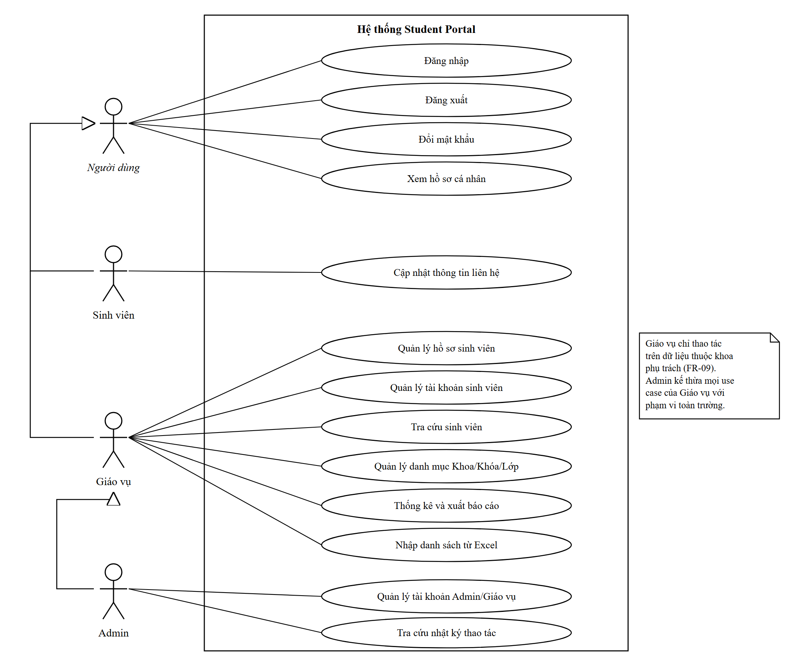

Hình 3.1. Biểu đồ Use Case tổng quát

Biểu đồ dùng quan hệ tổng quát hóa (generalization) giữa các tác nhân: Người dùng là tác nhân trừu tượng (tên in nghiêng) đại diện cho mọi tài khoản đã đăng nhập; Sinh viên và Giáo vụ kế thừa Người dùng; Admin kế thừa Giáo vụ nên sử dụng được mọi use case của Giáo vụ với phạm vi toàn trường, cộng thêm quản lý tài khoản Admin/Giáo vụ và tra cứu nhật ký. Kiểm soát truy cập (FR-08) và phạm vi dữ liệu (FR-09) là yêu cầu xuyên suốt, áp dụng cho mọi use case sau đăng nhập.

### 3.1.4. Danh sách và biểu đồ Use Case phân rã

**a) Danh sách Use Case**

<table>
<thead>
<tr>
<th><strong>Mã</strong></th>
<th><strong>Tên Use Case</strong></th>
<th><strong>Tác nhân</strong></th>
<th><strong>FR</strong></th>
</tr>
</thead>
<tbody>
<tr>
<td colspan="4"><strong>Xác thực và tài khoản cá nhân</strong></td>
</tr>
<tr>
<td>UC01</td>
<td>Đăng nhập</td>
<td>Admin, Giáo vụ, Sinh viên</td>
<td>FR-06, FR-08</td>
</tr>
<tr>
<td>UC02</td>
<td>Đăng xuất</td>
<td>Admin, Giáo vụ, Sinh viên</td>
<td>FR-07</td>
</tr>
<tr>
<td>UC03</td>
<td>Đổi mật khẩu</td>
<td>Admin, Giáo vụ, Sinh viên</td>
<td>FR-10</td>
</tr>
<tr>
<td>UC04</td>
<td>Xem hồ sơ cá nhân</td>
<td>Admin, Giáo vụ, Sinh viên</td>
<td>FR-11</td>
</tr>
<tr>
<td>UC05</td>
<td>Cập nhật thông tin liên hệ</td>
<td>Sinh viên</td>
<td>FR-12</td>
</tr>
<tr>
<td colspan="4"><strong>Quản lý tài khoản Admin/Giáo vụ</strong></td>
</tr>
<tr>
<td>UC06</td>
<td>Quản lý tài khoản Admin/Giáo vụ (xem DS, tạo, cập nhật)</td>
<td>Admin</td>
<td>FR-01 – FR-03</td>
</tr>
<tr>
<td>UC07</td>
<td>Cấp lại mật khẩu Admin/Giáo vụ</td>
<td>Admin</td>
<td>FR-04</td>
</tr>
<tr>
<td>UC08</td>
<td>Khóa/mở khóa tài khoản Admin/Giáo vụ</td>
<td>Admin</td>
<td>FR-05</td>
</tr>
<tr>
<td colspan="4"><strong>Hồ sơ và tài khoản sinh viên</strong></td>
</tr>
<tr>
<td>UC09</td>
<td>Thêm hồ sơ sinh viên</td>
<td>Admin, Giáo vụ</td>
<td>FR-13</td>
</tr>
<tr>
<td>UC10</td>
<td>Xem chi tiết hồ sơ sinh viên</td>
<td>Admin, Giáo vụ</td>
<td>FR-14</td>
</tr>
<tr>
<td>UC11</td>
<td>Cập nhật hồ sơ sinh viên</td>
<td>Admin, Giáo vụ</td>
<td>FR-15</td>
</tr>
<tr>
<td>UC12</td>
<td>Đổi trạng thái học tập</td>
<td>Admin, Giáo vụ</td>
<td>FR-16</td>
</tr>
<tr>
<td>UC13</td>
<td>Chuyển lớp</td>
<td>Admin, Giáo vụ</td>
<td>FR-17</td>
</tr>
<tr>
<td>UC14</td>
<td>Xóa mềm hồ sơ sinh viên</td>
<td>Admin, Giáo vụ</td>
<td>FR-18</td>
</tr>
<tr>
<td>UC15</td>
<td>Cấp lại mật khẩu sinh viên</td>
<td>Admin, Giáo vụ</td>
<td>FR-19</td>
</tr>
<tr>
<td>UC16</td>
<td>Khóa/mở khóa tài khoản sinh viên</td>
<td>Admin, Giáo vụ</td>
<td>FR-20</td>
</tr>
<tr>
<td colspan="4"><strong>Tra cứu, danh mục, thống kê, xuất/nhập, nhật ký</strong></td>
</tr>
<tr>
<td>UC17</td>
<td>Lập danh sách sinh viên theo Khoa, Khóa, Lớp</td>
<td>Admin, Giáo vụ</td>
<td>FR-21</td>
</tr>
<tr>
<td>UC18</td>
<td>Tìm kiếm sinh viên</td>
<td>Admin, Giáo vụ</td>
<td>FR-22</td>
</tr>
<tr>
<td>UC19</td>
<td>Quản lý danh mục Khoa, Khóa, Lớp</td>
<td>Admin; Giáo vụ (Lớp)</td>
<td>FR-23 – FR-26</td>
</tr>
<tr>
<td>UC20</td>
<td>Thống kê sinh viên</td>
<td>Admin, Giáo vụ</td>
<td>FR-27</td>
</tr>
<tr>
<td>UC21</td>
<td>Xuất danh sách sinh viên ra Excel/PDF</td>
<td>Admin, Giáo vụ</td>
<td>FR-28</td>
</tr>
<tr>
<td>UC22</td>
<td>Xuất báo cáo thống kê ra Excel/PDF</td>
<td>Admin, Giáo vụ</td>
<td>FR-29</td>
</tr>
<tr>
<td>UC23</td>
<td>Nhập danh sách sinh viên từ Excel</td>
<td>Admin, Giáo vụ</td>
<td>FR-30</td>
</tr>
<tr>
<td>UC24</td>
<td>Tra cứu nhật ký thao tác</td>
<td>Admin</td>
<td>FR-31</td>
</tr>
</tbody>
</table>

**b) Biểu đồ Use Case phân rã**

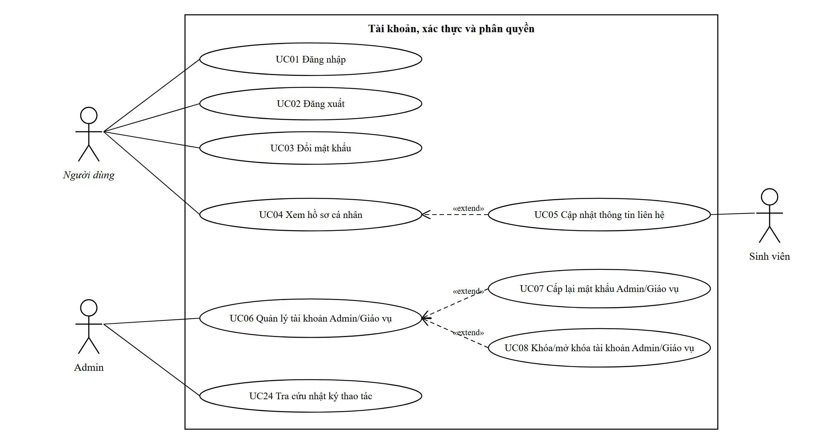

Hình 3.2. Biểu đồ Use Case phân rã – Tài khoản, xác thực và phân quyền

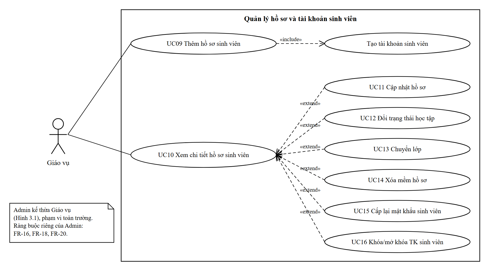

Hình 3.3. Biểu đồ Use Case phân rã – Quản lý hồ sơ và tài khoản sinh viên

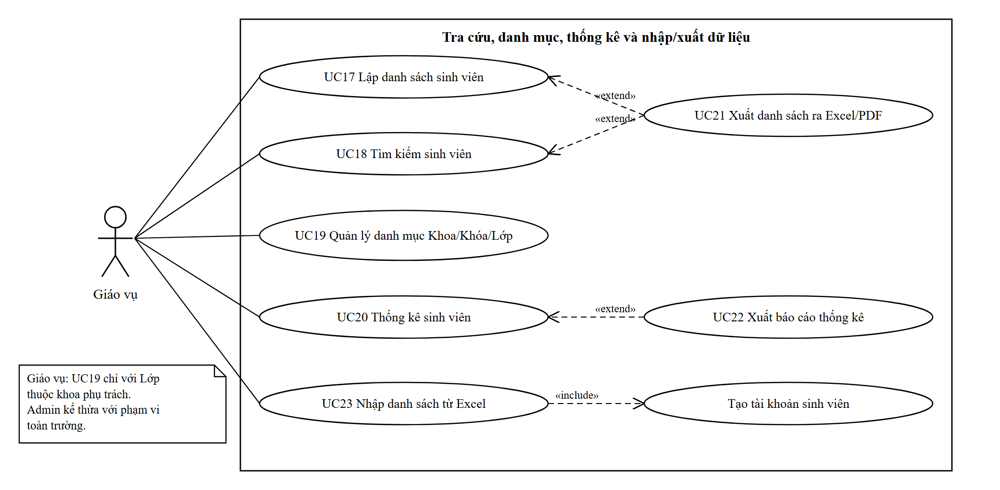

Hình 3.4. Biểu đồ Use Case phân rã – Tra cứu, danh mục, thống kê và nhập/xuất dữ liệu

Quan hệ giữa các Use Case: UC05 «extend» UC04; UC07, UC08 «extend» UC06; UC11 – UC16 «extend» UC10 (chỉ thực hiện từ màn hình chi tiết hồ sơ); UC21 «extend» UC17 và UC18; UC22 «extend» UC20; UC09 và UC23 «include» use case nội bộ "Tạo tài khoản sinh viên" (IAccountService). Mọi use case trừ UC01 có tiền điều kiện đã đăng nhập.

### 3.1.5. Đặc tả chi tiết các Use Case

Mỗi Use Case được đặc tả bằng một bảng gồm: tên Use Case, mã yêu cầu SRS, tác nhân, mô tả, tiền điều kiện, hậu điều kiện, luồng sự kiện chính và luồng sự kiện thay thế. Luồng thay thế được đánh số theo bước phát sinh ở luồng chính, ví dụ 4a là nhánh rẽ thứ nhất tại bước 4.

#### a) Nhóm Tài khoản, xác thực và phân quyền

##### UC01 – Đăng nhập

<table>
<tbody>
<tr>
<td><strong>Tên Use Case</strong></td>
<td><strong>UC01 – Đăng nhập</strong></td>
</tr>
<tr>
<td><strong>Mã yêu cầu</strong></td>
<td>FR-06, FR-08</td>
</tr>
<tr>
<td><strong>Tác nhân</strong></td>
<td>Admin, Giáo vụ, Sinh viên</td>
</tr>
<tr>
<td><strong>Mô tả</strong></td>
<td>Người dùng xác thực bằng tên đăng nhập và mật khẩu để truy cập các chức năng theo vai trò.</td>
</tr>
<tr>
<td><strong>Tiền điều kiện</strong></td>
<td>Tài khoản đã được cấp (UC06, UC09, UC23); người dùng chưa đăng nhập.</td>
</tr>
<tr>
<td><strong>Hậu điều kiện</strong></td>
<td>Cookie xác thực được tạo; số lần đăng nhập sai được đặt lại; thời điểm đăng nhập cuối được ghi nhận; giao diện hiển thị theo vai trò.</td>
</tr>
<tr>
<td><strong>Luồng sự kiện chính</strong></td>
<td><p><strong>1.</strong> Người dùng mở trang Đăng nhập.</p>
<p><strong>2.</strong> Hệ thống hiển thị form gồm tên đăng nhập và mật khẩu.</p>
<p><strong>3.</strong> Người dùng nhập tên đăng nhập, mật khẩu và bấm "Đăng nhập".</p>
<p><strong>4.</strong> Hệ thống kiểm tra tài khoản không bị khóa tạm, thông tin xác thực đúng và trạng thái tài khoản là HoatDong.</p>
<p><strong>5.</strong> Hệ thống tạo cookie xác thực (HttpOnly, Secure), đặt lại số lần sai, ghi thời điểm đăng nhập cuối.</p>
<p><strong>6.</strong> Hệ thống chuyển người dùng đến trang chủ với menu tương ứng vai trò.</p></td>
</tr>
<tr>
<td><strong>Luồng sự kiện thay thế</strong></td>
<td><p><strong>4a.</strong> Nếu sai tên đăng nhập hoặc mật khẩu, hoặc tài khoản đang ở trạng thái BiKhoa: hệ thống tăng số lần sai và hiển thị thông báo chung "Tên đăng nhập hoặc mật khẩu không đúng", không tiết lộ tên đăng nhập có tồn tại hay không; quay lại bước 3.</p>
<p><strong>4b.</strong> Nếu tài khoản đã sai 5 lần liên tiếp: hệ thống khóa tạm 15 phút và thông báo "Tài khoản tạm khóa, vui lòng thử lại sau"; use case kết thúc.</p>
<p><strong>6a.</strong> Nếu địa chỉ quay lại (returnUrl) không phải URL nội bộ: hệ thống bỏ qua và chuyển về trang chủ.</p></td>
</tr>
</tbody>
</table>

##### UC02 – Đăng xuất

<table>
<tbody>
<tr>
<td><strong>Tên Use Case</strong></td>
<td><strong>UC02 – Đăng xuất</strong></td>
</tr>
<tr>
<td><strong>Mã yêu cầu</strong></td>
<td>FR-07</td>
</tr>
<tr>
<td><strong>Tác nhân</strong></td>
<td>Admin, Giáo vụ, Sinh viên</td>
</tr>
<tr>
<td><strong>Mô tả</strong></td>
<td>Người dùng kết thúc phiên làm việc hiện tại.</td>
</tr>
<tr>
<td><strong>Tiền điều kiện</strong></td>
<td>Người dùng đã đăng nhập.</td>
</tr>
<tr>
<td><strong>Hậu điều kiện</strong></td>
<td>Cookie xác thực của phiên hiện tại bị hủy.</td>
</tr>
<tr>
<td><strong>Luồng sự kiện chính</strong></td>
<td><p><strong>1.</strong> Người dùng chọn "Đăng xuất" trên menu.</p>
<p><strong>2.</strong> Hệ thống hủy cookie xác thực của phiên hiện tại.</p>
<p><strong>3.</strong> Hệ thống chuyển về trang Đăng nhập.</p></td>
</tr>
<tr>
<td><strong>Luồng sự kiện thay thế</strong></td>
<td><strong>1a.</strong> Nếu phiên đã hết hạn: hệ thống chuyển thẳng về trang Đăng nhập.</td>
</tr>
</tbody>
</table>

##### UC03 – Đổi mật khẩu

<table>
<tbody>
<tr>
<td><strong>Tên Use Case</strong></td>
<td><strong>UC03 – Đổi mật khẩu</strong></td>
</tr>
<tr>
<td><strong>Mã yêu cầu</strong></td>
<td>FR-10</td>
</tr>
<tr>
<td><strong>Tác nhân</strong></td>
<td>Admin, Giáo vụ, Sinh viên</td>
</tr>
<tr>
<td><strong>Mô tả</strong></td>
<td>Người dùng tự đổi mật khẩu của chính mình.</td>
</tr>
<tr>
<td><strong>Tiền điều kiện</strong></td>
<td>Người dùng đã đăng nhập.</td>
</tr>
<tr>
<td><strong>Hậu điều kiện</strong></td>
<td>Mật khẩu mới được lưu dạng hash; phiên hiện tại được làm mới; các phiên khác bị vô hiệu; nhật ký DoiMatKhau được ghi.</td>
</tr>
<tr>
<td><strong>Luồng sự kiện chính</strong></td>
<td><p><strong>1.</strong> Người dùng chọn "Đổi mật khẩu".</p>
<p><strong>2.</strong> Hệ thống hiển thị form gồm mật khẩu hiện tại, mật khẩu mới và xác nhận mật khẩu mới.</p>
<p><strong>3.</strong> Người dùng nhập đủ ba trường và gửi.</p>
<p><strong>4.</strong> Hệ thống lấy định danh từ phiên đăng nhập, kiểm tra mật khẩu hiện tại đúng, mật khẩu mới tối thiểu 8 ký tự gồm chữ và số, khác mật khẩu hiện tại và trùng với ô xác nhận.</p>
<p><strong>5.</strong> Hệ thống lưu mật khẩu mới, cập nhật SecurityStamp, làm mới phiên hiện tại và ghi nhật ký.</p>
<p><strong>6.</strong> Hệ thống thông báo đổi mật khẩu thành công.</p></td>
</tr>
<tr>
<td><strong>Luồng sự kiện thay thế</strong></td>
<td><p><strong>4a.</strong> Nếu mật khẩu hiện tại sai: hệ thống báo lỗi tại trường mật khẩu hiện tại; quay lại bước 3.</p>
<p><strong>4b.</strong> Nếu mật khẩu mới không đạt chính sách, trùng mật khẩu hiện tại hoặc xác nhận không khớp: hệ thống báo lỗi tại trường tương ứng; quay lại bước 3.</p></td>
</tr>
</tbody>
</table>

##### UC04 – Xem hồ sơ cá nhân

<table>
<tbody>
<tr>
<td><strong>Tên Use Case</strong></td>
<td><strong>UC04 – Xem hồ sơ cá nhân</strong></td>
</tr>
<tr>
<td><strong>Mã yêu cầu</strong></td>
<td>FR-11</td>
</tr>
<tr>
<td><strong>Tác nhân</strong></td>
<td>Admin, Giáo vụ, Sinh viên</td>
</tr>
<tr>
<td><strong>Mô tả</strong></td>
<td>Người dùng xem thông tin hồ sơ hoặc tài khoản của chính mình.</td>
</tr>
<tr>
<td><strong>Tiền điều kiện</strong></td>
<td>Người dùng đã đăng nhập.</td>
</tr>
<tr>
<td><strong>Hậu điều kiện</strong></td>
<td>Không thay đổi dữ liệu.</td>
</tr>
<tr>
<td><strong>Luồng sự kiện chính</strong></td>
<td><p><strong>1.</strong> Người dùng chọn "Hồ sơ cá nhân".</p>
<p><strong>2.</strong> Hệ thống lấy định danh từ phiên đăng nhập (không nhận định danh từ URL).</p>
<p><strong>3.</strong> Với Sinh viên, hệ thống hiển thị hồ sơ: mã SV, họ tên, ngày sinh, giới tính, lớp, khoa, khóa, trạng thái học tập, SĐT, email, địa chỉ.</p>
<p><strong>4.</strong> Với Admin/Giáo vụ, hệ thống hiển thị thông tin tài khoản: tên đăng nhập, họ tên, vai trò, khoa phụ trách.</p></td>
</tr>
<tr>
<td><strong>Luồng sự kiện thay thế</strong></td>
<td><strong>2a.</strong> Nếu yêu cầu chứa định danh của hồ sơ khác: hệ thống từ chối với HTTP 403.</td>
</tr>
</tbody>
</table>

##### UC05 – Cập nhật thông tin liên hệ

<table>
<tbody>
<tr>
<td><strong>Tên Use Case</strong></td>
<td><strong>UC05 – Cập nhật thông tin liên hệ</strong></td>
</tr>
<tr>
<td><strong>Mã yêu cầu</strong></td>
<td>FR-12</td>
</tr>
<tr>
<td><strong>Tác nhân</strong></td>
<td>Sinh viên</td>
</tr>
<tr>
<td><strong>Mô tả</strong></td>
<td>Sinh viên tự cập nhật số điện thoại, email và địa chỉ của mình.</td>
</tr>
<tr>
<td><strong>Tiền điều kiện</strong></td>
<td>Sinh viên đã đăng nhập, tài khoản đang hoạt động; đang ở màn hình Hồ sơ cá nhân (UC04).</td>
</tr>
<tr>
<td><strong>Hậu điều kiện</strong></td>
<td>SĐT, Email, Địa chỉ được cập nhật; nhật ký CapNhatLienHe được ghi.</td>
</tr>
<tr>
<td><strong>Luồng sự kiện chính</strong></td>
<td><p><strong>1.</strong> Sinh viên bấm "Cập nhật" tại màn hình Hồ sơ cá nhân.</p>
<p><strong>2.</strong> Hệ thống hiển thị hộp thoại với ba trường SĐT, Email, Địa chỉ đã điền sẵn.</p>
<p><strong>3.</strong> Sinh viên sửa thông tin và bấm "Lưu".</p>
<p><strong>4.</strong> Hệ thống kiểm tra SĐT (10 chữ số, bắt đầu bằng 0), Email đúng định dạng, Địa chỉ tối đa 255 ký tự, và yêu cầu chỉ chứa ba trường được phép.</p>
<p><strong>5.</strong> Hệ thống lưu thay đổi, ghi nhật ký.</p>
<p><strong>6.</strong> Hệ thống đóng hộp thoại, cập nhật thông tin trên trang bằng Ajax và hiển thị thông báo thành công.</p></td>
</tr>
<tr>
<td><strong>Luồng sự kiện thay thế</strong></td>
<td><p><strong>4a.</strong> Nếu dữ liệu không hợp lệ: hệ thống báo lỗi tại trường tương ứng; quay lại bước 3.</p>
<p><strong>4b.</strong> Nếu yêu cầu chứa trường ngoài ba trường được phép hoặc định danh hồ sơ khác: hệ thống từ chối; use case kết thúc.</p></td>
</tr>
</tbody>
</table>

##### UC06 – Quản lý tài khoản Admin/Giáo vụ

<table>
<tbody>
<tr>
<td><strong>Tên Use Case</strong></td>
<td><strong>UC06 – Quản lý tài khoản Admin/Giáo vụ</strong></td>
</tr>
<tr>
<td><strong>Mã yêu cầu</strong></td>
<td>FR-01, FR-02, FR-03</td>
</tr>
<tr>
<td><strong>Tác nhân</strong></td>
<td>Admin</td>
</tr>
<tr>
<td><strong>Mô tả</strong></td>
<td>Admin xem danh sách, tạo mới và cập nhật tài khoản Admin/Giáo vụ.</td>
</tr>
<tr>
<td><strong>Tiền điều kiện</strong></td>
<td>Admin đã đăng nhập, tài khoản đang hoạt động.</td>
</tr>
<tr>
<td><strong>Hậu điều kiện</strong></td>
<td>Tài khoản Admin/Giáo vụ được tạo mới hoặc cập nhật; nhật ký TaoTaiKhoan / CapNhatTaiKhoan / DoiQuyenKhoa được ghi.</td>
</tr>
<tr>
<td><strong>Luồng sự kiện chính</strong></td>
<td><p><strong>1.</strong> Admin chọn "Quản lý tài khoản".</p>
<p><strong>2.</strong> Hệ thống kiểm tra vai trò Admin, hiển thị danh sách tài khoản Admin/Giáo vụ có phân trang, kèm bộ lọc vai trò, khoa phụ trách, trạng thái.</p>
<p><strong>3.</strong> Admin bấm "Tạo tài khoản".</p>
<p><strong>4.</strong> Hệ thống hiển thị form: họ tên, tên đăng nhập, vai trò, khoa phụ trách, mật khẩu ban đầu.</p>
<p><strong>5.</strong> Admin nhập thông tin; nếu chọn vai trò Giáo vụ thì chọn một khoa phụ trách; bấm "Lưu".</p>
<p><strong>6.</strong> Hệ thống kiểm tra tên đăng nhập duy nhất và đúng định dạng, khoa tồn tại và đang sử dụng, mật khẩu đạt chính sách.</p>
<p><strong>7.</strong> Hệ thống tạo tài khoản qua Identity với trạng thái HoatDong, gán vai trò, ghi nhật ký TaoTaiKhoan.</p>
<p><strong>8.</strong> Hệ thống quay về danh sách và thông báo thành công.</p></td>
</tr>
<tr>
<td><strong>Luồng sự kiện thay thế</strong></td>
<td><p><strong>2a.</strong> Nếu người truy cập không phải Admin: hệ thống trả HTTP 403.</p>
<p><strong>3a.</strong> Nếu Admin chọn "Sửa" một tài khoản: hệ thống hiển thị form họ tên, vai trò, khoa phụ trách; Admin sửa và lưu; hệ thống kiểm tra quy tắc còn ít nhất một Admin hoạt động, lưu, cập nhật SecurityStamp để thay đổi có hiệu lực từ yêu cầu kế tiếp, ghi nhật ký; tiếp tục bước 8.</p>
<p><strong>3b.</strong> Nếu khi sửa tài khoản, việc đổi vai trò làm mất Admin hoạt động cuối cùng: hệ thống từ chối và nêu lý do.</p>
<p><strong>6a.</strong> Nếu trùng tên đăng nhập, thiếu khoa với Giáo vụ hoặc mật khẩu không đạt: hệ thống báo lỗi tại trường tương ứng, giữ nguyên biểu mẫu; quay lại bước 5.</p></td>
</tr>
</tbody>
</table>

##### UC07 – Cấp lại mật khẩu tài khoản Admin/Giáo vụ

<table>
<tbody>
<tr>
<td><strong>Tên Use Case</strong></td>
<td><strong>UC07 – Cấp lại mật khẩu tài khoản Admin/Giáo vụ</strong></td>
</tr>
<tr>
<td><strong>Mã yêu cầu</strong></td>
<td>FR-04</td>
</tr>
<tr>
<td><strong>Tác nhân</strong></td>
<td>Admin</td>
</tr>
<tr>
<td><strong>Mô tả</strong></td>
<td>Admin đặt lại mật khẩu cho tài khoản Admin/Giáo vụ khi người dùng quên mật khẩu.</td>
</tr>
<tr>
<td><strong>Tiền điều kiện</strong></td>
<td>Admin đã đăng nhập; đang ở danh sách tài khoản (UC06).</td>
</tr>
<tr>
<td><strong>Hậu điều kiện</strong></td>
<td>Mật khẩu mới được lưu dạng hash; các phiên cũ của tài khoản bị vô hiệu; nhật ký CapLaiMatKhau được ghi.</td>
</tr>
<tr>
<td><strong>Luồng sự kiện chính</strong></td>
<td><p><strong>1.</strong> Admin chọn "Cấp lại mật khẩu" tại một tài khoản.</p>
<p><strong>2.</strong> Hệ thống hiển thị hộp thoại nhập mật khẩu mới và xác nhận.</p>
<p><strong>3.</strong> Admin nhập mật khẩu mới, xác nhận và bấm "Lưu".</p>
<p><strong>4.</strong> Hệ thống kiểm tra chính sách mật khẩu và ô xác nhận.</p>
<p><strong>5.</strong> Hệ thống đặt lại mật khẩu, cập nhật SecurityStamp, ghi nhật ký.</p>
<p><strong>6.</strong> Hệ thống thông báo thành công; Admin bàn giao mật khẩu mới cho người dùng ngoài hệ thống.</p></td>
</tr>
<tr>
<td><strong>Luồng sự kiện thay thế</strong></td>
<td><strong>4a.</strong> Nếu mật khẩu không đạt chính sách hoặc xác nhận không khớp: hệ thống báo lỗi; quay lại bước 3.</td>
</tr>
</tbody>
</table>

##### UC08 – Khóa/mở khóa tài khoản Admin/Giáo vụ

<table>
<tbody>
<tr>
<td><strong>Tên Use Case</strong></td>
<td><strong>UC08 – Khóa/mở khóa tài khoản Admin/Giáo vụ</strong></td>
</tr>
<tr>
<td><strong>Mã yêu cầu</strong></td>
<td>FR-05</td>
</tr>
<tr>
<td><strong>Tác nhân</strong></td>
<td>Admin</td>
</tr>
<tr>
<td><strong>Mô tả</strong></td>
<td>Admin khóa hoặc mở khóa tài khoản Admin/Giáo vụ kèm lý do.</td>
</tr>
<tr>
<td><strong>Tiền điều kiện</strong></td>
<td>Admin đã đăng nhập; đang ở danh sách tài khoản (UC06).</td>
</tr>
<tr>
<td><strong>Hậu điều kiện</strong></td>
<td>Trạng thái tài khoản chuyển HoatDong ↔︎ BiKhoa kèm lý do; tài khoản bị khóa bị từ chối từ yêu cầu kế tiếp; nhật ký KhoaTaiKhoan / MoKhoaTaiKhoan được ghi.</td>
</tr>
<tr>
<td><strong>Luồng sự kiện chính</strong></td>
<td><p><strong>1.</strong> Admin chọn "Khóa" hoặc "Mở khóa" tại một tài khoản.</p>
<p><strong>2.</strong> Hệ thống hiển thị hộp thoại xác nhận yêu cầu nhập lý do.</p>
<p><strong>3.</strong> Admin nhập lý do và xác nhận.</p>
<p><strong>4.</strong> Hệ thống kiểm tra có lý do và quy tắc còn ít nhất một Admin hoạt động.</p>
<p><strong>5.</strong> Hệ thống cập nhật trạng thái tài khoản, lưu lý do, cập nhật SecurityStamp, ghi nhật ký.</p>
<p><strong>6.</strong> Hệ thống cập nhật dòng tương ứng trong danh sách bằng Ajax.</p></td>
</tr>
<tr>
<td><strong>Luồng sự kiện thay thế</strong></td>
<td><p><strong>4a.</strong> Nếu thiếu lý do: hệ thống báo lỗi; quay lại bước 3.</p>
<p><strong>4b.</strong> Nếu thao tác khóa làm mất Admin hoạt động cuối cùng (kể cả tự khóa chính mình khi là Admin duy nhất): hệ thống từ chối; use case kết thúc.</p></td>
</tr>
</tbody>
</table>

#### b) Nhóm Hồ sơ và tài khoản sinh viên

##### UC09 – Thêm hồ sơ sinh viên

<table>
<tbody>
<tr>
<td><strong>Tên Use Case</strong></td>
<td><strong>UC09 – Thêm hồ sơ sinh viên</strong></td>
</tr>
<tr>
<td><strong>Mã yêu cầu</strong></td>
<td>FR-13</td>
</tr>
<tr>
<td><strong>Tác nhân</strong></td>
<td>Giáo vụ, Admin</td>
</tr>
<tr>
<td><strong>Mô tả</strong></td>
<td>Giáo vụ hoặc Admin thêm hồ sơ sinh viên mới; hệ thống tạo tài khoản sinh viên đi kèm.</td>
</tr>
<tr>
<td><strong>Tiền điều kiện</strong></td>
<td>Đã đăng nhập, tài khoản đang hoạt động; có ít nhất một lớp đang sử dụng trong phạm vi.</td>
</tr>
<tr>
<td><strong>Hậu điều kiện</strong></td>
<td>Hồ sơ sinh viên và tài khoản sinh viên (tên đăng nhập = mã SV) được tạo trong cùng một giao dịch; nhật ký TaoHoSo được ghi.</td>
</tr>
<tr>
<td><strong>Luồng sự kiện chính</strong></td>
<td><p><strong>1.</strong> Giáo vụ bấm "+ Thêm SV" trên màn hình danh sách sinh viên.</p>
<p><strong>2.</strong> Hệ thống hiển thị form BM01; danh sách Khoa, Khóa, Lớp chỉ gồm các mục trong phạm vi khoa phụ trách (Admin thấy toàn trường).</p>
<p><strong>3.</strong> Giáo vụ chọn lớp, nhập mã SV, họ tên, ngày sinh, giới tính, SĐT, email, địa chỉ, trạng thái ban đầu, mật khẩu ban đầu và bấm "Lưu".</p>
<p><strong>4.</strong> Hệ thống kiểm tra lớp thuộc phạm vi, mã SV đúng định dạng và chưa từng tồn tại (kể cả hồ sơ đã xóa mềm), dữ liệu đúng quy tắc và mật khẩu đạt chính sách.</p>
<p><strong>5.</strong> Hệ thống mở giao dịch: lưu hồ sơ, tạo tài khoản vai trò SinhVien qua dịch vụ tài khoản, ghi nhật ký, rồi xác nhận giao dịch.</p>
<p><strong>6.</strong> Hệ thống đóng form, hiển thị thông báo thành công và tải lại bảng danh sách bằng Ajax.</p></td>
</tr>
<tr>
<td><strong>Luồng sự kiện thay thế</strong></td>
<td><p><strong>4a.</strong> Nếu lớp ngoài phạm vi: hệ thống từ chối với HTTP 403; use case kết thúc.</p>
<p><strong>4b.</strong> Nếu mã SV đã tồn tại: hệ thống báo lỗi "Mã sinh viên đã tồn tại" tại trường mã SV (HTTP 409); quay lại bước 3.</p>
<p><strong>4c.</strong> Nếu dữ liệu sai quy tắc hoặc mật khẩu không đạt: hệ thống báo lỗi theo từng trường; quay lại bước 3.</p>
<p><strong>5a.</strong> Nếu tạo tài khoản lỗi: hệ thống hủy toàn bộ giao dịch (không lưu hồ sơ) và thông báo lỗi chung; use case kết thúc.</p></td>
</tr>
</tbody>
</table>

##### UC10 – Xem chi tiết hồ sơ sinh viên

<table>
<tbody>
<tr>
<td><strong>Tên Use Case</strong></td>
<td><strong>UC10 – Xem chi tiết hồ sơ sinh viên</strong></td>
</tr>
<tr>
<td><strong>Mã yêu cầu</strong></td>
<td>FR-14</td>
</tr>
<tr>
<td><strong>Tác nhân</strong></td>
<td>Giáo vụ, Admin</td>
</tr>
<tr>
<td><strong>Mô tả</strong></td>
<td>Giáo vụ hoặc Admin xem đầy đủ thông tin một hồ sơ sinh viên trong phạm vi được phép.</td>
</tr>
<tr>
<td><strong>Tiền điều kiện</strong></td>
<td>Đã đăng nhập, tài khoản đang hoạt động.</td>
</tr>
<tr>
<td><strong>Hậu điều kiện</strong></td>
<td>Không thay đổi dữ liệu; màn hình chi tiết là điểm bắt đầu của UC11 – UC16.</td>
</tr>
<tr>
<td><strong>Luồng sự kiện chính</strong></td>
<td><p><strong>1.</strong> Giáo vụ chọn một sinh viên từ danh sách (UC17) hoặc kết quả tìm kiếm (UC18).</p>
<p><strong>2.</strong> Hệ thống kiểm tra hồ sơ tồn tại, chưa bị xóa mềm và thuộc phạm vi.</p>
<p><strong>3.</strong> Hệ thống hiển thị đầy đủ hồ sơ, trạng thái học tập và trạng thái tài khoản.</p>
<p><strong>4.</strong> Hệ thống hiển thị các nút thao tác được phép theo vai trò và trạng thái hồ sơ: Sửa, Đổi trạng thái, Chuyển lớp, Xóa, Cấp lại mật khẩu, Khóa/Mở khóa.</p></td>
</tr>
<tr>
<td><strong>Luồng sự kiện thay thế</strong></td>
<td><p><strong>2a.</strong> Nếu hồ sơ không tồn tại hoặc đã xóa mềm: hệ thống hiển thị "Không tìm thấy sinh viên" (HTTP 404); use case kết thúc.</p>
<p><strong>2b.</strong> Nếu hồ sơ ngoài phạm vi: hệ thống từ chối với HTTP 403; use case kết thúc.</p></td>
</tr>
</tbody>
</table>

##### UC11 – Cập nhật hồ sơ sinh viên

<table>
<tbody>
<tr>
<td><strong>Tên Use Case</strong></td>
<td><strong>UC11 – Cập nhật hồ sơ sinh viên</strong></td>
</tr>
<tr>
<td><strong>Mã yêu cầu</strong></td>
<td>FR-15</td>
</tr>
<tr>
<td><strong>Tác nhân</strong></td>
<td>Giáo vụ, Admin</td>
</tr>
<tr>
<td><strong>Mô tả</strong></td>
<td>Giáo vụ hoặc Admin sửa thông tin hồ sơ sinh viên (trừ mã sinh viên).</td>
</tr>
<tr>
<td><strong>Tiền điều kiện</strong></td>
<td>Đang ở màn hình chi tiết hồ sơ (UC10); hồ sơ chưa xóa mềm, trong phạm vi.</td>
</tr>
<tr>
<td><strong>Hậu điều kiện</strong></td>
<td>Thông tin cá nhân được cập nhật, NgayCapNhat được ghi; nhật ký SuaHoSo được ghi.</td>
</tr>
<tr>
<td><strong>Luồng sự kiện chính</strong></td>
<td><p><strong>1.</strong> Giáo vụ bấm "Sửa".</p>
<p><strong>2.</strong> Hệ thống hiển thị form gồm họ tên, ngày sinh, giới tính, SĐT, email, địa chỉ; mã SV, lớp và trạng thái chỉ hiển thị, không cho sửa.</p>
<p><strong>3.</strong> Giáo vụ sửa thông tin và bấm "Lưu".</p>
<p><strong>4.</strong> Hệ thống kiểm tra quyền và dữ liệu theo quy tắc.</p>
<p><strong>5.</strong> Hệ thống lưu thay đổi, cập nhật HoTenKhongDau, NgayCapNhat và ghi nhật ký.</p>
<p><strong>6.</strong> Hệ thống cập nhật thông tin trên trang bằng Ajax và thông báo thành công.</p></td>
</tr>
<tr>
<td><strong>Luồng sự kiện thay thế</strong></td>
<td><p><strong>4a.</strong> Nếu dữ liệu sai quy tắc: hệ thống báo lỗi theo trường; quay lại bước 3.</p>
<p><strong>4b.</strong> Nếu hồ sơ đã bị xóa mềm hoặc ngoài phạm vi: hệ thống từ chối; use case kết thúc.</p></td>
</tr>
</tbody>
</table>

##### UC12 – Đổi trạng thái học tập

<table>
<tbody>
<tr>
<td><strong>Tên Use Case</strong></td>
<td><strong>UC12 – Đổi trạng thái học tập</strong></td>
</tr>
<tr>
<td><strong>Mã yêu cầu</strong></td>
<td>FR-16</td>
</tr>
<tr>
<td><strong>Tác nhân</strong></td>
<td>Giáo vụ, Admin</td>
</tr>
<tr>
<td><strong>Mô tả</strong></td>
<td>Giáo vụ hoặc Admin chuyển trạng thái học tập của sinh viên theo quyết định biến động.</td>
</tr>
<tr>
<td><strong>Tiền điều kiện</strong></td>
<td>Đang ở màn hình chi tiết hồ sơ (UC10); hồ sơ chưa xóa mềm, trong phạm vi.</td>
</tr>
<tr>
<td><strong>Hậu điều kiện</strong></td>
<td>Trạng thái học tập được cập nhật; DaCoBienDong = true; nếu chuyển sang Thôi học thì tài khoản bị khóa trong cùng giao dịch; nếu chuyển từ Thôi học về Đang học thì tài khoản giữ trạng thái khóa cho đến khi được mở thủ công (UC16); nhật ký DoiTrangThai được ghi.</td>
</tr>
<tr>
<td><strong>Luồng sự kiện chính</strong></td>
<td><p><strong>1.</strong> Giáo vụ bấm "Đổi trạng thái".</p>
<p><strong>2.</strong> Hệ thống hiển thị hộp thoại chỉ liệt kê các trạng thái được phép chuyển theo vai trò và trạng thái hiện tại (bảng quy tắc mục 3.1.2).</p>
<p><strong>3.</strong> Giáo vụ chọn trạng thái mới, nhập lý do hoặc số quyết định (BM07) và xác nhận.</p>
<p><strong>4.</strong> Hệ thống kiểm tra lại quy tắc chuyển trạng thái tại server.</p>
<p><strong>5.</strong> Hệ thống lưu trạng thái mới, đánh dấu DaCoBienDong; nếu trạng thái mới là Thôi học thì khóa tài khoản sinh viên; ghi nhật ký; tất cả trong một giao dịch.</p>
<p><strong>6.</strong> Hệ thống cập nhật nhãn trạng thái học tập và trạng thái tài khoản trên trang, thông báo thành công.</p></td>
</tr>
<tr>
<td><strong>Luồng sự kiện thay thế</strong></td>
<td><p><strong>4a.</strong> Nếu chuyển trạng thái không hợp lệ (ví dụ Bảo lưu → Đã tốt nghiệp): hệ thống chặn và nêu lý do; quay lại bước 3.</p>
<p><strong>4b.</strong> Nếu Giáo vụ thực hiện chuyển chỉ dành cho Admin (Thôi học → Đang học, sửa hồ sơ Đã tốt nghiệp): hệ thống từ chối với HTTP 403.</p>
<p><strong>4c.</strong> Nếu Admin sửa hồ sơ Đã tốt nghiệp mà không nhập lý do: hệ thống báo lỗi; quay lại bước 3.</p></td>
</tr>
</tbody>
</table>

##### UC13 – Chuyển lớp

<table>
<tbody>
<tr>
<td><strong>Tên Use Case</strong></td>
<td><strong>UC13 – Chuyển lớp</strong></td>
</tr>
<tr>
<td><strong>Mã yêu cầu</strong></td>
<td>FR-17</td>
</tr>
<tr>
<td><strong>Tác nhân</strong></td>
<td>Giáo vụ, Admin</td>
</tr>
<tr>
<td><strong>Mô tả</strong></td>
<td>Giáo vụ hoặc Admin chuyển sinh viên sang lớp hành chính khác.</td>
</tr>
<tr>
<td><strong>Tiền điều kiện</strong></td>
<td>Đang ở màn hình chi tiết hồ sơ (UC10); hồ sơ chưa xóa mềm, trong phạm vi.</td>
</tr>
<tr>
<td><strong>Hậu điều kiện</strong></td>
<td>Hồ sơ gắn với lớp mới (Khoa/Khóa xác định theo lớp mới); DaCoBienDong = true; nhật ký ChuyenLop được ghi.</td>
</tr>
<tr>
<td><strong>Luồng sự kiện chính</strong></td>
<td><p><strong>1.</strong> Giáo vụ bấm "Chuyển lớp".</p>
<p><strong>2.</strong> Hệ thống hiển thị danh sách lớp đích đang sử dụng: Giáo vụ chỉ thấy lớp thuộc khoa phụ trách, Admin thấy toàn trường.</p>
<p><strong>3.</strong> Giáo vụ chọn lớp đích, nhập lý do (không bắt buộc) và xác nhận.</p>
<p><strong>4.</strong> Hệ thống kiểm tra quyền với lớp hiện tại và lớp đích, lớp đích khác lớp hiện tại và chưa xóa mềm.</p>
<p><strong>5.</strong> Hệ thống lưu lớp mới, đánh dấu DaCoBienDong, ghi nhật ký.</p>
<p><strong>6.</strong> Hệ thống cập nhật thông tin lớp, khoa, khóa trên trang và thông báo thành công.</p></td>
</tr>
<tr>
<td><strong>Luồng sự kiện thay thế</strong></td>
<td><p><strong>4a.</strong> Nếu lớp đích không tồn tại hoặc đã xóa mềm: hệ thống báo lỗi; quay lại bước 3.</p>
<p><strong>4b.</strong> Nếu Giáo vụ chuyển sinh viên sang lớp ngoài khoa phụ trách: hệ thống từ chối với HTTP 403.</p></td>
</tr>
</tbody>
</table>

##### UC14 – Xóa mềm hồ sơ sinh viên

<table>
<tbody>
<tr>
<td><strong>Tên Use Case</strong></td>
<td><strong>UC14 – Xóa mềm hồ sơ sinh viên</strong></td>
</tr>
<tr>
<td><strong>Mã yêu cầu</strong></td>
<td>FR-18</td>
</tr>
<tr>
<td><strong>Tác nhân</strong></td>
<td>Giáo vụ, Admin</td>
</tr>
<tr>
<td><strong>Mô tả</strong></td>
<td>Giáo vụ hoặc Admin xóa mềm hồ sơ nhập sai; hồ sơ bị loại khỏi tra cứu và thống kê.</td>
</tr>
<tr>
<td><strong>Tiền điều kiện</strong></td>
<td>Đang ở màn hình chi tiết hồ sơ (UC10); hồ sơ trong phạm vi, chưa xóa mềm.</td>
</tr>
<tr>
<td><strong>Hậu điều kiện</strong></td>
<td>DaXoa = true kèm NgayXoa, NguoiXoa, LyDoXoa; tài khoản sinh viên bị khóa; hồ sơ bị loại khỏi tra cứu, thống kê, báo cáo; nhật ký XoaMemHoSo được ghi.</td>
</tr>
<tr>
<td><strong>Luồng sự kiện chính</strong></td>
<td><p><strong>1.</strong> Giáo vụ bấm "Xóa".</p>
<p><strong>2.</strong> Hệ thống hiển thị hộp thoại xác nhận yêu cầu nhập lý do.</p>
<p><strong>3.</strong> Giáo vụ nhập lý do và xác nhận.</p>
<p><strong>4.</strong> Hệ thống kiểm tra điều kiện xóa theo vai trò: Giáo vụ chỉ xóa hồ sơ Đang học, sinh viên chưa từng đăng nhập và chưa có đổi trạng thái/chuyển lớp; Admin xóa được mọi hồ sơ trừ hồ sơ Đã tốt nghiệp.</p>
<p><strong>5.</strong> Hệ thống đánh dấu xóa mềm, khóa tài khoản sinh viên và ghi nhật ký trong cùng một giao dịch.</p>
<p><strong>6.</strong> Hệ thống chuyển về danh sách sinh viên và thông báo thành công.</p></td>
</tr>
<tr>
<td><strong>Luồng sự kiện thay thế</strong></td>
<td><p><strong>4a.</strong> Nếu thiếu lý do: hệ thống báo lỗi; quay lại bước 3.</p>
<p><strong>4b.</strong> Nếu không đủ điều kiện xóa: hệ thống chặn và nêu lý do cụ thể (ví dụ "Sinh viên đã từng đăng nhập"); use case kết thúc.</p>
<p><strong>5a.</strong> Nếu giao dịch lỗi: hệ thống hủy toàn bộ thao tác và báo lỗi; use case kết thúc.</p></td>
</tr>
</tbody>
</table>

##### UC15 – Cấp lại mật khẩu tài khoản sinh viên

<table>
<tbody>
<tr>
<td><strong>Tên Use Case</strong></td>
<td><strong>UC15 – Cấp lại mật khẩu tài khoản sinh viên</strong></td>
</tr>
<tr>
<td><strong>Mã yêu cầu</strong></td>
<td>FR-19</td>
</tr>
<tr>
<td><strong>Tác nhân</strong></td>
<td>Giáo vụ, Admin</td>
</tr>
<tr>
<td><strong>Mô tả</strong></td>
<td>Giáo vụ hoặc Admin đặt lại mật khẩu cho tài khoản sinh viên.</td>
</tr>
<tr>
<td><strong>Tiền điều kiện</strong></td>
<td>Đang ở màn hình chi tiết hồ sơ (UC10); hồ sơ trong phạm vi.</td>
</tr>
<tr>
<td><strong>Hậu điều kiện</strong></td>
<td>Mật khẩu mới được lưu dạng hash; các phiên cũ của sinh viên bị vô hiệu; nhật ký CapLaiMatKhau được ghi.</td>
</tr>
<tr>
<td><strong>Luồng sự kiện chính</strong></td>
<td><p><strong>1.</strong> Giáo vụ bấm "Cấp lại mật khẩu".</p>
<p><strong>2.</strong> Hệ thống hiển thị hộp thoại nhập mật khẩu mới và xác nhận.</p>
<p><strong>3.</strong> Giáo vụ nhập mật khẩu mới, xác nhận và bấm "Lưu".</p>
<p><strong>4.</strong> Hệ thống kiểm tra chính sách mật khẩu và ô xác nhận.</p>
<p><strong>5.</strong> Hệ thống đặt lại mật khẩu qua dịch vụ tài khoản dùng chung, cập nhật SecurityStamp, ghi nhật ký.</p>
<p><strong>6.</strong> Hệ thống thông báo thành công; Giáo vụ bàn giao mật khẩu mới cho sinh viên.</p></td>
</tr>
<tr>
<td><strong>Luồng sự kiện thay thế</strong></td>
<td><p><strong>4a.</strong> Nếu mật khẩu không đạt chính sách hoặc xác nhận không khớp: hệ thống báo lỗi; quay lại bước 3.</p>
<p><strong>4b.</strong> Nếu hồ sơ ngoài phạm vi: hệ thống từ chối với HTTP 403.</p></td>
</tr>
</tbody>
</table>

##### UC16 – Khóa/mở khóa tài khoản sinh viên

<table>
<tbody>
<tr>
<td><strong>Tên Use Case</strong></td>
<td><strong>UC16 – Khóa/mở khóa tài khoản sinh viên</strong></td>
</tr>
<tr>
<td><strong>Mã yêu cầu</strong></td>
<td>FR-20</td>
</tr>
<tr>
<td><strong>Tác nhân</strong></td>
<td>Giáo vụ, Admin</td>
</tr>
<tr>
<td><strong>Mô tả</strong></td>
<td>Giáo vụ hoặc Admin khóa hoặc mở khóa tài khoản sinh viên kèm lý do.</td>
</tr>
<tr>
<td><strong>Tiền điều kiện</strong></td>
<td>Đang ở màn hình chi tiết hồ sơ (UC10); hồ sơ trong phạm vi.</td>
</tr>
<tr>
<td><strong>Hậu điều kiện</strong></td>
<td>Trạng thái tài khoản sinh viên được cập nhật kèm lý do; nhật ký KhoaTaiKhoan / MoKhoaTaiKhoan được ghi.</td>
</tr>
<tr>
<td><strong>Luồng sự kiện chính</strong></td>
<td><p><strong>1.</strong> Giáo vụ bấm "Khóa" hoặc "Mở khóa".</p>
<p><strong>2.</strong> Hệ thống hiển thị hộp thoại xác nhận yêu cầu nhập lý do.</p>
<p><strong>3.</strong> Giáo vụ nhập lý do và xác nhận.</p>
<p><strong>4.</strong> Hệ thống kiểm tra có lý do và điều kiện mở khóa.</p>
<p><strong>5.</strong> Hệ thống cập nhật trạng thái tài khoản qua dịch vụ tài khoản dùng chung, cập nhật SecurityStamp, ghi nhật ký.</p>
<p><strong>6.</strong> Hệ thống cập nhật trạng thái tài khoản trên trang và thông báo thành công.</p></td>
</tr>
<tr>
<td><strong>Luồng sự kiện thay thế</strong></td>
<td><p><strong>4a.</strong> Nếu thiếu lý do: hệ thống báo lỗi; quay lại bước 3.</p>
<p><strong>4b.</strong> Nếu Giáo vụ mở khóa tài khoản của sinh viên Thôi học: hệ thống từ chối (chỉ Admin được thực hiện).</p>
<p><strong>4c.</strong> Nếu hồ sơ đã bị xóa mềm: hệ thống từ chối mở khóa với mọi vai trò.</p></td>
</tr>
</tbody>
</table>

#### c) Nhóm Tra cứu, danh mục, thống kê, nhập/xuất và nhật ký

##### UC17 – Lập danh sách sinh viên theo Khoa, Khóa, Lớp

<table>
<tbody>
<tr>
<td><strong>Tên Use Case</strong></td>
<td><strong>UC17 – Lập danh sách sinh viên theo Khoa, Khóa, Lớp</strong></td>
</tr>
<tr>
<td><strong>Mã yêu cầu</strong></td>
<td>FR-21</td>
</tr>
<tr>
<td><strong>Tác nhân</strong></td>
<td>Giáo vụ, Admin</td>
</tr>
<tr>
<td><strong>Mô tả</strong></td>
<td>Giáo vụ hoặc Admin lập danh sách sinh viên theo Khoa, Khóa, Lớp và trạng thái.</td>
</tr>
<tr>
<td><strong>Tiền điều kiện</strong></td>
<td>Đã đăng nhập, tài khoản đang hoạt động.</td>
</tr>
<tr>
<td><strong>Hậu điều kiện</strong></td>
<td>Không thay đổi dữ liệu.</td>
</tr>
<tr>
<td><strong>Luồng sự kiện chính</strong></td>
<td><p><strong>1.</strong> Giáo vụ chọn "Sinh viên" trên menu.</p>
<p><strong>2.</strong> Hệ thống hiển thị bộ lọc Khoa, Khóa, Lớp, Trạng thái chỉ gồm lựa chọn trong phạm vi và trang đầu của danh sách.</p>
<p><strong>3.</strong> Giáo vụ chọn một hoặc nhiều tiêu chí.</p>
<p><strong>4.</strong> Hệ thống gửi yêu cầu Ajax; server áp phạm vi dữ liệu trước, sau đó lọc theo tiêu chí, loại hồ sơ đã xóa mềm, sắp xếp theo mã SV và phân trang (20 dòng/trang).</p>
<p><strong>5.</strong> Hệ thống hiển thị bảng gồm mã SV, họ tên, ngày sinh, lớp, trạng thái học tập, trạng thái tài khoản, kèm tổng số và phân trang, không tải lại trang.</p></td>
</tr>
<tr>
<td><strong>Luồng sự kiện thay thế</strong></td>
<td><p><strong>5a.</strong> Nếu không có sinh viên phù hợp: hệ thống hiển thị "Không có dữ liệu".</p>
<p><strong>5b.</strong> Giáo vụ có thể chọn "Xuất Excel/PDF" để thực hiện UC21.</p></td>
</tr>
</tbody>
</table>

##### UC18 – Tìm kiếm sinh viên

<table>
<tbody>
<tr>
<td><strong>Tên Use Case</strong></td>
<td><strong>UC18 – Tìm kiếm sinh viên</strong></td>
</tr>
<tr>
<td><strong>Mã yêu cầu</strong></td>
<td>FR-22</td>
</tr>
<tr>
<td><strong>Tác nhân</strong></td>
<td>Giáo vụ, Admin</td>
</tr>
<tr>
<td><strong>Mô tả</strong></td>
<td>Giáo vụ hoặc Admin tìm sinh viên theo mã hoặc họ tên (không phân biệt dấu).</td>
</tr>
<tr>
<td><strong>Tiền điều kiện</strong></td>
<td>Đang ở màn hình danh sách sinh viên (UC17).</td>
</tr>
<tr>
<td><strong>Hậu điều kiện</strong></td>
<td>Không thay đổi dữ liệu.</td>
</tr>
<tr>
<td><strong>Luồng sự kiện chính</strong></td>
<td><p><strong>1.</strong> Giáo vụ gõ từ khóa (tên hoặc mã SV) vào ô tìm kiếm, có thể kết hợp bộ lọc.</p>
<p><strong>2.</strong> Hệ thống chờ người dùng ngừng gõ 300 ms rồi gửi yêu cầu Ajax.</p>
<p><strong>3.</strong> Hệ thống chuẩn hóa từ khóa (chữ thường, bỏ dấu, đ → d), áp phạm vi dữ liệu, tìm theo HoTenKhongDau hoặc mã SV, áp bộ lọc và phân trang.</p>
<p><strong>4.</strong> Hệ thống cập nhật bảng kết quả và giữ từ khóa, bộ lọc trên URL để có thể quay lại.</p></td>
</tr>
<tr>
<td><strong>Luồng sự kiện thay thế</strong></td>
<td><p><strong>3a.</strong> Nếu kích thước trang yêu cầu lớn hơn 100: hệ thống tự giới hạn về 100.</p>
<p><strong>4a.</strong> Nếu không có kết quả: hệ thống hiển thị "Không tìm thấy sinh viên phù hợp".</p></td>
</tr>
</tbody>
</table>

##### UC19 – Quản lý danh mục Khoa, Khóa, Lớp

<table>
<tbody>
<tr>
<td><strong>Tên Use Case</strong></td>
<td><strong>UC19 – Quản lý danh mục Khoa, Khóa, Lớp</strong></td>
</tr>
<tr>
<td><strong>Mã yêu cầu</strong></td>
<td>FR-23 – FR-26</td>
</tr>
<tr>
<td><strong>Tác nhân</strong></td>
<td>Admin; Giáo vụ (chỉ Lớp thuộc khoa phụ trách)</td>
</tr>
<tr>
<td><strong>Mô tả</strong></td>
<td>Admin quản lý danh mục Khoa, Khóa, Lớp; Giáo vụ quản lý Lớp thuộc khoa phụ trách.</td>
</tr>
<tr>
<td><strong>Tiền điều kiện</strong></td>
<td>Đã đăng nhập, tài khoản đang hoạt động.</td>
</tr>
<tr>
<td><strong>Hậu điều kiện</strong></td>
<td>Danh mục được thêm, cập nhật hoặc đánh dấu ngừng sử dụng; nhật ký ThemDanhMuc / SuaDanhMuc / XoaMemDanhMuc được ghi.</td>
</tr>
<tr>
<td><strong>Luồng sự kiện chính</strong></td>
<td><p><strong>1.</strong> Người dùng chọn "Danh mục" và chọn tab Khoa, Khóa hoặc Lớp.</p>
<p><strong>2.</strong> Hệ thống hiển thị danh sách danh mục đang sử dụng trong phạm vi kèm các nút thao tác được phép.</p>
<p><strong>3.</strong> Người dùng bấm "Thêm" (hoặc "Sửa" tại một dòng), nhập mã, tên, năm nhập học hoặc Khoa/Khóa của Lớp và bấm "Lưu".</p>
<p><strong>4.</strong> Hệ thống kiểm tra quyền, mã duy nhất kể cả mã đã xóa mềm, tên Lớp không trùng trong cùng Khoa và Khóa.</p>
<p><strong>5.</strong> Hệ thống lưu, ghi nhật ký và cập nhật danh sách bằng Ajax.</p></td>
</tr>
<tr>
<td><strong>Luồng sự kiện thay thế</strong></td>
<td><p><strong>3a.</strong> Nếu người dùng chọn "Xóa": hệ thống yêu cầu xác nhận, kiểm tra ràng buộc (Khoa không còn Lớp hoặc Giáo vụ được gán; Khóa không còn Lớp; Lớp không còn hồ sơ chưa xóa mềm), đánh dấu DaXoa, ghi nhật ký; tiếp tục bước 5.</p>
<p><strong>3b.</strong> Nếu khi xóa, ràng buộc không thỏa: hệ thống chặn và nêu lý do.</p>
<p><strong>4a.</strong> Nếu trùng mã hoặc trùng tên Lớp: hệ thống báo lỗi, giữ biểu mẫu; quay lại bước 3.</p>
<p><strong>4b.</strong> Nếu sửa Khoa/Khóa đã có lớp chứa sinh viên: hệ thống chỉ cho sửa tên hiển thị, giữ cố định mã và năm nhập học.</p>
<p><strong>4c.</strong> Nếu Giáo vụ thao tác Khoa/Khóa hoặc Lớp ngoài khoa phụ trách: hệ thống từ chối với HTTP 403.</p></td>
</tr>
</tbody>
</table>

##### UC20 – Thống kê sinh viên

<table>
<tbody>
<tr>
<td><strong>Tên Use Case</strong></td>
<td><strong>UC20 – Thống kê sinh viên</strong></td>
</tr>
<tr>
<td><strong>Mã yêu cầu</strong></td>
<td>FR-27</td>
</tr>
<tr>
<td><strong>Tác nhân</strong></td>
<td>Giáo vụ, Admin</td>
</tr>
<tr>
<td><strong>Mô tả</strong></td>
<td>Giáo vụ hoặc Admin thống kê số lượng sinh viên theo trạng thái và theo nhóm Khoa/Khóa/Lớp.</td>
</tr>
<tr>
<td><strong>Tiền điều kiện</strong></td>
<td>Đã đăng nhập, tài khoản đang hoạt động.</td>
</tr>
<tr>
<td><strong>Hậu điều kiện</strong></td>
<td>Không thay đổi dữ liệu.</td>
</tr>
<tr>
<td><strong>Luồng sự kiện chính</strong></td>
<td><p><strong>1.</strong> Người dùng chọn "Thống kê".</p>
<p><strong>2.</strong> Hệ thống hiển thị lựa chọn nhóm theo (Khoa, Khóa hoặc Lớp) và bộ lọc trong phạm vi.</p>
<p><strong>3.</strong> Người dùng chọn tiêu chí và bấm "Xem".</p>
<p><strong>4.</strong> Hệ thống áp phạm vi dữ liệu, loại hồ sơ đã xóa mềm, nhóm và đếm số sinh viên theo từng trạng thái tại CSDL.</p>
<p><strong>5.</strong> Hệ thống hiển thị bảng gồm các cột Đang học, Bảo lưu, Đã tốt nghiệp, Thôi học, Tổng và dòng tổng cộng.</p></td>
</tr>
<tr>
<td><strong>Luồng sự kiện thay thế</strong></td>
<td><p><strong>5a.</strong> Nếu không có dữ liệu: hệ thống hiển thị bảng trống kèm ghi chú và vô hiệu nút xuất file.</p>
<p><strong>5b.</strong> Người dùng có thể chọn "Xuất Excel/PDF" để thực hiện UC22.</p></td>
</tr>
</tbody>
</table>

##### UC21 – Xuất danh sách sinh viên ra Excel/PDF

<table>
<tbody>
<tr>
<td><strong>Tên Use Case</strong></td>
<td><strong>UC21 – Xuất danh sách sinh viên ra Excel/PDF</strong></td>
</tr>
<tr>
<td><strong>Mã yêu cầu</strong></td>
<td>FR-28</td>
</tr>
<tr>
<td><strong>Tác nhân</strong></td>
<td>Giáo vụ, Admin</td>
</tr>
<tr>
<td><strong>Mô tả</strong></td>
<td>Xuất danh sách sinh viên đang hiển thị ra file Excel hoặc PDF theo mẫu BM03.</td>
</tr>
<tr>
<td><strong>Tiền điều kiện</strong></td>
<td>Đang ở danh sách sinh viên (UC17/UC18) với tiêu chí đã chọn.</td>
</tr>
<tr>
<td><strong>Hậu điều kiện</strong></td>
<td>File BM03 được tải về trình duyệt, không lưu trên server; nhật ký XuatDanhSach được ghi.</td>
</tr>
<tr>
<td><strong>Luồng sự kiện chính</strong></td>
<td><p><strong>1.</strong> Người dùng bấm "Xuất Excel" hoặc "Xuất PDF".</p>
<p><strong>2.</strong> Hệ thống nhận tiêu chí lọc hiện tại, kiểm tra quyền và truy vấn lại toàn bộ kết quả theo tiêu chí trong phạm vi được phép (không dùng dữ liệu gửi lên từ trình duyệt).</p>
<p><strong>3.</strong> Hệ thống tạo file theo mẫu BM03 trong bộ nhớ.</p>
<p><strong>4.</strong> Hệ thống ghi nhật ký gồm người xuất, phạm vi, tiêu chí, thời điểm.</p>
<p><strong>5.</strong> Hệ thống trả file DanhSachSinhVien_yyyyMMdd_HHmm cho trình duyệt tải về.</p></td>
</tr>
<tr>
<td><strong>Luồng sự kiện thay thế</strong></td>
<td><strong>2a.</strong> Nếu kết quả rỗng: hệ thống không tạo file và hiển thị cảnh báo; use case kết thúc.</td>
</tr>
</tbody>
</table>

##### UC22 – Xuất báo cáo thống kê ra Excel/PDF

<table>
<tbody>
<tr>
<td><strong>Tên Use Case</strong></td>
<td><strong>UC22 – Xuất báo cáo thống kê ra Excel/PDF</strong></td>
</tr>
<tr>
<td><strong>Mã yêu cầu</strong></td>
<td>FR-29</td>
</tr>
<tr>
<td><strong>Tác nhân</strong></td>
<td>Giáo vụ, Admin</td>
</tr>
<tr>
<td><strong>Mô tả</strong></td>
<td>Xuất kết quả thống kê ra file Excel hoặc PDF theo mẫu BM04.</td>
</tr>
<tr>
<td><strong>Tiền điều kiện</strong></td>
<td>Đang ở màn hình thống kê (UC20) với kết quả đã hiển thị.</td>
</tr>
<tr>
<td><strong>Hậu điều kiện</strong></td>
<td>File BM04 được tải về, không lưu trên server; nhật ký XuatThongKe được ghi.</td>
</tr>
<tr>
<td><strong>Luồng sự kiện chính</strong></td>
<td><p><strong>1.</strong> Người dùng bấm "Xuất Excel" hoặc "Xuất PDF".</p>
<p><strong>2.</strong> Hệ thống kiểm tra quyền và tổng hợp lại số liệu theo tiêu chí trong phạm vi được phép.</p>
<p><strong>3.</strong> Hệ thống tạo file theo mẫu BM04 trong bộ nhớ.</p>
<p><strong>4.</strong> Hệ thống ghi nhật ký lần xuất.</p>
<p><strong>5.</strong> Hệ thống trả file ThongKeSinhVien_yyyyMMdd_HHmm cho trình duyệt tải về.</p></td>
</tr>
<tr>
<td><strong>Luồng sự kiện thay thế</strong></td>
<td><strong>2a.</strong> Nếu không có số liệu: hệ thống không tạo file và hiển thị cảnh báo; use case kết thúc.</td>
</tr>
</tbody>
</table>

##### UC23 – Nhập danh sách sinh viên từ Excel

<table>
<tbody>
<tr>
<td><strong>Tên Use Case</strong></td>
<td><strong>UC23 – Nhập danh sách sinh viên từ Excel</strong></td>
</tr>
<tr>
<td><strong>Mã yêu cầu</strong></td>
<td>FR-30</td>
</tr>
<tr>
<td><strong>Tác nhân</strong></td>
<td>Giáo vụ, Admin</td>
</tr>
<tr>
<td><strong>Mô tả</strong></td>
<td>Giáo vụ hoặc Admin nhập hàng loạt hồ sơ sinh viên từ file Excel theo mẫu BM02.</td>
</tr>
<tr>
<td><strong>Tiền điều kiện</strong></td>
<td>Đã đăng nhập; danh mục Khoa/Khóa/Lớp tương ứng đã tồn tại.</td>
</tr>
<tr>
<td><strong>Hậu điều kiện</strong></td>
<td>Các dòng hợp lệ được thêm mới (hồ sơ + tài khoản) hoặc cập nhật; báo cáo BM05 được hiển thị; nhật ký Import được ghi; file tạm được giải phóng.</td>
</tr>
<tr>
<td><strong>Luồng sự kiện chính</strong></td>
<td><p><strong>1.</strong> Người dùng chọn "Nhập Excel" và tải file mẫu BM02.</p>
<p><strong>2.</strong> Người dùng điền danh sách, chọn file .xlsx và bấm "Tải lên".</p>
<p><strong>3.</strong> Hệ thống kiểm tra định dạng .xlsx, dung lượng tối đa 5 MB và tiêu đề cột đúng mẫu.</p>
<p><strong>4.</strong> Hệ thống đọc file trong bộ nhớ và đánh dấu lỗi cho mọi dòng có mã SV lặp trong file.</p>
<p><strong>5.</strong> Với từng dòng còn lại, hệ thống kiểm tra dữ liệu, lớp và quyền; nếu mã SV chưa tồn tại thì tạo hồ sơ và tài khoản như UC09, nếu đã tồn tại thì cập nhật hồ sơ theo quy tắc UC11, UC12, UC13 (giữ nguyên tài khoản và mật khẩu); mỗi dòng xử lý trong một giao dịch riêng.</p>
<p><strong>6.</strong> Hệ thống ghi nhật ký Import gồm số dòng thêm mới, cập nhật, lỗi và giải phóng file tạm.</p>
<p><strong>7.</strong> Hệ thống hiển thị báo cáo BM05 gồm tổng số dòng, số dòng thêm mới, cập nhật, lỗi và bảng chi tiết lỗi.</p></td>
</tr>
<tr>
<td><strong>Luồng sự kiện thay thế</strong></td>
<td><p><strong>3a.</strong> Nếu sai định dạng, quá dung lượng hoặc sai mẫu: hệ thống từ chối cả file; use case kết thúc.</p>
<p><strong>5a.</strong> Nếu một dòng thiếu trường bắt buộc, sai quy tắc, lớp ngoài phạm vi, thiếu mật khẩu với dòng thêm mới hoặc trùng mã SV đã xóa mềm: hệ thống ghi lỗi dòng đó vào báo cáo và tiếp tục dòng kế tiếp.</p>
<p><strong>5b.</strong> Nếu tạo tài khoản cho một dòng thêm mới bị lỗi: hệ thống hủy giao dịch của dòng đó, ghi lỗi; các dòng khác không bị ảnh hưởng.</p>
<p><strong>5c.</strong> Với dòng cập nhật có ô liên hệ tùy chọn để trống: hệ thống giữ giá trị hiện có.</p></td>
</tr>
</tbody>
</table>

##### UC24 – Tra cứu nhật ký thao tác

<table>
<tbody>
<tr>
<td><strong>Tên Use Case</strong></td>
<td><strong>UC24 – Tra cứu nhật ký thao tác</strong></td>
</tr>
<tr>
<td><strong>Mã yêu cầu</strong></td>
<td>FR-31</td>
</tr>
<tr>
<td><strong>Tác nhân</strong></td>
<td>Admin</td>
</tr>
<tr>
<td><strong>Mô tả</strong></td>
<td>Admin tra cứu nhật ký các thao tác thay đổi dữ liệu trong hệ thống.</td>
</tr>
<tr>
<td><strong>Tiền điều kiện</strong></td>
<td>Admin đã đăng nhập, tài khoản đang hoạt động.</td>
</tr>
<tr>
<td><strong>Hậu điều kiện</strong></td>
<td>Không thay đổi dữ liệu; nhật ký chỉ đọc.</td>
</tr>
<tr>
<td><strong>Luồng sự kiện chính</strong></td>
<td><p><strong>1.</strong> Admin chọn "Nhật ký thao tác".</p>
<p><strong>2.</strong> Hệ thống hiển thị bộ lọc khoảng thời gian, người thực hiện, loại hành động, đối tượng (mã SV, mã lớp, tên đăng nhập).</p>
<p><strong>3.</strong> Admin chọn bộ lọc và bấm "Tìm".</p>
<p><strong>4.</strong> Hệ thống kiểm tra vai trò Admin, lọc, sắp xếp mới nhất trước và phân trang.</p>
<p><strong>5.</strong> Hệ thống hiển thị bảng gồm thời điểm, người thực hiện, hành động, loại và mã đối tượng, chi tiết.</p></td>
</tr>
<tr>
<td><strong>Luồng sự kiện thay thế</strong></td>
<td><p><strong>4a.</strong> Nếu người truy cập không phải Admin: hệ thống trả HTTP 403; use case kết thúc.</p>
<p><strong>5a.</strong> Nếu không có bản ghi phù hợp: hệ thống hiển thị "Không có dữ liệu".</p></td>
</tr>
</tbody>
</table>

## 3.2. Thiết kế hệ thống

### 3.2.1. Kiến trúc tổng thể

- Mô hình MVC trên ASP.NET Core MVC, phân tầng: Giao diện (Razor View, HTML, CSS, JavaScript/Ajax) – Điều khiển (Controller) – Nghiệp vụ (Service) – Truy cập dữ liệu (Repository/EF Core) – CSDL SQL Server.
- Luồng xử lý chung: Trình duyệt → Controller (kiểm tra \[Authorize\], anti-forgery, ModelState) → Service (phạm vi dữ liệu, quy tắc nghiệp vụ, giao dịch, nhật ký) → EF Core → SQL Server; kết quả trả về dạng View, JSON hoặc File.
- Ba dịch vụ dùng chung IAccountService, IScopeService và IAuditLogService được định nghĩa dưới dạng interface (mục 3.2.1.4); các phân hệ phụ thuộc vào interface thay vì lớp cài đặt cụ thể.

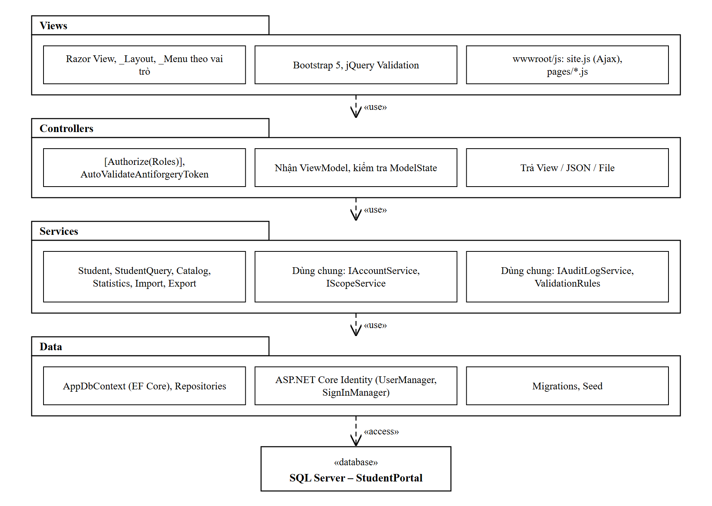

Hình 3.5. Biểu đồ gói (package diagram) thể hiện kiến trúc phân tầng

#### 3.2.1.1. Công nghệ và thư viện

| **Thành phần** | **Lựa chọn** | **Ghi chú** |
|----|----|----|
| Nền tảng | .NET 8 (LTS), ASP.NET Core MVC | Phiên bản hỗ trợ dài hạn; SDK 8.0 được cố định trong global.json. |
| ORM / CSDL | Entity Framework Core 8, SQL Server (LocalDB/Express khi dev) | Code-first, migration dùng chung trong một DbContext. |
| Xác thực | ASP.NET Core Identity (IdentityUser mở rộng) | Cookie authentication, Roles. |
| Giao diện | Bootstrap 5, Bootstrap Icons, jQuery, jQuery Validation Unobtrusive | Có sẵn trong template MVC. |
| Excel | ClosedXML (MIT) | Đọc file import, tạo file xuất .xlsx. |
| PDF | QuestPDF (Community License) | Giấy phép Community cho dự án học tập; sử dụng font hỗ trợ tiếng Việt. |
| Dữ liệu mẫu | Bogus (MIT) | Sinh khoảng 1.000 sinh viên mẫu phục vụ kiểm thử NFR-02. |

#### 3.2.1.2. Cấu trúc mã nguồn (solution)

Mã nguồn được tổ chức trong một project ASP.NET Core MVC, phân thư mục theo tầng:

| **Thư mục (StudentPortal.Web/)** | **Nội dung** |
|----|----|
| Controllers/ | AccountController, UsersController, StudentsController, FacultiesController, CoursesController, ClassesController, CatalogController, StatisticsController, ImportController, AuditLogsController, HomeController |
| Models/Entities/ | SinhVien, Khoa, KhoaHoc, Lop, ApplicationUser, NhatKyThaoTac; Enums: TrangThaiHocTap, GioiTinh, TrangThaiTaiKhoan |
| Models/ViewModels/ | \*CreateVm, \*EditVm, \*FilterVm, \*ListItemDto, PagedResult\<T\>, ApiResponse |
| Data/ | AppDbContext, Configurations/ (Fluent API), Migrations/, Seed/DbSeeder |
| Repositories/ | IRepository\<T\> và các repository cho truy vấn dùng lại |
| Services/Interfaces/ | IAccountService, IScopeService, IAuditLogService, IStudentService, IStudentQueryService, ICatalogService, IStatisticsService, IExportService, IImportService |
| Services/ | Các lớp triển khai tương ứng |
| Infrastructure/ | Authorization (tên vai trò, ScopeException → 403), Validation (attribute dùng chung), TextHelper (bỏ dấu), ExceptionMiddleware |
| Views/ | Shared/\_Layout, \_Menu, \_Modal, \_Pagination; thư mục theo từng Controller |
| wwwroot/ | css/site.css; js/site.js (ajax helper, toast, confirm, anti-forgery header); js/pages/\*.js |

#### 3.2.1.3. Danh sách Controller – Action (hợp đồng giữa giao diện và server)

Quy ước: View = trả trang HTML; JSON = trả ApiResponse; File = trả file tải về. Mọi POST yêu cầu anti-forgery token. Cột "Quyền" là vai trò được phép; phạm vi dữ liệu luôn áp dụng thêm.

<table>
<thead>
<tr>
<th><strong>Controller / Action</strong></th>
<th><strong>HTTP</strong></th>
<th><strong>Quyền</strong></th>
<th><strong>Trả về</strong></th>
<th><strong>FR</strong></th>
</tr>
</thead>
<tbody>
<tr>
<td colspan="5"><strong>AccountController – Lê Nam Khánh</strong></td>
</tr>
<tr>
<td>Login</td>
<td>GET/POST</td>
<td>Anonymous</td>
<td>View</td>
<td>FR-06</td>
</tr>
<tr>
<td>Logout</td>
<td>POST</td>
<td>Đã đăng nhập</td>
<td>Redirect</td>
<td>FR-07</td>
</tr>
<tr>
<td>ChangePassword</td>
<td>GET/POST</td>
<td>Cả 3 vai trò</td>
<td>View</td>
<td>FR-10</td>
</tr>
<tr>
<td>Profile</td>
<td>GET</td>
<td>Cả 3 vai trò</td>
<td>View</td>
<td>FR-11</td>
</tr>
<tr>
<td>UpdateContact</td>
<td>POST</td>
<td>SinhVien</td>
<td>JSON</td>
<td>FR-12</td>
</tr>
<tr>
<td>AccessDenied</td>
<td>GET</td>
<td>Đã đăng nhập</td>
<td>View (403)</td>
<td>FR-08</td>
</tr>
<tr>
<td colspan="5"><strong>UsersController [Admin] – Lê Nam Khánh</strong></td>
</tr>
<tr>
<td>Index / List</td>
<td>GET</td>
<td>Admin</td>
<td>View / JSON</td>
<td>FR-01</td>
</tr>
<tr>
<td>Create</td>
<td>GET/POST</td>
<td>Admin</td>
<td>View</td>
<td>FR-02</td>
</tr>
<tr>
<td>Edit/{id}</td>
<td>GET/POST</td>
<td>Admin</td>
<td>View</td>
<td>FR-03</td>
</tr>
<tr>
<td>ResetPassword</td>
<td>POST</td>
<td>Admin</td>
<td>JSON</td>
<td>FR-04</td>
</tr>
<tr>
<td>SetLock</td>
<td>POST</td>
<td>Admin</td>
<td>JSON</td>
<td>FR-05</td>
</tr>
<tr>
<td colspan="5"><strong>StudentsController [Admin, CanBo] – Từ Đức Anh (thao tác hồ sơ), Nguyễn Hoàng Quốc Duy (Index/Search), Trần Văn Dũng (Export)</strong></td>
</tr>
<tr>
<td>Index</td>
<td>GET</td>
<td>Admin, CanBo</td>
<td>View</td>
<td>FR-21</td>
</tr>
<tr>
<td>Search</td>
<td>GET</td>
<td>Admin, CanBo</td>
<td>JSON PagedResult</td>
<td>FR-21, FR-22</td>
</tr>
<tr>
<td>Create</td>
<td>POST</td>
<td>Admin, CanBo</td>
<td>JSON</td>
<td>FR-13</td>
</tr>
<tr>
<td>Details/{maSV}</td>
<td>GET</td>
<td>Admin, CanBo</td>
<td>View</td>
<td>FR-14</td>
</tr>
<tr>
<td>Edit</td>
<td>POST</td>
<td>Admin, CanBo</td>
<td>JSON</td>
<td>FR-15</td>
</tr>
<tr>
<td>AllowedStatuses/{maSV}</td>
<td>GET</td>
<td>Admin, CanBo</td>
<td>JSON</td>
<td>FR-16</td>
</tr>
<tr>
<td>ChangeStatus</td>
<td>POST</td>
<td>Admin, CanBo</td>
<td>JSON</td>
<td>FR-16</td>
</tr>
<tr>
<td>Transfer</td>
<td>POST</td>
<td>Admin, CanBo</td>
<td>JSON</td>
<td>FR-17</td>
</tr>
<tr>
<td>Delete</td>
<td>POST</td>
<td>Admin, CanBo</td>
<td>JSON</td>
<td>FR-18</td>
</tr>
<tr>
<td>ResetPassword</td>
<td>POST</td>
<td>Admin, CanBo</td>
<td>JSON</td>
<td>FR-19</td>
</tr>
<tr>
<td>SetLock</td>
<td>POST</td>
<td>Admin, CanBo</td>
<td>JSON</td>
<td>FR-20</td>
</tr>
<tr>
<td>Export?format=</td>
<td>GET</td>
<td>Admin, CanBo</td>
<td>File</td>
<td>FR-28</td>
</tr>
<tr>
<td colspan="5"><strong>Danh mục – Nguyễn Hoàng Quốc Duy</strong></td>
</tr>
<tr>
<td>Faculties / Courses: Index, List, Create, Edit, Delete</td>
<td>GET/POST</td>
<td>Admin (CanBo chỉ xem)</td>
<td>View / JSON</td>
<td>FR-23 – FR-26</td>
</tr>
<tr>
<td>Classes: Index, List, Create, Edit, Delete</td>
<td>GET/POST</td>
<td>Admin, CanBo (khoa mình)</td>
<td>View / JSON</td>
<td>FR-23 – FR-26</td>
</tr>
<tr>
<td>Catalog/Lookup?type=&amp;maKhoa=&amp;maKhoaHoc=</td>
<td>GET</td>
<td>Admin, CanBo</td>
<td>JSON (dropdown)</td>
<td>FR-13, 17, 21</td>
</tr>
<tr>
<td colspan="5"><strong>Thống kê, nhập/xuất – Trần Văn Dũng; Nhật ký – Nguyễn Hoàng Quốc Duy</strong></td>
</tr>
<tr>
<td>Statistics: Index, Data</td>
<td>GET</td>
<td>Admin, CanBo</td>
<td>View / JSON</td>
<td>FR-27</td>
</tr>
<tr>
<td>Statistics/Export?format=</td>
<td>GET</td>
<td>Admin, CanBo</td>
<td>File</td>
<td>FR-29</td>
</tr>
<tr>
<td>Import: Index, Template</td>
<td>GET</td>
<td>Admin, CanBo</td>
<td>View / File</td>
<td>FR-30</td>
</tr>
<tr>
<td>Import/Upload</td>
<td>POST multipart</td>
<td>Admin, CanBo</td>
<td>JSON (BM05)</td>
<td>FR-30</td>
</tr>
<tr>
<td>AuditLogs: Index, List</td>
<td>GET</td>
<td>Admin</td>
<td>View / JSON</td>
<td>FR-31</td>
</tr>
<tr>
<td>Home/Index</td>
<td>GET</td>
<td>Cả 3 vai trò</td>
<td>View (theo vai trò)</td>
<td>FR-08</td>
</tr>
</tbody>
</table>

#### 3.2.1.4. Interface dịch vụ dùng chung

<table>
<thead>
<tr>
<th><strong>Interface – phụ trách</strong></th>
<th><strong>Phương thức chính</strong></th>
<th><strong>Quy ước sử dụng</strong></th>
</tr>
</thead>
<tbody>
<tr>
<td>IScopeService – Khánh</td>
<td><p>UserScope GetCurrent()</p>
<p>IQueryable&lt;SinhVien&gt; ApplyStudentScope(IQueryable&lt;SinhVien&gt;)</p>
<p>IQueryable&lt;Lop&gt; ApplyClassScope(IQueryable&lt;Lop&gt;)</p>
<p>Task EnsureStudentInScopeAsync(string maSV)</p>
<p>Task EnsureClassInScopeAsync(string maLop)</p></td>
<td>Ensure* ném ScopeException → middleware trả 403. Mọi truy vấn sinh viên/lớp phải đi qua Apply* trước khi lọc, phân trang, xuất.</td>
</tr>
<tr>
<td>IAccountService – Khánh</td>
<td><p>Task&lt;Result&gt; CreateStudentAccountAsync(string maSV, string password)</p>
<p>Task&lt;Result&gt; CreateStaffAccountAsync(StaffCreateDto)</p>
<p>Task&lt;Result&gt; ResetPasswordAsync(string userName, string newPassword)</p>
<p>Task&lt;Result&gt; SetLockAsync(string userName, bool locked, string reason)</p>
<p>Task&lt;Result&gt; ChangePasswordAsync(string userId, string current, string newPwd)</p></td>
<td>Dùng chung AppDbContext (scoped) nên tham gia giao dịch của bên gọi; không tự Commit. SetLock cập nhật SecurityStamp.</td>
</tr>
<tr>
<td>IAuditLogService – Dũng</td>
<td><p>Task LogAsync(string hanhDong, string doiTuongLoai, string doiTuongMa, string? chiTiet = null)</p>
<p>Task&lt;PagedResult&lt;AuditLogDto&gt;&gt; QueryAsync(AuditLogFilter)</p></td>
<td>Lấy Username từ HttpContext; chỉ Add vào DbContext, được lưu khi bên gọi SaveChanges. Không truyền dữ liệu cá nhân vào chiTiet.</td>
</tr>
<tr>
<td>ValidationRules – Dũng</td>
<td>Regex MaSo, HoTen, SoDienThoai; [MaSo], [HoTen], [NgaySinh(MinAge = 15)], [SoDienThoai], [MatKhauManh]</td>
<td>Dùng cho ViewModel (client + server) và cho import Excel.</td>
</tr>
<tr>
<td>IStudentService – Đức Anh</td>
<td>CreateAsync, UpdateAsync, ChangeStatusAsync, TransferAsync, SoftDeleteAsync, GetDetailAsync, GetAllowedStatuses, UpdateFromImportAsync</td>
<td>Toàn bộ quy tắc FR-13 – FR-20 nằm ở đây; FR-30 gọi lại, không viết lại.</td>
</tr>
<tr>
<td>IStudentQueryService – Duy</td>
<td><p>IQueryable&lt;SinhVien&gt; BuildQuery(StudentFilter)</p>
<p>Task&lt;PagedResult&lt;StudentListItemDto&gt;&gt; SearchAsync(StudentFilter)</p></td>
<td>BuildQuery được IExportService dùng lại để xuất đúng tiêu chí FR-28.</td>
</tr>
</tbody>
</table>

#### 3.2.1.5. Quy ước Ajax/JSON và mã lỗi

- Mọi phản hồi JSON có dạng: { success: bool, message: string, data: object\|null, errors: { tenTruong: \[thông báo\] } \| null }.
- Danh sách phân trang: data = { items: \[\], page, pageSize, totalItems, totalPages }; pageSize mặc định 20, tối đa 100.
- Mã HTTP: 200 thành công; 400 dữ liệu không hợp lệ (kèm errors); 401 hết phiên (client chuyển về trang đăng nhập); 403 ngoài quyền/phạm vi; 404 không tìm thấy hoặc đã xóa mềm; 409 trùng mã; 500 lỗi hệ thống (thông báo chung).
- Client gửi anti-forgery token qua header "RequestVerificationToken" (site.js đọc từ thẻ input ẩn trong \_Layout); server bật AutoValidateAntiforgeryToken toàn cục.
- Ngày gửi/nhận dạng ISO 8601 (yyyy-MM-dd); hiển thị dd/MM/yyyy. Enum trả về kèm tên hiển thị tiếng Việt.

#### 3.2.1.6. Cấu hình bảo mật Identity

| **Thiết lập** | **Giá trị** |
|----|----|
| Password | RequiredLength = 8; RequireDigit = true; RequireNonAlphanumeric/Uppercase/Lowercase = false; thêm IPasswordValidator tùy chỉnh bắt buộc có ít nhất 1 chữ cái |
| Lockout | MaxFailedAccessAttempts = 5; DefaultLockoutTimeSpan = 15 phút; AllowedForNewUsers = true |
| Cookie | HttpOnly = true; SecurePolicy = Always; SameSite = Lax; ExpireTimeSpan = 30 phút, SlidingExpiration; LoginPath = /Account/Login; AccessDeniedPath = /Account/AccessDenied |
| Thu hồi phiên | SecurityStampValidatorOptions.ValidationInterval = TimeSpan.Zero và kiểm tra TrangThaiTaiKhoan trong OnValidatePrincipal để khóa/đổi quyền/đổi khoa có hiệu lực từ yêu cầu kế tiếp (FR-03, FR-05, FR-09) |
| Ajax chưa đăng nhập | Với request có header X-Requested-With, trả 401/403 thay vì redirect HTML (OnRedirectToLogin/OnRedirectToAccessDenied) |
| Seed | Tạo 3 vai trò và tài khoản Admin đầu tiên khi khởi động; mật khẩu Admin đọc từ user-secrets/biến môi trường, không commit lên Git |

### 3.2.2. Thiết kế cơ sở dữ liệu

Cơ sở dữ liệu được xây dựng theo vòng đời hồ sơ sinh viên: danh mục tổ chức (Khoa, Khóa, Lớp) → hồ sơ sinh viên → tài khoản → nhật ký. Tài khoản được hiện thực bằng bảng AspNetUsers của ASP.NET Core Identity, mở rộng các trường MaSV, MaKhoaPhuTrach, TrangThaiTaiKhoan. Tổng quan các bảng:

| **Bảng dữ liệu** | **Mục đích** | **Thuộc tính chính** |
|----|----|----|
| Khoa | Khoa chuyên môn | MaKhoa, TenKhoa, DaXoa |
| KhoaHoc | Khóa tuyển sinh | MaKhoaHoc, NamNhapHoc, DaXoa |
| Lop | Lớp hành chính, gắn Khoa và Khóa | MaLop, TenLop, MaKhoa, MaKhoaHoc, DaXoa |
| SinhVien | Hồ sơ sinh viên | MaSV, HoTen, NgaySinh, GioiTinh, MaLop, SDT, Email, DiaChi, TrangThai, DaXoa… |
| AspNetUsers (ApplicationUser) | Tài khoản đăng nhập của cả ba vai trò | Id, UserName, PasswordHash, HoTen, MaSV, MaKhoaPhuTrach, TrangThaiTaiKhoan |
| AspNetRoles, AspNetUserRoles | Vai trò Admin, CanBo, SinhVien | RoleId, Name, UserId |
| NhatKyThaoTac | Nhật ký thao tác nhạy cảm (chỉ thêm) | Id, ThoiDiem, Username, HanhDong, DoiTuongLoai, DoiTuongMa, ChiTiet |

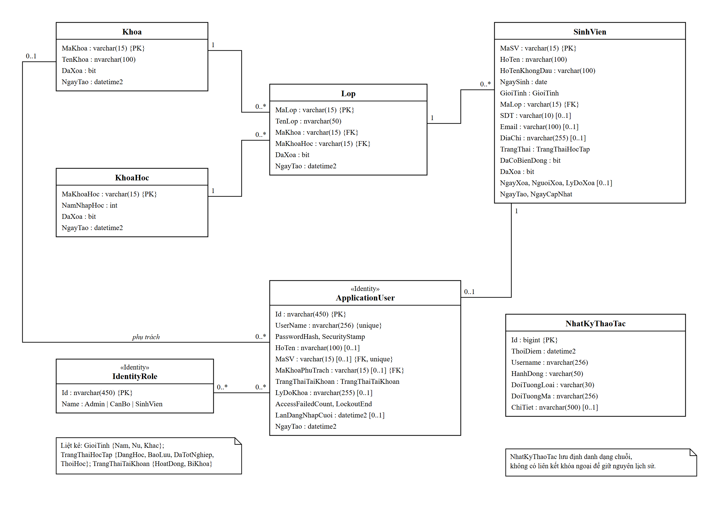

Hình 3.6. Biểu đồ lớp thực thể dữ liệu (ERD dạng UML)

- Quan hệ (bội số UML): Khoa 1 – 0..\* Lop; KhoaHoc 1 – 0..\* Lop; Lop 1 – 0..\* SinhVien; SinhVien 1 – 0..1 ApplicationUser (vai trò SinhVien, UserName = MaSV); Khoa 0..1 – 0..\* ApplicationUser (khoa phụ trách của Giáo vụ); ApplicationUser 0..\* – 0..\* IdentityRole.
- Khóa ngoại dùng DeleteBehavior.Restrict (không xóa dây chuyền) vì hệ thống chỉ xóa mềm.

#### 3.2.2.1. Chi tiết bảng

***Bảng Khoa***

| **Cột** | **Kiểu SQL**  | **Null** | **Ràng buộc / ghi chú**              |
|---------|---------------|:--------:|--------------------------------------|
| MaKhoa  | varchar(15)   |  Không   | PK; chữ số không dấu; không dùng lại |
| TenKhoa | nvarchar(100) |  Không   |                                      |
| DaXoa   | bit           |  Không   | Mặc định 0                           |
| NgayTao | datetime2     |  Không   | Mặc định thời điểm tạo               |

***Bảng KhoaHoc***

| **Cột**    | **Kiểu SQL** | **Null** | **Ràng buộc / ghi chú** |
|------------|--------------|:--------:|-------------------------|
| MaKhoaHoc  | varchar(15)  |  Không   | PK (ví dụ K2023)        |
| NamNhapHoc | int          |  Không   | 2000 – năm hiện tại + 1 |
| DaXoa      | bit          |  Không   | Mặc định 0              |
| NgayTao    | datetime2    |  Không   |                         |

***Bảng Lop***

| **Cột**   | **Kiểu SQL** | **Null** | **Ràng buộc / ghi chú**            |
|-----------|--------------|:--------:|------------------------------------|
| MaLop     | varchar(15)  |  Không   | PK                                 |
| TenLop    | nvarchar(50) |  Không   | UNIQUE (MaKhoa, MaKhoaHoc, TenLop) |
| MaKhoa    | varchar(15)  |  Không   | FK → Khoa                          |
| MaKhoaHoc | varchar(15)  |  Không   | FK → KhoaHoc                       |
| DaXoa     | bit          |  Không   |                                    |
| NgayTao   | datetime2    |  Không   |                                    |

***Bảng SinhVien***

| **Cột** | **Kiểu SQL** | **Null** | **Ràng buộc / ghi chú** |
|----|----|:--:|----|
| MaSV | varchar(15) | Không | PK; = UserName tài khoản |
| HoTen | nvarchar(100) | Không |  |
| HoTenKhongDau | varchar(100) | Không | Họ tên chữ thường, bỏ dấu, đ → d; Service tự tính khi lưu; phục vụ tìm kiếm không dấu (FR-22) |
| NgaySinh | date | Không |  |
| GioiTinh | tinyint | Không | 1 Nam, 2 Nữ, 3 Khác |
| MaLop | varchar(15) | Không | FK → Lop |
| SDT | varchar(10) | Có |  |
| Email | varchar(100) | Có |  |
| DiaChi | nvarchar(255) | Có |  |
| TrangThai | tinyint | Không | 1 Đang học, 2 Bảo lưu, 3 Đã tốt nghiệp, 4 Thôi học |
| DaCoBienDong | bit | Không | Bằng 1 sau lần đổi trạng thái/chuyển lớp đầu tiên; dùng cho điều kiện xóa của Giáo vụ (FR-18) |
| DaXoa | bit | Không | Mặc định 0 |
| NgayXoa | datetime2 | Có |  |
| NguoiXoa | nvarchar(256) | Có | UserName người xóa |
| LyDoXoa | nvarchar(500) | Có | Bắt buộc khi DaXoa = 1 (CHECK) |
| NgayTao | datetime2 | Không |  |
| NgayCapNhat | datetime2 | Có | Cập nhật ở mọi lần sửa |

***Bảng AspNetUsers (ApplicationUser : IdentityUser)***

| **Cột** | **Kiểu SQL** | **Null** | **Ràng buộc / ghi chú** |
|----|----|:--:|----|
| Id, UserName, NormalizedUserName, PasswordHash, SecurityStamp, AccessFailedCount, LockoutEnd, LockoutEnabled | theo Identity | — | Cột chuẩn của Identity; UserName duy nhất |
| HoTen | nvarchar(100) | Có | Bắt buộc với Admin/CanBo; null với SinhVien (lấy từ SinhVien) |
| MaSV | varchar(15) | Có | FK → SinhVien, UNIQUE (filtered, khi not null); bắt buộc và = UserName với SinhVien |
| MaKhoaPhuTrach | varchar(15) | Có | FK → Khoa; bắt buộc với CanBo, null với Admin/SinhVien |
| TrangThaiTaiKhoan | tinyint | Không | 1 HoatDong, 2 BiKhoa (khóa nghiệp vụ, khác LockoutEnd là khóa tạm) |
| LyDoKhoa | nvarchar(255) | Có |  |
| LanDangNhapCuoi | datetime2 | Có | Null khi chưa từng đăng nhập; dùng cho điều kiện xóa của Giáo vụ (FR-18) |
| NgayTao | datetime2 | Không |  |

***Bảng NhatKyThaoTac***

| **Cột** | **Kiểu SQL** | **Null** | **Ràng buộc / ghi chú** |
|----|----|:--:|----|
| Id | bigint identity | Không | PK |
| ThoiDiem | datetime2 | Không | Giờ server (UTC+7 khi hiển thị) |
| Username | nvarchar(256) | Không | Lưu dạng chuỗi, không FK, để giữ nguyên lịch sử |
| HanhDong | varchar(50) | Không | Mã hành động – xem bảng 3.2.2.2 |
| DoiTuongLoai | varchar(30) | Không | SinhVien \| TaiKhoan \| Khoa \| KhoaHoc \| Lop \| File |
| DoiTuongMa | nvarchar(256) | Không | MaSV, UserName, mã danh mục… |
| ChiTiet | nvarchar(500) | Có | Thông tin không nhạy cảm: lý do, trạng thái cũ → mới, tiêu chí xuất, số dòng import |

#### 3.2.2.2. Danh mục mã hành động nhật ký

| **Nhóm** | **Mã HanhDong** |
|----|----|
| Tài khoản | TaoTaiKhoan, CapNhatTaiKhoan, DoiQuyenKhoa, CapLaiMatKhau, DoiMatKhau, KhoaTaiKhoan, MoKhoaTaiKhoan |
| Hồ sơ | TaoHoSo, SuaHoSo, CapNhatLienHe, DoiTrangThai, ChuyenLop, XoaMemHoSo |
| Danh mục | ThemDanhMuc, SuaDanhMuc, XoaMemDanhMuc |
| Dữ liệu | Import, XuatDanhSach, XuatThongKe |

#### 3.2.2.3. Chỉ mục và bộ lọc truy vấn

- SinhVien: IX(MaLop), IX(TrangThai), IX(DaXoa), IX(HoTenKhongDau). Lop: IX(MaKhoa), IX(MaKhoaHoc). NhatKyThaoTac: IX(ThoiDiem DESC), IX(Username), IX(DoiTuongMa).
- Global query filter HasQueryFilter(x =\> !x.DaXoa) cho Khoa, KhoaHoc, Lop, SinhVien; kiểm tra trùng mã dùng IgnoreQueryFilters() để bao gồm cả bản ghi đã xóa mềm.
- Danh sách và thống kê luôn dùng AsNoTracking() và Select sang DTO.

#### 3.2.2.4. Quy tắc kiểm tra dữ liệu

| **Trường** | **Áp dụng** | **Quy tắc** | **Hiện thực** |
|----|----|----|----|
| MaSV / UserName | SinhVien, TaiKhoan | 6 – 15 ký tự chữ và số, không dấu, không khoảng trắng; duy nhất kể cả đã xóa mềm; cố định, không dùng lại | \[MaSo\] ^\[A-Za-z0-9\]{6,15}\$ + kiểm tra CSDL |
| HoTen | SinhVien | Bắt buộc, 2 – 100 ký tự, không chứa chữ số | \[Required\]\[StringLength(100, MinimumLength = 2)\]\[HoTen\] |
| NgaySinh | SinhVien | Không ở tương lai; đủ 15 tuổi | \[NgaySinh(MinAge = 15)\] |
| SDT | SinhVien | Không bắt buộc; 10 chữ số, bắt đầu bằng 0 | \[SoDienThoai\] ^0\d{9}\$ |
| Email | SinhVien | Không bắt buộc; đúng định dạng, ≤ 100 ký tự | \[EmailAddress\]\[StringLength(100)\] |
| MaKhoa, MaKhoaHoc, MaLop | Danh mục | Chữ số không dấu; duy nhất kể cả đã xóa mềm | \[MaSo\] (độ dài 2 – 15) + kiểm tra CSDL |
| TenLop | Lop | Duy nhất trong cùng Khoa và Khóa | Unique index + kiểm tra Service |
| Mật khẩu | TaiKhoan | ≥ 8 ký tự, có chữ và số; mật khẩu mới khác mật khẩu hiện tại | Identity PasswordOptions + validator tùy chỉnh |

#### 3.2.2.5. Dữ liệu mẫu (seed)

- 3 vai trò; 1 Admin; 3 Giáo vụ thuộc các khoa khác nhau để kiểm thử phạm vi dữ liệu.
- 4 khoa, 4 khóa (K2022 – K2025), khoảng 30 lớp; khoảng 1.000 sinh viên với đủ 4 trạng thái, có cả hồ sơ đã xóa mềm – phục vụ kiểm thử NFR-02 và các quy tắc FR-16, FR-18.

### 3.2.3. Thiết kế giao diện

Giao diện dùng một layout chung: thanh tiêu đề (tên hệ thống, người dùng, vai trò – khoa), menu bên trái hiển thị theo vai trò, vùng nội dung. Các thao tác thêm/sửa/đổi trạng thái/chuyển lớp/xóa dùng modal và Ajax; thông báo dạng toast. Danh sách màn hình được trình bày trong bảng dưới đây.

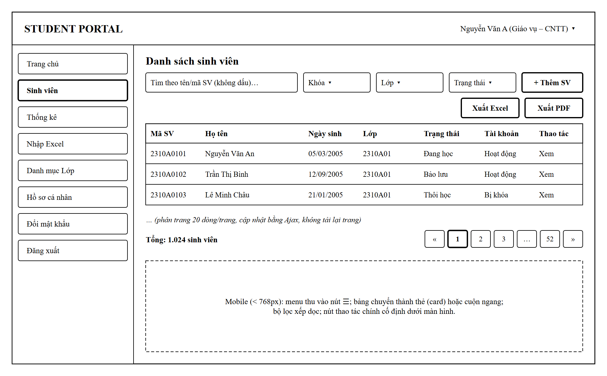

Hình 3.7. Wireframe layout chung và màn hình Danh sách sinh viên

| **Màn hình** | **Vai trò** | **Thành phần chính** | **FR** |
|----|----|----|----|
| Đăng nhập | Tất cả | Form tên đăng nhập/mật khẩu, thông báo lỗi chung; trang công khai, có title và meta description | FR-06 |
| Trang chủ | Tất cả | Admin/Giáo vụ: thẻ số liệu nhanh (tổng SV theo trạng thái trong phạm vi), lối tắt; Sinh viên: tóm tắt hồ sơ | FR-08 |
| Hồ sơ cá nhân | Tất cả | Thông tin hồ sơ/tài khoản; Sinh viên có nút Cập nhật liên hệ (modal) | FR-11, 12 |
| Đổi mật khẩu | Tất cả | MK hiện tại, MK mới, xác nhận; gợi ý chính sách mật khẩu | FR-10 |
| Quản lý tài khoản | Admin | Bộ lọc vai trò/khoa/trạng thái, bảng phân trang, nút Tạo, Sửa, Cấp lại MK, Khóa/Mở khóa | FR-01 – 05 |
| Danh sách sinh viên | Admin, Giáo vụ | Ô tìm kiếm không dấu, dropdown Khoa/Khóa/Lớp/Trạng thái, bảng, phân trang, Thêm SV, Xuất Excel/PDF (Hình 3.7) | FR-21, 22, 28 |
| Chi tiết hồ sơ | Admin, Giáo vụ | Thông tin hồ sơ + trạng thái tài khoản; nút thao tác hiển thị theo vai trò và trạng thái: Sửa, Đổi trạng thái, Chuyển lớp, Xóa, Cấp lại MK, Khóa/Mở khóa | FR-14 – 20 |
| Danh mục | Admin, Giáo vụ | Tab Khoa / Khóa / Lớp, bảng, modal thêm/sửa, xác nhận xóa mềm | FR-23 – 26 |
| Thống kê | Admin, Giáo vụ | Chọn nhóm theo, bộ lọc, bảng thống kê có dòng tổng, Xuất Excel/PDF | FR-27, 29 |
| Nhập Excel | Admin, Giáo vụ | Tải file mẫu, chọn file, thanh tiến trình, bảng kết quả BM05 | FR-30 |
| Nhật ký thao tác | Admin | Bộ lọc thời gian/người/hành động/đối tượng, bảng chỉ đọc | FR-31 |
| Từ chối truy cập / Lỗi | Tất cả | Trang 403, 404, 500 thân thiện, không lộ thông tin kỹ thuật | FR-08 |

# CHƯƠNG 4: MỘT SỐ CHỨC NĂNG CHÍNH

Chương này trình bày bốn chức năng tiêu biểu, mỗi thành viên một chức năng theo phân công ở mục 1.4. Mỗi chức năng gồm giao diện, mã HTML (Razor View), mã CSS, mã script phía client, mã script phía server và đánh giá. Các đoạn mã được trích từ kho mã nguồn của nhóm (nhánh main, bản gộp ngày 09/11/2026); phần lược bỏ được thay bằng dấu "// ...". Kết quả kiểm thử của từng chức năng được tổng hợp ở mục 4.5.

## 4.0. Môi trường cài đặt

| **Thành phần** | **Phiên bản / cấu hình** |
|----|----|
| Nền tảng | .NET 8, ASP.NET Core MVC (TargetFramework net8.0); SDK được cố định trong global.json (8.0.426, rollForward latestFeature) |
| CSDL | SQL Server LocalDB (MSSQLLocalDB), Entity Framework Core 8.0.10, một migration InitialCreate |
| Xác thực | ASP.NET Core Identity 8.0.10, cookie .StudentPortal.Auth (HttpOnly, Secure, hết hạn sau 30 phút không hoạt động) |
| Thư viện | ClosedXML 0.104.2 (Excel), QuestPDF 2024.12.3 – giấy phép Community (PDF), Bogus 35.6.1 (dữ liệu mẫu) |
| Giao diện | Bootstrap 5, Bootstrap Icons, jQuery, jQuery Validation Unobtrusive |
| Dữ liệu mẫu | 1 Admin, 3 Giáo vụ, 4 khoa, 4 khóa (K2022 – K2025), 32 lớp, 1.000 hồ sơ sinh viên (10 hồ sơ xóa mềm); mật khẩu mẫu đọc từ cấu hình Seed:AdminPassword, Seed:DemoPassword, không lưu trong mã nguồn |
| Quản lý mã nguồn | GitHub, nhánh theo chức năng, gộp qua Pull Request; phân tích chất lượng bằng SonarCloud Quality Gate |

## 4.1. Đăng nhập, phân quyền và phạm vi dữ liệu theo khoa – Lê Nam Khánh

### 4.1.1. Giao diện

Trang đăng nhập là trang công khai duy nhất của hệ thống, dùng form Razor gửi về AccountController. Khi đăng nhập sai, hệ thống hiển thị một thông báo chung, không cho biết tên đăng nhập có tồn tại hay tài khoản đang bị khóa. Sau khi đăng nhập, menu bên trái hiển thị theo vai trò. Giáo vụ không thấy mục Quản lý tài khoản và Nhật ký thao tác; tên vai trò và khoa phụ trách hiển thị ở góc phải thanh tiêu đề.

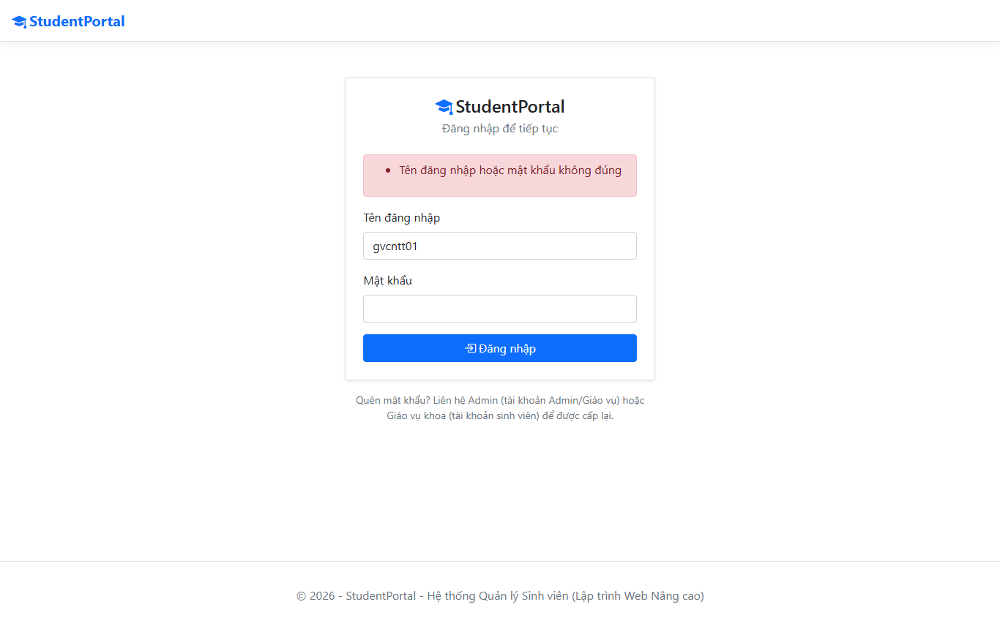

Hình 4.1. Trang đăng nhập khi nhập sai mật khẩu

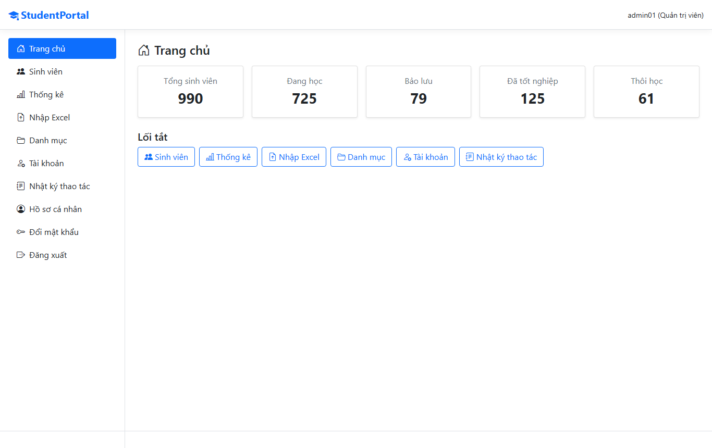

Hình 4.2. Trang chủ của Admin với menu đầy đủ chức năng

### 4.1.2. Mã HTML

Form dùng Tag Helper asp-for để kết gán LoginVm, asp-validation-for để hiển thị lỗi từng trường và asp-validation-summary cho lỗi chung. Token anti-forgery được Tag Helper form tự chèn.

**Views/Account/Login.cshtml**

```cshtml
<form asp-action="Login" method="post" novalidate>
    <input type="hidden" asp-for="ReturnUrl" />
    <div asp-validation-summary="ModelOnly" class="alert alert-danger py-2" role="alert"></div>
    <div class="mb-3">
        <label asp-for="UserName" class="form-label"></label>
        <input asp-for="UserName" class="form-control" autocomplete="username" />
        <span asp-validation-for="UserName" class="text-danger small"></span>
    </div>
    <div class="mb-3">
        <label asp-for="MatKhau" class="form-label"></label>
        <input asp-for="MatKhau" class="form-control" autocomplete="current-password" />
        <span asp-validation-for="MatKhau" class="text-danger small"></span>
    </div>
    <div class="d-grid">
        <button type="submit" class="btn btn-primary">Đăng nhập</button>
    </div>
</form>
```

### 4.1.3. Mã CSS

Bố cục chung (header, menu trái, vùng nội dung) dùng lưới Bootstrap và một số lớp riêng trong site.css. Trên màn hình từ 768 px, menu có độ rộng cố định 15rem; trên điện thoại, menu thu vào nút ☰ ở thanh tiêu đề.

**wwwroot/css/site.css**

```css
/* Layout chung: menu bên trái, vùng nội dung (mục 3.2.3) */
.app-noi-dung {
  min-width: 0;
  padding-bottom: 6rem !important;
}
@media (min-width: 768px) {
  .app-menu {
    flex: 0 0 15rem;
    min-height: calc(100vh - 57px);
  }
}
```

### 4.1.4. Mã ClientSide Script

Form đăng nhập dùng jQuery Validation Unobtrusive để kiểm tra trường bắt buộc ngay trên trình duyệt. Mọi lời gọi Ajax trong hệ thống đi qua hàm dùng chung trong site.js. Hàm này gửi kèm token anti-forgery qua header RequestVerificationToken; khi máy chủ trả 401 (hết phiên), hàm chuyển người dùng về trang đăng nhập và giữ lại địa chỉ đang xem.

**wwwroot/js/site.js**

```javascript
function veTrangDangNhap() {
    const returnUrl = encodeURIComponent(location.pathname + location.search);
    location.href = '/Account/Login?returnUrl=' + returnUrl;
}

function goi(options) {
    return new Promise(function (resolve, reject) {
        $.ajax(Object.assign({
            dataType: 'json',
            headers: {
                'RequestVerificationToken': antiForgeryToken(),
                'X-Requested-With': 'XMLHttpRequest'
            }
        }, options)).done(function (res) {
            resolve(res);
        }).fail(function (xhr) {
            if (xhr.status === 401) veTrangDangNhap();
            reject(taoLoi(xhr));
        });
    });
}
```

### 4.1.5. Mã ServerSide Script

Chính sách mật khẩu, khóa tạm và cookie được cấu hình trong Program.cs. ValidationInterval = 0 buộc Identity kiểm tra lại SecurityStamp ở mọi yêu cầu, nên tài khoản bị khóa hoặc bị đổi vai trò, khoa phụ trách sẽ chịu tác dụng ngay từ yêu cầu kế tiếp.

**Program.cs**

```csharp
builder.Services.AddIdentity<ApplicationUser, IdentityRole>(options =>
{
    options.Password.RequireDigit = true;
    options.Password.RequiredLength = 8;          // + LetterPasswordValidator: bắt buộc có chữ
    options.Lockout.DefaultLockoutTimeSpan = TimeSpan.FromMinutes(15);
    options.Lockout.MaxFailedAccessAttempts = 5;
    options.Lockout.AllowedForNewUsers = true;
})
.AddEntityFrameworkStores<AppDbContext>()
.AddSignInManager<AppSignInManager>()
.AddPasswordValidator<LetterPasswordValidator>()
.AddClaimsPrincipalFactory<AppClaimsPrincipalFactory>();

builder.Services.Configure<SecurityStampValidatorOptions>(o => o.ValidationInterval = TimeSpan.Zero);
builder.Services.ConfigureApplicationCookie(o =>
{
    o.Cookie.HttpOnly = true;
    o.Cookie.SecurePolicy = CookieSecurePolicy.Always;
    o.ExpireTimeSpan = TimeSpan.FromMinutes(30);
    o.SlidingExpiration = true;
});
```

Action Login bật lockoutOnFailure và trả về cùng một thông báo cho mọi trường hợp sai. Tài khoản ở trạng thái BiKhoa bị AppSignInManager từ chối trước bước kiểm tra mật khẩu, nên action tự tăng số lần sai để hành vi giống tài khoản thường.

**Controllers/AccountController.cs**

```csharp
[HttpPost, AllowAnonymous]
public async Task<IActionResult> Login(LoginVm dto)
{
    if (!ModelState.IsValid) return View(dto);
    var result = await _signInManager.PasswordSignInAsync(dto.UserName.Trim(), dto.MatKhau,
        isPersistent: false, lockoutOnFailure: true);
    if (!result.Succeeded)
    {
        if (result.IsNotAllowed)                      // tài khoản BiKhoa
        {
            var biKhoa = await _userManager.FindByNameAsync(dto.UserName.Trim());
            if (biKhoa != null) await _userManager.AccessFailedAsync(biKhoa);
        }
        ModelState.AddModelError(string.Empty, result.IsLockedOut ? LoiKhoaTam : LoiDangNhap);
        dto.MatKhau = string.Empty;
        return View(dto);
    }
    // ... ghi LanDangNhapCuoi, chuyển về returnUrl nội bộ hoặc trang chủ
}
```

Phạm vi dữ liệu (FR-09) được áp dụng tập trung trong ScopeService. Mọi truy vấn sinh viên, kể cả xuất file và nhập Excel, đều đi qua ApplyStudentScope trước khi lọc và phân trang. Admin thấy toàn bộ dữ liệu, Giáo vụ chỉ thấy khoa phụ trách, Sinh viên chỉ thấy hồ sơ của mình.

**Services/ScopeService.cs**

```csharp
public IQueryable<SinhVien> ApplyStudentScope(IQueryable<SinhVien> query)
{
    var scope = GetCurrent();
    if (scope.IsAdmin) return query;
    if (scope.IsCanBo)
    {
        var maKhoa = scope.MaKhoaPhuTrach;
        return query.Where(s => maKhoa != null && s.Lop!.MaKhoa == maKhoa);
    }
    if (scope.IsSinhVien)
    {
        var maSV = scope.MaSV;
        return query.Where(s => maSV != null && s.MaSV == maSV);
    }
    return query.Where(s => false);
}
```

### 4.1.6. Đánh giá

Mục 4.5 có 36 ca của UC01 – UC08, tất cả đều đạt. Một số kết quả tiêu biểu:

- Sai tên đăng nhập, sai mật khẩu hay tài khoản bị khóa đều nhận cùng một thông báo; returnUrl trỏ ra ngoài bị bỏ qua (TC004, TC005, TC007).
- Admin khóa tài khoản Giáo vụ đang đăng nhập ở trình duyệt khác: phiên đó bị đăng xuất ngay ở yêu cầu kế tiếp (TC034).
- Sai mật khẩu 5 lần liên tiếp thì tài khoản bị khóa tạm (TC006).
- Giáo vụ mở trang Quản lý tài khoản bị chuyển đến trang 403 (TC022).
- Giáo vụ khoa CNTT gọi trực tiếp API xem hồ sơ sinh viên khoa QTKD nhận HTTP 403; sinh viên xem hồ sơ người khác cũng nhận 403 (TC048, TC016).
- Admin không thể khóa hay đổi vai trò tài khoản Admin hoạt động cuối cùng (TC036, TC030).
- Admin đổi khoa phụ trách của một Giáo vụ từ CNTT sang QTKD; ngay ở yêu cầu kế tiếp, Giáo vụ đó chỉ còn thấy sinh viên khoa QTKD (TC029).

Kiểm tra phân quyền đặt ở cả thuộc tính \[Authorize(Roles)\] và tầng dịch vụ, nên gọi API trực tiếp, bỏ qua giao diện, vẫn bị chặn.

## 4.2. Thêm hồ sơ sinh viên kèm tài khoản – Từ Đức Anh

### 4.2.1. Giao diện

Chức năng thêm hồ sơ mở bằng nút "Thêm SV" trên trang danh sách và hiển thị trong modal theo phiếu BM01. Dropdown Lớp phụ thuộc vào Khoa và Khóa đang chọn, và chỉ chứa các lớp trong phạm vi của người dùng. Lỗi nhập liệu hiển thị ngay dưới từng trường trước khi gửi. Khi lưu thành công, modal đóng, danh sách tải lại bằng Ajax và một thông báo hiện ở góc phải.

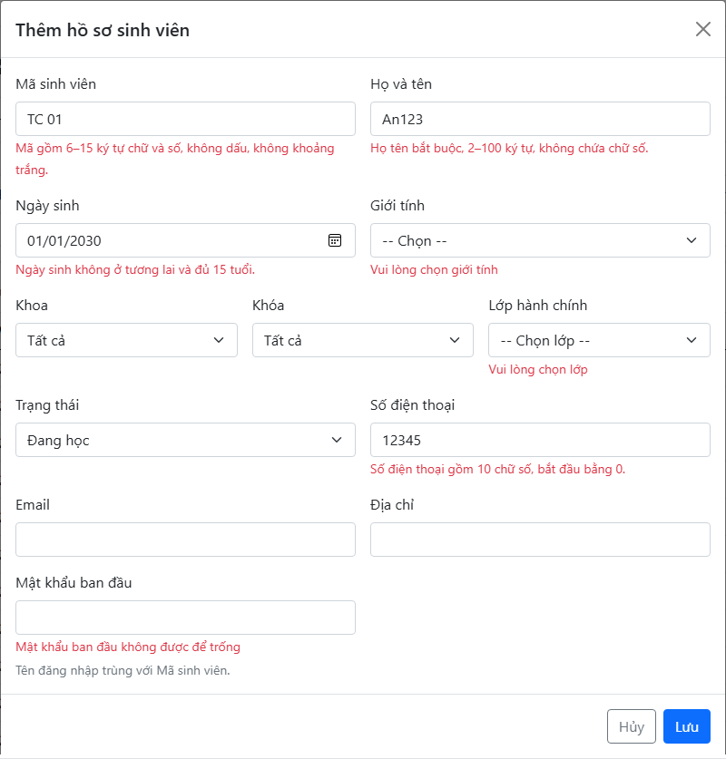

Hình 4.3. Modal thêm hồ sơ hiển thị lỗi kiểm tra phía client

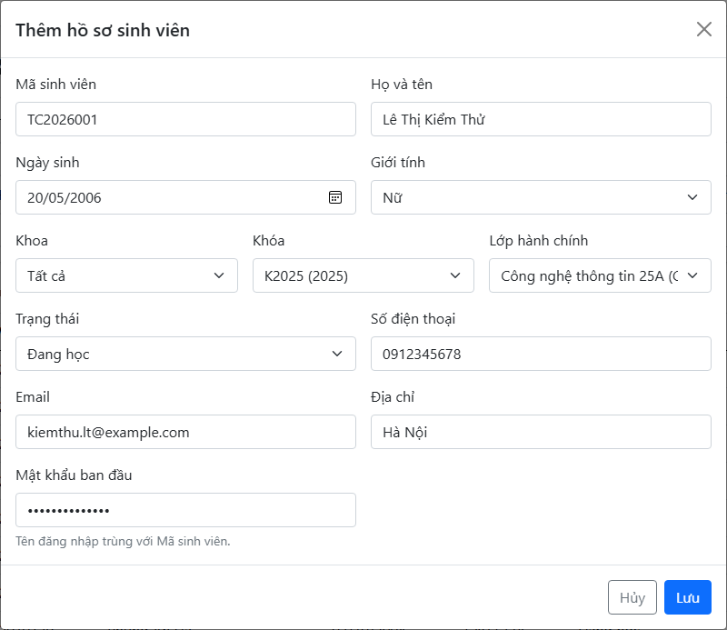

Hình 4.4. Modal thêm hồ sơ với dữ liệu hợp lệ

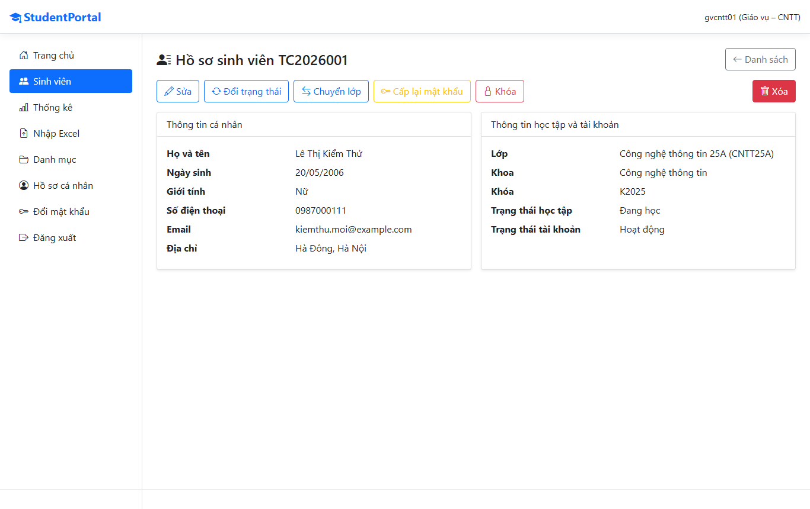

Hình 4.5. Trang chi tiết hồ sơ vừa tạo, các nút thao tác hiển thị theo vai trò và trạng thái

### 4.2.2. Mã HTML

Modal là partial view \_StudentCreateModal nhận StudentCreateVm. Tag Helper asp-for sinh các thuộc tính data-val-\* từ Data Annotations, nhờ đó quy tắc kiểm tra phía client và phía server dùng chung một nguồn.

**Views/Students/_StudentCreateModal.cshtml**

```cshtml
<form id="formThemSV" class="modal-content" novalidate>
  <div class="modal-body">
    <div class="alert alert-danger d-none loi-modal" role="alert"></div>
    <div class="row g-3">
      <div class="col-12 col-md-6">
        <label asp-for="MaSV" class="form-label"></label>
        <input asp-for="MaSV" class="form-control" maxlength="15" />
        <span asp-validation-for="MaSV" class="text-danger small"></span>
      </div>
      <!-- ... Họ tên, Ngày sinh, Giới tính -->
      <div class="col-12 col-md-4">
        <label for="csKhoa" class="form-label">Khoa</label>
        <select id="csKhoa" class="form-select"><option value="">Tất cả</option></select>
      </div>
      <!-- ... Khóa -->
      <div class="col-12 col-md-4">
        <label asp-for="MaLop" class="form-label"></label>
        <select asp-for="MaLop" class="form-select"><option value="">-- Chọn lớp --</option></select>
        <span asp-validation-for="MaLop" class="text-danger small"></span>
      </div>
      <!-- ... Trạng thái, SĐT, Email, Địa chỉ, Mật khẩu ban đầu -->
    </div>
  </div>
</form>
```

### 4.2.3. Mã CSS

Modal dùng lưới Bootstrap: hai cột từ 768 px trở lên và một cột trên điện thoại. Trên điện thoại, nút thao tác chính (Thêm SV) được cố định ở góc dưới màn hình để luôn trong tầm tay (Hình 4.8 ở mục 4.3).

**wwwroot/css/site.css**

```css
/* Mobile: nút thao tác chính cố định dưới màn hình (Hình 3.7) */
@media (max-width: 767.98px) {
  .app-nut-chinh {
    position: fixed;
    right: 1rem;
    bottom: 1rem;
    z-index: 1020;
  }
}
```

### 4.2.4. Mã ClientSide Script

Validator tùy biến NgaySinhAttribute được đăng ký phía client bằng một adapter trong site.js. Khi gửi form, script kiểm tra hợp lệ, khóa nút Lưu để tránh gửi lặp và gửi JSON qua App.post. Lỗi trùng mã (HTTP 409) được gắn vào đúng trường Mã sinh viên; lỗi 400 được gắn theo từng trường mà server trả về.

**wwwroot/js/site.js**

```javascript
$.validator.addMethod('ngaysinh', function (value, element, minAge) {
    if (this.optional(element)) return true;
    const ngay = new Date(value);
    const moc = new Date();
    moc.setFullYear(moc.getFullYear() - parseInt(minAge, 10));
    return !isNaN(ngay) && ngay <= moc;
});
$.validator.unobtrusive.adapters.addSingleVal('ngaysinh', 'minage');
```

**wwwroot/js/pages/students.js**

```javascript
$formThem.on('submit', function (e) {
    e.preventDefault();
    if (!$formThem.valid()) return;
    const $btn = $formThem.find('button[type="submit"]').prop('disabled', true);
    App.post('/Students/Create', {
        maSV: giaTri('MaSV'), hoTen: giaTri('HoTen'), ngaySinh: giaTri('NgaySinh'),
        gioiTinh: parseInt($('#GioiTinh').val(), 10) || null, maLop: csLop.value,
        trangThai: parseInt($('#TrangThai').val(), 10),
        sdt: giaTri('SDT'), email: giaTri('Email'), diaChi: giaTri('DiaChi'),
        matKhau: $('#MatKhau').val()
    }).then(function (res) {
        bootstrap.Modal.getOrCreateInstance(document.getElementById('modalThemSV')).hide();
        App.toast(res.message);
        loadPage(1);
    }).catch(function (err) {
        const errors = err.status === 409 ? { maSV: [err.message] } : err.errors;
        if (!errors || !App.showFieldErrors($formThem, errors)) {
            $formThem.find('.loi-modal').removeClass('d-none').text(App.errorText(err));
        }
    }).finally(function () { $btn.prop('disabled', false); });
});
```

### 4.2.5. Mã ServerSide Script

Controller chỉ nhận dữ liệu và gọi dịch vụ; ModelState sai được bộ lọc AjaxModelStateFilter chuyển thành JSON 400. Quy tắc nghiệp vụ nằm trong StudentService để chức năng nhập Excel (FR-30) dùng lại:

- Mã sinh viên duy nhất, kể cả so với hồ sơ đã xóa mềm.
- Lớp phải nằm trong phạm vi của người thêm.
- Hồ sơ, tài khoản và nhật ký được ghi trong cùng một giao dịch: tạo tài khoản lỗi thì hồ sơ cũng không được lưu.

**Controllers/StudentsController.cs**

```csharp
[HttpPost]
public async Task<IActionResult> Create([FromBody] StudentCreateVm dto)
{
    await _studentService.CreateAsync(dto);
    return Ok(ApiResponse.Ok(message: $"Đã thêm sinh viên '{dto.MaSV.Trim().ToUpperInvariant()}'."));
}
```

**Services/StudentService.cs**

```csharp
public async Task CreateAsync(StudentCreateVm dto)
{
    var maSV = dto.MaSV.Trim().ToUpperInvariant();
    await KiemTraLopAsync(dto.MaLop);                     // lớp đang dùng, trong phạm vi
    if (await _students.QueryIncludingDeleted().AnyAsync(s => s.MaSV == maSV))
        throw new NghiepVuException("Mã sinh viên đã tồn tại", StatusCodes.Status409Conflict);

    await using var tx = await _context.Database.BeginTransactionAsync();
    _students.Add(new SinhVien { MaSV = maSV, HoTen = dto.HoTen.Trim(),
        HoTenKhongDau = TextHelper.BoDau(dto.HoTen), /* ... */ TrangThai = dto.TrangThai });
    await _auditLog.LogAsync("TaoHoSo", LoaiSinhVien, maSV);
    await _students.SaveChangesAsync();

    var taoTaiKhoan = await _account.CreateStudentAccountAsync(maSV, dto.MatKhau);
    if (!taoTaiKhoan.Succeeded)                           // chưa commit: hồ sơ bị hủy theo
        throw new NghiepVuException("Không tạo được tài khoản sinh viên, hồ sơ chưa được lưu.");
    if (dto.TrangThai == TrangThaiHocTap.ThoiHoc)          // thống nhất với FR-16
        (await _account.SetLockAsync(maSV, true, "Hồ sơ tạo ở trạng thái Thôi học")).ThrowIfFailed();
    await tx.CommitAsync();
}
```

### 4.2.6. Đánh giá

Mục 4.5 có 47 ca của UC09 – UC16, 46/47 ca đạt, gồm thêm hồ sơ, xem, sửa, đổi trạng thái, chuyển lớp, xóa mềm, cấp lại mật khẩu và khóa tài khoản sinh viên. Một số kết quả tiêu biểu:

- Trùng mã, kể cả mã của hồ sơ đã xóa mềm, nhận HTTP 409; dữ liệu sai gửi thẳng lên server nhận HTTP 400 kèm lỗi từng trường (TC040, TC074, TC041).
- Khi tạo tài khoản lỗi (mã SV trùng tên đăng nhập của một Giáo vụ), giao dịch bị hủy và không có hồ sơ nào được lưu (TC043).
- Chuyển sang Thôi học thì tài khoản bị khóa; Admin chuyển Thôi học về Đang học thì tài khoản vẫn khóa, chỉ mở bằng tay (TC056, TC059).
- Giáo vụ chỉ xóa mềm được hồ sơ Đang học, chưa từng đăng nhập và chưa có biến động; các trường hợp khác bị chặn kèm lý do (TC067, TC069, TC070, TC071).

Ca TC045 chưa đạt: khi hai yêu cầu thêm cùng một mã mới đến máy chủ gần như đồng thời, cả hai cùng qua bước kiểm tra trùng, yêu cầu đến sau vi phạm khóa chính và nhận HTTP 500 thay vì 409. Dữ liệu vẫn đúng (chỉ một hồ sơ được lưu), và giao diện đã khóa nút Lưu trong lúc gửi nên người dùng thao tác bình thường khó gặp lỗi này. Cách khắc phục được nêu ở mục 5.3.

## 4.3. Danh sách và tìm kiếm sinh viên không dấu bằng Ajax – Nguyễn Hoàng Quốc Duy

### 4.3.1. Giao diện

Trang danh sách gồm ô tìm kiếm, bốn bộ lọc (Khoa, Khóa, Lớp, Trạng thái), bảng kết quả và phân trang. Kết quả cập nhật sau khi người dùng ngừng gõ 300 ms mà không tải lại trang. Từ khóa không cần dấu: gõ "nguyen" sẽ tìm ra cả "Nguyễn" và "Nguyên". Tiêu chí lọc được ghi lên URL nên khi quay lại trang, bộ lọc vẫn được giữ.

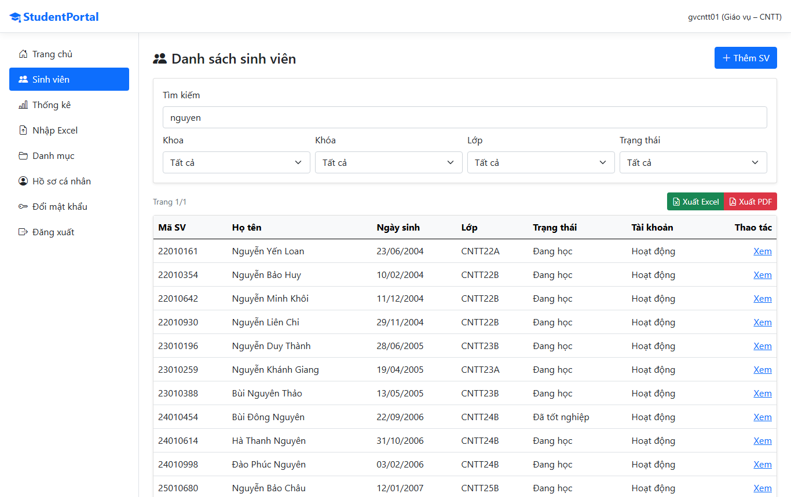

Hình 4.6. Tìm kiếm không dấu với từ khóa "nguyen"

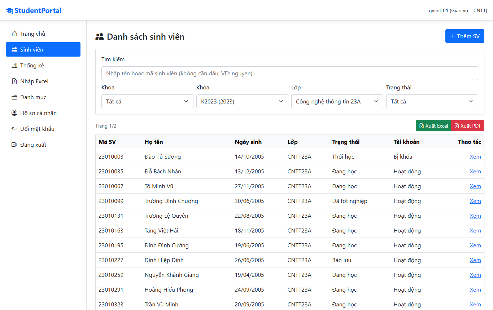

Hình 4.7. Danh sách lọc theo Khóa K2023 và lớp CNTT23A

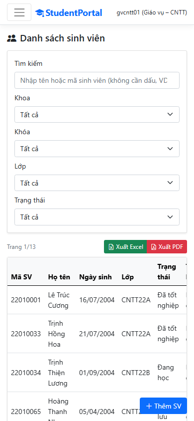

Hình 4.8. Danh sách sinh viên trên màn hình điện thoại (390 px)

### 4.3.2. Mã HTML

Bảng chỉ có phần đầu cố định; phần thân (tbody) do script dựng từ JSON. Thanh phân trang là partial dùng chung \_Pagination.

**Views/Students/Index.cshtml**

```cshtml
<form id="formDanhSach" class="row g-2 align-items-end">
    <div class="col-12">
        <label for="txtKeyword" class="form-label">Tìm kiếm</label>
        <input type="search" id="txtKeyword" name="keyword" class="form-control" maxlength="100"
               placeholder="Nhập tên hoặc mã sinh viên (không cần dấu, VD: nguyen)" autocomplete="off" />
    </div>
    <div class="col-12 col-md-3">
        <label for="selKhoa" class="form-label">Khoa</label>
        <select id="selKhoa" name="maKhoa" class="form-select"><option value="">Tất cả</option></select>
    </div>
    <!-- ... Khóa, Lớp, Trạng thái -->
</form>
<div class="table-responsive">
    <table class="table table-hover align-middle mb-0">
        <thead class="table-light"><tr><th>Mã SV</th><th>Họ tên</th> ... </tr></thead>
        <tbody id="dsBody"></tbody>
    </table>
</div>
<nav class="card-footer ..." aria-label="Phân trang danh sách">
    <span id="dsTotal" class="fw-semibold"></span>
    <partial name="_Pagination" model='"dsPaging"' />
</nav>
```

### 4.3.3. Mã CSS

Bảng nằm trong khung .table-responsive của Bootstrap. Trên màn hình hẹp, chỉ riêng bảng cuộn ngang, cả trang không bị cuộn ngang (TC139). Các bộ lọc dùng col-12 col-md-3 để xếp dọc trên điện thoại và nằm trên một hàng trên máy tính. Cỡ chữ gốc được giảm trên màn hình nhỏ:

**wwwroot/css/site.css**

```css
html { font-size: 14px; }
@media (min-width: 768px) {
  html { font-size: 16px; }
}
```

### 4.3.4. Mã ClientSide Script

Mỗi lần gõ, script đặt lại bộ đếm 300 ms (debounce). Biến requestSeq bảo đảm chỉ phản hồi của yêu cầu mới nhất được hiển thị, tránh trường hợp phản hồi cũ về sau ghi đè kết quả mới. Dữ liệu được đưa vào bảng bằng textContent nên nội dung từ CSDL không thể chèn mã HTML (chống XSS).

**wwwroot/js/pages/students.js**

```javascript
function loadPage(page) {
    const seq = ++requestSeq;
    const params = filterParams();
    const query = params.toString();
    history.replaceState(null, '', location.pathname + (query ? '?' + query : ''));
    params.set('page', page || 1);
    status.textContent = 'Đang tải...';
    App.get('/Students/Search?' + params.toString()).then(function (res) {
        if (seq !== requestSeq) return;                 // bỏ phản hồi cũ
        const d = res.data;
        renderRows(d.items);
        App.renderPaging(document.getElementById('dsPaging'), d.page, d.totalPages, loadPage);
        total.textContent = 'Tổng: ' + d.totalItems + ' sinh viên';
    });
}
txtKeyword.addEventListener('input', function () {
    clearTimeout(debounceTimer);
    debounceTimer = setTimeout(function () { loadPage(1); }, 300);
});
```

### 4.3.5. Mã ServerSide Script

Cột HoTenKhongDau được tính sẵn khi lưu hồ sơ (bỏ dấu, chữ thường, đ → d). Từ khóa được chuẩn hóa cùng cách rồi so khớp, nên tìm kiếm không phụ thuộc collation của CSDL. Lọc, sắp xếp và phân trang đều thực hiện tại CSDL bằng Skip/Take; pageSize mặc định 20, tối đa 100.

**Services/StudentQueryService.cs**

```csharp
public IQueryable<SinhVien> BuildQuery(StudentFilter filter)
{
    var query = _scope.ApplyStudentScope(_sinhViens.QueryNoTracking());  // FR-09
    if (!string.IsNullOrWhiteSpace(filter.Keyword))
    {
        var kwKhongDau = TextHelper.BoDau(filter.Keyword);
        query = query.Where(s => s.HoTenKhongDau.Contains(kwKhongDau) || s.MaSV.Contains(kwKhongDau));
    }
    if (!string.IsNullOrWhiteSpace(filter.MaKhoa)) query = query.Where(s => s.Lop!.MaKhoa == filter.MaKhoa);
    if (!string.IsNullOrWhiteSpace(filter.MaLop))  query = query.Where(s => s.MaLop == filter.MaLop);
    if (filter.TrangThai.HasValue)                 query = query.Where(s => s.TrangThai == filter.TrangThai.Value);
    return query;
}
```

**Infrastructure/TextHelper.cs**

```csharp
public static string BoDau(string? s)
{
    if (string.IsNullOrWhiteSpace(s)) return "";
    var chuan = s.Trim().ToLowerInvariant().Replace('đ', 'd').Normalize(NormalizationForm.FormD);
    var sb = new StringBuilder();
    foreach (var c in chuan)
        if (CharUnicodeInfo.GetUnicodeCategory(c) != UnicodeCategory.NonSpacingMark) sb.Append(c);
    return Regex.Replace(sb.ToString(), @"\s+", " ", RegexOptions.None, RegexTimeout);
}
```

### 4.3.6. Đánh giá

Mục 4.5 có 11 ca của UC17 – UC18, 10/11 ca đạt: lọc theo Khoa, Khóa, Lớp, Trạng thái, giới hạn theo phạm vi, tìm không dấu (gõ "nguyen", "NGUYỄN" cho cùng kết quả, "do" tìm ra "Đỗ"), thông báo khi không có kết quả và giới hạn 100 dòng/trang. Giao diện không cuộn ngang ở 390 px và 768 px (TC139, TC140). Với khoảng 1.000 sinh viên trên máy phát triển, thời gian phản hồi lâu nhất trong 5 lần gọi của các API danh sách, tìm kiếm, thống kê là 15 ms, 10 ms, 4 ms, 10 ms, thấp hơn nhiều so với ngưỡng 2 giây của NFR-02 (TC138).

Ca TC150 chưa đạt: dữ liệu mẫu có 71 hồ sơ có họ tên viết bằng chữ Ð (U+00D0, chữ Eth) thay cho chữ Đ tiếng Việt (U+0110), ví dụ "Vương Ðức Giang". Hàm TextHelper.BoDau chỉ đổi đ (U+0111) thành d, nên cột HoTenKhongDau lưu "vuong ðuc giang"; tìm "duc giang" hay "Vương Đức Giang" đều không ra hồ sơ này. Cách khắc phục được nêu ở mục 5.3.

Kiểm thử tải với 10, 25 và 50 người dùng đồng thời, mỗi mức 30 giây, không có yêu cầu lỗi; thời gian phản hồi p95 lần lượt 11 ms, 21 ms, 47 ms (TC151, TC152, TC153).

## 4.4. Nhập danh sách từ Excel và xuất báo cáo – Trần Văn Dũng

### 4.4.1. Giao diện

Trang Nhập Excel cho tải file mẫu BM02, chọn file .xlsx (tối đa 5 MB) và hiển thị thanh tiến trình trong lúc xử lý. Kết quả hiển thị ngay trên trang theo mẫu BM05: bốn ô tổng hợp và bảng các dòng lỗi (dòng, mã sinh viên, cột, nội dung lỗi). Các dòng hợp lệ vẫn được lưu; danh sách lỗi tải được dưới dạng file Excel để sửa và nhập lại. Trang Thống kê nhóm số liệu theo Khoa, Khóa hoặc Lớp, có dòng tổng cộng, và xuất được ra Excel hoặc PDF theo mẫu BM04.

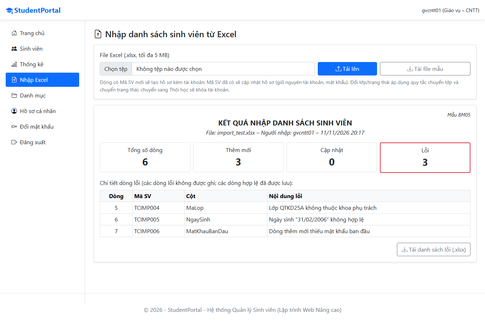

Hình 4.9. Kết quả nhập file Excel có 3 dòng lỗi

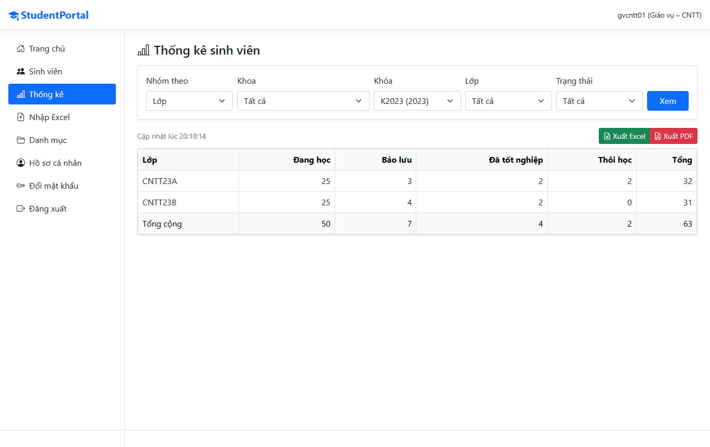

Hình 4.10. Thống kê sinh viên theo lớp của khóa K2023

### 4.4.2. Mã HTML

**Views/Import/Index.cshtml**

```cshtml
<form id="formImport" class="row g-2 align-items-end" enctype="multipart/form-data">
    <div class="col-12 col-md-7">
        <label for="fileExcel" class="form-label">File Excel (.xlsx, tối đa 5 MB)</label>
        <input type="file" id="fileExcel" name="file" class="form-control" accept=".xlsx" required />
    </div>
    <div class="col-6 col-md-2 d-grid">
        <button type="submit" id="btnImport" class="btn btn-primary">Tải lên</button>
    </div>
    <div class="col-6 col-md-3 d-grid">
        <a class="btn btn-outline-secondary" asp-action="Template">Tải file mẫu</a>
    </div>
</form>
<div id="importResult" class="card shadow-sm d-none mb-3">
    <!-- tiêu đề BM05, 4 ô #soTong #soThem #soSua #soLoi, bảng tbody#importErrors -->
</div>
```

### 4.4.3. Mã CSS

Bảng lỗi đặt trong khung có chiều cao tối đa 320 px và cuộn dọc, để file nhiều dòng lỗi không đẩy các nút thao tác ra khỏi màn hình. Ô "Lỗi" có viền đỏ dày để nổi bật (lớp Bootstrap border-2 border-danger).

**Views/Import/Index.cshtml**

```cshtml
<div class="table-responsive" style="max-height: 320px;">
    <table class="table table-sm table-bordered mb-3"> ... </table>
</div>
<div class="border border-2 border-danger rounded p-2">Lỗi<div class="fs-3 fw-bold" id="soLoi"></div></div>
```

### 4.4.4. Mã ClientSide Script

Script kiểm tra kích thước file trước khi gửi, gửi file bằng FormData qua App.upload, rồi dựng bảng kết quả bằng .text() để tránh chèn mã HTML từ nội dung file.

**wwwroot/js/pages/import.js**

```javascript
$('#formImport').on('submit', function (e) {
    e.preventDefault();
    const file = $('#fileExcel')[0].files[0];
    if (!file) return showError('Vui lòng chọn file Excel.');
    if (file.size > KICH_THUOC_TOI_DA) return showError('File vượt quá 5 MB.');
    const formData = new FormData();
    formData.append('file', file);
    $('#btnImport').prop('disabled', true);
    $('#importProgress').removeClass('d-none');
    App.upload('/Import/Upload', formData).then(function (res) {
        showResult(res.data);                       // BM05
    }).catch(function (err) {
        showError(err.message);
    }).finally(function () {
        $('#btnImport').prop('disabled', false);
        $('#importProgress').addClass('d-none');
    });
});
```

### 4.4.5. Mã ServerSide Script

Controller kiểm tra lại đuôi file và kích thước ở phía server. File chỉ được đọc trong bộ nhớ bằng ClosedXML, không ghi xuống đĩa (NFR-08). Mỗi dòng được xử lý độc lập qua cùng các quy tắc của StudentService: dòng lỗi được ghi vào báo cáo và bộ theo dõi thay đổi được xóa, để lỗi của dòng này không ảnh hưởng dòng sau.

**Controllers/ImportController.cs**

```csharp
[HttpPost]
[RequestSizeLimit(KichThuocToiDa + 64 * 1024)]
public async Task<IActionResult> Upload(IFormFile? file)
{
    if (file == null || file.Length == 0) return BadRequest(ApiResponse.Fail("Vui lòng chọn file Excel."));
    if (!Path.GetExtension(file.FileName).Equals(".xlsx", StringComparison.OrdinalIgnoreCase))
        return BadRequest(ApiResponse.Fail("Chỉ chấp nhận file .xlsx."));
    if (file.Length > KichThuocToiDa) return BadRequest(ApiResponse.Fail("File vượt quá 5 MB."));
    await using var stream = file.OpenReadStream();
    var data = await _importService.ImportAsync(stream, Path.GetFileName(file.FileName));
    return Ok(ApiResponse.Ok(data));
}
```

**Services/ImportService.cs**

```csharp
foreach (var r in cacDong)
{
    var maSV = DocMaSV(ws, r);
    try
    {
        if (dongLap.TryGetValue(maSV, out var cungMa))
            throw new DongLoiException(CotMaSV, $"Mã SV lặp trong file (trùng dòng {...})");
        if (await XuLyDongAsync(ws, r, maSV, lopDangDung, lopDuocPhep)) ketQua.SoThemMoi++;
        else ketQua.SoCapNhat++;
    }
    catch (DongLoiException ex)  { GhiLoi(ketQua, r, maSV, ex.Loi); }
    catch (NghiepVuException ex) { GhiLoi(ketQua, r, maSV, new[] { new LoiCot(ex.Truong ?? CotMaSV, ex.Message) }); }
    finally { _context.ChangeTracker.Clear(); }      // dòng lỗi không để lại thay đổi
}
await _auditLog.LogAsync("Import", "File", tenFile,
    $"Thêm mới: {ketQua.SoThemMoi}, cập nhật: {ketQua.SoCapNhat}, lỗi: {ketQua.SoLoi}");
```

Xuất danh sách dùng lại đúng truy vấn của trang danh sách (BuildQuery), nên file xuất chứa đúng những sinh viên người dùng được phép thấy với cùng tiêu chí lọc, không phân trang.

**Services/ExportService.cs**

```csharp
public async Task<FileXuat?> ExportStudentsAsync(StudentFilter filter, bool pdf)
{
    var ds = await _studentQuery.BuildQuery(filter).OrderBy(s => s.MaSV)
        .Select(s => new { s.MaSV, s.HoTen, s.NgaySinh, /* ... */ s.TrangThai }).ToListAsync();
    if (ds.Count == 0) return null;
    var thoiDiem = DateTime.Now;
    return TaoFile(pdf, new MauBaoCao
    {
        MaMau = "Mẫu BM03", TieuDe = "DANH SÁCH SINH VIÊN", /* ... tiêu chí, cột, dòng */
        TongSo = $"Tổng số: {ds.Count} sinh viên",
        NguoiXuat = _scope.GetCurrent().UserName, ThoiDiem = thoiDiem,
        TenFile = $"DanhSachSinhVien_{thoiDiem:yyyyMMdd_HHmm}" + DuoiFile(pdf)
    });   // ghi nhật ký Xuat bên trong TaoFile
}
```

### 4.4.6. Đánh giá

Mục 4.5 có 29 ca của UC20 – UC23, tất cả đều đạt. Một số kết quả tiêu biểu:

- File thử 6 dòng (3 hợp lệ, 3 lỗi cố ý) cho kết quả tổng 6, thêm mới 3, lỗi 3. Ba lỗi được báo đúng dòng, cột và nội dung: lớp ngoài khoa phụ trách, ngày 31/02 không hợp lệ, dòng thêm mới thiếu mật khẩu (TC119).
- Mã SV lặp trong file, mã trùng hồ sơ đã xóa mềm bị báo lỗi theo dòng; dòng cập nhật để trống ô liên hệ giữ nguyên giá trị cũ (TC122, TC123, TC121).
- File .csv, file quá 5 MB, file sai tiêu đề cột hoặc không đọc được bị từ chối cả file (TC124, TC125, TC126, TC127).
- Số liệu thống kê theo từng trạng thái khớp với danh sách lọc tương ứng; tổng cộng bằng tổng số sinh viên (TC110, TC108). Xuất file khi không có dữ liệu bị chặn, và Giáo vụ không xuất được dữ liệu khoa khác (TC113, TC114).
- Nội dung file xuất được đọc lại và đối chiếu từng ô: file Excel, PDF của danh sách (BM03) có đúng tiêu đề, mã mẫu, 11 cột; số dòng, thứ tự mã SV và nội dung từng dòng khớp với danh sách trên trang; có dòng tổng, người xuất, thời điểm và số trang. Xuất toàn trường cho đủ 990 sinh viên, không bị cắt theo trang 20 dòng. File thống kê (BM04) khớp từng dòng và dòng tổng cộng với bảng trên trang (TC141, TC142, TC147, TC148, TC149).

## 4.5. Kiểm thử chức năng

Bộ kiểm thử được xây dựng từ đặc tả Use Case ở mục 3.1.5: mỗi luồng sự kiện chính và mỗi luồng thay thế (4a, 4b, …) có ít nhất một ca, cộng thêm các ca cho quy tắc nghiệp vụ, nhập Excel, đối chiếu nội dung file xuất với mẫu BM03, BM04 và yêu cầu phi chức năng NFR-01 – NFR-03, NFR-06. Cột "UC / FR" ghi nhánh đặc tả mà ca kiểm tra (ví dụ UC09-4b là luồng thay thế 4b của UC09) và yêu cầu tương ứng.

Nhóm chạy các ca ngày 11 – 12/11/2026 trên bản build từ nhánh main, với một CSDL thử riêng được seed lại từ đầu (1.000 sinh viên). Các ca được thực hiện tự động trên trình duyệt Microsoft Edge (chế độ headless) qua giao thức DevTools: thao tác trên giao diện như người dùng, gọi trực tiếp các API Ajax để thử đường vượt quyền và dữ liệu sai, dùng thêm một trình duyệt thứ hai cho các ca cần hai phiên đăng nhập cùng lúc. File Excel, PDF xuất ra được đọc lại bằng thư viện openpyxl và PyMuPDF để so từng ô. Kiểm thử tải dùng một chương trình Node.js tạo nhiều người dùng ảo gửi yêu cầu song song. Ca hết phiên được chờ thật hơn 30 phút. Toàn bộ 140 ca chức năng được chạy lại trên Google Chrome và trên Mozilla Firefox 160 (giao thức WebDriver BiDi). Kết quả: 155/157 ca đạt.

| **Nhóm** | **Use Case / yêu cầu** | **Số ca** | **Đạt** |
|----|----|:--:|:--:|
| Tài khoản, xác thực, phân quyền | UC01 – UC08 | 36 | 36 |
| Hồ sơ và tài khoản sinh viên | UC09 – UC16 | 47 | 46 |
| Danh sách, tìm kiếm, danh mục | UC17 – UC19 | 25 | 24 |
| Thống kê, xuất, nhập Excel, nhật ký | UC20 – UC24 | 34 | 34 |
| Bảo mật và phi chức năng | FR-08, NFR-01 – NFR-03, NFR-06 | 15 | 15 |
| Tổng |  | 157 | 155 |

<table>
<thead>
<tr>
<th><strong>Mã</strong></th>
<th><strong>UC / FR</strong></th>
<th><strong>Nội dung kiểm thử</strong></th>
<th><strong>Kết quả mong đợi</strong></th>
<th><strong>Kết quả thực tế</strong></th>
<th><strong>Đạt</strong></th>
</tr>
</thead>
<tbody>
<tr>
<td>TC001</td>
<td><p>UC01</p>
<p>FR-06, FR-08</p></td>
<td>Giáo vụ đăng nhập đúng tên đăng nhập, mật khẩu</td>
<td>Vào trang chủ; menu không có Quản lý tài khoản</td>
<td>Trang /; menu theo vai trò: đúng</td>
<td>Đạt</td>
</tr>
<tr>
<td>TC002</td>
<td><p>UC01</p>
<p>FR-06, FR-08</p></td>
<td>Sinh viên đăng nhập bằng mã SV</td>
<td>Vào trang chủ; menu chỉ có Hồ sơ cá nhân, Đổi mật khẩu</td>
<td>Trang /; menu sinh viên: đúng</td>
<td>Đạt</td>
</tr>
<tr>
<td>TC003</td>
<td><p>UC01</p>
<p>FR-06</p></td>
<td>Đăng nhập kèm returnUrl nội bộ /Students</td>
<td>Chuyển đến /Students</td>
<td>Trang /Students</td>
<td>Đạt</td>
</tr>
<tr>
<td>TC004</td>
<td><p>UC01-4a</p>
<p>FR-06</p></td>
<td>Đăng nhập sai mật khẩu</td>
<td>Thông báo chung "Tên đăng nhập hoặc mật khẩu không đúng"</td>
<td>Tên đăng nhập hoặc mật khẩu không đúng</td>
<td>Đạt</td>
</tr>
<tr>
<td>TC005</td>
<td><p>UC01-4a</p>
<p>FR-06</p></td>
<td>Đăng nhập tên đăng nhập không tồn tại</td>
<td>Cùng thông báo chung như sai mật khẩu</td>
<td>Tên đăng nhập hoặc mật khẩu không đúng</td>
<td>Đạt</td>
</tr>
<tr>
<td>TC006</td>
<td><p>UC01-4b</p>
<p>FR-06, NFR-01</p></td>
<td>Sai mật khẩu 5 lần liên tiếp rồi nhập đúng</td>
<td>Khóa tạm 15 phút, thông báo "Tài khoản tạm khóa"</td>
<td>Tài khoản tạm khóa, vui lòng thử lại sau</td>
<td>Đạt</td>
</tr>
<tr>
<td>TC007</td>
<td><p>UC01-6a</p>
<p>FR-06</p></td>
<td>Đăng nhập kèm returnUrl trỏ ra ngoài (https://example.com)</td>
<td>Bỏ qua returnUrl, về trang chủ</td>
<td>https://localhost:7064/</td>
<td>Đạt</td>
</tr>
<tr>
<td>TC008</td>
<td><p>UC02</p>
<p>FR-07</p></td>
<td>Đăng xuất rồi mở lại /Students</td>
<td>Về trang đăng nhập; /Students bắt đăng nhập lại</td>
<td>Sau đăng xuất: /Account/Login; mở /Students: /Account/Login</td>
<td>Đạt</td>
</tr>
<tr>
<td>TC009</td>
<td><p>UC02-1a</p>
<p>FR-07</p></td>
<td>Phiên đã mất (xóa cookie) rồi bấm Đăng xuất</td>
<td>Chuyển thẳng về trang đăng nhập, không báo lỗi</td>
<td>Trang /Account/Login</td>
<td>Đạt</td>
</tr>
<tr>
<td>TC010</td>
<td><p>UC03-4a</p>
<p>FR-10</p></td>
<td>Đổi mật khẩu với mật khẩu hiện tại sai</td>
<td>Báo lỗi ở trường mật khẩu hiện tại</td>
<td>Mật khẩu hiện tại không đúng.</td>
<td>Đạt</td>
</tr>
<tr>
<td>TC011</td>
<td><p>UC03-4b</p>
<p>FR-10, NFR-01</p></td>
<td>Mật khẩu mới "abcdefgh" (không có số)</td>
<td>Báo lỗi chính sách mật khẩu</td>
<td>Mật khẩu tối thiểu 8 ký tự, gồm cả chữ và số.</td>
<td>Đạt</td>
</tr>
<tr>
<td>TC012</td>
<td><p>UC03-4b</p>
<p>FR-10</p></td>
<td>Xác nhận mật khẩu mới không khớp</td>
<td>Báo lỗi ở trường xác nhận</td>
<td>Xác nhận mật khẩu mới không khớp</td>
<td>Đạt</td>
</tr>
<tr>
<td>TC013</td>
<td><p>UC03-4b</p>
<p>FR-10</p></td>
<td>Mật khẩu mới trùng mật khẩu hiện tại</td>
<td>Báo lỗi mật khẩu mới phải khác</td>
<td>Mật khẩu mới phải khác mật khẩu hiện tại.</td>
<td>Đạt</td>
</tr>
<tr>
<td>TC014</td>
<td><p>UC03</p>
<p>FR-10</p></td>
<td>Sinh viên đổi mật khẩu hợp lệ rồi đăng nhập bằng mật khẩu mới</td>
<td>Thông báo "Đã đổi mật khẩu."; đăng nhập được bằng mật khẩu mới</td>
<td>Thông báo: có; đăng nhập lại: /</td>
<td>Đạt</td>
</tr>
<tr>
<td>TC015</td>
<td><p>UC04</p>
<p>FR-11</p></td>
<td>Sinh viên xem hồ sơ cá nhân</td>
<td>Hiển thị mã SV, họ tên, lớp, trạng thái của chính mình</td>
<td>Có mã TK26B01 và lớp CNTT25A</td>
<td>Đạt</td>
</tr>
<tr>
<td>TC016</td>
<td><p>UC04-2a</p>
<p>FR-11, FR-09</p></td>
<td>Sinh viên mở /Account/Profile?maSV=&lt;mã người khác&gt;</td>
<td>HTTP 403</td>
<td>HTTP 403</td>
<td>Đạt</td>
</tr>
<tr>
<td>TC017</td>
<td><p>UC05</p>
<p>FR-12</p></td>
<td>Sinh viên cập nhật SĐT, Email, Địa chỉ rồi mở lại hồ sơ</td>
<td>Lưu thành công, hồ sơ hiển thị giá trị mới</td>
<td>HTTP 200; hồ sơ có SĐT mới: có</td>
<td>Đạt</td>
</tr>
<tr>
<td>TC018</td>
<td><p>UC05-4a</p>
<p>FR-12, NFR-05</p></td>
<td>Cập nhật liên hệ với SĐT "123", email "abc"</td>
<td>HTTP 400 kèm lỗi từng trường</td>
<td>HTTP 400; trường lỗi: sdt, email</td>
<td>Đạt</td>
</tr>
<tr>
<td>TC019</td>
<td><p>UC05-4b</p>
<p>FR-12</p></td>
<td>Gửi thêm trường hoTen ngoài ba trường được phép</td>
<td>Từ chối yêu cầu</td>
<td>HTTP 400</td>
<td>Đạt</td>
</tr>
<tr>
<td>TC020</td>
<td><p>UC04</p>
<p>FR-11</p></td>
<td>Giáo vụ xem hồ sơ cá nhân</td>
<td>Hiển thị tên đăng nhập, vai trò, khoa phụ trách</td>
<td>Có gvcntt01, vai trò Giáo vụ</td>
<td>Đạt</td>
</tr>
<tr>
<td>TC021</td>
<td><p>UC05-4b</p>
<p>FR-12, FR-08</p></td>
<td>Giáo vụ gọi API cập nhật liên hệ (chỉ dành cho sinh viên)</td>
<td>HTTP 403</td>
<td>HTTP 403</td>
<td>Đạt</td>
</tr>
<tr>
<td>TC022</td>
<td><p>UC06-2a</p>
<p>FR-01, FR-08</p></td>
<td>Giáo vụ mở /Users và gọi /Users/List</td>
<td>Trang 403; API trả HTTP 403</td>
<td>Trang /Account/AccessDenied; API HTTP 403</td>
<td>Đạt</td>
</tr>
<tr>
<td>TC023</td>
<td><p>UC06</p>
<p>FR-01</p></td>
<td>Admin xem danh sách tài khoản, lọc vai trò Giáo vụ và khoa CNTT</td>
<td>Lọc đúng vai trò và khoa, có phân trang</td>
<td>Giáo vụ: 3; Giáo vụ CNTT: 1</td>
<td>Đạt</td>
</tr>
<tr>
<td>TC024</td>
<td><p>UC06</p>
<p>FR-02</p></td>
<td>Admin tạo tài khoản Giáo vụ gvtest01, khoa CNTT</td>
<td>Tạo thành công, quay về danh sách</td>
<td>Thông báo: Đã tạo tài khoản 'gvtest01'</td>
<td>Đạt</td>
</tr>
<tr>
<td>TC025</td>
<td><p>UC06-6a</p>
<p>FR-02</p></td>
<td>Tạo tài khoản trùng tên đăng nhập gvtest01</td>
<td>Báo lỗi trùng, giữ biểu mẫu</td>
<td>Tên đăng nhập 'gvtest01' đã tồn tại.</td>
<td>Đạt</td>
</tr>
<tr>
<td>TC026</td>
<td><p>UC06-6a</p>
<p>FR-02</p></td>
<td>Tạo Giáo vụ không chọn khoa phụ trách</td>
<td>Báo lỗi thiếu khoa</td>
<td>Giáo vụ bắt buộc có khoa phụ trách.</td>
<td>Đạt</td>
</tr>
<tr>
<td>TC027</td>
<td><p>UC06-6a</p>
<p>FR-02, NFR-01</p></td>
<td>Tạo tài khoản với mật khẩu "1234567"</td>
<td>Báo lỗi mật khẩu không đạt chính sách</td>
<td>Mật khẩu tối thiểu 8 ký tự, gồm cả chữ và số.</td>
<td>Đạt</td>
</tr>
<tr>
<td>TC028</td>
<td><p>UC06-6a</p>
<p>FR-02, NFR-05</p></td>
<td>Tạo tài khoản tên đăng nhập "gv test" (có khoảng trắng)</td>
<td>Báo lỗi định dạng tên đăng nhập</td>
<td>Mã gồm 6–15 ký tự chữ và số, không dấu, không khoảng trắng.</td>
<td>Đạt</td>
</tr>
<tr>
<td>TC029</td>
<td><p>UC06-3a</p>
<p>FR-03, FR-08</p></td>
<td>Admin đổi khoa phụ trách gvtest01 từ CNTT sang QTKD</td>
<td>Cập nhật thành công; gvtest01 chỉ thấy sinh viên khoa QTKD</td>
<td>Thông báo: có; thấy QTKD 242, CNTT 0</td>
<td>Đạt</td>
</tr>
<tr>
<td>TC030</td>
<td><p>UC06-3b</p>
<p>FR-03</p></td>
<td>Đổi vai trò Admin duy nhất (admin01) thành Giáo vụ</td>
<td>Từ chối, nêu lý do; admin01 vẫn là Admin</td>
<td>Không thể đổi vai trò Admin hoạt động cuối cùng của hệ thống.; vai trò hiện tại: Admin</td>
<td>Đạt</td>
</tr>
<tr>
<td>TC031</td>
<td><p>UC07-4a</p>
<p>FR-04</p></td>
<td>Cấp lại mật khẩu gvtest01 với xác nhận không khớp</td>
<td>HTTP 400, báo lỗi</td>
<td>HTTP 400</td>
<td>Đạt</td>
</tr>
<tr>
<td>TC032</td>
<td><p>UC07</p>
<p>FR-04</p></td>
<td>Cấp lại mật khẩu gvtest01 rồi đăng nhập bằng mật khẩu mới</td>
<td>Đăng nhập được bằng mật khẩu mới</td>
<td>Cấp lại: HTTP 200; đăng nhập: /</td>
<td>Đạt</td>
</tr>
<tr>
<td>TC033</td>
<td><p>UC08-4a</p>
<p>FR-05</p></td>
<td>Khóa tài khoản gvtest01 không nhập lý do</td>
<td>HTTP 400, báo thiếu lý do</td>
<td>HTTP 400</td>
<td>Đạt</td>
</tr>
<tr>
<td>TC034</td>
<td><p>UC08</p>
<p>FR-05, FR-08</p></td>
<td>Khóa gvtest01 khi tài khoản này đang đăng nhập ở trình duyệt khác</td>
<td>Khóa thành công; phiên đang mở bị đăng xuất ở yêu cầu kế tiếp; đăng nhập lại bị từ chối</td>
<td>Khóa: HTTP 200; trước: /Students, sau: /Account/Login; đăng nhập lại: Tên đăng nhập hoặc mật khẩu không đúng</td>
<td>Đạt</td>
</tr>
<tr>
<td>TC035</td>
<td><p>UC08</p>
<p>FR-05</p></td>
<td>Mở khóa gvtest01 rồi đăng nhập</td>
<td>Mở khóa thành công, đăng nhập được</td>
<td>HTTP 200; đăng nhập: /</td>
<td>Đạt</td>
</tr>
<tr>
<td>TC036</td>
<td><p>UC08-4b</p>
<p>FR-05</p></td>
<td>Admin tự khóa tài khoản Admin duy nhất</td>
<td>Từ chối</td>
<td>HTTP 400: Không thể khóa Admin hoạt động cuối cùng của hệ thống.</td>
<td>Đạt</td>
</tr>
<tr>
<td>TC037</td>
<td><p>UC09</p>
<p>FR-13</p></td>
<td>Thêm hồ sơ TK26A01 qua modal trên trang danh sách</td>
<td>Lưu hồ sơ và tài khoản, đóng modal, danh sách tải lại</td>
<td>Đã thêm sinh viên 'TK26A01'.</td>
<td>Đạt</td>
</tr>
<tr>
<td>TC038</td>
<td><p>UC09</p>
<p>FR-13, FR-06</p></td>
<td>Sinh viên TK26A01 vừa tạo đăng nhập bằng mã SV và mật khẩu ban đầu</td>
<td>Đăng nhập được</td>
<td>Trang /</td>
<td>Đạt</td>
</tr>
<tr>
<td>TC039</td>
<td><p>UC09-4a</p>
<p>FR-13, FR-09</p></td>
<td>Giáo vụ CNTT thêm hồ sơ vào lớp QTKD25A</td>
<td>HTTP 403</td>
<td>HTTP 403</td>
<td>Đạt</td>
</tr>
<tr>
<td>TC040</td>
<td><p>UC09-4b</p>
<p>FR-13</p></td>
<td>Thêm hồ sơ trùng mã TK26A01</td>
<td>HTTP 409 "Mã sinh viên đã tồn tại"</td>
<td>HTTP 409: Mã sinh viên đã tồn tại</td>
<td>Đạt</td>
</tr>
<tr>
<td>TC041</td>
<td><p>UC09-4c</p>
<p>FR-13, NFR-05</p></td>
<td>Gửi thẳng dữ liệu sai lên server (họ tên 2 ký tự có số, ngày sinh tương lai, SĐT, email, mật khẩu sai)</td>
<td>HTTP 400 kèm lỗi từng trường</td>
<td>HTTP 400; trường lỗi: sdt, email, hoTen, matKhau, ngaySinh</td>
<td>Đạt</td>
</tr>
<tr>
<td>TC042</td>
<td><p>UC09-4c</p>
<p>FR-13, NFR-05</p></td>
<td>Thêm hồ sơ mã SV "TK 26" (có khoảng trắng, quá ngắn)</td>
<td>HTTP 400, lỗi ở trường mã SV</td>
<td>HTTP 400; {"maSV":["Mã gồm 6–15 ký tự chữ và số, không dấu, không khoảng trắng."]}</td>
<td>Đạt</td>
</tr>
<tr>
<td>TC043</td>
<td><p>UC09-5a</p>
<p>FR-13</p></td>
<td>Thêm hồ sơ mã GVTEST01 (trùng tên đăng nhập Giáo vụ nên tạo tài khoản lỗi)</td>
<td>Báo lỗi; giao dịch bị hủy, không có hồ sơ GVTEST01</td>
<td>HTTP 409: Tên đăng nhập (Mã SV) đã tồn tại.; hồ sơ tìm thấy: 0</td>
<td>Đạt</td>
</tr>
<tr>
<td>TC044</td>
<td><p>UC09</p>
<p>FR-13, FR-16</p></td>
<td>Thêm hồ sơ ở trạng thái Thôi học</td>
<td>Tài khoản được tạo ở trạng thái khóa</td>
<td>Trạng thái tài khoản: Bị khóa</td>
<td>Đạt</td>
</tr>
<tr>
<td>TC045</td>
<td><p>UC09-4b</p>
<p>FR-13</p></td>
<td>Gửi đồng thời 2 yêu cầu thêm cùng mã TK26R01</td>
<td>Một yêu cầu thành công, yêu cầu còn lại HTTP 409</td>
<td>HTTP 200 và 500; số hồ sơ: 1</td>
<td>Không đạt</td>
</tr>
<tr>
<td>TC046</td>
<td><p>UC10</p>
<p>FR-14</p></td>
<td>Giáo vụ xem chi tiết hồ sơ TK26G01 (Đang học, chưa đăng nhập)</td>
<td>Hiển thị đầy đủ thông tin và nút thao tác theo vai trò</td>
<td>Có họ tên, lớp: có; nút hiển thị: Danh sách, Sửa, Đổi trạng thái, Chuyển lớp, Cấp lại mật khẩu, Khóa, Xóa</td>
<td>Đạt</td>
</tr>
<tr>
<td>TC047</td>
<td><p>UC10-2a</p>
<p>FR-14</p></td>
<td>Mở chi tiết mã không tồn tại KHONGCO99</td>
<td>Trang "Không tìm thấy sinh viên" (HTTP 404)</td>
<td>Hiển thị: Không tìm thấy sinh viên</td>
<td>Đạt</td>
</tr>
<tr>
<td>TC048</td>
<td><p>UC10-2b</p>
<p>FR-14, FR-09</p></td>
<td>Giáo vụ CNTT mở chi tiết hồ sơ khoa QTKD</td>
<td>HTTP 403</td>
<td>HTTP 403</td>
<td>Đạt</td>
</tr>
<tr>
<td>TC049</td>
<td><p>UC11</p>
<p>FR-15, FR-22</p></td>
<td>Sửa họ tên TK26A01 thành "Lê Thị Kiểm Định" rồi tìm "kiem dinh"</td>
<td>Lưu thành công; cột không dấu được cập nhật nên tìm thấy</td>
<td>HTTP 200; tìm "kiem dinh": 1 kết quả</td>
<td>Đạt</td>
</tr>
<tr>
<td>TC050</td>
<td><p>UC11-4a</p>
<p>FR-15, NFR-05</p></td>
<td>Sửa hồ sơ với họ tên "Nguyễn 123"</td>
<td>HTTP 400, lỗi ở trường họ tên</td>
<td>HTTP 400; hoTen</td>
<td>Đạt</td>
</tr>
<tr>
<td>TC051</td>
<td><p>UC11-4b</p>
<p>FR-15, FR-09</p></td>
<td>Giáo vụ CNTT sửa hồ sơ khoa QTKD</td>
<td>HTTP 403</td>
<td>HTTP 403</td>
<td>Đạt</td>
</tr>
<tr>
<td>TC052</td>
<td><p>UC11</p>
<p>FR-15</p></td>
<td>Gửi kèm maLop, trangThai khi sửa hồ sơ (các trường chỉ hiển thị)</td>
<td>Lớp và trạng thái không bị đổi</td>
<td>HTTP 200; lớp CNTT25A, trạng thái Đang học</td>
<td>Đạt</td>
</tr>
<tr>
<td>TC053</td>
<td><p>UC12</p>
<p>FR-16</p></td>
<td>Xem danh sách trạng thái được chuyển của hồ sơ Đang học (Giáo vụ)</td>
<td>Bảo lưu, Đã tốt nghiệp, Thôi học</td>
<td>Bảo lưu, Đã tốt nghiệp, Thôi học</td>
<td>Đạt</td>
</tr>
<tr>
<td>TC054</td>
<td><p>UC12</p>
<p>FR-16</p></td>
<td>Đổi trạng thái Đang học → Bảo lưu</td>
<td>Thành công</td>
<td>HTTP 200: Đã đổi trạng thái học tập.</td>
<td>Đạt</td>
</tr>
<tr>
<td>TC055</td>
<td><p>UC12-4a</p>
<p>FR-16</p></td>
<td>Đổi trạng thái Bảo lưu → Đã tốt nghiệp</td>
<td>Chặn và nêu lý do</td>
<td>HTTP 400: Không được chuyển từ Bảo lưu sang Đã tốt nghiệp.</td>
<td>Đạt</td>
</tr>
<tr>
<td>TC056</td>
<td><p>UC12</p>
<p>FR-16</p></td>
<td>Đổi trạng thái Đang học → Thôi học</td>
<td>Thành công; tài khoản sinh viên bị khóa</td>
<td>HTTP 200; tài khoản: Bị khóa</td>
<td>Đạt</td>
</tr>
<tr>
<td>TC057</td>
<td><p>UC12-4b</p>
<p>FR-16</p></td>
<td>Giáo vụ đổi Thôi học → Đang học</td>
<td>HTTP 403 (chỉ Admin)</td>
<td>HTTP 403: Chỉ Admin được thực hiện chuyển trạng thái này.</td>
<td>Đạt</td>
</tr>
<tr>
<td>TC058</td>
<td><p>UC12-4b</p>
<p>FR-16</p></td>
<td>Giáo vụ đổi trạng thái hồ sơ Đã tốt nghiệp</td>
<td>HTTP 403</td>
<td>HTTP 403</td>
<td>Đạt</td>
</tr>
<tr>
<td>TC059</td>
<td><p>UC12</p>
<p>FR-16, FR-20</p></td>
<td>Admin đổi Thôi học → Đang học</td>
<td>Thành công; tài khoản vẫn khóa, chỉ mở thủ công</td>
<td>HTTP 200; tài khoản: Bị khóa</td>
<td>Đạt</td>
</tr>
<tr>
<td>TC060</td>
<td><p>UC12-4c</p>
<p>FR-16</p></td>
<td>Admin đổi hồ sơ Đã tốt nghiệp mà không nhập lý do</td>
<td>Báo lỗi thiếu lý do</td>
<td>HTTP 400: Sửa trạng thái hồ sơ Đã tốt nghiệp bắt buộc nhập lý do.</td>
<td>Đạt</td>
</tr>
<tr>
<td>TC061</td>
<td><p>UC12</p>
<p>FR-16</p></td>
<td>Admin đổi hồ sơ Đã tốt nghiệp → Đang học có lý do</td>
<td>Thành công</td>
<td>HTTP 200</td>
<td>Đạt</td>
</tr>
<tr>
<td>TC062</td>
<td><p>UC13</p>
<p>FR-17</p></td>
<td>Chuyển TK26D01 từ CNTT25A sang CNTT25B</td>
<td>Thành công, lớp mới là CNTT25B</td>
<td>HTTP 200; lớp hiện tại CNTT25B</td>
<td>Đạt</td>
</tr>
<tr>
<td>TC063</td>
<td><p>UC13-4a</p>
<p>FR-17</p></td>
<td>Chuyển sang lớp không tồn tại KHONGCO</td>
<td>Báo lỗi lớp đích</td>
<td>HTTP 400: Lớp không tồn tại hoặc đã ngừng sử dụng.</td>
<td>Đạt</td>
</tr>
<tr>
<td>TC064</td>
<td><p>UC13-4a</p>
<p>FR-17</p></td>
<td>Chuyển sang lớp đã xóa mềm CNTT25X</td>
<td>Báo lỗi lớp đích</td>
<td>HTTP 400: Lớp không tồn tại hoặc đã ngừng sử dụng.</td>
<td>Đạt</td>
</tr>
<tr>
<td>TC065</td>
<td><p>UC13</p>
<p>FR-17</p></td>
<td>Chuyển sang chính lớp hiện tại CNTT25B</td>
<td>Báo lỗi lớp đích phải khác lớp hiện tại</td>
<td>HTTP 400: Lớp đích phải khác lớp hiện tại.</td>
<td>Đạt</td>
</tr>
<tr>
<td>TC066</td>
<td><p>UC13-4b</p>
<p>FR-17, FR-09</p></td>
<td>Giáo vụ CNTT chuyển sinh viên sang lớp QTKD25A</td>
<td>HTTP 403</td>
<td>HTTP 403</td>
<td>Đạt</td>
</tr>
<tr>
<td>TC067</td>
<td><p>UC14</p>
<p>FR-18</p></td>
<td>Giáo vụ xóa mềm hồ sơ Đang học, chưa từng đăng nhập, chưa có biến động (TK26C03)</td>
<td>Xóa thành công; hồ sơ không còn trong danh sách</td>
<td>HTTP 200; tìm lại: 0</td>
<td>Đạt</td>
</tr>
<tr>
<td>TC068</td>
<td><p>UC14-4a</p>
<p>FR-18</p></td>
<td>Xóa mềm không nhập lý do</td>
<td>HTTP 400, báo thiếu lý do</td>
<td>HTTP 400</td>
<td>Đạt</td>
</tr>
<tr>
<td>TC069</td>
<td><p>UC14-4b</p>
<p>FR-18</p></td>
<td>Giáo vụ xóa hồ sơ sinh viên đã từng đăng nhập (TK26A01)</td>
<td>Chặn, nêu "Sinh viên đã từng đăng nhập"</td>
<td>HTTP 400: Sinh viên đã từng đăng nhập.</td>
<td>Đạt</td>
</tr>
<tr>
<td>TC070</td>
<td><p>UC14-4b</p>
<p>FR-18</p></td>
<td>Giáo vụ xóa hồ sơ đã chuyển lớp (TK26D01)</td>
<td>Chặn, nêu lý do có biến động</td>
<td>HTTP 400: Hồ sơ đã có thao tác đổi trạng thái hoặc chuyển lớp.</td>
<td>Đạt</td>
</tr>
<tr>
<td>TC071</td>
<td><p>UC14-4b</p>
<p>FR-18</p></td>
<td>Giáo vụ xóa hồ sơ Bảo lưu (TK26C01)</td>
<td>Chặn, chỉ xóa hồ sơ Đang học</td>
<td>HTTP 400: Giáo vụ chỉ được xóa hồ sơ ở trạng thái Đang học.</td>
<td>Đạt</td>
</tr>
<tr>
<td>TC072</td>
<td><p>UC10-2a</p>
<p>FR-14, FR-18</p></td>
<td>Mở chi tiết hồ sơ vừa xóa mềm TK26C03</td>
<td>HTTP 404</td>
<td>HTTP 404</td>
<td>Đạt</td>
</tr>
<tr>
<td>TC073</td>
<td><p>UC11-4b</p>
<p>FR-15, FR-18</p></td>
<td>Sửa hồ sơ đã xóa mềm TK26C03</td>
<td>Từ chối (HTTP 404)</td>
<td>HTTP 404</td>
<td>Đạt</td>
</tr>
<tr>
<td>TC074</td>
<td><p>UC09-4b</p>
<p>FR-13</p></td>
<td>Thêm hồ sơ trùng mã đã xóa mềm TK26C03</td>
<td>HTTP 409, mã không được dùng lại</td>
<td>HTTP 409: Mã sinh viên đã tồn tại</td>
<td>Đạt</td>
</tr>
<tr>
<td>TC075</td>
<td><p>UC14</p>
<p>FR-18</p></td>
<td>Admin xóa mềm hồ sơ sinh viên đã từng đăng nhập (TK26A01)</td>
<td>Xóa thành công</td>
<td>HTTP 200</td>
<td>Đạt</td>
</tr>
<tr>
<td>TC076</td>
<td><p>UC14-4b</p>
<p>FR-18</p></td>
<td>Admin xóa hồ sơ Đã tốt nghiệp</td>
<td>Chặn, không xóa hồ sơ Đã tốt nghiệp</td>
<td>HTTP 400: Không được xóa hồ sơ Đã tốt nghiệp.</td>
<td>Đạt</td>
</tr>
<tr>
<td>TC077</td>
<td><p>UC15</p>
<p>FR-19</p></td>
<td>Giáo vụ cấp lại mật khẩu TK26E01, sinh viên đăng nhập bằng mật khẩu mới</td>
<td>Đăng nhập được bằng mật khẩu mới</td>
<td>HTTP 200; đăng nhập: /</td>
<td>Đạt</td>
</tr>
<tr>
<td>TC078</td>
<td><p>UC15-4a</p>
<p>FR-19</p></td>
<td>Cấp lại mật khẩu sinh viên với xác nhận không khớp</td>
<td>HTTP 400</td>
<td>HTTP 400</td>
<td>Đạt</td>
</tr>
<tr>
<td>TC079</td>
<td><p>UC15-4b</p>
<p>FR-19, FR-09</p></td>
<td>Giáo vụ CNTT cấp lại mật khẩu sinh viên khoa QTKD</td>
<td>HTTP 403</td>
<td>HTTP 403</td>
<td>Đạt</td>
</tr>
<tr>
<td>TC080</td>
<td><p>UC16</p>
<p>FR-20</p></td>
<td>Khóa TK26E01 rồi đăng nhập; mở khóa rồi đăng nhập lại</td>
<td>Khi khóa: đăng nhập bị từ chối; sau mở khóa: đăng nhập được</td>
<td>Khóa 200: "Tên đăng nhập hoặc mật khẩu không đúng"; mở 200: /</td>
<td>Đạt</td>
</tr>
<tr>
<td>TC081</td>
<td><p>UC16-4a</p>
<p>FR-20</p></td>
<td>Khóa tài khoản sinh viên không nhập lý do</td>
<td>HTTP 400</td>
<td>HTTP 400</td>
<td>Đạt</td>
</tr>
<tr>
<td>TC082</td>
<td><p>UC16-4b</p>
<p>FR-20</p></td>
<td>Giáo vụ mở khóa tài khoản sinh viên Thôi học</td>
<td>HTTP 403 (chỉ Admin)</td>
<td>HTTP 403: Chỉ Admin được mở khóa tài khoản sinh viên Thôi học.</td>
<td>Đạt</td>
</tr>
<tr>
<td>TC083</td>
<td><p>UC16-4c</p>
<p>FR-20, FR-18</p></td>
<td>Mở khóa tài khoản của hồ sơ đã xóa mềm TK26C03</td>
<td>Từ chối</td>
<td>HTTP 400</td>
<td>Đạt</td>
</tr>
<tr>
<td>TC084</td>
<td><p>UC17</p>
<p>FR-21</p></td>
<td>Lập danh sách lớp CNTT23A</td>
<td>Chỉ sinh viên CNTT23A, sắp theo mã SV, trang mặc định 20 dòng</td>
<td>32 SV; trang 20 dòng; đúng lớp: có; đúng thứ tự: có</td>
<td>Đạt</td>
</tr>
<tr>
<td>TC085</td>
<td><p>UC17</p>
<p>FR-21</p></td>
<td>Kết hợp lọc Khóa K2024 và trạng thái Bảo lưu</td>
<td>Mọi dòng thuộc khóa 2024 và đang Bảo lưu</td>
<td>6 SV; đúng tiêu chí: có</td>
<td>Đạt</td>
</tr>
<tr>
<td>TC086</td>
<td><p>UC17</p>
<p>FR-21, FR-09</p></td>
<td>So sánh tổng số sinh viên Giáo vụ CNTT thấy với Admin thấy</td>
<td>Giáo vụ thấy đúng số sinh viên khoa CNTT; Admin thấy toàn trường</td>
<td>Giáo vụ: 264; Admin: 1002 (khoa CNTT: 264)</td>
<td>Đạt</td>
</tr>
<tr>
<td>TC087</td>
<td><p>UC17-5a</p>
<p>FR-21</p></td>
<td>Lọc lớp chưa có sinh viên (Admin tạo lớp CNTT25C)</td>
<td>Bảng hiển thị "Không có dữ liệu"</td>
<td>Không có dữ liệu</td>
<td>Đạt</td>
</tr>
<tr>
<td>TC088</td>
<td><p>UC18</p>
<p>FR-22</p></td>
<td>Tìm "nguyen" (không dấu) trên giao diện</td>
<td>Mọi kết quả có họ tên chứa "nguyen" khi bỏ dấu; từ khóa giữ trên URL</td>
<td>12 dòng; URL ?keyword=nguyen</td>
<td>Đạt</td>
</tr>
<tr>
<td>TC089</td>
<td><p>UC18</p>
<p>FR-22</p></td>
<td>Tìm "NGUYỄN" (chữ hoa, có dấu) so với "nguyen"</td>
<td>Cùng số kết quả</td>
<td>"NGUYỄN": 12; "nguyen": 12</td>
<td>Đạt</td>
</tr>
<tr>
<td>TC090</td>
<td><p>UC18</p>
<p>FR-22</p></td>
<td>Tìm "do" để ra họ "Đỗ"</td>
<td>Có kết quả họ tên chứa "Đỗ"</td>
<td>12 kết quả; có "Đỗ": có</td>
<td>Đạt</td>
</tr>
<tr>
<td>TC091</td>
<td><p>UC18</p>
<p>FR-22</p></td>
<td>Tìm theo một phần mã sinh viên "TK26B"</td>
<td>Ra hồ sơ TK26B01</td>
<td>TK26B01</td>
<td>Đạt</td>
</tr>
<tr>
<td>TC092</td>
<td><p>UC18-4a</p>
<p>FR-22</p></td>
<td>Tìm từ khóa không khớp "zzqqxx" trên giao diện</td>
<td>Hiển thị "Không tìm thấy sinh viên phù hợp"</td>
<td>Không tìm thấy sinh viên phù hợp</td>
<td>Đạt</td>
</tr>
<tr>
<td>TC093</td>
<td><p>UC18-3a</p>
<p>FR-22</p></td>
<td>Yêu cầu pageSize=500</td>
<td>Tự giới hạn 100 dòng/trang</td>
<td>pageSize 100, trả 100 dòng</td>
<td>Đạt</td>
</tr>
<tr>
<td>TC094</td>
<td><p>UC19</p>
<p>FR-23</p></td>
<td>Giáo vụ xem danh mục Khoa, Khóa, Lớp</td>
<td>Hiển thị danh mục trong phạm vi; Lớp chỉ thuộc khoa CNTT</td>
<td>Khoa 1, Khóa 4, Lớp 9 (đều CNTT: có)</td>
<td>Đạt</td>
</tr>
<tr>
<td>TC095</td>
<td><p>UC19-4c</p>
<p>FR-24, FR-08</p></td>
<td>Giáo vụ thêm Khoa mới</td>
<td>HTTP 403 (chỉ Admin)</td>
<td>HTTP 403</td>
<td>Đạt</td>
</tr>
<tr>
<td>TC096</td>
<td><p>UC19-4c</p>
<p>FR-24, FR-09</p></td>
<td>Giáo vụ CNTT thêm lớp thuộc khoa QTKD</td>
<td>HTTP 403</td>
<td>HTTP 403</td>
<td>Đạt</td>
</tr>
<tr>
<td>TC097</td>
<td><p>UC19</p>
<p>FR-24</p></td>
<td>Giáo vụ CNTT thêm lớp CNTT25D thuộc khoa mình</td>
<td>Thêm thành công</td>
<td>HTTP 200</td>
<td>Đạt</td>
</tr>
<tr>
<td>TC098</td>
<td><p>UC19-4a</p>
<p>FR-24</p></td>
<td>Thêm lớp CNTT25E trùng tên lớp CNTT25D trong cùng Khoa, Khóa</td>
<td>Báo lỗi trùng tên</td>
<td>HTTP 409: Tên lớp 'Công nghệ thông tin 25D' đã có trong cùng Khoa và Khóa.</td>
<td>Đạt</td>
</tr>
<tr>
<td>TC099</td>
<td><p>UC19-3b</p>
<p>FR-26</p></td>
<td>Xóa lớp CNTT23A còn sinh viên</td>
<td>Chặn, nêu lý do</td>
<td>HTTP 400: Không thể xóa: lớp còn hồ sơ sinh viên.</td>
<td>Đạt</td>
</tr>
<tr>
<td>TC100</td>
<td><p>UC19-3a</p>
<p>FR-26</p></td>
<td>Xóa mềm lớp trống CNTT25D</td>
<td>Xóa thành công</td>
<td>HTTP 200</td>
<td>Đạt</td>
</tr>
<tr>
<td>TC101</td>
<td><p>UC19</p>
<p>FR-24</p></td>
<td>Admin thêm Khoa TEST, Khóa K2026</td>
<td>Cả hai thành công</td>
<td>Khoa: HTTP 200; Khóa: HTTP 200</td>
<td>Đạt</td>
</tr>
<tr>
<td>TC102</td>
<td><p>UC19-4a</p>
<p>FR-24</p></td>
<td>Thêm Khoa trùng mã TEST</td>
<td>Báo lỗi trùng mã</td>
<td>HTTP 409: Mã khoa 'TEST' đã tồn tại hoặc đã từng được sử dụng.</td>
<td>Đạt</td>
</tr>
<tr>
<td>TC103</td>
<td><p>UC19</p>
<p>FR-25</p></td>
<td>Admin sửa tên Khoa TEST</td>
<td>Tên mới được lưu</td>
<td>HTTP 200; tên hiện tại: Khoa kiểm thử (đã sửa)</td>
<td>Đạt</td>
</tr>
<tr>
<td>TC104</td>
<td><p>UC19-4b</p>
<p>FR-25</p></td>
<td>Sửa năm nhập học Khóa K2023 (đã có lớp chứa sinh viên) từ 2023 thành 2024; đối chứng sửa Khóa K2026 chưa có lớp</td>
<td>K2023 không đổi được năm nhập học; K2026 sửa được</td>
<td>K2023: HTTP 400 (Khóa đã có lớp chứa sinh viên: giữ cố định năm nhập học.), năm hiện tại 2023; K2026: HTTP 200, năm hiện tại 2027</td>
<td>Đạt</td>
</tr>
<tr>
<td>TC105</td>
<td><p>UC19-3b</p>
<p>FR-26</p></td>
<td>Xóa Khoa CNTT còn lớp và Giáo vụ</td>
<td>Chặn, nêu lý do</td>
<td>HTTP 400: Không thể xóa: khoa còn lớp đang sử dụng.</td>
<td>Đạt</td>
</tr>
<tr>
<td>TC106</td>
<td><p>UC19-3a</p>
<p>FR-26</p></td>
<td>Xóa mềm Khoa TEST (chưa có lớp)</td>
<td>Xóa thành công</td>
<td>HTTP 200</td>
<td>Đạt</td>
</tr>
<tr>
<td>TC107</td>
<td><p>UC19-4a</p>
<p>FR-24</p></td>
<td>Thêm lại Khoa mã TEST (đã xóa mềm)</td>
<td>Báo lỗi, mã không được dùng lại</td>
<td>HTTP 409: Mã khoa 'TEST' đã tồn tại hoặc đã từng được sử dụng.</td>
<td>Đạt</td>
</tr>
<tr>
<td>TC108</td>
<td><p>UC20</p>
<p>FR-27</p></td>
<td>Admin thống kê theo Khoa</td>
<td>Tổng cộng bằng tổng số sinh viên chưa xóa mềm</td>
<td>4 khoa; tổng cộng 1002; tổng các dòng 1002; danh sách 1002</td>
<td>Đạt</td>
</tr>
<tr>
<td>TC109</td>
<td><p>UC20</p>
<p>FR-27</p></td>
<td>Giáo vụ CNTT thống kê theo lớp</td>
<td>Chỉ lớp CNTT; tổng cộng bằng số sinh viên Giáo vụ thấy</td>
<td>8 lớp; tổng 264; danh sách 264</td>
<td>Đạt</td>
</tr>
<tr>
<td>TC110</td>
<td><p>UC20</p>
<p>FR-27</p></td>
<td>Kiểm tra cột trạng thái của lớp CNTT23A</td>
<td>Số Đang học, Bảo lưu, Đã tốt nghiệp, Thôi học khớp với danh sách lọc</td>
<td>Thống kê 25/3/2/2; danh sách 25/3/2/2</td>
<td>Đạt</td>
</tr>
<tr>
<td>TC111</td>
<td><p>UC20-5a</p>
<p>FR-27</p></td>
<td>Thống kê lớp chưa có sinh viên CNTT25C trên giao diện</td>
<td>Bảng trống kèm ghi chú; nút xuất file bị vô hiệu</td>
<td>"Không có sinh viên phù hợp với tiêu chí đã chọn."; nút xuất vô hiệu: có</td>
<td>Đạt</td>
</tr>
<tr>
<td>TC112</td>
<td><p>UC21</p>
<p>FR-28</p></td>
<td>Xuất danh sách lớp CNTT23A ra Excel và PDF</td>
<td>Tải file .xlsx, .pdf tên DanhSachSinhVien_yyyyMMdd_HHmm</td>
<td>Excel 200, 10042 byte, DanhSachSinhVien_20261111_2224.xlsx; PDF 200, 102184 byte</td>
<td>Đạt</td>
</tr>
<tr>
<td>TC113</td>
<td><p>UC21-2a</p>
<p>FR-28</p></td>
<td>Xuất danh sách khi không có kết quả (lớp CNTT25C)</td>
<td>Không tạo file, báo cảnh báo</td>
<td>HTTP 400: Không có sinh viên nào để xuất.</td>
<td>Đạt</td>
</tr>
<tr>
<td>TC114</td>
<td><p>UC21</p>
<p>FR-28, FR-09, NFR-08</p></td>
<td>Giáo vụ CNTT xuất danh sách với maKhoa=QTKD</td>
<td>Không lộ dữ liệu khoa khác (không có file)</td>
<td>HTTP 400: Không có sinh viên nào để xuất.</td>
<td>Đạt</td>
</tr>
<tr>
<td>TC115</td>
<td><p>UC22</p>
<p>FR-29</p></td>
<td>Xuất báo cáo thống kê theo lớp ra PDF và Excel</td>
<td>Tải file tên ThongKeSinhVien_yyyyMMdd_HHmm</td>
<td>PDF 200, ThongKeSinhVien_20261111_2224.pdf; Excel 200, 7533 byte</td>
<td>Đạt</td>
</tr>
<tr>
<td>TC116</td>
<td><p>UC22-2a</p>
<p>FR-29</p></td>
<td>Xuất thống kê khi không có số liệu (lớp CNTT25C)</td>
<td>Không tạo file, báo cảnh báo</td>
<td>HTTP 400: Không có dữ liệu thống kê để xuất.</td>
<td>Đạt</td>
</tr>
<tr>
<td>TC117</td>
<td><p>UC21</p>
<p>FR-28, NFR-07</p></td>
<td>Kiểm tra nhật ký sau khi xuất file</td>
<td>Có bản ghi XuatDanhSach và XuatThongKe của gvcntt01</td>
<td>XuatThongKe, XuatDanhSach</td>
<td>Đạt</td>
</tr>
<tr>
<td>TC118</td>
<td><p>UC23</p>
<p>FR-30</p></td>
<td>Tải file mẫu BM02</td>
<td>Tải về file MauNhapSinhVien.xlsx</td>
<td>HTTP 200, 6851 byte, MauNhapSinhVien.xlsx</td>
<td>Đạt</td>
</tr>
<tr>
<td>TC119</td>
<td><p>UC23</p>
<p>FR-30</p></td>
<td>Nhập file 6 dòng: 3 hợp lệ, 3 lỗi cố ý (lớp ngoài khoa, ngày 31/02, thiếu mật khẩu)</td>
<td>Tổng 6, thêm mới 3, lỗi 3; báo đúng dòng, cột, nội dung lỗi</td>
<td>Tổng 6, thêm 3, cập nhật 0, lỗi 3</td>
<td>Đạt</td>
</tr>
<tr>
<td>TC120</td>
<td><p>UC23</p>
<p>FR-30, FR-06</p></td>
<td>Sinh viên vừa nhập TCIMP001 đăng nhập bằng mật khẩu trong file</td>
<td>Đăng nhập được</td>
<td>Trang /</td>
<td>Đạt</td>
</tr>
<tr>
<td>TC121</td>
<td><p>UC23</p>
<p>FR-30</p></td>
<td>Nhập lại TCIMP002 với họ tên mới, ô SĐT, Email để trống</td>
<td>Cập nhật 1 dòng; họ tên mới; SĐT, Email giữ giá trị cũ</td>
<td>Cập nhật 1; họ tên Vũ Thị Lan Anh Cập Nhật; còn SĐT cũ: có</td>
<td>Đạt</td>
</tr>
<tr>
<td>TC122</td>
<td><p>UC23</p>
<p>FR-30</p></td>
<td>Nhập file có mã SV lặp ở 2 dòng</td>
<td>Cả 2 dòng lặp bị báo lỗi, không lưu</td>
<td>Tổng 2, thêm 0, lỗi 2: 2 Mã SV lặp trong file (trùng dòng 3); 3 Mã SV lặp trong file (trùng dòng 2)</td>
<td>Đạt</td>
</tr>
<tr>
<td>TC123</td>
<td><p>UC23-5a</p>
<p>FR-30</p></td>
<td>Nhập dòng có mã SV đã xóa mềm (TK26C03)</td>
<td>Ghi lỗi dòng đó, không khôi phục hồ sơ</td>
<td>Lỗi 1: Mã SV trùng với hồ sơ đã xóa mềm, không được dùng lại</td>
<td>Đạt</td>
</tr>
<tr>
<td>TC124</td>
<td><p>UC23-3a</p>
<p>FR-30</p></td>
<td>Tải lên file .csv</td>
<td>Từ chối cả file</td>
<td>HTTP 400: Chỉ chấp nhận file .xlsx.</td>
<td>Đạt</td>
</tr>
<tr>
<td>TC125</td>
<td><p>UC23-3a</p>
<p>FR-30</p></td>
<td>Tải lên file .xlsx 6 MB</td>
<td>Từ chối file vượt 5 MB</td>
<td>HTTP 400: Dữ liệu không hợp lệ.</td>
<td>Đạt</td>
</tr>
<tr>
<td>TC126</td>
<td><p>UC23-3a</p>
<p>FR-30</p></td>
<td>Tải lên file .xlsx sai tiêu đề cột</td>
<td>Từ chối cả file, nêu cột sai</td>
<td>HTTP 400: File sai mẫu: cột 1 phải là 'MaSV'.</td>
<td>Đạt</td>
</tr>
<tr>
<td>TC127</td>
<td><p>UC23-3a</p>
<p>FR-30</p></td>
<td>Tải lên file đuôi .xlsx nhưng nội dung không phải Excel</td>
<td>Từ chối, báo sai định dạng</td>
<td>HTTP 400: File không đúng định dạng .xlsx.</td>
<td>Đạt</td>
</tr>
<tr>
<td>TC128</td>
<td><p>UC24-4a</p>
<p>FR-31, FR-08</p></td>
<td>Giáo vụ gọi API nhật ký</td>
<td>HTTP 403</td>
<td>HTTP 403</td>
<td>Đạt</td>
</tr>
<tr>
<td>TC129</td>
<td><p>UC24</p>
<p>FR-31, NFR-07</p></td>
<td>Admin lọc nhật ký theo đối tượng TK26C02</td>
<td>Có đủ các hành động TaoHoSo, TaoTaiKhoan, DoiTrangThai, KhoaTaiKhoan đã thực hiện trên hồ sơ</td>
<td>DoiTrangThai, KhoaTaiKhoan, TaoTaiKhoan, TaoHoSo</td>
<td>Đạt</td>
</tr>
<tr>
<td>TC130</td>
<td><p>UC24</p>
<p>FR-31</p></td>
<td>Lọc nhật ký theo người thực hiện gvcntt01 và hành động TaoHoSo</td>
<td>Chỉ bản ghi đúng người và hành động</td>
<td>16 bản ghi; đúng tiêu chí: có</td>
<td>Đạt</td>
</tr>
<tr>
<td>TC131</td>
<td><p>UC24-5a</p>
<p>FR-31</p></td>
<td>Lọc nhật ký khoảng ngày 01/01/2020 – 02/01/2020</td>
<td>Không có bản ghi</td>
<td>0 bản ghi</td>
<td>Đạt</td>
</tr>
<tr>
<td>TC132</td>
<td><p>UC24</p>
<p>NFR-07, NFR-08</p></td>
<td>Tìm mật khẩu thử trong nội dung nhật ký</td>
<td>Nhật ký không chứa mật khẩu</td>
<td>77 bản ghi mới nhất; chứa mật khẩu: 0</td>
<td>Đạt</td>
</tr>
<tr>
<td>TC133</td>
<td>NFR-01</td>
<td>Gửi POST /Students/Create thiếu token anti-forgery</td>
<td>Từ chối (HTTP 400)</td>
<td>HTTP 400</td>
<td>Đạt</td>
</tr>
<tr>
<td>TC134</td>
<td>NFR-01</td>
<td>Kiểm tra cờ cookie xác thực</td>
<td>HttpOnly, Secure, không lưu lâu dài</td>
<td>HttpOnly có, Secure có, phiên trình duyệt có</td>
<td>Đạt</td>
</tr>
<tr>
<td>TC135</td>
<td>NFR-01</td>
<td>Kiểm tra cột PasswordHash trong CSDL</td>
<td>Mọi mật khẩu được băm (định dạng Identity v3), không lưu bản rõ</td>
<td>1022/1022 tài khoản có hash dạng AQAAAA...</td>
<td>Đạt</td>
</tr>
<tr>
<td>TC136</td>
<td><p>NFR-01</p>
<p>NFR-01, FR-15</p></td>
<td>Nhập địa chỉ chứa thẻ &lt;img onerror&gt; rồi mở trang chi tiết</td>
<td>Nội dung hiển thị dạng chữ, không chạy mã</td>
<td>Phần tử chèn được: 0; hiển thị nguyên văn: có</td>
<td>Đạt</td>
</tr>
<tr>
<td>TC137</td>
<td><p>FR-08</p>
<p>FR-08, NFR-01</p></td>
<td>Mở trang không có quyền và trang không tồn tại</td>
<td>Trang 403, 404 thân thiện, không lộ thông tin kỹ thuật</td>
<td>403: có; 404: có; lộ chi tiết lỗi: không</td>
<td>Đạt</td>
</tr>
<tr>
<td>TC138</td>
<td>NFR-02</td>
<td>Đo thời gian phản hồi danh sách và thống kê với khoảng 1.000 sinh viên (Admin)</td>
<td>Mọi yêu cầu dưới 2 giây</td>
<td>Lâu nhất (trong 5 lần) của 4 API: 15 ms, 10 ms, 4 ms, 10 ms</td>
<td>Đạt</td>
</tr>
<tr>
<td>TC139</td>
<td>NFR-03</td>
<td>Mở danh sách sinh viên trên điện thoại 390 px</td>
<td>Không cuộn ngang toàn trang; menu thu gọn trên điện thoại</td>
<td>Chiều rộng trang 390 px; menu: none</td>
<td>Đạt</td>
</tr>
<tr>
<td>TC140</td>
<td>NFR-03</td>
<td>Mở danh sách sinh viên trên máy tính bảng 768 px</td>
<td>Không cuộn ngang toàn trang; menu thu gọn trên điện thoại</td>
<td>Chiều rộng trang 768 px; menu: block</td>
<td>Đạt</td>
</tr>
<tr>
<td>TC141</td>
<td><p>UC21</p>
<p>FR-28</p></td>
<td>Đối chiếu file Excel BM03 – lọc lớp CNTT23A</td>
<td>Đúng tiêu đề, mã mẫu, 11 cột theo BM03; số dòng, thứ tự mã SV và nội dung từng dòng khớp danh sách trên trang; có dòng tổng, người xuất, thời điểm</td>
<td>32 dòng dữ liệu (API 32); cột đúng mẫu; thứ tự mã SV khớp: có; nội dung khớp: có; "Tổng số: 32 sinh viên"; tên file DanhSachSinhVien_20261112_0622.xlsx</td>
<td>Đạt</td>
</tr>
<tr>
<td>TC142</td>
<td><p>UC21</p>
<p>FR-28</p></td>
<td>Đối chiếu file PDF BM03 – lọc lớp CNTT23A</td>
<td>Đúng tiêu đề, mã mẫu, cột BM03; đủ mọi mã SV của file Excel; dòng tổng; số trang "Trang x/y" ở mọi trang</td>
<td>2 trang; thiếu 0 mã SV; số trang ở mọi trang: có; tổng số đúng: có</td>
<td>Đạt</td>
</tr>
<tr>
<td>TC143</td>
<td><p>UC21</p>
<p>FR-28</p></td>
<td>Đối chiếu file Excel BM03 – từ khóa "nguyen", khoa CNTT</td>
<td>Đúng tiêu đề, mã mẫu, 11 cột theo BM03; số dòng, thứ tự mã SV và nội dung từng dòng khớp danh sách trên trang; có dòng tổng, người xuất, thời điểm</td>
<td>12 dòng dữ liệu (API 12); cột đúng mẫu; thứ tự mã SV khớp: có; nội dung khớp: có; "Tổng số: 12 sinh viên"; tên file DanhSachSinhVien_20261112_0622.xlsx</td>
<td>Đạt</td>
</tr>
<tr>
<td>TC144</td>
<td><p>UC21</p>
<p>FR-28</p></td>
<td>Đối chiếu file PDF BM03 – từ khóa "nguyen", khoa CNTT</td>
<td>Đúng tiêu đề, mã mẫu, cột BM03; đủ mọi mã SV của file Excel; dòng tổng; số trang "Trang x/y" ở mọi trang</td>
<td>1 trang; thiếu 0 mã SV; số trang ở mọi trang: có; tổng số đúng: có</td>
<td>Đạt</td>
</tr>
<tr>
<td>TC145</td>
<td><p>UC21</p>
<p>FR-28</p></td>
<td>Đối chiếu file Excel BM03 – khoa QTKD, khóa K2024, Bảo lưu</td>
<td>Đúng tiêu đề, mã mẫu, 11 cột theo BM03; số dòng, thứ tự mã SV và nội dung từng dòng khớp danh sách trên trang; có dòng tổng, người xuất, thời điểm</td>
<td>5 dòng dữ liệu (API 5); cột đúng mẫu; thứ tự mã SV khớp: có; nội dung khớp: có; "Tổng số: 5 sinh viên"; tên file DanhSachSinhVien_20261112_0622.xlsx</td>
<td>Đạt</td>
</tr>
<tr>
<td>TC146</td>
<td><p>UC21</p>
<p>FR-28</p></td>
<td>Đối chiếu file PDF BM03 – khoa QTKD, khóa K2024, Bảo lưu</td>
<td>Đúng tiêu đề, mã mẫu, cột BM03; đủ mọi mã SV của file Excel; dòng tổng; số trang "Trang x/y" ở mọi trang</td>
<td>1 trang; thiếu 0 mã SV; số trang ở mọi trang: có; tổng số đúng: có</td>
<td>Đạt</td>
</tr>
<tr>
<td>TC147</td>
<td><p>UC21</p>
<p>FR-28</p></td>
<td>Xuất toàn bộ danh sách (Admin, không lọc)</td>
<td>File chứa toàn bộ sinh viên, không bị cắt theo trang 20 dòng; PDF tự sang trang có số trang</td>
<td>Excel 990 dòng / API 990; PDF 33 trang, trang cuối ghi "Trang 33/33": có</td>
<td>Đạt</td>
</tr>
<tr>
<td>TC148</td>
<td><p>UC22</p>
<p>FR-29</p></td>
<td>Đối chiếu file Excel và PDF BM04 – theo lớp, khoa CNTT</td>
<td>Đúng tiêu đề, mã mẫu, cột BM04; từng dòng và dòng tổng cộng khớp bảng thống kê trên trang; mỗi dòng Đang học + Bảo lưu + Đã tốt nghiệp + Thôi học = Tổng</td>
<td>8 dòng + tổng cộng; Excel khớp: có; cộng ngang đúng: có; PDF khớp: có; tên file ThongKeSinhVien_20261112_0622.xlsx, ThongKeSinhVien_20261112_0622.pdf</td>
<td>Đạt</td>
</tr>
<tr>
<td>TC149</td>
<td><p>UC22</p>
<p>FR-29</p></td>
<td>Đối chiếu file Excel và PDF BM04 – theo khoa, toàn trường</td>
<td>Đúng tiêu đề, mã mẫu, cột BM04; từng dòng và dòng tổng cộng khớp bảng thống kê trên trang; mỗi dòng Đang học + Bảo lưu + Đã tốt nghiệp + Thôi học = Tổng</td>
<td>4 dòng + tổng cộng; Excel khớp: có; cộng ngang đúng: có; PDF khớp: có; tên file ThongKeSinhVien_20261112_0622.xlsx, ThongKeSinhVien_20261112_0622.pdf</td>
<td>Đạt</td>
</tr>
<tr>
<td>TC150</td>
<td><p>UC18</p>
<p>FR-22</p></td>
<td>Tìm "duc giang" và "Vương Đức Giang" (chữ Đ tiếng Việt) để ra hồ sơ "Vương Ðức Giang" trong dữ liệu mẫu (chữ Ð U+00D0)</td>
<td>Tìm thấy hồ sơ 22010993</td>
<td>"duc giang": 0 kết quả; "Vương Đức Giang": 0 kết quả; tìm "vuong" thấy hồ sơ: 22010993 Vương Ðức Giang</td>
<td>Không đạt</td>
</tr>
<tr>
<td>TC151</td>
<td>NFR-02</td>
<td>Kiểm thử tải: 10 người dùng đồng thời trong 30 giây gọi danh sách, tìm kiếm, thống kê, chi tiết</td>
<td>Không có yêu cầu lỗi; thời gian phản hồi p95 dưới 2 giây</td>
<td>38.562 yêu cầu (1.285,4 yêu cầu/giây), 0 lỗi; p50 6 ms, p95 11 ms, lâu nhất 288 ms</td>
<td>Đạt</td>
</tr>
<tr>
<td>TC152</td>
<td>NFR-02</td>
<td>Kiểm thử tải: 25 người dùng đồng thời trong 30 giây gọi danh sách, tìm kiếm, thống kê, chi tiết</td>
<td>Không có yêu cầu lỗi; thời gian phản hồi p95 dưới 2 giây</td>
<td>45.450 yêu cầu (1.515 yêu cầu/giây), 0 lỗi; p50 11 ms, p95 21 ms, lâu nhất 396 ms</td>
<td>Đạt</td>
</tr>
<tr>
<td>TC153</td>
<td>NFR-02</td>
<td>Kiểm thử tải: 50 người dùng đồng thời trong 30 giây gọi danh sách, tìm kiếm, thống kê, chi tiết</td>
<td>Không có yêu cầu lỗi; thời gian phản hồi p95 dưới 2 giây</td>
<td>48.937 yêu cầu (1.631,2 yêu cầu/giây), 0 lỗi; p50 21 ms, p95 47 ms, lâu nhất 474 ms</td>
<td>Đạt</td>
</tr>
<tr>
<td>TC154</td>
<td><p>NFR-01</p>
<p>NFR-01, FR-07</p></td>
<td>Đăng nhập rồi để yên không thao tác 31,5 phút</td>
<td>Hết phiên: API trả 401, mở trang bị chuyển về trang đăng nhập</td>
<td>Sau 31,6 phút: API HTTP 401; mở /Students: /Account/Login</td>
<td>Đạt</td>
</tr>
<tr>
<td>TC155</td>
<td>NFR-01</td>
<td>Đăng nhập, thao tác mỗi 10 phút (phút 10, 20, 30), kiểm tra ở phút 31,5</td>
<td>Phiên được gia hạn theo thao tác (sliding), vẫn còn đăng nhập</td>
<td>Thao tác phút 10/20/30: HTTP 200/200/200; mở /Students ở phút 31,6: /Students</td>
<td>Đạt</td>
</tr>
<tr>
<td>TC156</td>
<td>NFR-06</td>
<td>Chạy lại toàn bộ 140 ca TC001 – TC140 trên Google Chrome</td>
<td>Kết quả giống trên Microsoft Edge</td>
<td>Chrome: 139/140 ca đạt; kết quả từng ca giống Edge: có</td>
<td>Đạt</td>
</tr>
<tr>
<td>TC157</td>
<td>NFR-06</td>
<td>Chạy lại toàn bộ 140 ca TC001 – TC140 trên Mozilla Firefox 160</td>
<td>Kết quả giống trên Microsoft Edge</td>
<td>Firefox: 139/140 ca đạt; kết quả từng ca giống Edge: có</td>
<td>Đạt</td>
</tr>
</tbody>
</table>

Kết quả kiểm thử tải (máy phát triển, ứng dụng và chương trình tạo tải chạy trên cùng một máy, CSDL LocalDB):

| **Người dùng đồng thời** | **Số yêu cầu / 30 giây** | **Yêu cầu / giây** | **Lỗi** | **p50 (ms)** | **p95 (ms)** | **Lâu nhất (ms)** |
|:--:|:--:|:--:|:--:|:--:|:--:|:--:|
| 10 | 38.562 | 1285,4 | 0 | 6 | 11 | 288 |
| 25 | 45.450 | 1515 | 0 | 11 | 21 | 396 |
| 50 | 48.937 | 1631,2 | 0 | 21 | 47 | 474 |

Phạm vi kiểm thử còn thiếu:

- Kiểm thử tải chạy trên máy phát triển, chưa chạy trên máy demo hay máy chủ triển khai thật.
- Mã nguồn chưa có project kiểm thử đơn vị hoặc kiểm thử tích hợp chạy tự động trong quy trình build.

## 4.6. Đáp ứng các yêu cầu

Bảng sau đối chiếu các yêu cầu kỹ thuật của bài tập lớn (mục 1.3) với sản phẩm đã xây dựng.

| **Yêu cầu của BTL** | **Minh chứng trong sản phẩm** | **Kết quả** |
|----|----|----|
| Công nghệ ASP.NET Core MVC, HTML, CSS | ASP.NET Core MVC trên .NET 8, Razor View, Bootstrap 5, site.css (mục 4.0 – 4.4). | Đạt |
| Sử dụng các điều khiển Validator | Data Annotations và validator tùy biến MaSo, HoTen, NgaySinh, SoDienThoai, MatKhauManh có adapter phía client (mục 4.2.4); server từ chối dữ liệu sai gửi thẳng (TC041, TC050, TC018). | Đạt |
| Khai thác CSDL và kết gán dữ liệu | EF Core + SQL Server, Tag Helper asp-for; dropdown Khoa → Khóa → Lớp phụ thuộc nhau; lọc và phân trang tại CSDL (mục 4.3.5). | Đạt |
| Xử lý bằng kỹ thuật AJAX | Danh sách, tìm kiếm, thêm/sửa/đổi trạng thái/chuyển lớp/xóa mềm, danh mục, thống kê, nhập Excel, nhật ký đều gọi Ajax trả JSON qua App trong site.js (mục 4.1.4). | Đạt |
| Xác thực và phân quyền | Identity, \[Authorize(Roles)\], ScopeService giới hạn theo khoa và chủ hồ sơ (TC022, TC048, TC016, TC066, TC095, TC029). | Đạt |
| An toàn thông tin | HTTPS; cookie HttpOnly, Secure (TC134); mật khẩu băm (TC135); khóa tạm 15 phút sau 5 lần sai (TC006); anti-forgery toàn cục (TC133); thông báo đăng nhập chung (TC004, TC005); nội dung người dùng nhập không chạy được mã (TC136); nhật ký không chứa mật khẩu (TC132). | Đạt |
| Responsive, SEO | Bố cục co giãn, menu thu gọn trên điện thoại, không cuộn ngang ở 390 px và 768 px (TC139, TC140). Trang đăng nhập có title và meta description; các trang nội bộ đặt noindex, nofollow; HTML5 ngữ nghĩa header/nav/main/footer. | Đạt |

# CHƯƠNG 5: KẾT LUẬN

## 5.1. Đánh giá sản phẩm so với mục tiêu đã đề ra

| **Mục tiêu** | **Kết quả** | **Minh chứng** |
|----|----|----|
| MT1: CSDL tập trung, mã SV duy nhất, hồ sơ và tài khoản cùng giao dịch, xóa mềm, kiểm soát chuyển trạng thái và chuyển lớp | Đạt. Riêng trường hợp hai yêu cầu thêm cùng mã đến đồng thời trả lỗi 500 thay vì 409 (TC045), dữ liệu vẫn nhất quán | Các ca UC09 – UC16, UC19 |
| MT2: Danh sách, tìm kiếm không dấu bằng Ajax, thống kê, xuất Excel/PDF, nhập Excel có báo lỗi từng dòng | Đạt. Riêng tìm kiếm bỏ sót họ tên viết bằng chữ Ð (U+00D0) có trong 71 hồ sơ mẫu (TC150) | Các ca UC17, UC18, UC20 – UC23 |
| MT3: Identity, ba vai trò, phạm vi theo khoa ở mọi endpoint, nhật ký thao tác, chống dò mật khẩu | Đạt | Các ca UC01 – UC08, UC24, NFR-01 |
| MT4: Cổng sinh viên xem hồ sơ, cập nhật liên hệ, đổi mật khẩu; giao diện responsive | Đạt | Các ca UC03 – UC05, NFR-03 |

## 5.2. Kết quả đạt được

- Xây dựng ứng dụng web Student Portal trên ASP.NET Core MVC đáp ứng 31/31 yêu cầu chức năng FR-01 – FR-31 của SRS, gồm 11 Controller, 9 dịch vụ (trong đó 3 dịch vụ dùng chung: phạm vi dữ liệu, tài khoản, nhật ký) và 9 file script riêng cho từng trang; mỗi FR đều có ít nhất một ca kiểm thử ở mục 4.5.
- Phân quyền ba vai trò, phạm vi dữ liệu theo khoa áp dụng thống nhất ở tầng dịch vụ, kể cả xuất và nhập file.
- Bộ 157 ca kiểm thử xây dựng từ đặc tả 24 Use Case, chạy tự động trên trình duyệt, 155 ca đạt; phát hiện và ghi nhận hai lỗi: xử lý đồng thời ở FR-13 và tìm kiếm chữ Ð ở FR-22.
- Quy trình làm việc nhóm theo mã yêu cầu: tên nhánh và commit gắn FR/NFR, gộp qua Pull Request, kiểm tra chất lượng bằng SonarCloud Quality Gate.
- Bộ tài liệu phân tích – thiết kế (Chương 2, 3) bám sát mã nguồn: tên Controller/Action, interface dùng chung, quy ước JSON và cấu trúc CSDL trong mã đúng với mục 3.2.

## 5.3. Hạn chế của hệ thống

- Thêm cùng một mã sinh viên đồng thời từ hai yêu cầu trả HTTP 500 (TC045). Cách khắc phục: trong StudentService.CreateAsync bắt DbUpdateException có SqlException số 2627/2601 (trùng khóa) và chuyển thành NghiepVuException 409 "Mã sinh viên đã tồn tại"; áp dụng tương tự cho tạo tài khoản và danh mục.
- Chu kỳ hỗ trợ của .NET 8 kết thúc ngày 10/11/2026. Trước khi triển khai thật cần nâng TargetFramework, các gói EF Core/Identity và global.json lên .NET 10, bản hỗ trợ dài hạn hiện hành.
- Chưa có kiểm thử đơn vị và kiểm thử tích hợp trong solution; bộ kiểm thử ở mục 4.5 chạy ngoài quy trình build.
- Tìm kiếm không dấu bỏ sót họ tên viết bằng chữ Ð (U+00D0) thay cho Đ (U+0110); dữ liệu mẫu có 71 hồ sơ như vậy (TC150). Cách khắc phục: trong TextHelper.BoDau đổi thêm ð thành d (sau ToLowerInvariant, Ð thành ð); khi lưu hồ sơ và khi nhập Excel, chuẩn hóa Ð thành Đ trong họ tên; sửa dữ liệu mẫu trong DbSeeder; tính lại cột HoTenKhongDau cho dữ liệu đã có.
- Kiểm thử tải mới chạy trên máy phát triển.
- Không có chức năng khôi phục mật khẩu qua email; người dùng quên mật khẩu phải liên hệ Admin hoặc Giáo vụ (theo phạm vi SRS).
- Chưa có quản lý điểm, đăng ký học phần, tuyển sinh (ngoài phạm vi đề tài).

## 5.4. Hướng phát triển

- Khắc phục lỗi xử lý đồng thời ở FR-13 và lỗi tìm kiếm chữ Ð ở FR-22; nâng cấp lên .NET 10.
- Bổ sung project kiểm thử (xUnit) cho các quy tắc nghiệp vụ trong StudentService, ImportService, ScopeService và đưa bộ kiểm thử giao diện vào GitHub Actions.
- Khôi phục mật khẩu qua email/OTP; đăng nhập một lần (SSO) với hệ thống của trường.
- Biểu đồ thống kê trực quan trên trang Thống kê; lịch sử biến động hồ sơ theo từng sinh viên.
- Tích hợp đăng ký học phần, quản lý điểm khi mở rộng phạm vi.

## 5.5. Bài học kinh nghiệm

- Chốt sớm các interface dùng chung (IScopeService, IAccountService, IAuditLogService) và quy ước JSON giúp bốn thành viên làm song song các phân hệ mà vẫn ghép được với nhau.
- Đặt quy tắc nghiệp vụ ở tầng dịch vụ thay vì Controller cho phép chức năng nhập Excel dùng lại toàn bộ quy tắc thêm, sửa, chuyển lớp, đổi trạng thái của hồ sơ.
- Kiểm tra phân quyền phải làm ở phía server cho từng API; ẩn nút trên giao diện là chưa đủ, các ca gọi API trực tiếp (TC048, TC066, TC095) cho thấy điều đó.
- Kiểm tra tồn tại rồi mới ghi chưa đủ khi có yêu cầu đồng thời; ràng buộc trong CSDL cần được bắt và chuyển thành thông báo nghiệp vụ.
- Gắn mã FR vào nhánh, commit và ca kiểm thử giúp truy vết từ yêu cầu đến mã nguồn và kết quả kiểm thử.

# TÀI LIỆU THAM KHẢO

\[1\] Nhóm thực hiện, Đặc tả yêu cầu hệ thống quản lý sinh viên (SRS) – Đề tài 1: Student Portal.

\[2\] Nhóm thực hiện, Phân công công việc và ma trận RACI.

\[3\] IEEE Std 830-1998, Recommended Practice for Software Requirements Specifications.

\[4\] ISO/IEC/IEEE 29148:2018, Systems and software engineering – Requirements engineering.

\[5\] Bộ Giáo dục và Đào tạo, Thông tư 08/2021/TT-BGDĐT ban hành Quy chế đào tạo trình độ đại học.

\[6\] Bộ Giáo dục và Đào tạo, Thông tư 10/2016/TT-BGDĐT ban hành Quy chế công tác sinh viên đối với chương trình đào tạo đại học hệ chính quy.

\[7\] Chính phủ, Nghị định 13/2023/NĐ-CP về bảo vệ dữ liệu cá nhân.

\[8\] Thủ tướng Chính phủ, Quyết định 131/QĐ-TTg ngày 25/01/2022 về tăng cường ứng dụng CNTT và chuyển đổi số trong giáo dục và đào tạo.

\[9\] Microsoft, ASP.NET Core documentation – MVC, Identity, Entity Framework Core (learn.microsoft.com).

\[10\] OWASP Foundation, OWASP Top 10.

\[11\] ClosedXML, ClosedXML documentation (docs.closedxml.io).

\[12\] QuestPDF, QuestPDF documentation (www.questpdf.com).

# PHỤ LỤC A: MA TRẬN TRUY VẾT YÊU CẦU

Ma trận liên kết mỗi yêu cầu chức năng với nghiệp vụ, Use Case, Controller, thành viên phụ trách và Sprint thực hiện theo kế hoạch 8 tuần.

| **FR** | **NV** | **UC** | **Controller** | **Phụ trách** | **Sprint** |
|----|:--:|:--:|----|:--:|:--:|
| FR-01 – 05 | NV01 | UC06 – 08 | Users | Khánh | S1 (T4) |
| FR-06, 07 | NV02 | UC01, 02 | Account | Khánh | S1 (T4) |
| FR-08, 09 | NV03 | Tất cả | IScopeService | Khánh | S1 (T4) |
| FR-10 | NV04 | UC03 | Account | Khánh | S1 (T4) |
| FR-11, 12 | NV05 | UC04, 05 | Account | Khánh | S2 (T5) |
| FR-13 | NV06 | UC09 | Students | Đức Anh | S1 – S2 |
| FR-14, 15 | NV07 | UC10, 11 | Students | Đức Anh | S2 (T5) |
| FR-16 | NV08 | UC12 | Students | Đức Anh | S2 (T5) |
| FR-17 | NV09 | UC13 | Students | Đức Anh | S2 (T5) |
| FR-18 | NV10 | UC14 | Students | Đức Anh | S2 (T5) |
| FR-19, 20 | NV11 | UC15, 16 | Students | Đức Anh | S2 (T5) |
| FR-21, 22 | NV12 | UC17, 18 | Students (Index/Search) | Duy | S2 (T5) |
| FR-23 – 26 | NV13 | UC19 | Faculties/Courses/Classes | Duy | S1 (T4) |
| FR-27 | NV14 | UC20 | Statistics | Dũng | S2 (T5) |
| FR-28, 29 | NV14 | UC21, 22 | Students/Statistics Export | Dũng | S3 (T6) |
| FR-30 | NV15 | UC23 | Import | Dũng | S2 – S3 |
| FR-31 | NV16 | UC24 | AuditLogs | Duy | S3 (T6) |
| NFR-05, 07 | NV16 | — | ValidationRules, IAuditLogService | Dũng | S1 (T4) |
| NFR-02 | — | — | Chỉ mục, seed 1.000 SV | Đức Anh | S3 (T6) |

# PHỤ LỤC B: QUY ƯỚC PHÁT TRIỂN

## B.1. Git

- Nhánh chính main (luôn chạy được); mỗi chức năng một nhánh feature/FR-xx-ten-ngan (ví dụ feature/FR-13-them-ho-so).
- Commit message bắt đầu bằng mã yêu cầu: "FR-13: thêm giao dịch tạo hồ sơ + tài khoản".
- Gộp vào main qua Pull Request, tối thiểu 1 thành viên review (ưu tiên cặp kiểm thử chéo); migration mới được thông báo cho cả nhóm trước khi gộp để tránh xung đột.
- Không commit chuỗi kết nối thật, mật khẩu Admin, file dữ liệu cá nhân; dùng user-secrets và appsettings.Development.json mẫu.

## B.2. Định nghĩa hoàn thành (Definition of Done) cho mỗi FR

- Đủ luồng chính và mọi ngoại lệ trong SRS/UC; validate client + server bằng ValidationRules dùng chung.
- Có \[Authorize(Roles)\] và đi qua IScopeService; thử truy cập ngoài phạm vi trả 403.
- POST có anti-forgery; Ajax trả JSON đúng quy ước mục 3.2.1.5.
- Thao tác nhạy cảm có ghi nhật ký, không ghi dữ liệu cá nhân/mật khẩu.
- Kiểm tra giao diện ở desktop và mobile (375 px) trên Chrome và một trình duyệt khác.
- Test case của FR đã chạy đạt; được thành viên kiểm thử chéo xác nhận.

## B.3. Quy ước mã nguồn

- C#: PascalCase cho lớp/phương thức/thuộc tính, camelCase cho biến; async có hậu tố Async; một lớp một file.
- Thực thể và cột CSDL: tiếng Việt không dấu PascalCase (SinhVien, MaSV); Controller/Action tiếng Anh (StudentsController.Create).
- Controller không chứa quy tắc nghiệp vụ; không gọi DbContext trực tiếp từ Controller.
- JavaScript mỗi trang một file wwwroot/js/pages/\<trang\>.js; chỉ dùng helper trong site.js để gọi Ajax.
