# 02. KHẢO SÁT QUY TRÌNH, BIỂU MẪU VÀ YÊU CẦU

Ứng dụng quản lý sinh viên Student Portal

Các quy trình nghiệp vụ P01 đến P11 kèm biểu đồ hoạt động, các biểu mẫu BM01 đến BM07 và các yêu cầu R01 đến R16.

## 2.1. Các quy trình nghiệp vụ

Các quy trình dưới đây mô tả công việc thực tế của Phòng Công tác sinh viên, giáo vụ khoa và sinh viên khi dùng Student Portal. Mỗi quy trình ghi rõ yêu cầu chức năng (FR) trong SRS mà nó bao phủ.

### P01: Cấp và quản lý tài khoản Admin/Giáo vụ

*Yêu cầu SRS liên quan: FR-01 – FR-05.*

Quy trình do Admin thực hiện khi có cán bộ mới cần sử dụng hệ thống, hoặc khi cần điều chỉnh, khóa tài khoản. Tài khoản Admin đầu tiên được khởi tạo khi cài đặt (seed).

- Bước 1: Admin đăng nhập và mở chức năng "Quản lý tài khoản". Hệ thống kiểm tra vai trò Admin, hiển thị danh sách tài khoản Admin/Giáo vụ gồm tên đăng nhập, họ tên, vai trò, khoa phụ trách, trạng thái; cho phép lọc theo vai trò, khoa, trạng thái và phân trang (FR-01).
- Bước 2: Admin chọn "Tạo tài khoản", nhập họ tên, tên đăng nhập, vai trò (Admin hoặc Giáo vụ), khoa phụ trách (bắt buộc với Giáo vụ) và mật khẩu ban đầu theo phiếu BM06.
- Bước 3: Hệ thống kiểm tra tên đăng nhập duy nhất và đúng định dạng, khoa tồn tại và đang sử dụng, mật khẩu tối thiểu 8 ký tự gồm chữ và số.

  - Không hợp lệ: báo lỗi từng trường, giữ nguyên biểu mẫu, quay lại bước 2.

  - Hợp lệ: lưu tài khoản qua ASP.NET Core Identity với trạng thái HoatDong, ghi nhật ký TaoTaiKhoan.

- Bước 4: Admin bàn giao tên đăng nhập và mật khẩu ban đầu cho cán bộ (ngoài hệ thống); cán bộ đổi mật khẩu ở lần đăng nhập đầu tiên.
- Bước 5: Khi có thay đổi, Admin cập nhật họ tên/vai trò/khoa phụ trách (FR-03), cấp lại mật khẩu khi người dùng quên (FR-04), hoặc khóa/mở khóa tài khoản kèm lý do (FR-05).
- Bước 6: Hệ thống kiểm tra quy tắc "luôn còn ít nhất một Admin hoạt động"; thao tác làm mất Admin hoạt động cuối cùng bị từ chối.
- Bước 7: Hệ thống lưu thay đổi, cập nhật SecurityStamp để thay đổi quyền, khoa hoặc trạng thái khóa có hiệu lực từ yêu cầu truy cập kế tiếp, ghi nhật ký.

**Biểu đồ hoạt động (UML Activity Diagram, phân làn theo tác nhân):**

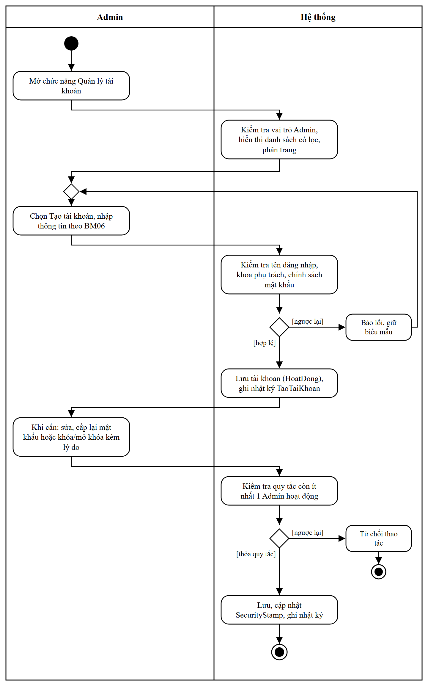

Hình 2.1. Biểu đồ hoạt động quy trình P01 – Cấp và quản lý tài khoản Admin/Giáo vụ

### P02: Đăng nhập, phân quyền và đổi mật khẩu

*Yêu cầu SRS liên quan: FR-06 – FR-10.*

Quy trình áp dụng cho cả ba vai trò. Tài khoản sinh viên dùng mã sinh viên làm tên đăng nhập.

- Bước 1: Người dùng mở trang đăng nhập, nhập tên đăng nhập và mật khẩu.
- Bước 2: Nếu tài khoản đang bị khóa tạm do đăng nhập sai 5 lần liên tiếp, hệ thống từ chối với thông báo chung; tài khoản tự mở lại sau 15 phút.
- Bước 3: Hệ thống kiểm tra thông tin xác thực và trạng thái tài khoản.

  - Sai thông tin hoặc tài khoản bị khóa: tăng bộ đếm sai, hiển thị thông báo chung "Tên đăng nhập hoặc mật khẩu không đúng", không tiết lộ tên đăng nhập có tồn tại hay không.

  - Đúng: tạo cookie xác thực (HttpOnly, Secure), đặt lại bộ đếm sai, ghi thời điểm đăng nhập cuối.

- Bước 4: Hệ thống chuyển đến trang chủ theo vai trò; menu chỉ hiển thị chức năng được phép (FR-08).
- Bước 5: Với mỗi yêu cầu tiếp theo (kể cả Ajax, xuất, nhập file), server kiểm tra trạng thái tài khoản, vai trò và phạm vi dữ liệu (FR-09); yêu cầu vượt quyền bị trả HTTP 403.
- Bước 6: Khi cần đổi mật khẩu, người dùng nhập mật khẩu hiện tại, mật khẩu mới và xác nhận. Hệ thống kiểm tra mật khẩu hiện tại đúng, mật khẩu mới đạt chính sách và khác mật khẩu hiện tại; lưu, làm mới phiên hiện tại và ghi nhật ký (FR-10).
- Bước 7: Người dùng chọn Đăng xuất; hệ thống hủy cookie và chuyển về trang đăng nhập (FR-07).

**Biểu đồ hoạt động (UML Activity Diagram, phân làn theo tác nhân):**

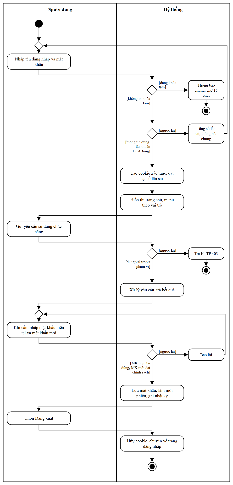

Hình 2.2. Biểu đồ hoạt động quy trình P02 – Đăng nhập, phân quyền và đổi mật khẩu

### P03: Tiếp nhận hồ sơ sinh viên mới

*Yêu cầu SRS liên quan: FR-13.*

Quy trình do Admin hoặc Giáo vụ thực hiện khi có sinh viên mới nhập học. Điều kiện: danh mục Khoa, Khóa, Lớp đã được khởi tạo (P10).

- Bước 1: Cán bộ chọn "Thêm sinh viên" trên màn hình danh sách.
- Bước 2: Cán bộ chọn lớp (Khoa và Khóa tự xác định theo lớp), nhập thông tin theo phiếu BM01: mã SV, họ tên, ngày sinh, giới tính, SĐT, email, địa chỉ, trạng thái ban đầu và mật khẩu ban đầu.
- Bước 3: Hệ thống kiểm tra lớp thuộc phạm vi được phép (Giáo vụ chỉ được chọn lớp thuộc khoa phụ trách); ngoài phạm vi thì từ chối.
- Bước 4: Hệ thống kiểm tra mã SV đúng định dạng (6 – 15 ký tự chữ số không dấu) và chưa từng tồn tại – kể cả hồ sơ đã xóa mềm; kiểm tra dữ liệu theo quy tắc mục 3.2.2.4 và chính sách mật khẩu. Không hợp lệ: báo lỗi theo từng trường.
- Bước 5: Hệ thống mở một giao dịch: lưu hồ sơ SinhVien, gọi dịch vụ tài khoản tạo tài khoản vai trò SinhVien với Username = MaSV, ghi nhật ký TaoHoSo. Nếu tạo tài khoản lỗi thì rollback cả hồ sơ.
- Bước 6: Hệ thống trả kết quả dạng JSON, cập nhật danh sách bằng Ajax; cán bộ bàn giao mã SV và mật khẩu ban đầu cho sinh viên.

**Biểu đồ hoạt động (UML Activity Diagram, phân làn theo tác nhân):**

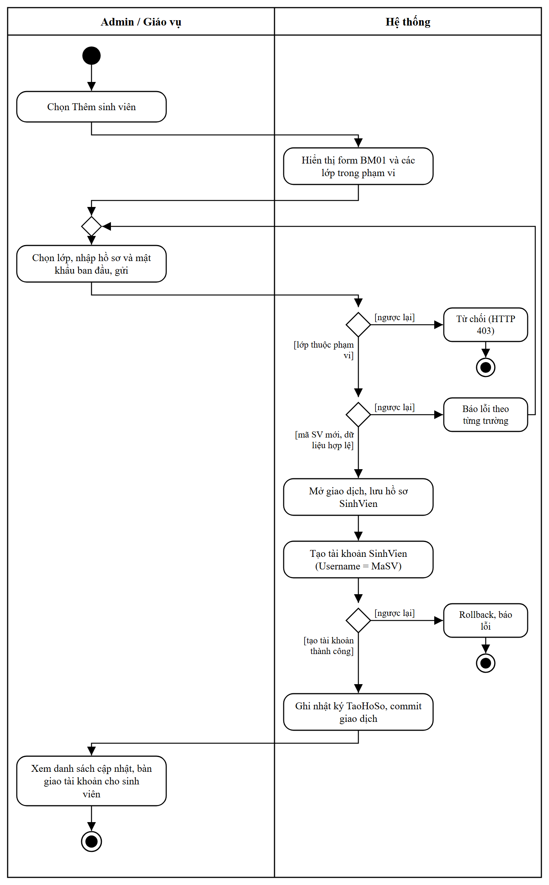

Hình 2.3. Biểu đồ hoạt động quy trình P03 – Tiếp nhận hồ sơ sinh viên mới

### P04: Cập nhật và xử lý biến động hồ sơ

*Yêu cầu SRS liên quan: FR-14 – FR-17.*

Quy trình xử lý khi thông tin sinh viên thay đổi hoặc có quyết định bảo lưu, thôi học, tốt nghiệp, chuyển lớp.

- Bước 1: Cán bộ tìm sinh viên (P09) và mở chi tiết hồ sơ (FR-14). Hồ sơ không tồn tại, đã xóa mềm hoặc ngoài phạm vi thì không cho thao tác.
- Bước 2: Cán bộ chọn một trong ba thao tác:

  - Sửa thông tin cá nhân (FR-15): họ tên, ngày sinh, giới tính, SĐT, email, địa chỉ; mã SV giữ cố định.

  - Đổi trạng thái học tập (FR-16) theo quyết định BM07: chọn trạng thái mới, nhập lý do (bắt buộc khi Admin sửa hồ sơ Đã tốt nghiệp).

  - Chuyển lớp (FR-17) theo quyết định BM07: chọn lớp đích đang sử dụng; Giáo vụ chỉ chọn lớp trong khoa phụ trách.

- Bước 3: Hệ thống kiểm tra quyền và quy tắc nghiệp vụ (bảng chuyển trạng thái mục 3.1.2; lớp đích hợp lệ). Vi phạm: chặn thao tác và nêu lý do.
- Bước 4: Hệ thống lưu thay đổi; nếu chuyển sang Thôi học thì khóa tài khoản sinh viên trong cùng giao dịch, nếu chuyển từ Thôi học về Đang học thì tài khoản vẫn giữ trạng thái khóa cho đến khi được mở thủ công (P06). Với đổi trạng thái và chuyển lớp, hệ thống đánh dấu hồ sơ đã phát sinh biến động (DaCoBienDong).
- Bước 5: Hệ thống ghi nhật ký (SuaHoSo, DoiTrangThai, ChuyenLop) và cập nhật giao diện bằng Ajax.

**Biểu đồ hoạt động (UML Activity Diagram, phân làn theo tác nhân):**

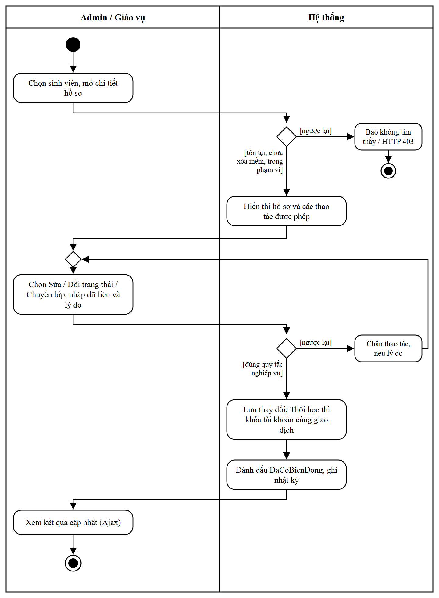

Hình 2.4. Biểu đồ hoạt động quy trình P04 – Cập nhật và xử lý biến động hồ sơ

### P05: Xóa mềm hồ sơ nhập sai

*Yêu cầu SRS liên quan: FR-18.*

Quy trình xử lý khi một hồ sơ bị nhập sai (thường là sai mã sinh viên – trường không được sửa). Hồ sơ không bị xóa khỏi CSDL mà được đánh dấu xóa mềm.

- Bước 1: Cán bộ mở chi tiết hồ sơ nhập sai, chọn "Xóa", nhập lý do (bắt buộc) và xác nhận.
- Bước 2: Hệ thống kiểm tra điều kiện xóa mềm:

  - Giáo vụ: chỉ xóa hồ sơ ở trạng thái Đang học, sinh viên chưa từng đăng nhập và chưa có thao tác đổi trạng thái/chuyển lớp.

  - Admin: được xóa cả hồ sơ đã phát sinh các thao tác trên, trừ hồ sơ Đã tốt nghiệp.

- Bước 3: Trong một giao dịch, hệ thống đặt DaXoa = true, ghi NgayXoa, NguoiXoa, LyDoXoa và khóa tài khoản sinh viên tương ứng; lỗi thì rollback toàn bộ.
- Bước 4: Hệ thống ghi nhật ký XoaMemHoSo; hồ sơ biến mất khỏi danh sách, tìm kiếm, thống kê, báo cáo.
- Bước 5: Cán bộ tạo lại hồ sơ với mã đúng theo P03. Mã đã xóa mềm không được dùng lại.

**Biểu đồ hoạt động (UML Activity Diagram, phân làn theo tác nhân):**

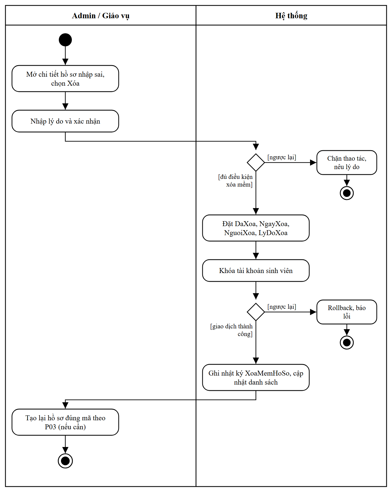

Hình 2.5. Biểu đồ hoạt động quy trình P05 – Xóa mềm hồ sơ nhập sai

### P06: Hỗ trợ tài khoản sinh viên

*Yêu cầu SRS liên quan: FR-19, FR-20.*

Quy trình khi sinh viên quên mật khẩu, hoặc nhà trường cần tạm khóa/mở khóa tài khoản sinh viên.

- Bước 1: Sinh viên liên hệ giáo vụ khoa (hoặc nhà trường có yêu cầu khóa tài khoản).
- Bước 2: Cán bộ tìm và mở chi tiết hồ sơ sinh viên trong phạm vi được phép.
- Bước 3: Cán bộ chọn "Cấp lại mật khẩu" (nhập mật khẩu mới và xác nhận – FR-19) hoặc "Khóa/Mở khóa" (nhập lý do – FR-20).
- Bước 4: Hệ thống kiểm tra mật khẩu đạt chính sách hoặc có lý do; kiểm tra điều kiện mở khóa: chỉ Admin được mở khóa tài khoản sinh viên Thôi học; tài khoản của hồ sơ đã xóa mềm không được mở khóa.
- Bước 5: Hệ thống cập nhật qua dịch vụ tài khoản dùng chung, cập nhật SecurityStamp (đăng xuất các phiên cũ), ghi nhật ký CapLaiMatKhau / KhoaTaiKhoan / MoKhoaTaiKhoan và thông báo kết quả.

**Biểu đồ hoạt động (UML Activity Diagram, phân làn theo tác nhân):**

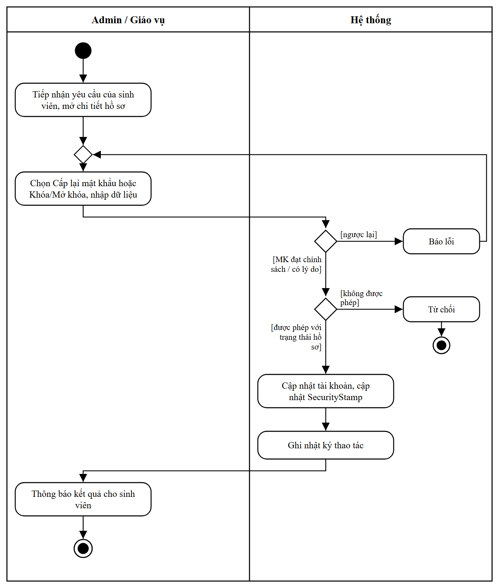

Hình 2.6. Biểu đồ hoạt động quy trình P06 – Hỗ trợ tài khoản sinh viên

### P07: Sinh viên xem và cập nhật thông tin liên hệ

*Yêu cầu SRS liên quan: FR-11, FR-12.*

Quy trình tự phục vụ của sinh viên.

- Bước 1: Sinh viên đăng nhập bằng mã SV và mở "Hồ sơ cá nhân" (FR-11).
- Bước 2: Server lấy MaSV từ tài khoản đang đăng nhập (không nhận MaSV từ URL hay form) và hiển thị hồ sơ: thông tin cá nhân, lớp, khoa, khóa, trạng thái học tập.
- Bước 3: Sinh viên chọn "Cập nhật", sửa SĐT, Email, Địa chỉ (FR-12).
- Bước 4: Hệ thống kiểm tra dữ liệu và chỉ chấp nhận ba trường trên; yêu cầu chứa trường khác hoặc định danh hồ sơ khác bị từ chối.
- Bước 5: Hệ thống lưu, ghi nhật ký CapNhatLienHe và thông báo kết quả bằng Ajax.

**Biểu đồ hoạt động (UML Activity Diagram, phân làn theo tác nhân):**

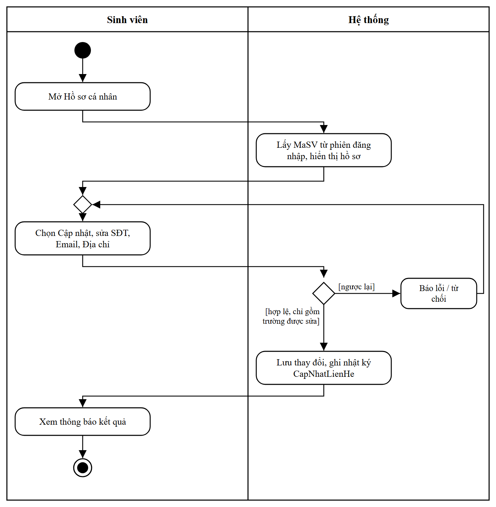

Hình 2.7. Biểu đồ hoạt động quy trình P07 – Sinh viên xem và cập nhật thông tin liên hệ

### P08: Nhập danh sách sinh viên từ Excel

*Yêu cầu SRS liên quan: FR-30.*

Quy trình dùng khi tiếp nhận sinh viên số lượng lớn (đầu khóa) hoặc cập nhật hàng loạt.

- Bước 1: Cán bộ tải file mẫu BM02 từ hệ thống và điền danh sách.
- Bước 2: Cán bộ chọn file .xlsx và tải lên. Hệ thống kiểm tra đúng mẫu (tên và thứ tự cột), định dạng .xlsx, dung lượng tối đa 5 MB; sai thì từ chối cả file.
- Bước 3: Hệ thống đọc file trong bộ nhớ (không lưu lâu dài trên server), đánh dấu lỗi tất cả các dòng có mã SV lặp trong file.
- Bước 4: Với từng dòng còn lại:

  - Kiểm tra trường bắt buộc, quy tắc dữ liệu, lớp tồn tại và thuộc phạm vi, quyền với hồ sơ hiện có.

  - Mã SV chưa có: tạo hồ sơ và tài khoản trong một giao dịch như P03 (bắt buộc có mật khẩu ban đầu).

  - Mã SV đã có: cập nhật hồ sơ theo quy tắc FR-15; nếu trạng thái hoặc lớp thay đổi thì áp dụng quy tắc FR-16, FR-17, FR-20; giữ nguyên tài khoản và mật khẩu; ô trống ở trường liên hệ tùy chọn giữ giá trị cũ.

  - Mã SV trùng hồ sơ đã xóa mềm: báo lỗi dòng.

  - Dòng lỗi được rollback riêng; các dòng hợp lệ khác vẫn được lưu.

- Bước 5: Hệ thống ghi nhật ký Import (số dòng thêm, cập nhật, lỗi), giải phóng file tạm và trả báo cáo kết quả BM05.

**Biểu đồ hoạt động (UML Activity Diagram, phân làn theo tác nhân):**

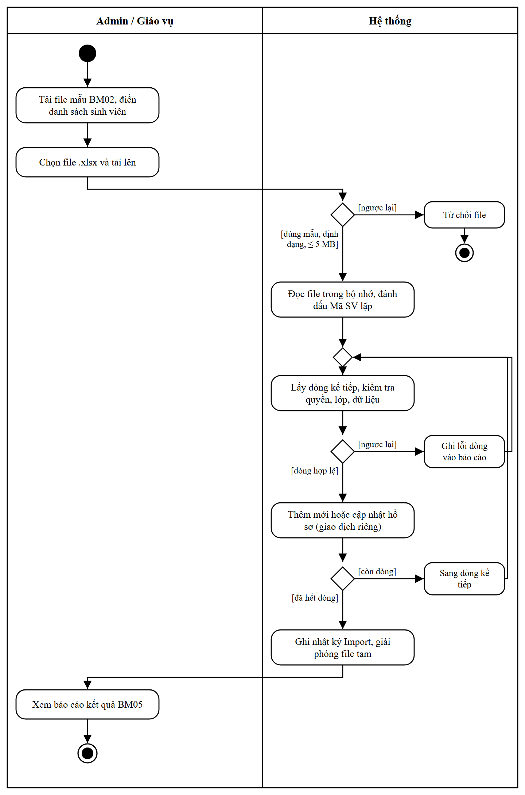

Hình 2.8. Biểu đồ hoạt động quy trình P08 – Nhập danh sách sinh viên từ Excel

### P09: Tra cứu, thống kê và xuất báo cáo

*Yêu cầu SRS liên quan: FR-21, FR-22, FR-27 – FR-29.*

Quy trình được dùng hằng ngày bởi Admin và Giáo vụ.

- Bước 1: Cán bộ mở "Danh sách sinh viên" (FR-21) hoặc "Thống kê" (FR-27).
- Bước 2: Cán bộ chọn tiêu chí Khoa/Khóa/Lớp/Trạng thái (Giáo vụ chỉ thấy lựa chọn trong khoa phụ trách) và/hoặc nhập từ khóa tên, mã SV (FR-22).
- Bước 3: Trình duyệt gửi yêu cầu Ajax (debounce 300 ms khi gõ).
- Bước 4: Server áp dụng bộ lọc phạm vi trước, sau đó lọc, tìm kiếm không dấu và phân trang/tổng hợp tại CSDL; hồ sơ đã xóa mềm bị loại.
- Bước 5: Server trả JSON; trình duyệt hiển thị bảng và tổng số. Không có dữ liệu: hiển thị "Không có dữ liệu".
- Bước 6: Cán bộ chọn "Xuất Excel" hoặc "Xuất PDF" (FR-28, FR-29). Server truy vấn lại theo đúng tiêu chí và phạm vi (không tin dữ liệu từ client), tạo file trong bộ nhớ theo BM03/BM04; dữ liệu rỗng thì không cho xuất.
- Bước 7: Server ghi nhật ký Xuat (người xuất, phạm vi, tiêu chí, thời điểm) và trả file cho trình duyệt; file không được lưu trên server.

**Biểu đồ hoạt động (UML Activity Diagram, phân làn theo tác nhân):**

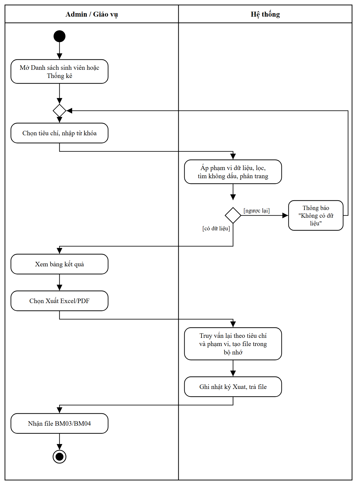

Hình 2.9. Biểu đồ hoạt động quy trình P09 – Tra cứu, thống kê và xuất báo cáo

### P10: Quản lý danh mục Khoa, Khóa, Lớp

*Yêu cầu SRS liên quan: FR-23 – FR-26.*

Danh mục là nền tảng cho mọi chức năng hồ sơ. Admin quản lý cả ba loại; Giáo vụ chỉ quản lý Lớp thuộc khoa phụ trách.

- Bước 1: Cán bộ mở "Danh mục", chọn loại Khoa, Khóa hoặc Lớp (FR-23).
- Bước 2: Cán bộ chọn Thêm (FR-24), Sửa (FR-25) hoặc Xóa mềm (FR-26).
- Bước 3: Hệ thống kiểm tra quyền: Giáo vụ thao tác Khoa/Khóa hoặc Lớp ngoài khoa bị từ chối.
- Bước 4: Hệ thống kiểm tra ràng buộc:

  - Mã Khoa/Khóa/Lớp duy nhất kể cả mã đã xóa mềm; tên Lớp duy nhất trong cùng Khoa và Khóa.

  - Khoa/Khóa đã có lớp chứa sinh viên: chỉ được sửa tên hiển thị, không sửa mã và năm nhập học.

  - Không xóa mềm Khoa còn Lớp chưa xóa hoặc còn Giáo vụ được gán; Khóa còn Lớp chưa xóa; Lớp còn hồ sơ sinh viên chưa xóa.

- Bước 5: Hệ thống lưu hoặc đánh dấu DaXoa, ghi nhật ký, cập nhật giao diện bằng Ajax. Danh mục đã xóa mềm không còn xuất hiện trong danh sách chọn.

**Biểu đồ hoạt động (UML Activity Diagram, phân làn theo tác nhân):**

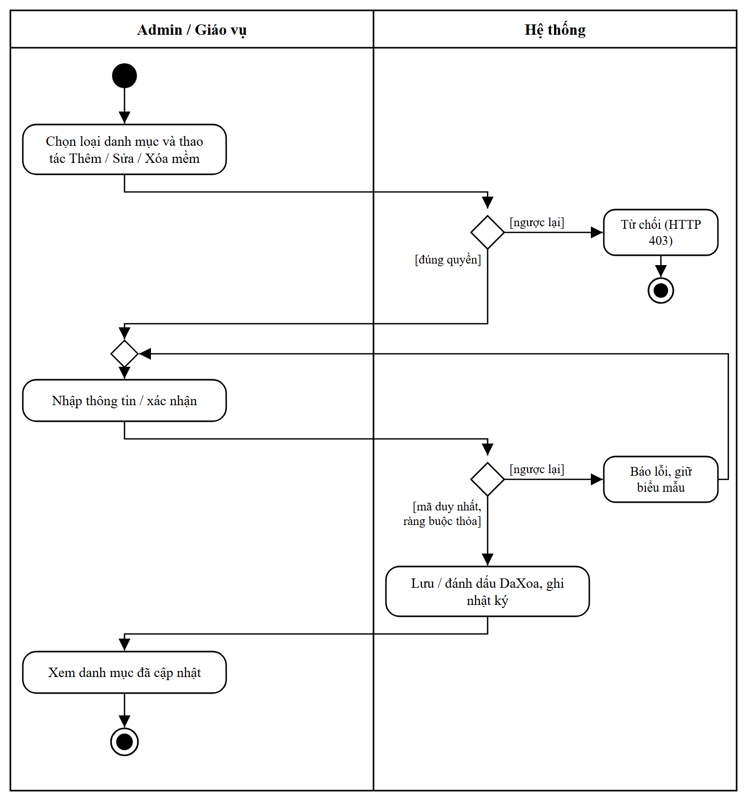

Hình 2.10. Biểu đồ hoạt động quy trình P10 – Quản lý danh mục Khoa, Khóa, Lớp

### P11: Tra cứu nhật ký thao tác

*Yêu cầu SRS liên quan: FR-31, NFR-07.*

Quy trình giám sát của Admin. Nhật ký do dịch vụ ghi nhật ký dùng chung tự sinh khi thực hiện các thao tác nhạy cảm (NFR-07) và chỉ đọc trên giao diện.

- Bước 1: Admin mở "Nhật ký thao tác".
- Bước 2: Admin chọn khoảng thời gian, người thực hiện, loại hành động, đối tượng (mã SV, mã lớp, tên đăng nhập).
- Bước 3: Trình duyệt gửi Ajax; server kiểm tra vai trò Admin (không phải Admin: HTTP 403).
- Bước 4: Server lọc, sắp xếp mới nhất trước và phân trang; trả JSON.
- Bước 5: Trình duyệt hiển thị bảng gồm thời điểm, người thực hiện, hành động, loại và mã đối tượng, chi tiết.

**Biểu đồ hoạt động (UML Activity Diagram, phân làn theo tác nhân):**

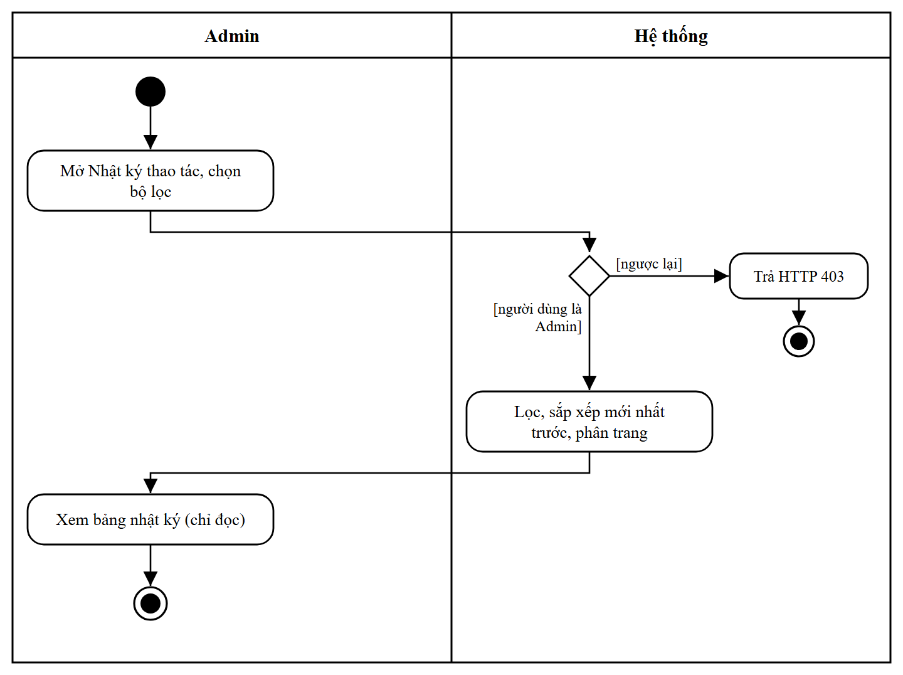

Hình 2.11. Biểu đồ hoạt động quy trình P11 – Tra cứu nhật ký thao tác

## 2.2. Các hồ sơ, biểu mẫu

Các biểu mẫu sau được xây dựng từ nghiệp vụ quản lý sinh viên và là căn cứ cho form nhập liệu, file mẫu Excel và file xuất của hệ thống.

### BM01. Phiếu thông tin hồ sơ sinh viên

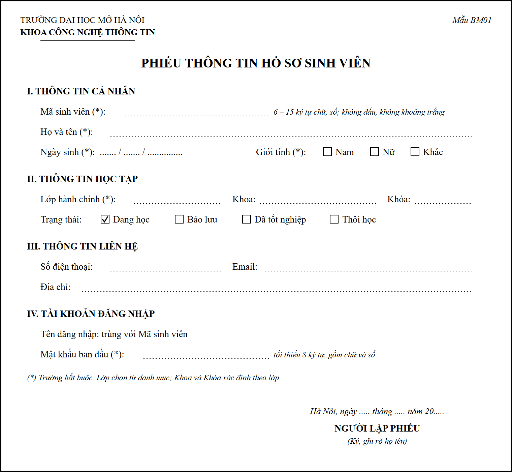

Hình 2.12. Mẫu BM01 – Phiếu thông tin hồ sơ sinh viên

### BM02. Mẫu file Excel nhập danh sách sinh viên

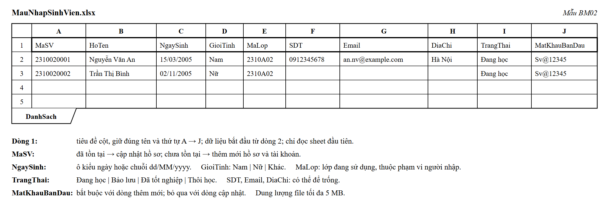

Hình 2.13. Mẫu BM02 – Mẫu file Excel nhập danh sách sinh viên

### BM03. Danh sách sinh viên (file xuất Excel/PDF)

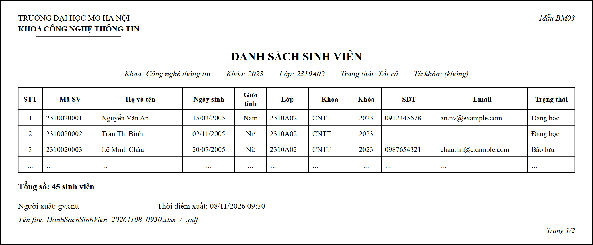

Hình 2.14. Mẫu BM03 – Danh sách sinh viên (file xuất Excel/PDF)

### BM04. Báo cáo thống kê sinh viên

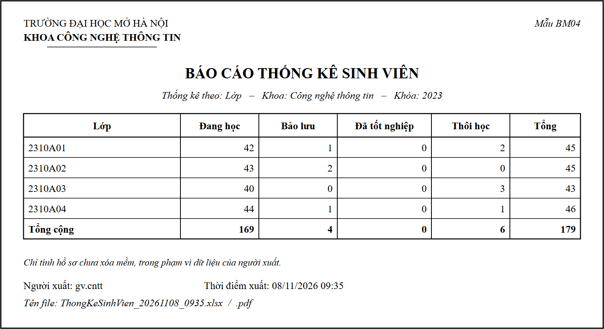

Hình 2.15. Mẫu BM04 – Báo cáo thống kê sinh viên

### BM05. Báo cáo kết quả nhập Excel

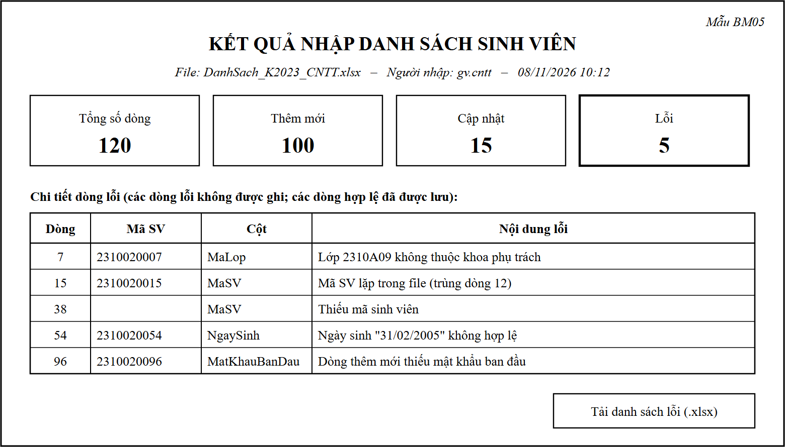

Hình 2.16. Mẫu BM05 – Báo cáo kết quả nhập Excel

### BM06. Phiếu đề nghị cấp/điều chỉnh tài khoản Admin/Giáo vụ

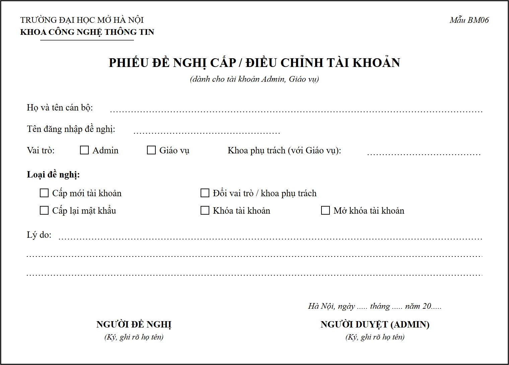

Hình 2.17. Mẫu BM06 – Phiếu đề nghị cấp/điều chỉnh tài khoản Admin/Giáo vụ

### BM07. Quyết định biến động học tập

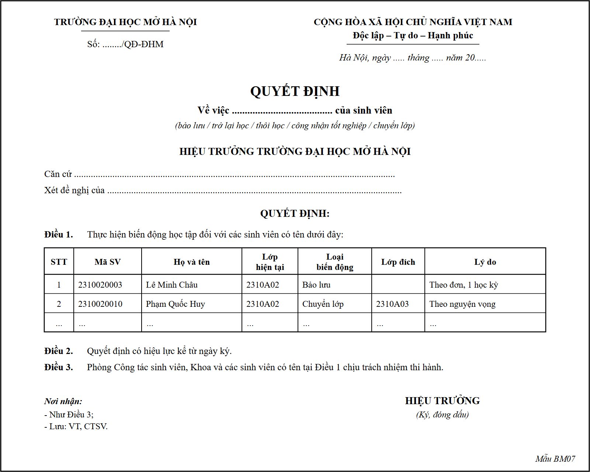

Hình 2.18. Mẫu BM07 – Quyết định biến động học tập

## 2.3. Các yêu cầu

### 2.3.1. Yêu cầu chức năng

**R01. Quản lý tài khoản Admin/Giáo vụ**

- Admin xem danh sách tài khoản Admin/Giáo vụ, lọc theo vai trò, khoa phụ trách, trạng thái, có phân trang.
- Admin tạo tài khoản Admin hoặc Giáo vụ; mỗi Giáo vụ gán đúng một khoa phụ trách.
- Admin cập nhật họ tên, vai trò, khoa phụ trách; thay đổi có hiệu lực từ yêu cầu kế tiếp.
- Admin cấp lại mật khẩu, khóa/mở khóa tài khoản kèm lý do; tài khoản không bị xóa; luôn còn ít nhất một Admin hoạt động.

**Dẫn chứng:** Thông tư 10/2016/TT-BGDĐT giao trách nhiệm quản lý thông tin sinh viên cho các đơn vị cụ thể trong trường; việc cấp quyền theo khoa thể hiện đúng phân cấp trách nhiệm đó.

*Ánh xạ SRS: FR-01 – FR-05*

**R02. Xác thực, phân quyền và đổi mật khẩu**

- Đăng nhập bằng tên đăng nhập và mật khẩu; khóa tạm 15 phút sau 5 lần sai liên tiếp; thông báo lỗi chung.
- Đăng xuất hủy cookie xác thực.
- Kiểm soát truy cập theo vai trò tại server ở mọi endpoint; menu hiển thị theo vai trò.
- Giới hạn phạm vi dữ liệu: Admin toàn trường, Giáo vụ theo khoa phụ trách, Sinh viên chỉ hồ sơ của mình.
- Mọi người dùng tự đổi mật khẩu của chính mình.

**Dẫn chứng:** Nghị định 13/2023/NĐ-CP yêu cầu áp dụng biện pháp bảo vệ dữ liệu cá nhân, giới hạn chủ thể được xử lý dữ liệu; OWASP Top 10 khuyến nghị kiểm soát truy cập tại server và chống dò mật khẩu.

*Ánh xạ SRS: FR-06 – FR-10*

**R03. Hồ sơ cá nhân**

- Người dùng xem hồ sơ/thông tin tài khoản của chính mình; định danh lấy từ phiên đăng nhập.
- Sinh viên tự cập nhật SĐT, Email, Địa chỉ; các trường khác do cán bộ quản lý.

**Dẫn chứng:** Nghị định 13/2023/NĐ-CP ghi nhận quyền của chủ thể dữ liệu được tiếp cận và yêu cầu chỉnh sửa dữ liệu cá nhân của mình.

*Ánh xạ SRS: FR-11, FR-12*

**R04. Quản lý hồ sơ sinh viên**

- Thêm hồ sơ kèm tài khoản sinh viên trong một giao dịch; mã SV duy nhất, không dùng lại.
- Xem chi tiết hồ sơ là điểm bắt đầu của mọi thao tác trên hồ sơ.
- Cập nhật thông tin cá nhân; mã SV cố định.
- Đổi trạng thái học tập theo bảng quy tắc; chuyển sang Thôi học tự động khóa tài khoản.
- Chuyển lớp; Giáo vụ chỉ chuyển trong khoa.
- Xóa mềm hồ sơ nhập sai kèm lý do, khóa tài khoản trong cùng giao dịch.

**Dẫn chứng:** Thông tư 08/2021/TT-BGDĐT quy định các tình huống nghỉ học tạm thời, thôi học và công nhận tốt nghiệp – là căn cứ cho các trạng thái học tập và quy tắc chuyển trạng thái.

*Ánh xạ SRS: FR-13 – FR-18*

**R05. Quản lý tài khoản sinh viên**

- Admin/Giáo vụ cấp lại mật khẩu khi sinh viên quên.
- Admin/Giáo vụ khóa/mở khóa tài khoản kèm lý do; chỉ Admin mở khóa sinh viên Thôi học; không mở khóa tài khoản của hồ sơ đã xóa mềm.

**Dẫn chứng:** Yêu cầu nghiệp vụ hỗ trợ sinh viên của giáo vụ khoa; kiểm soát truy cập theo trạng thái người học.

*Ánh xạ SRS: FR-19, FR-20*

**R06. Tra cứu sinh viên**

- Lập danh sách theo Khoa, Khóa, Lớp có phân trang và tổng số.
- Tìm kiếm theo tên hoặc mã SV, không phân biệt hoa thường và dấu tiếng Việt, kết hợp bộ lọc, hiển thị động không tải lại trang.

**Dẫn chứng:** Khắc phục Vấn đề 2 (mục 1.1.2); yêu cầu AJAX của bài tập lớn.

*Ánh xạ SRS: FR-21, FR-22*

**R07. Quản lý danh mục Khoa, Khóa, Lớp**

- Xem, thêm, cập nhật, xóa mềm danh mục; Giáo vụ chỉ thao tác Lớp thuộc khoa phụ trách.
- Mã duy nhất kể cả mã đã xóa mềm; ràng buộc khi sửa, xóa danh mục đang được sử dụng.

**Dẫn chứng:** Cơ cấu tổ chức đào tạo theo Khoa – Khóa – Lớp hành chính của trường đại học.

*Ánh xạ SRS: FR-23 – FR-26*

**R08. Thống kê, xuất và nhập dữ liệu**

- Thống kê số lượng sinh viên theo Khoa/Khóa/Lớp/Trạng thái dạng bảng.
- Xuất danh sách và báo cáo thống kê ra Excel/PDF theo phạm vi được phép; ghi nhật ký mỗi lần xuất.
- Nhập danh sách sinh viên từ Excel theo mẫu, báo cáo kết quả từng dòng.

**Dẫn chứng:** Nghị định 13/2023/NĐ-CP yêu cầu kiểm soát việc chuyển giao, sao chép dữ liệu cá nhân – mỗi lần xuất file chứa dữ liệu sinh viên phải giới hạn phạm vi và lưu vết.

*Ánh xạ SRS: FR-27 – FR-30*

**R09. Nhật ký thao tác**

- Ghi nhật ký các thao tác nhạy cảm: tạo/sửa/xóa mềm hồ sơ, đổi trạng thái, chuyển lớp, tạo tài khoản, khóa/mở khóa, cấp lại/đổi mật khẩu, đổi quyền/khoa, thay đổi danh mục, import, xuất dữ liệu.
- Admin tra cứu nhật ký theo thời gian, người thực hiện, hành động, đối tượng; nhật ký chỉ đọc.

**Dẫn chứng:** Nghị định 13/2023/NĐ-CP yêu cầu ghi nhận, lưu vết hoạt động xử lý dữ liệu cá nhân.

*Ánh xạ SRS: FR-31, NFR-07*

### 2.3.2. Yêu cầu phi chức năng

**R10. Bảo mật**

- ASP.NET Core Identity; hash mật khẩu có salt (PBKDF2 mặc định của Identity).
- HTTPS cho toàn bộ giao tiếp; HSTS khi triển khai.
- Cookie xác thực HttpOnly, Secure, SameSite=Lax; hết hạn trượt 30 phút.
- Mật khẩu tối thiểu 8 ký tự gồm chữ và số; khóa tạm 15 phút sau 5 lần sai.
- Anti-forgery token cho mọi thao tác thay đổi dữ liệu (form và Ajax).
- Kiểm tra vai trò, trạng thái tài khoản, khoa và quyền sở hữu hồ sơ tại server.

*Ánh xạ SRS: NFR-01*

**R11. Hiệu năng**

- Trang danh sách phản hồi dưới 2 giây với dữ liệu mẫu khoảng 1.000 sinh viên trên máy demo.
- Phân trang, lọc và tổng hợp tại CSDL (IQueryable, Skip/Take, GroupBy); AsNoTracking và Select chỉ các cột cần thiết.
- Chỉ mục cho các cột tìm kiếm, lọc (mục 3.2.2.3).

*Ánh xạ SRS: NFR-02*

**R12. Khả dụng và tương thích**

- Giao diện responsive bằng Bootstrap 5, kiểm thử tối thiểu 2 kích thước màn hình (desktop ≥ 1366 px, mobile 375 px).
- Xác nhận trước thao tác quan trọng (xóa mềm, khóa tài khoản, đổi trạng thái); thông báo rõ sau mỗi thao tác.
- Hoạt động trên Chrome, Edge, Firefox phiên bản gần nhất.

*Ánh xạ SRS: NFR-03, NFR-06*

**R13. Khả năng bảo trì, mở rộng**

- Tách lớp Model – View – Controller – Service – Repository; Dependency Injection.
- Quy tắc nghiệp vụ chỉ đặt ở tầng Service; Controller mỏng.
- Interface dịch vụ dùng chung (tài khoản, phạm vi, nhật ký) chỉ thay đổi khi nhóm trưởng duyệt.
- Coding convention C# của Microsoft; đặt tên thực thể tiếng Việt không dấu PascalCase.

*Ánh xạ SRS: NFR-04*

**R14. Độ tin cậy**

- Validate cả client (jQuery Validation) và server (Data Annotations/ModelState) theo cùng một bộ quy tắc.
- Giao dịch CSDL cho các thao tác nhiều bước (hồ sơ + tài khoản, xóa mềm + khóa tài khoản, từng dòng import).
- Xử lý ngoại lệ tập trung; lỗi không lộ stack trace cho người dùng.

*Ánh xạ SRS: NFR-05*

**R15. Truy vết**

- Dịch vụ ghi nhật ký dùng chung lưu thời điểm, người thực hiện, hành động, loại và mã đối tượng.
- Nhật ký chỉ thêm, không sửa/xóa qua giao diện; không ghi mật khẩu và dữ liệu cá nhân.

*Ánh xạ SRS: NFR-07*

**R16. Bảo vệ dữ liệu cá nhân**

- Giới hạn theo vai trò/khoa ở mọi endpoint kể cả xuất file.
- File import/export chỉ xử lý trong bộ nhớ hoặc lưu tạm và xóa ngay sau khi xử lý.
- Không ghi dữ liệu cá nhân, mật khẩu vào log ứng dụng (ILogger).
- Áp dụng xóa mềm; dữ liệu đã xóa mềm bị loại khỏi tra cứu, thống kê, báo cáo.

*Ánh xạ SRS: NFR-08*
