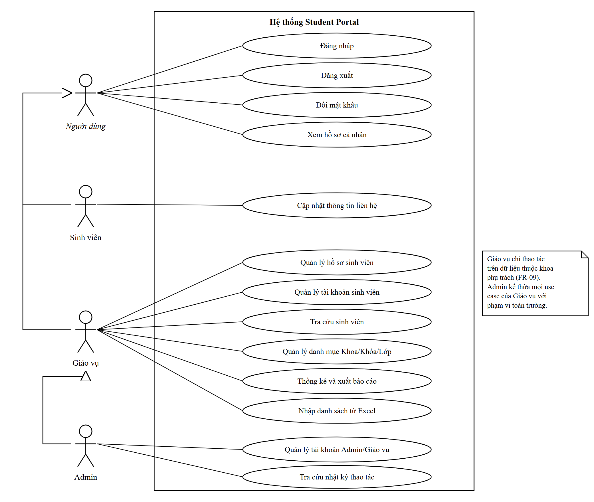
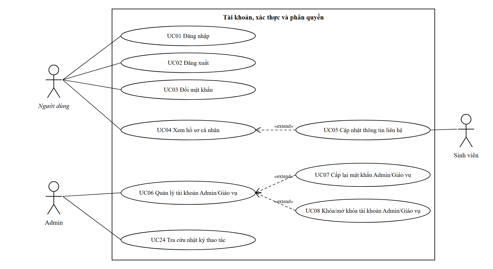
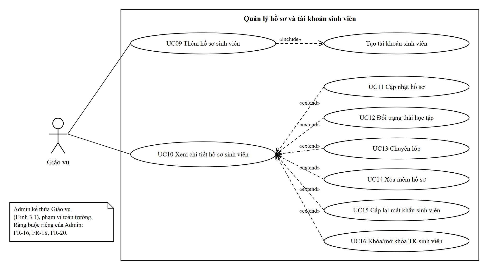
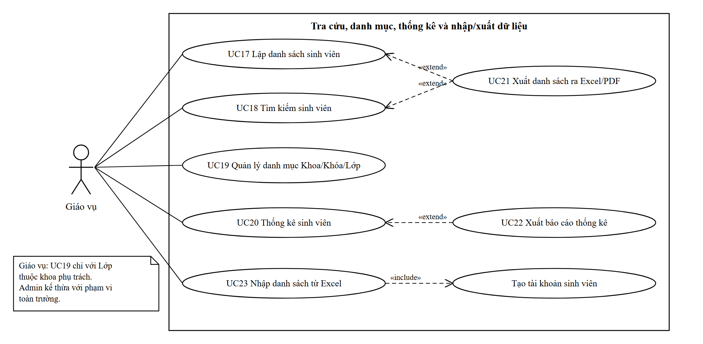

# 03. ĐẶC TẢ NGHIỆP VỤ VÀ USE CASE

Ứng dụng quản lý sinh viên Student Portal

Các nghiệp vụ NV01 đến NV16, biểu đồ Use Case tổng quát và phân rã, đặc tả chi tiết UC01 đến UC24.

## 3.1. Phân tích hệ thống

Hệ thống có ba tác nhân nghiệp vụ, phân biệt theo vai trò và phạm vi dữ liệu; một số xử lý tự động do chính hệ thống thực hiện. Người chưa đăng nhập chỉ truy cập được trang đăng nhập.

| **Tác nhân** | **Mô tả** | **Đặc điểm / phạm vi** |
|----|----|----|
| Admin (vai trò Admin) | Quản trị viên hệ thống thuộc Phòng Công tác sinh viên | Toàn quyền trên dữ liệu toàn trường; quản lý tài khoản Admin/Giáo vụ, danh mục Khoa/Khóa; tra cứu nhật ký; một số chuyển trạng thái và mở khóa chỉ Admin được làm. |
| Giáo vụ (vai trò CanBo) | Cán bộ giáo vụ khoa, được gán đúng một khoa phụ trách | Quản lý hồ sơ, tài khoản sinh viên, Lớp, thống kê, xuất/nhập trong khoa phụ trách. Khoa của sinh viên xác định qua lớp. |
| Sinh viên (vai trò SinhVien) | Người học, tài khoản tạo cùng hồ sơ, tên đăng nhập = mã SV | Chỉ xem hồ sơ của mình, cập nhật SĐT/Email/Địa chỉ, đổi mật khẩu. |
| Hệ thống (tác nhân nội bộ) | Các xử lý tự động | Khóa tạm khi đăng nhập sai; tự khóa tài khoản khi Thôi học hoặc xóa mềm; ghi nhật ký. |

Tên vai trò lưu trong CSDL là Admin, CanBo, SinhVien; trên giao diện lần lượt hiển thị là "Quản trị viên", "Giáo vụ", "Sinh viên".

### 3.1.1. Phân tích nghiệp vụ

**Mô tả nghiệp vụ**

**NV01 – Quản lý tài khoản Admin/Giáo vụ.** Admin là người duy nhất cấp, sửa, khóa tài khoản cán bộ. Mỗi Giáo vụ phải có đúng một khoa phụ trách vì toàn bộ phạm vi dữ liệu của họ suy ra từ khoa này. Tài khoản không bao giờ bị xóa (để giữ nguyên nhật ký), chỉ bị khóa. Quy tắc "luôn còn ít nhất một Admin hoạt động" ngăn hệ thống rơi vào trạng thái không ai quản trị được.

**NV02 – Đăng nhập, đăng xuất.** Nghiệp vụ dùng chung cho cả ba vai trò. Ngoài việc kiểm tra mật khẩu, hệ thống phải kiểm tra trạng thái tài khoản (HoatDong/BiKhoa) và khóa tạm sau 5 lần sai để chống dò mật khẩu. Thông báo lỗi luôn là thông báo chung để không tiết lộ tên đăng nhập có tồn tại hay không.

**NV03 – Kiểm soát truy cập và phạm vi dữ liệu.** Đây là nghiệp vụ xuyên suốt: mọi yêu cầu đều qua hai lớp kiểm tra – vai trò (được dùng chức năng nào) và phạm vi (được thấy dữ liệu nào). Phạm vi được áp vào câu truy vấn trước khi lọc, tìm kiếm, phân trang hoặc xuất, nên Giáo vụ không thể nhìn thấy sinh viên khoa khác dù thay đổi tham số trên URL hay request Ajax.

**NV04 – Đổi mật khẩu.** Mọi người dùng tự đổi mật khẩu của mình. Hệ thống không khôi phục mật khẩu qua email; người dùng quên mật khẩu được cấp lại mật khẩu theo NV01 (cán bộ) hoặc NV11 (sinh viên).

**NV05 – Xem và cập nhật hồ sơ cá nhân.** Định danh luôn lấy từ phiên đăng nhập. Sinh viên chỉ được sửa ba trường liên hệ; các trường nghiệp vụ (lớp, trạng thái, họ tên…) do cán bộ quản lý để bảo đảm tính chính xác.

**NV06 – Thêm hồ sơ sinh viên kèm tài khoản.** Hồ sơ và tài khoản luôn tồn tại thành cặp, nên được tạo trong cùng một giao dịch: nếu tạo tài khoản lỗi, hồ sơ cũng bị hủy. Mã SV là khóa chính, đồng thời là tên đăng nhập, cố định suốt vòng đời và không được dùng lại kể cả khi hồ sơ bị xóa mềm.

**NV07 – Cập nhật hồ sơ.** Chỉ cập nhật thông tin cá nhân; lớp và trạng thái được thay đổi qua nghiệp vụ riêng (NV08, NV09) để áp dụng quy tắc và ghi nhật ký đúng loại hành động. Hồ sơ đã xóa mềm không được cập nhật.

**NV08 – Đổi trạng thái học tập.** Nghiệp vụ có quy tắc chặt nhất, được trình bày trong bảng quy tắc chuyển trạng thái tại mục 3.1.2. Chuyển sang Thôi học tự động khóa tài khoản; khi Admin chuyển sinh viên Thôi học trở lại Đang học, tài khoản vẫn giữ trạng thái khóa và chỉ được mở thủ công (NV11). Hồ sơ Đã tốt nghiệp được coi là lưu trữ, chỉ Admin sửa khi nhập nhầm và phải có lý do.

**NV09 – Chuyển lớp.** Khoa/Khóa của sinh viên luôn suy ra từ lớp, nên chuyển lớp có thể làm sinh viên đổi khoa – vì vậy Giáo vụ chỉ được chuyển trong khoa mình, Admin được chuyển liên khoa.

**NV10 – Xóa mềm hồ sơ nhập sai.** Xóa mềm thay cho xóa cứng để giữ toàn vẹn dữ liệu và dấu vết. Điều kiện xóa của Giáo vụ hẹp (hồ sơ "sạch": Đang học, chưa đăng nhập, chưa biến động) để tránh xóa nhầm hồ sơ đang dùng; Admin có quyền rộng hơn nhưng không xóa hồ sơ Đã tốt nghiệp.

**NV11 – Cấp lại mật khẩu, khóa/mở khóa tài khoản sinh viên.** Thực hiện qua dịch vụ tài khoản dùng chung. Mở khóa bị giới hạn: sinh viên Thôi học chỉ Admin mở; hồ sơ đã xóa mềm không bao giờ được mở.

**NV12 – Tra cứu danh sách và tìm kiếm.** Nghiệp vụ dùng nhiều nhất. Tìm kiếm phải không phân biệt dấu ("nguyen" tìm ra "Nguyễn") và hiển thị động bằng Ajax. Kết quả chỉ gồm hồ sơ chưa xóa mềm, trong phạm vi.

**NV13 – Quản lý danh mục.** Danh mục là dữ liệu gốc; mọi ràng buộc xóa/sửa nhằm không làm "mồ côi" hồ sơ sinh viên và không phá vỡ phạm vi của Giáo vụ.

**NV14 – Thống kê và xuất báo cáo.** Số liệu được tổng hợp tại CSDL theo phạm vi; xuất file luôn truy vấn lại ở server theo cùng tiêu chí (không nhận dữ liệu từ client) và ghi nhật ký vì đây là hành vi sao chép dữ liệu cá nhân ra ngoài hệ thống.

**NV15 – Nhập danh sách từ Excel.** Tái sử dụng toàn bộ quy tắc của NV06 – NV09 thông qua IStudentService, không viết lại quy tắc ở tầng import. Giao dịch theo từng dòng: dòng lỗi không ảnh hưởng các dòng hợp lệ.

**NV16 – Ghi và tra cứu nhật ký.** Mọi Service gọi IAuditLogService khi thực hiện thao tác nhạy cảm; bản ghi được thêm trong cùng giao dịch với thao tác nên không có trường hợp thao tác thành công mà thiếu nhật ký. Admin tra cứu ở chế độ chỉ đọc.

### 3.1.2. Chi tiết nghiệp vụ

**Nhóm 1: Tài khoản và xác thực (NV01 – NV05)**

| **Thuộc tính** | **NV01 – Quản lý TK Admin/Giáo vụ** | **NV02 – Đăng nhập/đăng xuất** | **NV04 – Đổi mật khẩu** |
|----|----|----|----|
| **Tác nhân** | Admin | Admin, Giáo vụ, Sinh viên | Admin, Giáo vụ, Sinh viên |
| **Đầu vào** | Họ tên, tên đăng nhập, vai trò, khoa phụ trách, mật khẩu; lý do khóa | Tên đăng nhập, mật khẩu | MK hiện tại, MK mới, xác nhận |
| **Xử lý** | Kiểm tra duy nhất, khoa hợp lệ, chính sách MK; UserManager.CreateAsync; cập nhật SecurityStamp khi đổi quyền/khóa | SignInManager.PasswordSignInAsync (lockoutOnFailure: true); kiểm tra TrangThaiTaiKhoan; cập nhật LanDangNhapCuoi | UserManager.ChangePasswordAsync; RefreshSignInAsync |
| **Đầu ra** | Tài khoản HoatDong / được cập nhật / BiKhoa | Cookie xác thực, chuyển hướng theo vai trò | Mật khẩu mới, phiên được làm mới |
| **Quy tắc** | Không xóa tài khoản; luôn ≥ 1 Admin hoạt động; Giáo vụ có đúng 1 khoa | Khóa tạm 15 phút sau 5 lần sai; thông báo lỗi chung | MK mới ≠ MK hiện tại; ≥ 8 ký tự gồm chữ và số |
| **Yêu cầu** | R01, R10, R15 | R02, R10 | R02, R10, R15 |

**NV03 – Kiểm soát truy cập và phạm vi dữ liệu (áp dụng cho mọi nghiệp vụ còn lại):**

| **Vai trò** | **Phạm vi sinh viên** | **Phạm vi danh mục** | **Điều kiện áp vào truy vấn** |
|----|----|----|----|
| Admin | Toàn trường | Khoa, Khóa, Lớp toàn trường | Không thêm điều kiện |
| CanBo | Sinh viên thuộc lớp của khoa phụ trách | Xem Khoa/Khóa liên quan; thêm/sửa/xóa Lớp thuộc khoa | sv.Lop.MaKhoa == user.MaKhoaPhuTrach |
| SinhVien | Chỉ hồ sơ của mình | Không truy cập | sv.MaSV == user.MaSV |

**Nhóm 2: Vòng đời hồ sơ sinh viên (NV06 – NV10)**

| **Thuộc tính** | **NV06 – Thêm hồ sơ** | **NV08 – Đổi trạng thái** | **NV09 – Chuyển lớp** | **NV10 – Xóa mềm** |
|----|----|----|----|----|
| **Tác nhân** | Admin, Giáo vụ | Admin, Giáo vụ | Admin, Giáo vụ | Admin, Giáo vụ |
| **Đầu vào** | BM01 + mật khẩu ban đầu | Trạng thái mới, lý do | Lớp đích, lý do | Lý do (bắt buộc) |
| **Xử lý** | Giao dịch: thêm SinhVien → tạo tài khoản → ghi nhật ký | Kiểm tra bảng chuyển trạng thái; Thôi học → khóa TK; DaCoBienDong = true | Kiểm tra quyền với lớp hiện tại và lớp đích; DaCoBienDong = true | Kiểm tra điều kiện; giao dịch: DaXoa = true + khóa TK |
| **Đầu ra** | Hồ sơ + tài khoản mới | Trạng thái mới | Hồ sơ gắn lớp mới | Hồ sơ đã xóa mềm, TK bị khóa |
| **Quy tắc** | Mã SV duy nhất kể cả đã xóa; lớp trong phạm vi, đang dùng | Theo bảng dưới | Giáo vụ chỉ trong khoa; lớp đích chưa xóa mềm | Giáo vụ: Đang học + chưa đăng nhập + chưa biến động; Admin: trừ Đã tốt nghiệp |
| **Yêu cầu** | R04, R14, R15 | R04, R15 | R04, R15 | R04, R15, R16 |

**Bảng quy tắc chuyển trạng thái học tập (NV08 – FR-16):**

| **Trạng thái hiện tại** | **Trạng thái mới** | **Ai được thực hiện** | **Tác động kèm theo** |
|----|----|----|----|
| Đang học | Bảo lưu | Admin, Giáo vụ | — |
| Đang học | Đã tốt nghiệp | Admin, Giáo vụ | Hồ sơ chuyển sang lưu trữ |
| Đang học | Thôi học | Admin, Giáo vụ | Tự động khóa tài khoản |
| Bảo lưu | Đang học | Admin, Giáo vụ | — |
| Bảo lưu | Thôi học | Admin, Giáo vụ | Tự động khóa tài khoản |
| Thôi học | Đang học | Chỉ Admin | Tài khoản giữ trạng thái khóa, chỉ được mở thủ công (UC16) |
| Đã tốt nghiệp | Trạng thái khác | Chỉ Admin, bắt buộc lý do | Chỉ dùng để sửa nhập nhầm |
| Các cặp khác | — | Không cho phép | Ví dụ Bảo lưu → Đã tốt nghiệp, Thôi học → Bảo lưu |

**Nhóm 3: Tra cứu, danh mục, thống kê, nhập/xuất, nhật ký (NV12 – NV16)**

| **Thuộc tính** | **NV12 – Tra cứu** | **NV13 – Danh mục** | **NV14 – Thống kê & xuất** | **NV15 – Nhập Excel** |
|----|----|----|----|----|
| **Tác nhân** | Admin, Giáo vụ | Admin; Giáo vụ (chỉ Lớp) | Admin, Giáo vụ | Admin, Giáo vụ |
| **Đầu vào** | Từ khóa, Khoa/Khóa/Lớp/Trạng thái, trang | Mã, tên, năm nhập học, Khoa/Khóa của Lớp | Tiêu chí; loại file xlsx/pdf | File .xlsx theo BM02 |
| **Xử lý** | Phạm vi → lọc → tìm theo HoTenKhongDau/MaSV → Skip/Take | Kiểm tra quyền, mã duy nhất (IgnoreQueryFilters), ràng buộc xóa | GroupBy tại CSDL; tạo file trong MemoryStream | Đọc file trong bộ nhớ; từng dòng gọi IStudentService trong giao dịch riêng |
| **Đầu ra** | JSON PagedResult | Danh mục cập nhật | Bảng thống kê; file BM03/BM04 | Báo cáo BM05 |
| **Quy tắc** | Loại hồ sơ đã xóa mềm | Không dùng lại mã; không làm mồ côi dữ liệu | Dữ liệu rỗng: không xuất; ghi nhật ký mỗi lần xuất | Mã lặp trong file: lỗi mọi dòng; lỗi dòng không ảnh hưởng dòng khác |
| **Yêu cầu** | R06, R11 | R07, R15 | R08, R16 | R08, R14, R16 |

### 3.1.3. Biểu đồ Use Case tổng quát

Hình 3.1. Biểu đồ Use Case tổng quát

Biểu đồ dùng quan hệ tổng quát hóa (generalization) giữa các tác nhân: Người dùng là tác nhân trừu tượng (tên in nghiêng) đại diện cho mọi tài khoản đã đăng nhập; Sinh viên và Giáo vụ kế thừa Người dùng; Admin kế thừa Giáo vụ nên sử dụng được mọi use case của Giáo vụ với phạm vi toàn trường, cộng thêm quản lý tài khoản Admin/Giáo vụ và tra cứu nhật ký. Kiểm soát truy cập (FR-08) và phạm vi dữ liệu (FR-09) là yêu cầu xuyên suốt, áp dụng cho mọi use case sau đăng nhập.

### 3.1.4. Danh sách và biểu đồ Use Case phân rã

**a) Danh sách Use Case**

<table>
<thead>
<tr>
<th><strong>Mã</strong></th>
<th><strong>Tên Use Case</strong></th>
<th><strong>Tác nhân</strong></th>
<th><strong>FR</strong></th>
</tr>
</thead>
<tbody>
<tr>
<td colspan="4"><strong>Xác thực và tài khoản cá nhân</strong></td>
</tr>
<tr>
<td>UC01</td>
<td>Đăng nhập</td>
<td>Admin, Giáo vụ, Sinh viên</td>
<td>FR-06, FR-08</td>
</tr>
<tr>
<td>UC02</td>
<td>Đăng xuất</td>
<td>Admin, Giáo vụ, Sinh viên</td>
<td>FR-07</td>
</tr>
<tr>
<td>UC03</td>
<td>Đổi mật khẩu</td>
<td>Admin, Giáo vụ, Sinh viên</td>
<td>FR-10</td>
</tr>
<tr>
<td>UC04</td>
<td>Xem hồ sơ cá nhân</td>
<td>Admin, Giáo vụ, Sinh viên</td>
<td>FR-11</td>
</tr>
<tr>
<td>UC05</td>
<td>Cập nhật thông tin liên hệ</td>
<td>Sinh viên</td>
<td>FR-12</td>
</tr>
<tr>
<td colspan="4"><strong>Quản lý tài khoản Admin/Giáo vụ</strong></td>
</tr>
<tr>
<td>UC06</td>
<td>Quản lý tài khoản Admin/Giáo vụ (xem DS, tạo, cập nhật)</td>
<td>Admin</td>
<td>FR-01 – FR-03</td>
</tr>
<tr>
<td>UC07</td>
<td>Cấp lại mật khẩu Admin/Giáo vụ</td>
<td>Admin</td>
<td>FR-04</td>
</tr>
<tr>
<td>UC08</td>
<td>Khóa/mở khóa tài khoản Admin/Giáo vụ</td>
<td>Admin</td>
<td>FR-05</td>
</tr>
<tr>
<td colspan="4"><strong>Hồ sơ và tài khoản sinh viên</strong></td>
</tr>
<tr>
<td>UC09</td>
<td>Thêm hồ sơ sinh viên</td>
<td>Admin, Giáo vụ</td>
<td>FR-13</td>
</tr>
<tr>
<td>UC10</td>
<td>Xem chi tiết hồ sơ sinh viên</td>
<td>Admin, Giáo vụ</td>
<td>FR-14</td>
</tr>
<tr>
<td>UC11</td>
<td>Cập nhật hồ sơ sinh viên</td>
<td>Admin, Giáo vụ</td>
<td>FR-15</td>
</tr>
<tr>
<td>UC12</td>
<td>Đổi trạng thái học tập</td>
<td>Admin, Giáo vụ</td>
<td>FR-16</td>
</tr>
<tr>
<td>UC13</td>
<td>Chuyển lớp</td>
<td>Admin, Giáo vụ</td>
<td>FR-17</td>
</tr>
<tr>
<td>UC14</td>
<td>Xóa mềm hồ sơ sinh viên</td>
<td>Admin, Giáo vụ</td>
<td>FR-18</td>
</tr>
<tr>
<td>UC15</td>
<td>Cấp lại mật khẩu sinh viên</td>
<td>Admin, Giáo vụ</td>
<td>FR-19</td>
</tr>
<tr>
<td>UC16</td>
<td>Khóa/mở khóa tài khoản sinh viên</td>
<td>Admin, Giáo vụ</td>
<td>FR-20</td>
</tr>
<tr>
<td colspan="4"><strong>Tra cứu, danh mục, thống kê, xuất/nhập, nhật ký</strong></td>
</tr>
<tr>
<td>UC17</td>
<td>Lập danh sách sinh viên theo Khoa, Khóa, Lớp</td>
<td>Admin, Giáo vụ</td>
<td>FR-21</td>
</tr>
<tr>
<td>UC18</td>
<td>Tìm kiếm sinh viên</td>
<td>Admin, Giáo vụ</td>
<td>FR-22</td>
</tr>
<tr>
<td>UC19</td>
<td>Quản lý danh mục Khoa, Khóa, Lớp</td>
<td>Admin; Giáo vụ (Lớp)</td>
<td>FR-23 – FR-26</td>
</tr>
<tr>
<td>UC20</td>
<td>Thống kê sinh viên</td>
<td>Admin, Giáo vụ</td>
<td>FR-27</td>
</tr>
<tr>
<td>UC21</td>
<td>Xuất danh sách sinh viên ra Excel/PDF</td>
<td>Admin, Giáo vụ</td>
<td>FR-28</td>
</tr>
<tr>
<td>UC22</td>
<td>Xuất báo cáo thống kê ra Excel/PDF</td>
<td>Admin, Giáo vụ</td>
<td>FR-29</td>
</tr>
<tr>
<td>UC23</td>
<td>Nhập danh sách sinh viên từ Excel</td>
<td>Admin, Giáo vụ</td>
<td>FR-30</td>
</tr>
<tr>
<td>UC24</td>
<td>Tra cứu nhật ký thao tác</td>
<td>Admin</td>
<td>FR-31</td>
</tr>
</tbody>
</table>

**b) Biểu đồ Use Case phân rã**

Hình 3.2. Biểu đồ Use Case phân rã – Tài khoản, xác thực và phân quyền

Hình 3.3. Biểu đồ Use Case phân rã – Quản lý hồ sơ và tài khoản sinh viên

Hình 3.4. Biểu đồ Use Case phân rã – Tra cứu, danh mục, thống kê và nhập/xuất dữ liệu

Quan hệ giữa các Use Case: UC05 «extend» UC04; UC07, UC08 «extend» UC06; UC11 – UC16 «extend» UC10 (chỉ thực hiện từ màn hình chi tiết hồ sơ); UC21 «extend» UC17 và UC18; UC22 «extend» UC20; UC09 và UC23 «include» use case nội bộ "Tạo tài khoản sinh viên" (IAccountService). Mọi use case trừ UC01 có tiền điều kiện đã đăng nhập.

### 3.1.5. Đặc tả chi tiết các Use Case

Mỗi Use Case được đặc tả bằng một bảng gồm: tên Use Case, mã yêu cầu SRS, tác nhân, mô tả, tiền điều kiện, hậu điều kiện, luồng sự kiện chính và luồng sự kiện thay thế. Luồng thay thế được đánh số theo bước phát sinh ở luồng chính, ví dụ 4a là nhánh rẽ thứ nhất tại bước 4.

#### a) Nhóm Tài khoản, xác thực và phân quyền

##### UC01 – Đăng nhập

<table>
<tbody>
<tr>
<td><strong>Tên Use Case</strong></td>
<td><strong>UC01 – Đăng nhập</strong></td>
</tr>
<tr>
<td><strong>Mã yêu cầu</strong></td>
<td>FR-06, FR-08</td>
</tr>
<tr>
<td><strong>Tác nhân</strong></td>
<td>Admin, Giáo vụ, Sinh viên</td>
</tr>
<tr>
<td><strong>Mô tả</strong></td>
<td>Người dùng xác thực bằng tên đăng nhập và mật khẩu để truy cập các chức năng theo vai trò.</td>
</tr>
<tr>
<td><strong>Tiền điều kiện</strong></td>
<td>Tài khoản đã được cấp (UC06, UC09, UC23); người dùng chưa đăng nhập.</td>
</tr>
<tr>
<td><strong>Hậu điều kiện</strong></td>
<td>Cookie xác thực được tạo; số lần đăng nhập sai được đặt lại; thời điểm đăng nhập cuối được ghi nhận; giao diện hiển thị theo vai trò.</td>
</tr>
<tr>
<td><strong>Luồng sự kiện chính</strong></td>
<td>
<strong>1.</strong> Người dùng mở trang Đăng nhập.

<strong>2.</strong> Hệ thống hiển thị form gồm tên đăng nhập và mật khẩu.

<strong>3.</strong> Người dùng nhập tên đăng nhập, mật khẩu và bấm "Đăng nhập".

<strong>4.</strong> Hệ thống kiểm tra tài khoản không bị khóa tạm, thông tin xác thực đúng và trạng thái tài khoản là HoatDong.

<strong>5.</strong> Hệ thống tạo cookie xác thực (HttpOnly, Secure), đặt lại số lần sai, ghi thời điểm đăng nhập cuối.

<strong>6.</strong> Hệ thống chuyển người dùng đến trang chủ với menu tương ứng vai trò.
</td>
</tr>
<tr>
<td><strong>Luồng sự kiện thay thế</strong></td>
<td>
<strong>4a.</strong> Nếu sai tên đăng nhập hoặc mật khẩu, hoặc tài khoản đang ở trạng thái BiKhoa: hệ thống tăng số lần sai và hiển thị thông báo chung "Tên đăng nhập hoặc mật khẩu không đúng", không tiết lộ tên đăng nhập có tồn tại hay không; quay lại bước 3.

<strong>4b.</strong> Nếu tài khoản đã sai 5 lần liên tiếp: hệ thống khóa tạm 15 phút và thông báo "Tài khoản tạm khóa, vui lòng thử lại sau"; use case kết thúc.

<strong>6a.</strong> Nếu địa chỉ quay lại (returnUrl) không phải URL nội bộ: hệ thống bỏ qua và chuyển về trang chủ.
</td>
</tr>
</tbody>
</table>

##### UC02 – Đăng xuất

<table>
<tbody>
<tr>
<td><strong>Tên Use Case</strong></td>
<td><strong>UC02 – Đăng xuất</strong></td>
</tr>
<tr>
<td><strong>Mã yêu cầu</strong></td>
<td>FR-07</td>
</tr>
<tr>
<td><strong>Tác nhân</strong></td>
<td>Admin, Giáo vụ, Sinh viên</td>
</tr>
<tr>
<td><strong>Mô tả</strong></td>
<td>Người dùng kết thúc phiên làm việc hiện tại.</td>
</tr>
<tr>
<td><strong>Tiền điều kiện</strong></td>
<td>Người dùng đã đăng nhập.</td>
</tr>
<tr>
<td><strong>Hậu điều kiện</strong></td>
<td>Cookie xác thực của phiên hiện tại bị hủy.</td>
</tr>
<tr>
<td><strong>Luồng sự kiện chính</strong></td>
<td>
<strong>1.</strong> Người dùng chọn "Đăng xuất" trên menu.

<strong>2.</strong> Hệ thống hủy cookie xác thực của phiên hiện tại.

<strong>3.</strong> Hệ thống chuyển về trang Đăng nhập.
</td>
</tr>
<tr>
<td><strong>Luồng sự kiện thay thế</strong></td>
<td><strong>1a.</strong> Nếu phiên đã hết hạn: hệ thống chuyển thẳng về trang Đăng nhập.</td>
</tr>
</tbody>
</table>

##### UC03 – Đổi mật khẩu

<table>
<tbody>
<tr>
<td><strong>Tên Use Case</strong></td>
<td><strong>UC03 – Đổi mật khẩu</strong></td>
</tr>
<tr>
<td><strong>Mã yêu cầu</strong></td>
<td>FR-10</td>
</tr>
<tr>
<td><strong>Tác nhân</strong></td>
<td>Admin, Giáo vụ, Sinh viên</td>
</tr>
<tr>
<td><strong>Mô tả</strong></td>
<td>Người dùng tự đổi mật khẩu của chính mình.</td>
</tr>
<tr>
<td><strong>Tiền điều kiện</strong></td>
<td>Người dùng đã đăng nhập.</td>
</tr>
<tr>
<td><strong>Hậu điều kiện</strong></td>
<td>Mật khẩu mới được lưu dạng hash; phiên hiện tại được làm mới; các phiên khác bị vô hiệu; nhật ký DoiMatKhau được ghi.</td>
</tr>
<tr>
<td><strong>Luồng sự kiện chính</strong></td>
<td>
<strong>1.</strong> Người dùng chọn "Đổi mật khẩu".

<strong>2.</strong> Hệ thống hiển thị form gồm mật khẩu hiện tại, mật khẩu mới và xác nhận mật khẩu mới.

<strong>3.</strong> Người dùng nhập đủ ba trường và gửi.

<strong>4.</strong> Hệ thống lấy định danh từ phiên đăng nhập, kiểm tra mật khẩu hiện tại đúng, mật khẩu mới tối thiểu 8 ký tự gồm chữ và số, khác mật khẩu hiện tại và trùng với ô xác nhận.

<strong>5.</strong> Hệ thống lưu mật khẩu mới, cập nhật SecurityStamp, làm mới phiên hiện tại và ghi nhật ký.

<strong>6.</strong> Hệ thống thông báo đổi mật khẩu thành công.
</td>
</tr>
<tr>
<td><strong>Luồng sự kiện thay thế</strong></td>
<td>
<strong>4a.</strong> Nếu mật khẩu hiện tại sai: hệ thống báo lỗi tại trường mật khẩu hiện tại; quay lại bước 3.

<strong>4b.</strong> Nếu mật khẩu mới không đạt chính sách, trùng mật khẩu hiện tại hoặc xác nhận không khớp: hệ thống báo lỗi tại trường tương ứng; quay lại bước 3.
</td>
</tr>
</tbody>
</table>

##### UC04 – Xem hồ sơ cá nhân

<table>
<tbody>
<tr>
<td><strong>Tên Use Case</strong></td>
<td><strong>UC04 – Xem hồ sơ cá nhân</strong></td>
</tr>
<tr>
<td><strong>Mã yêu cầu</strong></td>
<td>FR-11</td>
</tr>
<tr>
<td><strong>Tác nhân</strong></td>
<td>Admin, Giáo vụ, Sinh viên</td>
</tr>
<tr>
<td><strong>Mô tả</strong></td>
<td>Người dùng xem thông tin hồ sơ hoặc tài khoản của chính mình.</td>
</tr>
<tr>
<td><strong>Tiền điều kiện</strong></td>
<td>Người dùng đã đăng nhập.</td>
</tr>
<tr>
<td><strong>Hậu điều kiện</strong></td>
<td>Không thay đổi dữ liệu.</td>
</tr>
<tr>
<td><strong>Luồng sự kiện chính</strong></td>
<td>
<strong>1.</strong> Người dùng chọn "Hồ sơ cá nhân".

<strong>2.</strong> Hệ thống lấy định danh từ phiên đăng nhập (không nhận định danh từ URL).

<strong>3.</strong> Với Sinh viên, hệ thống hiển thị hồ sơ: mã SV, họ tên, ngày sinh, giới tính, lớp, khoa, khóa, trạng thái học tập, SĐT, email, địa chỉ.

<strong>4.</strong> Với Admin/Giáo vụ, hệ thống hiển thị thông tin tài khoản: tên đăng nhập, họ tên, vai trò, khoa phụ trách.
</td>
</tr>
<tr>
<td><strong>Luồng sự kiện thay thế</strong></td>
<td><strong>2a.</strong> Nếu yêu cầu chứa định danh của hồ sơ khác: hệ thống từ chối với HTTP 403.</td>
</tr>
</tbody>
</table>

##### UC05 – Cập nhật thông tin liên hệ

<table>
<tbody>
<tr>
<td><strong>Tên Use Case</strong></td>
<td><strong>UC05 – Cập nhật thông tin liên hệ</strong></td>
</tr>
<tr>
<td><strong>Mã yêu cầu</strong></td>
<td>FR-12</td>
</tr>
<tr>
<td><strong>Tác nhân</strong></td>
<td>Sinh viên</td>
</tr>
<tr>
<td><strong>Mô tả</strong></td>
<td>Sinh viên tự cập nhật số điện thoại, email và địa chỉ của mình.</td>
</tr>
<tr>
<td><strong>Tiền điều kiện</strong></td>
<td>Sinh viên đã đăng nhập, tài khoản đang hoạt động; đang ở màn hình Hồ sơ cá nhân (UC04).</td>
</tr>
<tr>
<td><strong>Hậu điều kiện</strong></td>
<td>SĐT, Email, Địa chỉ được cập nhật; nhật ký CapNhatLienHe được ghi.</td>
</tr>
<tr>
<td><strong>Luồng sự kiện chính</strong></td>
<td>
<strong>1.</strong> Sinh viên bấm "Cập nhật" tại màn hình Hồ sơ cá nhân.

<strong>2.</strong> Hệ thống hiển thị hộp thoại với ba trường SĐT, Email, Địa chỉ đã điền sẵn.

<strong>3.</strong> Sinh viên sửa thông tin và bấm "Lưu".

<strong>4.</strong> Hệ thống kiểm tra SĐT (10 chữ số, bắt đầu bằng 0), Email đúng định dạng, Địa chỉ tối đa 255 ký tự, và yêu cầu chỉ chứa ba trường được phép.

<strong>5.</strong> Hệ thống lưu thay đổi, ghi nhật ký.

<strong>6.</strong> Hệ thống đóng hộp thoại, cập nhật thông tin trên trang bằng Ajax và hiển thị thông báo thành công.
</td>
</tr>
<tr>
<td><strong>Luồng sự kiện thay thế</strong></td>
<td>
<strong>4a.</strong> Nếu dữ liệu không hợp lệ: hệ thống báo lỗi tại trường tương ứng; quay lại bước 3.

<strong>4b.</strong> Nếu yêu cầu chứa trường ngoài ba trường được phép hoặc định danh hồ sơ khác: hệ thống từ chối; use case kết thúc.
</td>
</tr>
</tbody>
</table>

##### UC06 – Quản lý tài khoản Admin/Giáo vụ

<table>
<tbody>
<tr>
<td><strong>Tên Use Case</strong></td>
<td><strong>UC06 – Quản lý tài khoản Admin/Giáo vụ</strong></td>
</tr>
<tr>
<td><strong>Mã yêu cầu</strong></td>
<td>FR-01, FR-02, FR-03</td>
</tr>
<tr>
<td><strong>Tác nhân</strong></td>
<td>Admin</td>
</tr>
<tr>
<td><strong>Mô tả</strong></td>
<td>Admin xem danh sách, tạo mới và cập nhật tài khoản Admin/Giáo vụ.</td>
</tr>
<tr>
<td><strong>Tiền điều kiện</strong></td>
<td>Admin đã đăng nhập, tài khoản đang hoạt động.</td>
</tr>
<tr>
<td><strong>Hậu điều kiện</strong></td>
<td>Tài khoản Admin/Giáo vụ được tạo mới hoặc cập nhật; nhật ký TaoTaiKhoan / CapNhatTaiKhoan / DoiQuyenKhoa được ghi.</td>
</tr>
<tr>
<td><strong>Luồng sự kiện chính</strong></td>
<td>
<strong>1.</strong> Admin chọn "Quản lý tài khoản".

<strong>2.</strong> Hệ thống kiểm tra vai trò Admin, hiển thị danh sách tài khoản Admin/Giáo vụ có phân trang, kèm bộ lọc vai trò, khoa phụ trách, trạng thái.

<strong>3.</strong> Admin bấm "Tạo tài khoản".

<strong>4.</strong> Hệ thống hiển thị form: họ tên, tên đăng nhập, vai trò, khoa phụ trách, mật khẩu ban đầu.

<strong>5.</strong> Admin nhập thông tin; nếu chọn vai trò Giáo vụ thì chọn một khoa phụ trách; bấm "Lưu".

<strong>6.</strong> Hệ thống kiểm tra tên đăng nhập duy nhất và đúng định dạng, khoa tồn tại và đang sử dụng, mật khẩu đạt chính sách.

<strong>7.</strong> Hệ thống tạo tài khoản qua Identity với trạng thái HoatDong, gán vai trò, ghi nhật ký TaoTaiKhoan.

<strong>8.</strong> Hệ thống quay về danh sách và thông báo thành công.
</td>
</tr>
<tr>
<td><strong>Luồng sự kiện thay thế</strong></td>
<td>
<strong>2a.</strong> Nếu người truy cập không phải Admin: hệ thống trả HTTP 403.

<strong>3a.</strong> Nếu Admin chọn "Sửa" một tài khoản: hệ thống hiển thị form họ tên, vai trò, khoa phụ trách; Admin sửa và lưu; hệ thống kiểm tra quy tắc còn ít nhất một Admin hoạt động, lưu, cập nhật SecurityStamp để thay đổi có hiệu lực từ yêu cầu kế tiếp, ghi nhật ký; tiếp tục bước 8.

<strong>3b.</strong> Nếu khi sửa tài khoản, việc đổi vai trò làm mất Admin hoạt động cuối cùng: hệ thống từ chối và nêu lý do.

<strong>6a.</strong> Nếu trùng tên đăng nhập, thiếu khoa với Giáo vụ hoặc mật khẩu không đạt: hệ thống báo lỗi tại trường tương ứng, giữ nguyên biểu mẫu; quay lại bước 5.
</td>
</tr>
</tbody>
</table>

##### UC07 – Cấp lại mật khẩu tài khoản Admin/Giáo vụ

<table>
<tbody>
<tr>
<td><strong>Tên Use Case</strong></td>
<td><strong>UC07 – Cấp lại mật khẩu tài khoản Admin/Giáo vụ</strong></td>
</tr>
<tr>
<td><strong>Mã yêu cầu</strong></td>
<td>FR-04</td>
</tr>
<tr>
<td><strong>Tác nhân</strong></td>
<td>Admin</td>
</tr>
<tr>
<td><strong>Mô tả</strong></td>
<td>Admin đặt lại mật khẩu cho tài khoản Admin/Giáo vụ khi người dùng quên mật khẩu.</td>
</tr>
<tr>
<td><strong>Tiền điều kiện</strong></td>
<td>Admin đã đăng nhập; đang ở danh sách tài khoản (UC06).</td>
</tr>
<tr>
<td><strong>Hậu điều kiện</strong></td>
<td>Mật khẩu mới được lưu dạng hash; các phiên cũ của tài khoản bị vô hiệu; nhật ký CapLaiMatKhau được ghi.</td>
</tr>
<tr>
<td><strong>Luồng sự kiện chính</strong></td>
<td>
<strong>1.</strong> Admin chọn "Cấp lại mật khẩu" tại một tài khoản.

<strong>2.</strong> Hệ thống hiển thị hộp thoại nhập mật khẩu mới và xác nhận.

<strong>3.</strong> Admin nhập mật khẩu mới, xác nhận và bấm "Lưu".

<strong>4.</strong> Hệ thống kiểm tra chính sách mật khẩu và ô xác nhận.

<strong>5.</strong> Hệ thống đặt lại mật khẩu, cập nhật SecurityStamp, ghi nhật ký.

<strong>6.</strong> Hệ thống thông báo thành công; Admin bàn giao mật khẩu mới cho người dùng ngoài hệ thống.
</td>
</tr>
<tr>
<td><strong>Luồng sự kiện thay thế</strong></td>
<td><strong>4a.</strong> Nếu mật khẩu không đạt chính sách hoặc xác nhận không khớp: hệ thống báo lỗi; quay lại bước 3.</td>
</tr>
</tbody>
</table>

##### UC08 – Khóa/mở khóa tài khoản Admin/Giáo vụ

<table>
<tbody>
<tr>
<td><strong>Tên Use Case</strong></td>
<td><strong>UC08 – Khóa/mở khóa tài khoản Admin/Giáo vụ</strong></td>
</tr>
<tr>
<td><strong>Mã yêu cầu</strong></td>
<td>FR-05</td>
</tr>
<tr>
<td><strong>Tác nhân</strong></td>
<td>Admin</td>
</tr>
<tr>
<td><strong>Mô tả</strong></td>
<td>Admin khóa hoặc mở khóa tài khoản Admin/Giáo vụ kèm lý do.</td>
</tr>
<tr>
<td><strong>Tiền điều kiện</strong></td>
<td>Admin đã đăng nhập; đang ở danh sách tài khoản (UC06).</td>
</tr>
<tr>
<td><strong>Hậu điều kiện</strong></td>
<td>Trạng thái tài khoản chuyển HoatDong ↔︎ BiKhoa kèm lý do; tài khoản bị khóa bị từ chối từ yêu cầu kế tiếp; nhật ký KhoaTaiKhoan / MoKhoaTaiKhoan được ghi.</td>
</tr>
<tr>
<td><strong>Luồng sự kiện chính</strong></td>
<td>
<strong>1.</strong> Admin chọn "Khóa" hoặc "Mở khóa" tại một tài khoản.

<strong>2.</strong> Hệ thống hiển thị hộp thoại xác nhận yêu cầu nhập lý do.

<strong>3.</strong> Admin nhập lý do và xác nhận.

<strong>4.</strong> Hệ thống kiểm tra có lý do và quy tắc còn ít nhất một Admin hoạt động.

<strong>5.</strong> Hệ thống cập nhật trạng thái tài khoản, lưu lý do, cập nhật SecurityStamp, ghi nhật ký.

<strong>6.</strong> Hệ thống cập nhật dòng tương ứng trong danh sách bằng Ajax.
</td>
</tr>
<tr>
<td><strong>Luồng sự kiện thay thế</strong></td>
<td>
<strong>4a.</strong> Nếu thiếu lý do: hệ thống báo lỗi; quay lại bước 3.

<strong>4b.</strong> Nếu thao tác khóa làm mất Admin hoạt động cuối cùng (kể cả tự khóa chính mình khi là Admin duy nhất): hệ thống từ chối; use case kết thúc.
</td>
</tr>
</tbody>
</table>

#### b) Nhóm Hồ sơ và tài khoản sinh viên

##### UC09 – Thêm hồ sơ sinh viên

<table>
<tbody>
<tr>
<td><strong>Tên Use Case</strong></td>
<td><strong>UC09 – Thêm hồ sơ sinh viên</strong></td>
</tr>
<tr>
<td><strong>Mã yêu cầu</strong></td>
<td>FR-13</td>
</tr>
<tr>
<td><strong>Tác nhân</strong></td>
<td>Giáo vụ, Admin</td>
</tr>
<tr>
<td><strong>Mô tả</strong></td>
<td>Giáo vụ hoặc Admin thêm hồ sơ sinh viên mới; hệ thống tạo tài khoản sinh viên đi kèm.</td>
</tr>
<tr>
<td><strong>Tiền điều kiện</strong></td>
<td>Đã đăng nhập, tài khoản đang hoạt động; có ít nhất một lớp đang sử dụng trong phạm vi.</td>
</tr>
<tr>
<td><strong>Hậu điều kiện</strong></td>
<td>Hồ sơ sinh viên và tài khoản sinh viên (tên đăng nhập = mã SV) được tạo trong cùng một giao dịch; nhật ký TaoHoSo được ghi.</td>
</tr>
<tr>
<td><strong>Luồng sự kiện chính</strong></td>
<td>
<strong>1.</strong> Giáo vụ bấm "+ Thêm SV" trên màn hình danh sách sinh viên.

<strong>2.</strong> Hệ thống hiển thị form BM01; danh sách Khoa, Khóa, Lớp chỉ gồm các mục trong phạm vi khoa phụ trách (Admin thấy toàn trường).

<strong>3.</strong> Giáo vụ chọn lớp, nhập mã SV, họ tên, ngày sinh, giới tính, SĐT, email, địa chỉ, trạng thái ban đầu, mật khẩu ban đầu và bấm "Lưu".

<strong>4.</strong> Hệ thống kiểm tra lớp thuộc phạm vi, mã SV đúng định dạng và chưa từng tồn tại (kể cả hồ sơ đã xóa mềm), dữ liệu đúng quy tắc và mật khẩu đạt chính sách.

<strong>5.</strong> Hệ thống mở giao dịch: lưu hồ sơ, tạo tài khoản vai trò SinhVien qua dịch vụ tài khoản, ghi nhật ký, rồi xác nhận giao dịch.

<strong>6.</strong> Hệ thống đóng form, hiển thị thông báo thành công và tải lại bảng danh sách bằng Ajax.
</td>
</tr>
<tr>
<td><strong>Luồng sự kiện thay thế</strong></td>
<td>
<strong>4a.</strong> Nếu lớp ngoài phạm vi: hệ thống từ chối với HTTP 403; use case kết thúc.

<strong>4b.</strong> Nếu mã SV đã tồn tại: hệ thống báo lỗi "Mã sinh viên đã tồn tại" tại trường mã SV (HTTP 409); quay lại bước 3.

<strong>4c.</strong> Nếu dữ liệu sai quy tắc hoặc mật khẩu không đạt: hệ thống báo lỗi theo từng trường; quay lại bước 3.

<strong>5a.</strong> Nếu tạo tài khoản lỗi: hệ thống hủy toàn bộ giao dịch (không lưu hồ sơ) và thông báo lỗi chung; use case kết thúc.
</td>
</tr>
</tbody>
</table>

##### UC10 – Xem chi tiết hồ sơ sinh viên

<table>
<tbody>
<tr>
<td><strong>Tên Use Case</strong></td>
<td><strong>UC10 – Xem chi tiết hồ sơ sinh viên</strong></td>
</tr>
<tr>
<td><strong>Mã yêu cầu</strong></td>
<td>FR-14</td>
</tr>
<tr>
<td><strong>Tác nhân</strong></td>
<td>Giáo vụ, Admin</td>
</tr>
<tr>
<td><strong>Mô tả</strong></td>
<td>Giáo vụ hoặc Admin xem đầy đủ thông tin một hồ sơ sinh viên trong phạm vi được phép.</td>
</tr>
<tr>
<td><strong>Tiền điều kiện</strong></td>
<td>Đã đăng nhập, tài khoản đang hoạt động.</td>
</tr>
<tr>
<td><strong>Hậu điều kiện</strong></td>
<td>Không thay đổi dữ liệu; màn hình chi tiết là điểm bắt đầu của UC11 – UC16.</td>
</tr>
<tr>
<td><strong>Luồng sự kiện chính</strong></td>
<td>
<strong>1.</strong> Giáo vụ chọn một sinh viên từ danh sách (UC17) hoặc kết quả tìm kiếm (UC18).

<strong>2.</strong> Hệ thống kiểm tra hồ sơ tồn tại, chưa bị xóa mềm và thuộc phạm vi.

<strong>3.</strong> Hệ thống hiển thị đầy đủ hồ sơ, trạng thái học tập và trạng thái tài khoản.

<strong>4.</strong> Hệ thống hiển thị các nút thao tác được phép theo vai trò và trạng thái hồ sơ: Sửa, Đổi trạng thái, Chuyển lớp, Xóa, Cấp lại mật khẩu, Khóa/Mở khóa.
</td>
</tr>
<tr>
<td><strong>Luồng sự kiện thay thế</strong></td>
<td>
<strong>2a.</strong> Nếu hồ sơ không tồn tại hoặc đã xóa mềm: hệ thống hiển thị "Không tìm thấy sinh viên" (HTTP 404); use case kết thúc.

<strong>2b.</strong> Nếu hồ sơ ngoài phạm vi: hệ thống từ chối với HTTP 403; use case kết thúc.
</td>
</tr>
</tbody>
</table>

##### UC11 – Cập nhật hồ sơ sinh viên

<table>
<tbody>
<tr>
<td><strong>Tên Use Case</strong></td>
<td><strong>UC11 – Cập nhật hồ sơ sinh viên</strong></td>
</tr>
<tr>
<td><strong>Mã yêu cầu</strong></td>
<td>FR-15</td>
</tr>
<tr>
<td><strong>Tác nhân</strong></td>
<td>Giáo vụ, Admin</td>
</tr>
<tr>
<td><strong>Mô tả</strong></td>
<td>Giáo vụ hoặc Admin sửa thông tin hồ sơ sinh viên (trừ mã sinh viên).</td>
</tr>
<tr>
<td><strong>Tiền điều kiện</strong></td>
<td>Đang ở màn hình chi tiết hồ sơ (UC10); hồ sơ chưa xóa mềm, trong phạm vi.</td>
</tr>
<tr>
<td><strong>Hậu điều kiện</strong></td>
<td>Thông tin cá nhân được cập nhật, NgayCapNhat được ghi; nhật ký SuaHoSo được ghi.</td>
</tr>
<tr>
<td><strong>Luồng sự kiện chính</strong></td>
<td>
<strong>1.</strong> Giáo vụ bấm "Sửa".

<strong>2.</strong> Hệ thống hiển thị form gồm họ tên, ngày sinh, giới tính, SĐT, email, địa chỉ; mã SV, lớp và trạng thái chỉ hiển thị, không cho sửa.

<strong>3.</strong> Giáo vụ sửa thông tin và bấm "Lưu".

<strong>4.</strong> Hệ thống kiểm tra quyền và dữ liệu theo quy tắc.

<strong>5.</strong> Hệ thống lưu thay đổi, cập nhật HoTenKhongDau, NgayCapNhat và ghi nhật ký.

<strong>6.</strong> Hệ thống cập nhật thông tin trên trang bằng Ajax và thông báo thành công.
</td>
</tr>
<tr>
<td><strong>Luồng sự kiện thay thế</strong></td>
<td>
<strong>4a.</strong> Nếu dữ liệu sai quy tắc: hệ thống báo lỗi theo trường; quay lại bước 3.

<strong>4b.</strong> Nếu hồ sơ đã bị xóa mềm hoặc ngoài phạm vi: hệ thống từ chối; use case kết thúc.
</td>
</tr>
</tbody>
</table>

##### UC12 – Đổi trạng thái học tập

<table>
<tbody>
<tr>
<td><strong>Tên Use Case</strong></td>
<td><strong>UC12 – Đổi trạng thái học tập</strong></td>
</tr>
<tr>
<td><strong>Mã yêu cầu</strong></td>
<td>FR-16</td>
</tr>
<tr>
<td><strong>Tác nhân</strong></td>
<td>Giáo vụ, Admin</td>
</tr>
<tr>
<td><strong>Mô tả</strong></td>
<td>Giáo vụ hoặc Admin chuyển trạng thái học tập của sinh viên theo quyết định biến động.</td>
</tr>
<tr>
<td><strong>Tiền điều kiện</strong></td>
<td>Đang ở màn hình chi tiết hồ sơ (UC10); hồ sơ chưa xóa mềm, trong phạm vi.</td>
</tr>
<tr>
<td><strong>Hậu điều kiện</strong></td>
<td>Trạng thái học tập được cập nhật; DaCoBienDong = true; nếu chuyển sang Thôi học thì tài khoản bị khóa trong cùng giao dịch; nếu chuyển từ Thôi học về Đang học thì tài khoản giữ trạng thái khóa cho đến khi được mở thủ công (UC16); nhật ký DoiTrangThai được ghi.</td>
</tr>
<tr>
<td><strong>Luồng sự kiện chính</strong></td>
<td>
<strong>1.</strong> Giáo vụ bấm "Đổi trạng thái".

<strong>2.</strong> Hệ thống hiển thị hộp thoại chỉ liệt kê các trạng thái được phép chuyển theo vai trò và trạng thái hiện tại (bảng quy tắc mục 3.1.2).

<strong>3.</strong> Giáo vụ chọn trạng thái mới, nhập lý do hoặc số quyết định (BM07) và xác nhận.

<strong>4.</strong> Hệ thống kiểm tra lại quy tắc chuyển trạng thái tại server.

<strong>5.</strong> Hệ thống lưu trạng thái mới, đánh dấu DaCoBienDong; nếu trạng thái mới là Thôi học thì khóa tài khoản sinh viên; ghi nhật ký; tất cả trong một giao dịch.

<strong>6.</strong> Hệ thống cập nhật nhãn trạng thái học tập và trạng thái tài khoản trên trang, thông báo thành công.
</td>
</tr>
<tr>
<td><strong>Luồng sự kiện thay thế</strong></td>
<td>
<strong>4a.</strong> Nếu chuyển trạng thái không hợp lệ (ví dụ Bảo lưu → Đã tốt nghiệp): hệ thống chặn và nêu lý do; quay lại bước 3.

<strong>4b.</strong> Nếu Giáo vụ thực hiện chuyển chỉ dành cho Admin (Thôi học → Đang học, sửa hồ sơ Đã tốt nghiệp): hệ thống từ chối với HTTP 403.

<strong>4c.</strong> Nếu Admin sửa hồ sơ Đã tốt nghiệp mà không nhập lý do: hệ thống báo lỗi; quay lại bước 3.
</td>
</tr>
</tbody>
</table>

##### UC13 – Chuyển lớp

<table>
<tbody>
<tr>
<td><strong>Tên Use Case</strong></td>
<td><strong>UC13 – Chuyển lớp</strong></td>
</tr>
<tr>
<td><strong>Mã yêu cầu</strong></td>
<td>FR-17</td>
</tr>
<tr>
<td><strong>Tác nhân</strong></td>
<td>Giáo vụ, Admin</td>
</tr>
<tr>
<td><strong>Mô tả</strong></td>
<td>Giáo vụ hoặc Admin chuyển sinh viên sang lớp hành chính khác.</td>
</tr>
<tr>
<td><strong>Tiền điều kiện</strong></td>
<td>Đang ở màn hình chi tiết hồ sơ (UC10); hồ sơ chưa xóa mềm, trong phạm vi.</td>
</tr>
<tr>
<td><strong>Hậu điều kiện</strong></td>
<td>Hồ sơ gắn với lớp mới (Khoa/Khóa xác định theo lớp mới); DaCoBienDong = true; nhật ký ChuyenLop được ghi.</td>
</tr>
<tr>
<td><strong>Luồng sự kiện chính</strong></td>
<td>
<strong>1.</strong> Giáo vụ bấm "Chuyển lớp".

<strong>2.</strong> Hệ thống hiển thị danh sách lớp đích đang sử dụng: Giáo vụ chỉ thấy lớp thuộc khoa phụ trách, Admin thấy toàn trường.

<strong>3.</strong> Giáo vụ chọn lớp đích, nhập lý do (không bắt buộc) và xác nhận.

<strong>4.</strong> Hệ thống kiểm tra quyền với lớp hiện tại và lớp đích, lớp đích khác lớp hiện tại và chưa xóa mềm.

<strong>5.</strong> Hệ thống lưu lớp mới, đánh dấu DaCoBienDong, ghi nhật ký.

<strong>6.</strong> Hệ thống cập nhật thông tin lớp, khoa, khóa trên trang và thông báo thành công.
</td>
</tr>
<tr>
<td><strong>Luồng sự kiện thay thế</strong></td>
<td>
<strong>4a.</strong> Nếu lớp đích không tồn tại hoặc đã xóa mềm: hệ thống báo lỗi; quay lại bước 3.

<strong>4b.</strong> Nếu Giáo vụ chuyển sinh viên sang lớp ngoài khoa phụ trách: hệ thống từ chối với HTTP 403.
</td>
</tr>
</tbody>
</table>

##### UC14 – Xóa mềm hồ sơ sinh viên

<table>
<tbody>
<tr>
<td><strong>Tên Use Case</strong></td>
<td><strong>UC14 – Xóa mềm hồ sơ sinh viên</strong></td>
</tr>
<tr>
<td><strong>Mã yêu cầu</strong></td>
<td>FR-18</td>
</tr>
<tr>
<td><strong>Tác nhân</strong></td>
<td>Giáo vụ, Admin</td>
</tr>
<tr>
<td><strong>Mô tả</strong></td>
<td>Giáo vụ hoặc Admin xóa mềm hồ sơ nhập sai; hồ sơ bị loại khỏi tra cứu và thống kê.</td>
</tr>
<tr>
<td><strong>Tiền điều kiện</strong></td>
<td>Đang ở màn hình chi tiết hồ sơ (UC10); hồ sơ trong phạm vi, chưa xóa mềm.</td>
</tr>
<tr>
<td><strong>Hậu điều kiện</strong></td>
<td>DaXoa = true kèm NgayXoa, NguoiXoa, LyDoXoa; tài khoản sinh viên bị khóa; hồ sơ bị loại khỏi tra cứu, thống kê, báo cáo; nhật ký XoaMemHoSo được ghi.</td>
</tr>
<tr>
<td><strong>Luồng sự kiện chính</strong></td>
<td>
<strong>1.</strong> Giáo vụ bấm "Xóa".

<strong>2.</strong> Hệ thống hiển thị hộp thoại xác nhận yêu cầu nhập lý do.

<strong>3.</strong> Giáo vụ nhập lý do và xác nhận.

<strong>4.</strong> Hệ thống kiểm tra điều kiện xóa theo vai trò: Giáo vụ chỉ xóa hồ sơ Đang học, sinh viên chưa từng đăng nhập và chưa có đổi trạng thái/chuyển lớp; Admin xóa được mọi hồ sơ trừ hồ sơ Đã tốt nghiệp.

<strong>5.</strong> Hệ thống đánh dấu xóa mềm, khóa tài khoản sinh viên và ghi nhật ký trong cùng một giao dịch.

<strong>6.</strong> Hệ thống chuyển về danh sách sinh viên và thông báo thành công.
</td>
</tr>
<tr>
<td><strong>Luồng sự kiện thay thế</strong></td>
<td>
<strong>4a.</strong> Nếu thiếu lý do: hệ thống báo lỗi; quay lại bước 3.

<strong>4b.</strong> Nếu không đủ điều kiện xóa: hệ thống chặn và nêu lý do cụ thể (ví dụ "Sinh viên đã từng đăng nhập"); use case kết thúc.

<strong>5a.</strong> Nếu giao dịch lỗi: hệ thống hủy toàn bộ thao tác và báo lỗi; use case kết thúc.
</td>
</tr>
</tbody>
</table>

##### UC15 – Cấp lại mật khẩu tài khoản sinh viên

<table>
<tbody>
<tr>
<td><strong>Tên Use Case</strong></td>
<td><strong>UC15 – Cấp lại mật khẩu tài khoản sinh viên</strong></td>
</tr>
<tr>
<td><strong>Mã yêu cầu</strong></td>
<td>FR-19</td>
</tr>
<tr>
<td><strong>Tác nhân</strong></td>
<td>Giáo vụ, Admin</td>
</tr>
<tr>
<td><strong>Mô tả</strong></td>
<td>Giáo vụ hoặc Admin đặt lại mật khẩu cho tài khoản sinh viên.</td>
</tr>
<tr>
<td><strong>Tiền điều kiện</strong></td>
<td>Đang ở màn hình chi tiết hồ sơ (UC10); hồ sơ trong phạm vi.</td>
</tr>
<tr>
<td><strong>Hậu điều kiện</strong></td>
<td>Mật khẩu mới được lưu dạng hash; các phiên cũ của sinh viên bị vô hiệu; nhật ký CapLaiMatKhau được ghi.</td>
</tr>
<tr>
<td><strong>Luồng sự kiện chính</strong></td>
<td>
<strong>1.</strong> Giáo vụ bấm "Cấp lại mật khẩu".

<strong>2.</strong> Hệ thống hiển thị hộp thoại nhập mật khẩu mới và xác nhận.

<strong>3.</strong> Giáo vụ nhập mật khẩu mới, xác nhận và bấm "Lưu".

<strong>4.</strong> Hệ thống kiểm tra chính sách mật khẩu và ô xác nhận.

<strong>5.</strong> Hệ thống đặt lại mật khẩu qua dịch vụ tài khoản dùng chung, cập nhật SecurityStamp, ghi nhật ký.

<strong>6.</strong> Hệ thống thông báo thành công; Giáo vụ bàn giao mật khẩu mới cho sinh viên.
</td>
</tr>
<tr>
<td><strong>Luồng sự kiện thay thế</strong></td>
<td>
<strong>4a.</strong> Nếu mật khẩu không đạt chính sách hoặc xác nhận không khớp: hệ thống báo lỗi; quay lại bước 3.

<strong>4b.</strong> Nếu hồ sơ ngoài phạm vi: hệ thống từ chối với HTTP 403.
</td>
</tr>
</tbody>
</table>

##### UC16 – Khóa/mở khóa tài khoản sinh viên

<table>
<tbody>
<tr>
<td><strong>Tên Use Case</strong></td>
<td><strong>UC16 – Khóa/mở khóa tài khoản sinh viên</strong></td>
</tr>
<tr>
<td><strong>Mã yêu cầu</strong></td>
<td>FR-20</td>
</tr>
<tr>
<td><strong>Tác nhân</strong></td>
<td>Giáo vụ, Admin</td>
</tr>
<tr>
<td><strong>Mô tả</strong></td>
<td>Giáo vụ hoặc Admin khóa hoặc mở khóa tài khoản sinh viên kèm lý do.</td>
</tr>
<tr>
<td><strong>Tiền điều kiện</strong></td>
<td>Đang ở màn hình chi tiết hồ sơ (UC10); hồ sơ trong phạm vi.</td>
</tr>
<tr>
<td><strong>Hậu điều kiện</strong></td>
<td>Trạng thái tài khoản sinh viên được cập nhật kèm lý do; nhật ký KhoaTaiKhoan / MoKhoaTaiKhoan được ghi.</td>
</tr>
<tr>
<td><strong>Luồng sự kiện chính</strong></td>
<td>
<strong>1.</strong> Giáo vụ bấm "Khóa" hoặc "Mở khóa".

<strong>2.</strong> Hệ thống hiển thị hộp thoại xác nhận yêu cầu nhập lý do.

<strong>3.</strong> Giáo vụ nhập lý do và xác nhận.

<strong>4.</strong> Hệ thống kiểm tra có lý do và điều kiện mở khóa.

<strong>5.</strong> Hệ thống cập nhật trạng thái tài khoản qua dịch vụ tài khoản dùng chung, cập nhật SecurityStamp, ghi nhật ký.

<strong>6.</strong> Hệ thống cập nhật trạng thái tài khoản trên trang và thông báo thành công.
</td>
</tr>
<tr>
<td><strong>Luồng sự kiện thay thế</strong></td>
<td>
<strong>4a.</strong> Nếu thiếu lý do: hệ thống báo lỗi; quay lại bước 3.

<strong>4b.</strong> Nếu Giáo vụ mở khóa tài khoản của sinh viên Thôi học: hệ thống từ chối (chỉ Admin được thực hiện).

<strong>4c.</strong> Nếu hồ sơ đã bị xóa mềm: hệ thống từ chối mở khóa với mọi vai trò.
</td>
</tr>
</tbody>
</table>

#### c) Nhóm Tra cứu, danh mục, thống kê, nhập/xuất và nhật ký

##### UC17 – Lập danh sách sinh viên theo Khoa, Khóa, Lớp

<table>
<tbody>
<tr>
<td><strong>Tên Use Case</strong></td>
<td><strong>UC17 – Lập danh sách sinh viên theo Khoa, Khóa, Lớp</strong></td>
</tr>
<tr>
<td><strong>Mã yêu cầu</strong></td>
<td>FR-21</td>
</tr>
<tr>
<td><strong>Tác nhân</strong></td>
<td>Giáo vụ, Admin</td>
</tr>
<tr>
<td><strong>Mô tả</strong></td>
<td>Giáo vụ hoặc Admin lập danh sách sinh viên theo Khoa, Khóa, Lớp và trạng thái.</td>
</tr>
<tr>
<td><strong>Tiền điều kiện</strong></td>
<td>Đã đăng nhập, tài khoản đang hoạt động.</td>
</tr>
<tr>
<td><strong>Hậu điều kiện</strong></td>
<td>Không thay đổi dữ liệu.</td>
</tr>
<tr>
<td><strong>Luồng sự kiện chính</strong></td>
<td>
<strong>1.</strong> Giáo vụ chọn "Sinh viên" trên menu.

<strong>2.</strong> Hệ thống hiển thị bộ lọc Khoa, Khóa, Lớp, Trạng thái chỉ gồm lựa chọn trong phạm vi và trang đầu của danh sách.

<strong>3.</strong> Giáo vụ chọn một hoặc nhiều tiêu chí.

<strong>4.</strong> Hệ thống gửi yêu cầu Ajax; server áp phạm vi dữ liệu trước, sau đó lọc theo tiêu chí, loại hồ sơ đã xóa mềm, sắp xếp theo mã SV và phân trang (20 dòng/trang).

<strong>5.</strong> Hệ thống hiển thị bảng gồm mã SV, họ tên, ngày sinh, lớp, trạng thái học tập, trạng thái tài khoản, kèm tổng số và phân trang, không tải lại trang.
</td>
</tr>
<tr>
<td><strong>Luồng sự kiện thay thế</strong></td>
<td>
<strong>5a.</strong> Nếu không có sinh viên phù hợp: hệ thống hiển thị "Không có dữ liệu".

<strong>5b.</strong> Giáo vụ có thể chọn "Xuất Excel/PDF" để thực hiện UC21.
</td>
</tr>
</tbody>
</table>

##### UC18 – Tìm kiếm sinh viên

<table>
<tbody>
<tr>
<td><strong>Tên Use Case</strong></td>
<td><strong>UC18 – Tìm kiếm sinh viên</strong></td>
</tr>
<tr>
<td><strong>Mã yêu cầu</strong></td>
<td>FR-22</td>
</tr>
<tr>
<td><strong>Tác nhân</strong></td>
<td>Giáo vụ, Admin</td>
</tr>
<tr>
<td><strong>Mô tả</strong></td>
<td>Giáo vụ hoặc Admin tìm sinh viên theo mã hoặc họ tên (không phân biệt dấu).</td>
</tr>
<tr>
<td><strong>Tiền điều kiện</strong></td>
<td>Đang ở màn hình danh sách sinh viên (UC17).</td>
</tr>
<tr>
<td><strong>Hậu điều kiện</strong></td>
<td>Không thay đổi dữ liệu.</td>
</tr>
<tr>
<td><strong>Luồng sự kiện chính</strong></td>
<td>
<strong>1.</strong> Giáo vụ gõ từ khóa (tên hoặc mã SV) vào ô tìm kiếm, có thể kết hợp bộ lọc.

<strong>2.</strong> Hệ thống chờ người dùng ngừng gõ 300 ms rồi gửi yêu cầu Ajax.

<strong>3.</strong> Hệ thống chuẩn hóa từ khóa (chữ thường, bỏ dấu, đ → d), áp phạm vi dữ liệu, tìm theo HoTenKhongDau hoặc mã SV, áp bộ lọc và phân trang.

<strong>4.</strong> Hệ thống cập nhật bảng kết quả và giữ từ khóa, bộ lọc trên URL để có thể quay lại.
</td>
</tr>
<tr>
<td><strong>Luồng sự kiện thay thế</strong></td>
<td>
<strong>3a.</strong> Nếu kích thước trang yêu cầu lớn hơn 100: hệ thống tự giới hạn về 100.

<strong>4a.</strong> Nếu không có kết quả: hệ thống hiển thị "Không tìm thấy sinh viên phù hợp".
</td>
</tr>
</tbody>
</table>

##### UC19 – Quản lý danh mục Khoa, Khóa, Lớp

<table>
<tbody>
<tr>
<td><strong>Tên Use Case</strong></td>
<td><strong>UC19 – Quản lý danh mục Khoa, Khóa, Lớp</strong></td>
</tr>
<tr>
<td><strong>Mã yêu cầu</strong></td>
<td>FR-23 – FR-26</td>
</tr>
<tr>
<td><strong>Tác nhân</strong></td>
<td>Admin; Giáo vụ (chỉ Lớp thuộc khoa phụ trách)</td>
</tr>
<tr>
<td><strong>Mô tả</strong></td>
<td>Admin quản lý danh mục Khoa, Khóa, Lớp; Giáo vụ quản lý Lớp thuộc khoa phụ trách.</td>
</tr>
<tr>
<td><strong>Tiền điều kiện</strong></td>
<td>Đã đăng nhập, tài khoản đang hoạt động.</td>
</tr>
<tr>
<td><strong>Hậu điều kiện</strong></td>
<td>Danh mục được thêm, cập nhật hoặc đánh dấu ngừng sử dụng; nhật ký ThemDanhMuc / SuaDanhMuc / XoaMemDanhMuc được ghi.</td>
</tr>
<tr>
<td><strong>Luồng sự kiện chính</strong></td>
<td>
<strong>1.</strong> Người dùng chọn "Danh mục" và chọn tab Khoa, Khóa hoặc Lớp.

<strong>2.</strong> Hệ thống hiển thị danh sách danh mục đang sử dụng trong phạm vi kèm các nút thao tác được phép.

<strong>3.</strong> Người dùng bấm "Thêm" (hoặc "Sửa" tại một dòng), nhập mã, tên, năm nhập học hoặc Khoa/Khóa của Lớp và bấm "Lưu".

<strong>4.</strong> Hệ thống kiểm tra quyền, mã duy nhất kể cả mã đã xóa mềm, tên Lớp không trùng trong cùng Khoa và Khóa.

<strong>5.</strong> Hệ thống lưu, ghi nhật ký và cập nhật danh sách bằng Ajax.
</td>
</tr>
<tr>
<td><strong>Luồng sự kiện thay thế</strong></td>
<td>
<strong>3a.</strong> Nếu người dùng chọn "Xóa": hệ thống yêu cầu xác nhận, kiểm tra ràng buộc (Khoa không còn Lớp hoặc Giáo vụ được gán; Khóa không còn Lớp; Lớp không còn hồ sơ chưa xóa mềm), đánh dấu DaXoa, ghi nhật ký; tiếp tục bước 5.

<strong>3b.</strong> Nếu khi xóa, ràng buộc không thỏa: hệ thống chặn và nêu lý do.

<strong>4a.</strong> Nếu trùng mã hoặc trùng tên Lớp: hệ thống báo lỗi, giữ biểu mẫu; quay lại bước 3.

<strong>4b.</strong> Nếu sửa Khoa/Khóa đã có lớp chứa sinh viên: hệ thống chỉ cho sửa tên hiển thị, giữ cố định mã và năm nhập học.

<strong>4c.</strong> Nếu Giáo vụ thao tác Khoa/Khóa hoặc Lớp ngoài khoa phụ trách: hệ thống từ chối với HTTP 403.
</td>
</tr>
</tbody>
</table>

##### UC20 – Thống kê sinh viên

<table>
<tbody>
<tr>
<td><strong>Tên Use Case</strong></td>
<td><strong>UC20 – Thống kê sinh viên</strong></td>
</tr>
<tr>
<td><strong>Mã yêu cầu</strong></td>
<td>FR-27</td>
</tr>
<tr>
<td><strong>Tác nhân</strong></td>
<td>Giáo vụ, Admin</td>
</tr>
<tr>
<td><strong>Mô tả</strong></td>
<td>Giáo vụ hoặc Admin thống kê số lượng sinh viên theo trạng thái và theo nhóm Khoa/Khóa/Lớp.</td>
</tr>
<tr>
<td><strong>Tiền điều kiện</strong></td>
<td>Đã đăng nhập, tài khoản đang hoạt động.</td>
</tr>
<tr>
<td><strong>Hậu điều kiện</strong></td>
<td>Không thay đổi dữ liệu.</td>
</tr>
<tr>
<td><strong>Luồng sự kiện chính</strong></td>
<td>
<strong>1.</strong> Người dùng chọn "Thống kê".

<strong>2.</strong> Hệ thống hiển thị lựa chọn nhóm theo (Khoa, Khóa hoặc Lớp) và bộ lọc trong phạm vi.

<strong>3.</strong> Người dùng chọn tiêu chí và bấm "Xem".

<strong>4.</strong> Hệ thống áp phạm vi dữ liệu, loại hồ sơ đã xóa mềm, nhóm và đếm số sinh viên theo từng trạng thái tại CSDL.

<strong>5.</strong> Hệ thống hiển thị bảng gồm các cột Đang học, Bảo lưu, Đã tốt nghiệp, Thôi học, Tổng và dòng tổng cộng.
</td>
</tr>
<tr>
<td><strong>Luồng sự kiện thay thế</strong></td>
<td>
<strong>5a.</strong> Nếu không có dữ liệu: hệ thống hiển thị bảng trống kèm ghi chú và vô hiệu nút xuất file.

<strong>5b.</strong> Người dùng có thể chọn "Xuất Excel/PDF" để thực hiện UC22.
</td>
</tr>
</tbody>
</table>

##### UC21 – Xuất danh sách sinh viên ra Excel/PDF

<table>
<tbody>
<tr>
<td><strong>Tên Use Case</strong></td>
<td><strong>UC21 – Xuất danh sách sinh viên ra Excel/PDF</strong></td>
</tr>
<tr>
<td><strong>Mã yêu cầu</strong></td>
<td>FR-28</td>
</tr>
<tr>
<td><strong>Tác nhân</strong></td>
<td>Giáo vụ, Admin</td>
</tr>
<tr>
<td><strong>Mô tả</strong></td>
<td>Xuất danh sách sinh viên đang hiển thị ra file Excel hoặc PDF theo mẫu BM03.</td>
</tr>
<tr>
<td><strong>Tiền điều kiện</strong></td>
<td>Đang ở danh sách sinh viên (UC17/UC18) với tiêu chí đã chọn.</td>
</tr>
<tr>
<td><strong>Hậu điều kiện</strong></td>
<td>File BM03 được tải về trình duyệt, không lưu trên server; nhật ký XuatDanhSach được ghi.</td>
</tr>
<tr>
<td><strong>Luồng sự kiện chính</strong></td>
<td>
<strong>1.</strong> Người dùng bấm "Xuất Excel" hoặc "Xuất PDF".

<strong>2.</strong> Hệ thống nhận tiêu chí lọc hiện tại, kiểm tra quyền và truy vấn lại toàn bộ kết quả theo tiêu chí trong phạm vi được phép (không dùng dữ liệu gửi lên từ trình duyệt).

<strong>3.</strong> Hệ thống tạo file theo mẫu BM03 trong bộ nhớ.

<strong>4.</strong> Hệ thống ghi nhật ký gồm người xuất, phạm vi, tiêu chí, thời điểm.

<strong>5.</strong> Hệ thống trả file DanhSachSinhVien_yyyyMMdd_HHmm cho trình duyệt tải về.
</td>
</tr>
<tr>
<td><strong>Luồng sự kiện thay thế</strong></td>
<td><strong>2a.</strong> Nếu kết quả rỗng: hệ thống không tạo file và hiển thị cảnh báo; use case kết thúc.</td>
</tr>
</tbody>
</table>

##### UC22 – Xuất báo cáo thống kê ra Excel/PDF

<table>
<tbody>
<tr>
<td><strong>Tên Use Case</strong></td>
<td><strong>UC22 – Xuất báo cáo thống kê ra Excel/PDF</strong></td>
</tr>
<tr>
<td><strong>Mã yêu cầu</strong></td>
<td>FR-29</td>
</tr>
<tr>
<td><strong>Tác nhân</strong></td>
<td>Giáo vụ, Admin</td>
</tr>
<tr>
<td><strong>Mô tả</strong></td>
<td>Xuất kết quả thống kê ra file Excel hoặc PDF theo mẫu BM04.</td>
</tr>
<tr>
<td><strong>Tiền điều kiện</strong></td>
<td>Đang ở màn hình thống kê (UC20) với kết quả đã hiển thị.</td>
</tr>
<tr>
<td><strong>Hậu điều kiện</strong></td>
<td>File BM04 được tải về, không lưu trên server; nhật ký XuatThongKe được ghi.</td>
</tr>
<tr>
<td><strong>Luồng sự kiện chính</strong></td>
<td>
<strong>1.</strong> Người dùng bấm "Xuất Excel" hoặc "Xuất PDF".

<strong>2.</strong> Hệ thống kiểm tra quyền và tổng hợp lại số liệu theo tiêu chí trong phạm vi được phép.

<strong>3.</strong> Hệ thống tạo file theo mẫu BM04 trong bộ nhớ.

<strong>4.</strong> Hệ thống ghi nhật ký lần xuất.

<strong>5.</strong> Hệ thống trả file ThongKeSinhVien_yyyyMMdd_HHmm cho trình duyệt tải về.
</td>
</tr>
<tr>
<td><strong>Luồng sự kiện thay thế</strong></td>
<td><strong>2a.</strong> Nếu không có số liệu: hệ thống không tạo file và hiển thị cảnh báo; use case kết thúc.</td>
</tr>
</tbody>
</table>

##### UC23 – Nhập danh sách sinh viên từ Excel

<table>
<tbody>
<tr>
<td><strong>Tên Use Case</strong></td>
<td><strong>UC23 – Nhập danh sách sinh viên từ Excel</strong></td>
</tr>
<tr>
<td><strong>Mã yêu cầu</strong></td>
<td>FR-30</td>
</tr>
<tr>
<td><strong>Tác nhân</strong></td>
<td>Giáo vụ, Admin</td>
</tr>
<tr>
<td><strong>Mô tả</strong></td>
<td>Giáo vụ hoặc Admin nhập hàng loạt hồ sơ sinh viên từ file Excel theo mẫu BM02.</td>
</tr>
<tr>
<td><strong>Tiền điều kiện</strong></td>
<td>Đã đăng nhập; danh mục Khoa/Khóa/Lớp tương ứng đã tồn tại.</td>
</tr>
<tr>
<td><strong>Hậu điều kiện</strong></td>
<td>Các dòng hợp lệ được thêm mới (hồ sơ + tài khoản) hoặc cập nhật; báo cáo BM05 được hiển thị; nhật ký Import được ghi; file tạm được giải phóng.</td>
</tr>
<tr>
<td><strong>Luồng sự kiện chính</strong></td>
<td>
<strong>1.</strong> Người dùng chọn "Nhập Excel" và tải file mẫu BM02.

<strong>2.</strong> Người dùng điền danh sách, chọn file .xlsx và bấm "Tải lên".

<strong>3.</strong> Hệ thống kiểm tra định dạng .xlsx, dung lượng tối đa 5 MB và tiêu đề cột đúng mẫu.

<strong>4.</strong> Hệ thống đọc file trong bộ nhớ và đánh dấu lỗi cho mọi dòng có mã SV lặp trong file.

<strong>5.</strong> Với từng dòng còn lại, hệ thống kiểm tra dữ liệu, lớp và quyền; nếu mã SV chưa tồn tại thì tạo hồ sơ và tài khoản như UC09, nếu đã tồn tại thì cập nhật hồ sơ theo quy tắc UC11, UC12, UC13 (giữ nguyên tài khoản và mật khẩu); mỗi dòng xử lý trong một giao dịch riêng.

<strong>6.</strong> Hệ thống ghi nhật ký Import gồm số dòng thêm mới, cập nhật, lỗi và giải phóng file tạm.

<strong>7.</strong> Hệ thống hiển thị báo cáo BM05 gồm tổng số dòng, số dòng thêm mới, cập nhật, lỗi và bảng chi tiết lỗi.
</td>
</tr>
<tr>
<td><strong>Luồng sự kiện thay thế</strong></td>
<td>
<strong>3a.</strong> Nếu sai định dạng, quá dung lượng hoặc sai mẫu: hệ thống từ chối cả file; use case kết thúc.

<strong>5a.</strong> Nếu một dòng thiếu trường bắt buộc, sai quy tắc, lớp ngoài phạm vi, thiếu mật khẩu với dòng thêm mới hoặc trùng mã SV đã xóa mềm: hệ thống ghi lỗi dòng đó vào báo cáo và tiếp tục dòng kế tiếp.

<strong>5b.</strong> Nếu tạo tài khoản cho một dòng thêm mới bị lỗi: hệ thống hủy giao dịch của dòng đó, ghi lỗi; các dòng khác không bị ảnh hưởng.

<strong>5c.</strong> Với dòng cập nhật có ô liên hệ tùy chọn để trống: hệ thống giữ giá trị hiện có.
</td>
</tr>
</tbody>
</table>

##### UC24 – Tra cứu nhật ký thao tác

<table>
<tbody>
<tr>
<td><strong>Tên Use Case</strong></td>
<td><strong>UC24 – Tra cứu nhật ký thao tác</strong></td>
</tr>
<tr>
<td><strong>Mã yêu cầu</strong></td>
<td>FR-31</td>
</tr>
<tr>
<td><strong>Tác nhân</strong></td>
<td>Admin</td>
</tr>
<tr>
<td><strong>Mô tả</strong></td>
<td>Admin tra cứu nhật ký các thao tác thay đổi dữ liệu trong hệ thống.</td>
</tr>
<tr>
<td><strong>Tiền điều kiện</strong></td>
<td>Admin đã đăng nhập, tài khoản đang hoạt động.</td>
</tr>
<tr>
<td><strong>Hậu điều kiện</strong></td>
<td>Không thay đổi dữ liệu; nhật ký chỉ đọc.</td>
</tr>
<tr>
<td><strong>Luồng sự kiện chính</strong></td>
<td>
<strong>1.</strong> Admin chọn "Nhật ký thao tác".

<strong>2.</strong> Hệ thống hiển thị bộ lọc khoảng thời gian, người thực hiện, loại hành động, đối tượng (mã SV, mã lớp, tên đăng nhập).

<strong>3.</strong> Admin chọn bộ lọc và bấm "Tìm".

<strong>4.</strong> Hệ thống kiểm tra vai trò Admin, lọc, sắp xếp mới nhất trước và phân trang.

<strong>5.</strong> Hệ thống hiển thị bảng gồm thời điểm, người thực hiện, hành động, loại và mã đối tượng, chi tiết.
</td>
</tr>
<tr>
<td><strong>Luồng sự kiện thay thế</strong></td>
<td>
<strong>4a.</strong> Nếu người truy cập không phải Admin: hệ thống trả HTTP 403; use case kết thúc.

<strong>5a.</strong> Nếu không có bản ghi phù hợp: hệ thống hiển thị "Không có dữ liệu".
</td>
</tr>
</tbody>
</table>
