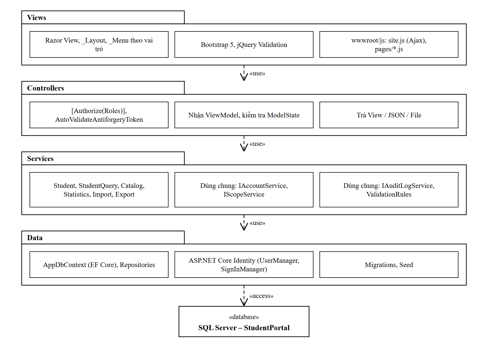
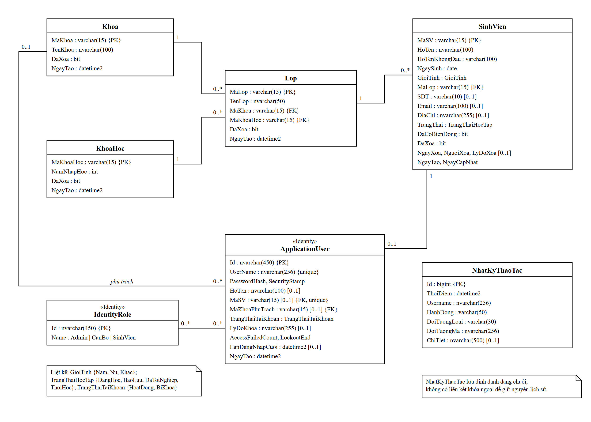
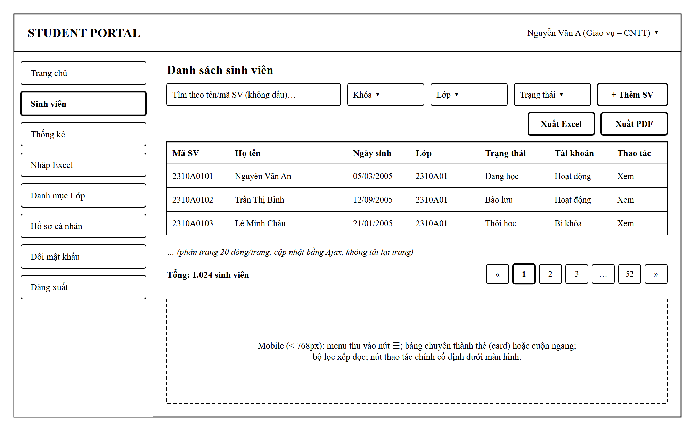

# 04. THIẾT KẾ HỆ THỐNG

Ứng dụng quản lý sinh viên Student Portal

Kiến trúc, cấu trúc mã nguồn, danh sách Controller – Action, interface dùng chung, cơ sở dữ liệu và giao diện.

## 3.2. Thiết kế hệ thống

### 3.2.1. Kiến trúc tổng thể

- Mô hình MVC trên ASP.NET Core MVC, phân tầng: Giao diện (Razor View, HTML, CSS, JavaScript/Ajax) – Điều khiển (Controller) – Nghiệp vụ (Service) – Truy cập dữ liệu (Repository/EF Core) – CSDL SQL Server.
- Luồng xử lý chung: Trình duyệt → Controller (kiểm tra \[Authorize\], anti-forgery, ModelState) → Service (phạm vi dữ liệu, quy tắc nghiệp vụ, giao dịch, nhật ký) → EF Core → SQL Server; kết quả trả về dạng View, JSON hoặc File.
- Ba dịch vụ dùng chung IAccountService, IScopeService và IAuditLogService được định nghĩa dưới dạng interface (mục 3.2.1.4); các phân hệ phụ thuộc vào interface thay vì lớp cài đặt cụ thể.

Hình 3.5. Biểu đồ gói (package diagram) thể hiện kiến trúc phân tầng

#### 3.2.1.1. Công nghệ và thư viện

| **Thành phần** | **Lựa chọn** | **Ghi chú** |
|----|----|----|
| Nền tảng | .NET 8 (LTS), ASP.NET Core MVC | Phiên bản hỗ trợ dài hạn; SDK 8.0 được cố định trong global.json. |
| ORM / CSDL | Entity Framework Core 8, SQL Server (LocalDB/Express khi dev) | Code-first, migration dùng chung trong một DbContext. |
| Xác thực | ASP.NET Core Identity (IdentityUser mở rộng) | Cookie authentication, Roles. |
| Giao diện | Bootstrap 5, Bootstrap Icons, jQuery, jQuery Validation Unobtrusive | Có sẵn trong template MVC. |
| Excel | ClosedXML (MIT) | Đọc file import, tạo file xuất .xlsx. |
| PDF | QuestPDF (Community License) | Giấy phép Community cho dự án học tập; sử dụng font hỗ trợ tiếng Việt. |
| Dữ liệu mẫu | Bogus (MIT) | Sinh khoảng 1.000 sinh viên mẫu phục vụ kiểm thử NFR-02. |

#### 3.2.1.2. Cấu trúc mã nguồn (solution)

Mã nguồn được tổ chức trong một project ASP.NET Core MVC, phân thư mục theo tầng:

| **Thư mục (StudentPortal.Web/)** | **Nội dung** |
|----|----|
| Controllers/ | AccountController, UsersController, StudentsController, FacultiesController, CoursesController, ClassesController, CatalogController, StatisticsController, ImportController, AuditLogsController, HomeController |
| Models/Entities/ | SinhVien, Khoa, KhoaHoc, Lop, ApplicationUser, NhatKyThaoTac; Enums: TrangThaiHocTap, GioiTinh, TrangThaiTaiKhoan |
| Models/ViewModels/ | \*CreateVm, \*EditVm, \*FilterVm, \*ListItemDto, PagedResult\<T\>, ApiResponse |
| Data/ | AppDbContext, Configurations/ (Fluent API), Migrations/, Seed/DbSeeder |
| Repositories/ | IRepository\<T\> và các repository cho truy vấn dùng lại |
| Services/Interfaces/ | IAccountService, IScopeService, IAuditLogService, IStudentService, IStudentQueryService, ICatalogService, IStatisticsService, IExportService, IImportService |
| Services/ | Các lớp triển khai tương ứng |
| Infrastructure/ | Authorization (tên vai trò, ScopeException → 403), Validation (attribute dùng chung), TextHelper (bỏ dấu), ExceptionMiddleware |
| Views/ | Shared/\_Layout, \_Menu, \_Modal, \_Pagination; thư mục theo từng Controller |
| wwwroot/ | css/site.css; js/site.js (ajax helper, toast, confirm, anti-forgery header); js/pages/\*.js |

#### 3.2.1.3. Danh sách Controller – Action (hợp đồng giữa giao diện và server)

Quy ước: View = trả trang HTML; JSON = trả ApiResponse; File = trả file tải về. Mọi POST yêu cầu anti-forgery token. Cột "Quyền" là vai trò được phép; phạm vi dữ liệu luôn áp dụng thêm.

<table>
<thead>
<tr>
<th><strong>Controller / Action</strong></th>
<th><strong>HTTP</strong></th>
<th><strong>Quyền</strong></th>
<th><strong>Trả về</strong></th>
<th><strong>FR</strong></th>
</tr>
</thead>
<tbody>
<tr>
<td colspan="5"><strong>AccountController – Lê Nam Khánh</strong></td>
</tr>
<tr>
<td>Login</td>
<td>GET/POST</td>
<td>Anonymous</td>
<td>View</td>
<td>FR-06</td>
</tr>
<tr>
<td>Logout</td>
<td>POST</td>
<td>Đã đăng nhập</td>
<td>Redirect</td>
<td>FR-07</td>
</tr>
<tr>
<td>ChangePassword</td>
<td>GET/POST</td>
<td>Cả 3 vai trò</td>
<td>View</td>
<td>FR-10</td>
</tr>
<tr>
<td>Profile</td>
<td>GET</td>
<td>Cả 3 vai trò</td>
<td>View</td>
<td>FR-11</td>
</tr>
<tr>
<td>UpdateContact</td>
<td>POST</td>
<td>SinhVien</td>
<td>JSON</td>
<td>FR-12</td>
</tr>
<tr>
<td>AccessDenied</td>
<td>GET</td>
<td>Đã đăng nhập</td>
<td>View (403)</td>
<td>FR-08</td>
</tr>
<tr>
<td colspan="5"><strong>UsersController [Admin] – Lê Nam Khánh</strong></td>
</tr>
<tr>
<td>Index / List</td>
<td>GET</td>
<td>Admin</td>
<td>View / JSON</td>
<td>FR-01</td>
</tr>
<tr>
<td>Create</td>
<td>GET/POST</td>
<td>Admin</td>
<td>View</td>
<td>FR-02</td>
</tr>
<tr>
<td>Edit/{id}</td>
<td>GET/POST</td>
<td>Admin</td>
<td>View</td>
<td>FR-03</td>
</tr>
<tr>
<td>ResetPassword</td>
<td>POST</td>
<td>Admin</td>
<td>JSON</td>
<td>FR-04</td>
</tr>
<tr>
<td>SetLock</td>
<td>POST</td>
<td>Admin</td>
<td>JSON</td>
<td>FR-05</td>
</tr>
<tr>
<td colspan="5"><strong>StudentsController [Admin, CanBo] – Từ Đức Anh (thao tác hồ sơ), Nguyễn Hoàng Quốc Duy (Index/Search), Trần Văn Dũng (Export)</strong></td>
</tr>
<tr>
<td>Index</td>
<td>GET</td>
<td>Admin, CanBo</td>
<td>View</td>
<td>FR-21</td>
</tr>
<tr>
<td>Search</td>
<td>GET</td>
<td>Admin, CanBo</td>
<td>JSON PagedResult</td>
<td>FR-21, FR-22</td>
</tr>
<tr>
<td>Create</td>
<td>POST</td>
<td>Admin, CanBo</td>
<td>JSON</td>
<td>FR-13</td>
</tr>
<tr>
<td>Details/{maSV}</td>
<td>GET</td>
<td>Admin, CanBo</td>
<td>View</td>
<td>FR-14</td>
</tr>
<tr>
<td>Edit</td>
<td>POST</td>
<td>Admin, CanBo</td>
<td>JSON</td>
<td>FR-15</td>
</tr>
<tr>
<td>AllowedStatuses/{maSV}</td>
<td>GET</td>
<td>Admin, CanBo</td>
<td>JSON</td>
<td>FR-16</td>
</tr>
<tr>
<td>ChangeStatus</td>
<td>POST</td>
<td>Admin, CanBo</td>
<td>JSON</td>
<td>FR-16</td>
</tr>
<tr>
<td>Transfer</td>
<td>POST</td>
<td>Admin, CanBo</td>
<td>JSON</td>
<td>FR-17</td>
</tr>
<tr>
<td>Delete</td>
<td>POST</td>
<td>Admin, CanBo</td>
<td>JSON</td>
<td>FR-18</td>
</tr>
<tr>
<td>ResetPassword</td>
<td>POST</td>
<td>Admin, CanBo</td>
<td>JSON</td>
<td>FR-19</td>
</tr>
<tr>
<td>SetLock</td>
<td>POST</td>
<td>Admin, CanBo</td>
<td>JSON</td>
<td>FR-20</td>
</tr>
<tr>
<td>Export?format=</td>
<td>GET</td>
<td>Admin, CanBo</td>
<td>File</td>
<td>FR-28</td>
</tr>
<tr>
<td colspan="5"><strong>Danh mục – Nguyễn Hoàng Quốc Duy</strong></td>
</tr>
<tr>
<td>Faculties / Courses: Index, List, Create, Edit, Delete</td>
<td>GET/POST</td>
<td>Admin (CanBo chỉ xem)</td>
<td>View / JSON</td>
<td>FR-23 – FR-26</td>
</tr>
<tr>
<td>Classes: Index, List, Create, Edit, Delete</td>
<td>GET/POST</td>
<td>Admin, CanBo (khoa mình)</td>
<td>View / JSON</td>
<td>FR-23 – FR-26</td>
</tr>
<tr>
<td>Catalog/Lookup?type=&amp;maKhoa=&amp;maKhoaHoc=</td>
<td>GET</td>
<td>Admin, CanBo</td>
<td>JSON (dropdown)</td>
<td>FR-13, 17, 21</td>
</tr>
<tr>
<td colspan="5"><strong>Thống kê, nhập/xuất – Trần Văn Dũng; Nhật ký – Nguyễn Hoàng Quốc Duy</strong></td>
</tr>
<tr>
<td>Statistics: Index, Data</td>
<td>GET</td>
<td>Admin, CanBo</td>
<td>View / JSON</td>
<td>FR-27</td>
</tr>
<tr>
<td>Statistics/Export?format=</td>
<td>GET</td>
<td>Admin, CanBo</td>
<td>File</td>
<td>FR-29</td>
</tr>
<tr>
<td>Import: Index, Template</td>
<td>GET</td>
<td>Admin, CanBo</td>
<td>View / File</td>
<td>FR-30</td>
</tr>
<tr>
<td>Import/Upload</td>
<td>POST multipart</td>
<td>Admin, CanBo</td>
<td>JSON (BM05)</td>
<td>FR-30</td>
</tr>
<tr>
<td>AuditLogs: Index, List</td>
<td>GET</td>
<td>Admin</td>
<td>View / JSON</td>
<td>FR-31</td>
</tr>
<tr>
<td>Home/Index</td>
<td>GET</td>
<td>Cả 3 vai trò</td>
<td>View (theo vai trò)</td>
<td>FR-08</td>
</tr>
</tbody>
</table>

#### 3.2.1.4. Interface dịch vụ dùng chung

<table>
<thead>
<tr>
<th><strong>Interface – phụ trách</strong></th>
<th><strong>Phương thức chính</strong></th>
<th><strong>Quy ước sử dụng</strong></th>
</tr>
</thead>
<tbody>
<tr>
<td>IScopeService – Khánh</td>
<td>
UserScope GetCurrent()

IQueryable&lt;SinhVien&gt; ApplyStudentScope(IQueryable&lt;SinhVien&gt;)

IQueryable&lt;Lop&gt; ApplyClassScope(IQueryable&lt;Lop&gt;)

Task EnsureStudentInScopeAsync(string maSV)

Task EnsureClassInScopeAsync(string maLop)
</td>
<td>Ensure* ném ScopeException → middleware trả 403. Mọi truy vấn sinh viên/lớp phải đi qua Apply* trước khi lọc, phân trang, xuất.</td>
</tr>
<tr>
<td>IAccountService – Khánh</td>
<td>
Task&lt;Result&gt; CreateStudentAccountAsync(string maSV, string password)

Task&lt;Result&gt; CreateStaffAccountAsync(StaffCreateDto)

Task&lt;Result&gt; ResetPasswordAsync(string userName, string newPassword)

Task&lt;Result&gt; SetLockAsync(string userName, bool locked, string reason)

Task&lt;Result&gt; ChangePasswordAsync(string userId, string current, string newPwd)
</td>
<td>Dùng chung AppDbContext (scoped) nên tham gia giao dịch của bên gọi; không tự Commit. SetLock cập nhật SecurityStamp.</td>
</tr>
<tr>
<td>IAuditLogService – Dũng</td>
<td>
Task LogAsync(string hanhDong, string doiTuongLoai, string doiTuongMa, string? chiTiet = null)

Task&lt;PagedResult&lt;AuditLogDto&gt;&gt; QueryAsync(AuditLogFilter)
</td>
<td>Lấy Username từ HttpContext; chỉ Add vào DbContext, được lưu khi bên gọi SaveChanges. Không truyền dữ liệu cá nhân vào chiTiet.</td>
</tr>
<tr>
<td>ValidationRules – Dũng</td>
<td>Regex MaSo, HoTen, SoDienThoai; [MaSo], [HoTen], [NgaySinh(MinAge = 15)], [SoDienThoai], [MatKhauManh]</td>
<td>Dùng cho ViewModel (client + server) và cho import Excel.</td>
</tr>
<tr>
<td>IStudentService – Đức Anh</td>
<td>CreateAsync, UpdateAsync, ChangeStatusAsync, TransferAsync, SoftDeleteAsync, GetDetailAsync, GetAllowedStatuses, UpdateFromImportAsync</td>
<td>Toàn bộ quy tắc FR-13 – FR-20 nằm ở đây; FR-30 gọi lại, không viết lại.</td>
</tr>
<tr>
<td>IStudentQueryService – Duy</td>
<td>
IQueryable&lt;SinhVien&gt; BuildQuery(StudentFilter)

Task&lt;PagedResult&lt;StudentListItemDto&gt;&gt; SearchAsync(StudentFilter)
</td>
<td>BuildQuery được IExportService dùng lại để xuất đúng tiêu chí FR-28.</td>
</tr>
</tbody>
</table>

#### 3.2.1.5. Quy ước Ajax/JSON và mã lỗi

- Mọi phản hồi JSON có dạng: { success: bool, message: string, data: object\|null, errors: { tenTruong: \[thông báo\] } \| null }.
- Danh sách phân trang: data = { items: \[\], page, pageSize, totalItems, totalPages }; pageSize mặc định 20, tối đa 100.
- Mã HTTP: 200 thành công; 400 dữ liệu không hợp lệ (kèm errors); 401 hết phiên (client chuyển về trang đăng nhập); 403 ngoài quyền/phạm vi; 404 không tìm thấy hoặc đã xóa mềm; 409 trùng mã; 500 lỗi hệ thống (thông báo chung).
- Client gửi anti-forgery token qua header "RequestVerificationToken" (site.js đọc từ thẻ input ẩn trong \_Layout); server bật AutoValidateAntiforgeryToken toàn cục.
- Ngày gửi/nhận dạng ISO 8601 (yyyy-MM-dd); hiển thị dd/MM/yyyy. Enum trả về kèm tên hiển thị tiếng Việt.

#### 3.2.1.6. Cấu hình bảo mật Identity

| **Thiết lập** | **Giá trị** |
|----|----|
| Password | RequiredLength = 8; RequireDigit = true; RequireNonAlphanumeric/Uppercase/Lowercase = false; thêm IPasswordValidator tùy chỉnh bắt buộc có ít nhất 1 chữ cái |
| Lockout | MaxFailedAccessAttempts = 5; DefaultLockoutTimeSpan = 15 phút; AllowedForNewUsers = true |
| Cookie | HttpOnly = true; SecurePolicy = Always; SameSite = Lax; ExpireTimeSpan = 30 phút, SlidingExpiration; LoginPath = /Account/Login; AccessDeniedPath = /Account/AccessDenied |
| Thu hồi phiên | SecurityStampValidatorOptions.ValidationInterval = TimeSpan.Zero và kiểm tra TrangThaiTaiKhoan trong OnValidatePrincipal để khóa/đổi quyền/đổi khoa có hiệu lực từ yêu cầu kế tiếp (FR-03, FR-05, FR-09) |
| Ajax chưa đăng nhập | Với request có header X-Requested-With, trả 401/403 thay vì redirect HTML (OnRedirectToLogin/OnRedirectToAccessDenied) |
| Seed | Tạo 3 vai trò và tài khoản Admin đầu tiên khi khởi động; mật khẩu Admin đọc từ user-secrets/biến môi trường, không commit lên Git |

### 3.2.2. Thiết kế cơ sở dữ liệu

Cơ sở dữ liệu được xây dựng theo vòng đời hồ sơ sinh viên: danh mục tổ chức (Khoa, Khóa, Lớp) → hồ sơ sinh viên → tài khoản → nhật ký. Tài khoản được hiện thực bằng bảng AspNetUsers của ASP.NET Core Identity, mở rộng các trường MaSV, MaKhoaPhuTrach, TrangThaiTaiKhoan. Tổng quan các bảng:

| **Bảng dữ liệu** | **Mục đích** | **Thuộc tính chính** |
|----|----|----|
| Khoa | Khoa chuyên môn | MaKhoa, TenKhoa, DaXoa |
| KhoaHoc | Khóa tuyển sinh | MaKhoaHoc, NamNhapHoc, DaXoa |
| Lop | Lớp hành chính, gắn Khoa và Khóa | MaLop, TenLop, MaKhoa, MaKhoaHoc, DaXoa |
| SinhVien | Hồ sơ sinh viên | MaSV, HoTen, NgaySinh, GioiTinh, MaLop, SDT, Email, DiaChi, TrangThai, DaXoa… |
| AspNetUsers (ApplicationUser) | Tài khoản đăng nhập của cả ba vai trò | Id, UserName, PasswordHash, HoTen, MaSV, MaKhoaPhuTrach, TrangThaiTaiKhoan |
| AspNetRoles, AspNetUserRoles | Vai trò Admin, CanBo, SinhVien | RoleId, Name, UserId |
| NhatKyThaoTac | Nhật ký thao tác nhạy cảm (chỉ thêm) | Id, ThoiDiem, Username, HanhDong, DoiTuongLoai, DoiTuongMa, ChiTiet |

Hình 3.6. Biểu đồ lớp thực thể dữ liệu (ERD dạng UML)

- Quan hệ (bội số UML): Khoa 1 – 0..\* Lop; KhoaHoc 1 – 0..\* Lop; Lop 1 – 0..\* SinhVien; SinhVien 1 – 0..1 ApplicationUser (vai trò SinhVien, UserName = MaSV); Khoa 0..1 – 0..\* ApplicationUser (khoa phụ trách của Giáo vụ); ApplicationUser 0..\* – 0..\* IdentityRole.
- Khóa ngoại dùng DeleteBehavior.Restrict (không xóa dây chuyền) vì hệ thống chỉ xóa mềm.

#### 3.2.2.1. Chi tiết bảng

***Bảng Khoa***

| **Cột** | **Kiểu SQL**  | **Null** | **Ràng buộc / ghi chú**              |
|---------|---------------|:--------:|--------------------------------------|
| MaKhoa  | varchar(15)   |  Không   | PK; chữ số không dấu; không dùng lại |
| TenKhoa | nvarchar(100) |  Không   |                                      |
| DaXoa   | bit           |  Không   | Mặc định 0                           |
| NgayTao | datetime2     |  Không   | Mặc định thời điểm tạo               |

***Bảng KhoaHoc***

| **Cột**    | **Kiểu SQL** | **Null** | **Ràng buộc / ghi chú** |
|------------|--------------|:--------:|-------------------------|
| MaKhoaHoc  | varchar(15)  |  Không   | PK (ví dụ K2023)        |
| NamNhapHoc | int          |  Không   | 2000 – năm hiện tại + 1 |
| DaXoa      | bit          |  Không   | Mặc định 0              |
| NgayTao    | datetime2    |  Không   |                         |

***Bảng Lop***

| **Cột**   | **Kiểu SQL** | **Null** | **Ràng buộc / ghi chú**            |
|-----------|--------------|:--------:|------------------------------------|
| MaLop     | varchar(15)  |  Không   | PK                                 |
| TenLop    | nvarchar(50) |  Không   | UNIQUE (MaKhoa, MaKhoaHoc, TenLop) |
| MaKhoa    | varchar(15)  |  Không   | FK → Khoa                          |
| MaKhoaHoc | varchar(15)  |  Không   | FK → KhoaHoc                       |
| DaXoa     | bit          |  Không   |                                    |
| NgayTao   | datetime2    |  Không   |                                    |

***Bảng SinhVien***

| **Cột** | **Kiểu SQL** | **Null** | **Ràng buộc / ghi chú** |
|----|----|:--:|----|
| MaSV | varchar(15) | Không | PK; = UserName tài khoản |
| HoTen | nvarchar(100) | Không |  |
| HoTenKhongDau | varchar(100) | Không | Họ tên chữ thường, bỏ dấu, đ → d; Service tự tính khi lưu; phục vụ tìm kiếm không dấu (FR-22) |
| NgaySinh | date | Không |  |
| GioiTinh | tinyint | Không | 1 Nam, 2 Nữ, 3 Khác |
| MaLop | varchar(15) | Không | FK → Lop |
| SDT | varchar(10) | Có |  |
| Email | varchar(100) | Có |  |
| DiaChi | nvarchar(255) | Có |  |
| TrangThai | tinyint | Không | 1 Đang học, 2 Bảo lưu, 3 Đã tốt nghiệp, 4 Thôi học |
| DaCoBienDong | bit | Không | Bằng 1 sau lần đổi trạng thái/chuyển lớp đầu tiên; dùng cho điều kiện xóa của Giáo vụ (FR-18) |
| DaXoa | bit | Không | Mặc định 0 |
| NgayXoa | datetime2 | Có |  |
| NguoiXoa | nvarchar(256) | Có | UserName người xóa |
| LyDoXoa | nvarchar(500) | Có | Bắt buộc khi DaXoa = 1 (CHECK) |
| NgayTao | datetime2 | Không |  |
| NgayCapNhat | datetime2 | Có | Cập nhật ở mọi lần sửa |

***Bảng AspNetUsers (ApplicationUser : IdentityUser)***

| **Cột** | **Kiểu SQL** | **Null** | **Ràng buộc / ghi chú** |
|----|----|:--:|----|
| Id, UserName, NormalizedUserName, PasswordHash, SecurityStamp, AccessFailedCount, LockoutEnd, LockoutEnabled | theo Identity | — | Cột chuẩn của Identity; UserName duy nhất |
| HoTen | nvarchar(100) | Có | Bắt buộc với Admin/CanBo; null với SinhVien (lấy từ SinhVien) |
| MaSV | varchar(15) | Có | FK → SinhVien, UNIQUE (filtered, khi not null); bắt buộc và = UserName với SinhVien |
| MaKhoaPhuTrach | varchar(15) | Có | FK → Khoa; bắt buộc với CanBo, null với Admin/SinhVien |
| TrangThaiTaiKhoan | tinyint | Không | 1 HoatDong, 2 BiKhoa (khóa nghiệp vụ, khác LockoutEnd là khóa tạm) |
| LyDoKhoa | nvarchar(255) | Có |  |
| LanDangNhapCuoi | datetime2 | Có | Null khi chưa từng đăng nhập; dùng cho điều kiện xóa của Giáo vụ (FR-18) |
| NgayTao | datetime2 | Không |  |

***Bảng NhatKyThaoTac***

| **Cột** | **Kiểu SQL** | **Null** | **Ràng buộc / ghi chú** |
|----|----|:--:|----|
| Id | bigint identity | Không | PK |
| ThoiDiem | datetime2 | Không | Giờ server (UTC+7 khi hiển thị) |
| Username | nvarchar(256) | Không | Lưu dạng chuỗi, không FK, để giữ nguyên lịch sử |
| HanhDong | varchar(50) | Không | Mã hành động – xem bảng 3.2.2.2 |
| DoiTuongLoai | varchar(30) | Không | SinhVien \| TaiKhoan \| Khoa \| KhoaHoc \| Lop \| File |
| DoiTuongMa | nvarchar(256) | Không | MaSV, UserName, mã danh mục… |
| ChiTiet | nvarchar(500) | Có | Thông tin không nhạy cảm: lý do, trạng thái cũ → mới, tiêu chí xuất, số dòng import |

#### 3.2.2.2. Danh mục mã hành động nhật ký

| **Nhóm** | **Mã HanhDong** |
|----|----|
| Tài khoản | TaoTaiKhoan, CapNhatTaiKhoan, DoiQuyenKhoa, CapLaiMatKhau, DoiMatKhau, KhoaTaiKhoan, MoKhoaTaiKhoan |
| Hồ sơ | TaoHoSo, SuaHoSo, CapNhatLienHe, DoiTrangThai, ChuyenLop, XoaMemHoSo |
| Danh mục | ThemDanhMuc, SuaDanhMuc, XoaMemDanhMuc |
| Dữ liệu | Import, XuatDanhSach, XuatThongKe |

#### 3.2.2.3. Chỉ mục và bộ lọc truy vấn

- SinhVien: IX(MaLop), IX(TrangThai), IX(DaXoa), IX(HoTenKhongDau). Lop: IX(MaKhoa), IX(MaKhoaHoc). NhatKyThaoTac: IX(ThoiDiem DESC), IX(Username), IX(DoiTuongMa).
- Global query filter HasQueryFilter(x =\> !x.DaXoa) cho Khoa, KhoaHoc, Lop, SinhVien; kiểm tra trùng mã dùng IgnoreQueryFilters() để bao gồm cả bản ghi đã xóa mềm.
- Danh sách và thống kê luôn dùng AsNoTracking() và Select sang DTO.

#### 3.2.2.4. Quy tắc kiểm tra dữ liệu

| **Trường** | **Áp dụng** | **Quy tắc** | **Hiện thực** |
|----|----|----|----|
| MaSV / UserName | SinhVien, TaiKhoan | 6 – 15 ký tự chữ và số, không dấu, không khoảng trắng; duy nhất kể cả đã xóa mềm; cố định, không dùng lại | \[MaSo\] ^\[A-Za-z0-9\]{6,15}\$ + kiểm tra CSDL |
| HoTen | SinhVien | Bắt buộc, 2 – 100 ký tự, không chứa chữ số | \[Required\]\[StringLength(100, MinimumLength = 2)\]\[HoTen\] |
| NgaySinh | SinhVien | Không ở tương lai; đủ 15 tuổi | \[NgaySinh(MinAge = 15)\] |
| SDT | SinhVien | Không bắt buộc; 10 chữ số, bắt đầu bằng 0 | \[SoDienThoai\] ^0\d{9}\$ |
| Email | SinhVien | Không bắt buộc; đúng định dạng, ≤ 100 ký tự | \[EmailAddress\]\[StringLength(100)\] |
| MaKhoa, MaKhoaHoc, MaLop | Danh mục | Chữ số không dấu; duy nhất kể cả đã xóa mềm | \[MaSo\] (độ dài 2 – 15) + kiểm tra CSDL |
| TenLop | Lop | Duy nhất trong cùng Khoa và Khóa | Unique index + kiểm tra Service |
| Mật khẩu | TaiKhoan | ≥ 8 ký tự, có chữ và số; mật khẩu mới khác mật khẩu hiện tại | Identity PasswordOptions + validator tùy chỉnh |

#### 3.2.2.5. Dữ liệu mẫu (seed)

- 3 vai trò; 1 Admin; 3 Giáo vụ thuộc các khoa khác nhau để kiểm thử phạm vi dữ liệu.
- 4 khoa, 4 khóa (K2022 – K2025), khoảng 30 lớp; khoảng 1.000 sinh viên với đủ 4 trạng thái, có cả hồ sơ đã xóa mềm – phục vụ kiểm thử NFR-02 và các quy tắc FR-16, FR-18.

### 3.2.3. Thiết kế giao diện

Giao diện dùng một layout chung: thanh tiêu đề (tên hệ thống, người dùng, vai trò – khoa), menu bên trái hiển thị theo vai trò, vùng nội dung. Các thao tác thêm/sửa/đổi trạng thái/chuyển lớp/xóa dùng modal và Ajax; thông báo dạng toast. Danh sách màn hình được trình bày trong bảng dưới đây.

Hình 3.7. Wireframe layout chung và màn hình Danh sách sinh viên

| **Màn hình** | **Vai trò** | **Thành phần chính** | **FR** |
|----|----|----|----|
| Đăng nhập | Tất cả | Form tên đăng nhập/mật khẩu, thông báo lỗi chung; trang công khai, có title và meta description | FR-06 |
| Trang chủ | Tất cả | Admin/Giáo vụ: thẻ số liệu nhanh (tổng SV theo trạng thái trong phạm vi), lối tắt; Sinh viên: tóm tắt hồ sơ | FR-08 |
| Hồ sơ cá nhân | Tất cả | Thông tin hồ sơ/tài khoản; Sinh viên có nút Cập nhật liên hệ (modal) | FR-11, 12 |
| Đổi mật khẩu | Tất cả | MK hiện tại, MK mới, xác nhận; gợi ý chính sách mật khẩu | FR-10 |
| Quản lý tài khoản | Admin | Bộ lọc vai trò/khoa/trạng thái, bảng phân trang, nút Tạo, Sửa, Cấp lại MK, Khóa/Mở khóa | FR-01 – 05 |
| Danh sách sinh viên | Admin, Giáo vụ | Ô tìm kiếm không dấu, dropdown Khoa/Khóa/Lớp/Trạng thái, bảng, phân trang, Thêm SV, Xuất Excel/PDF (Hình 3.7) | FR-21, 22, 28 |
| Chi tiết hồ sơ | Admin, Giáo vụ | Thông tin hồ sơ + trạng thái tài khoản; nút thao tác hiển thị theo vai trò và trạng thái: Sửa, Đổi trạng thái, Chuyển lớp, Xóa, Cấp lại MK, Khóa/Mở khóa | FR-14 – 20 |
| Danh mục | Admin, Giáo vụ | Tab Khoa / Khóa / Lớp, bảng, modal thêm/sửa, xác nhận xóa mềm | FR-23 – 26 |
| Thống kê | Admin, Giáo vụ | Chọn nhóm theo, bộ lọc, bảng thống kê có dòng tổng, Xuất Excel/PDF | FR-27, 29 |
| Nhập Excel | Admin, Giáo vụ | Tải file mẫu, chọn file, thanh tiến trình, bảng kết quả BM05 | FR-30 |
| Nhật ký thao tác | Admin | Bộ lọc thời gian/người/hành động/đối tượng, bảng chỉ đọc | FR-31 |
| Từ chối truy cập / Lỗi | Tất cả | Trang 403, 404, 500 thân thiện, không lộ thông tin kỹ thuật | FR-08 |
