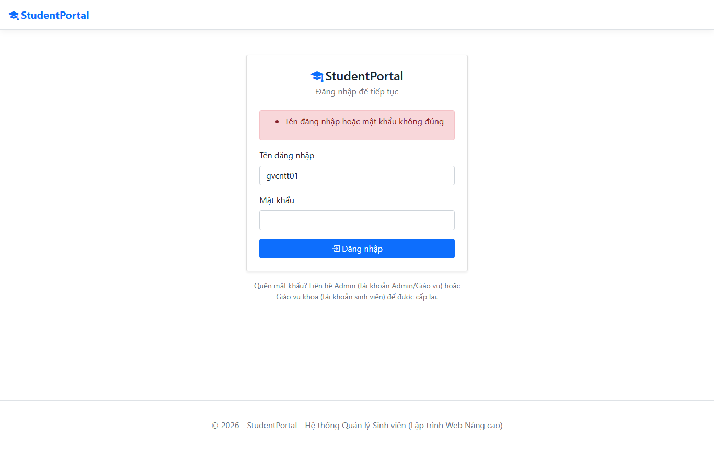
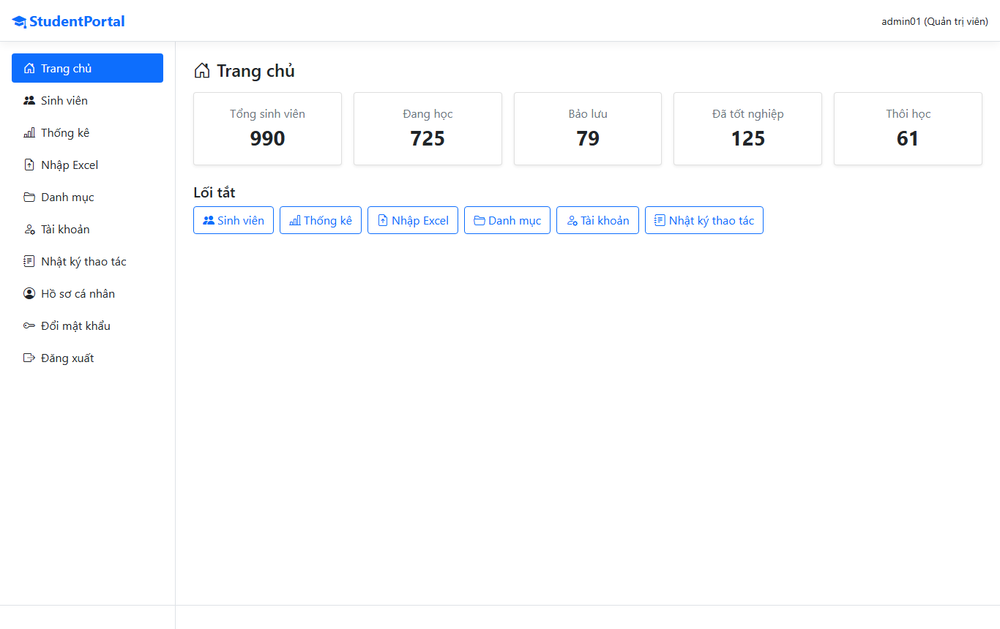
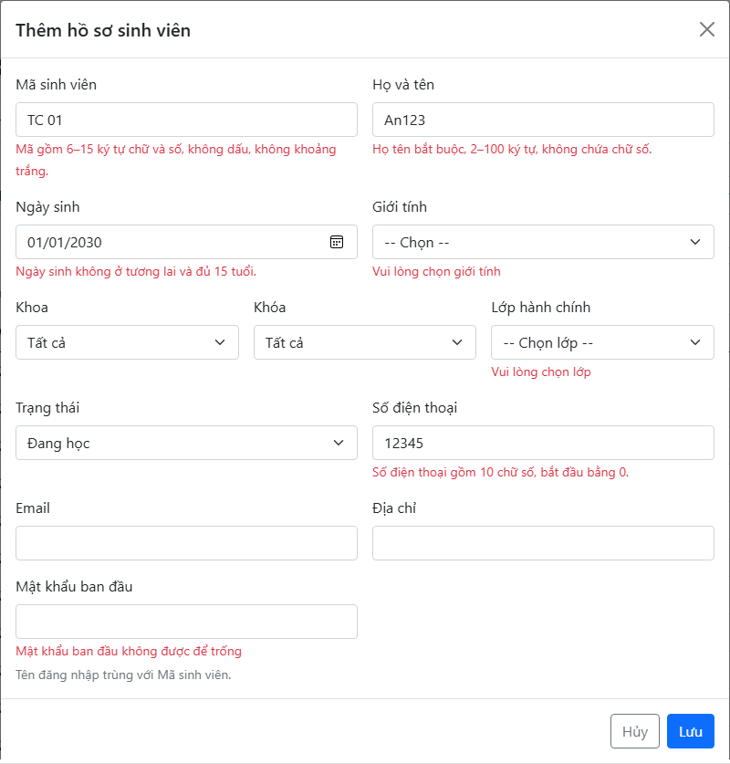
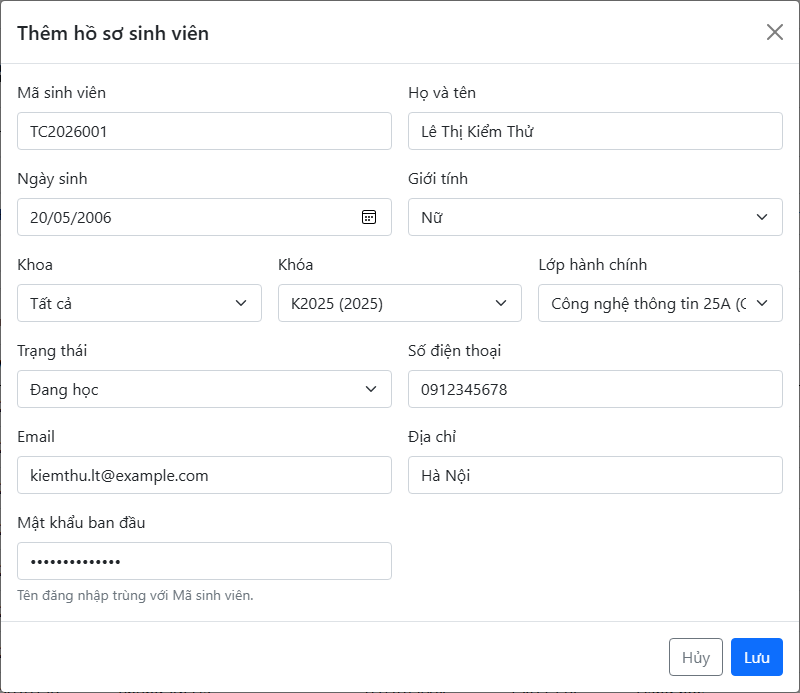
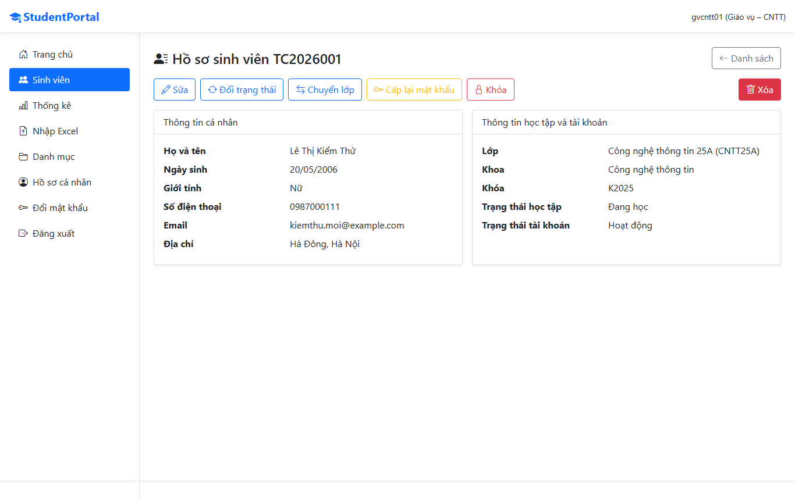
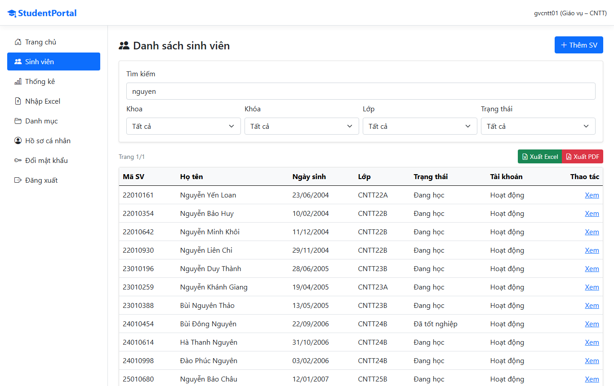
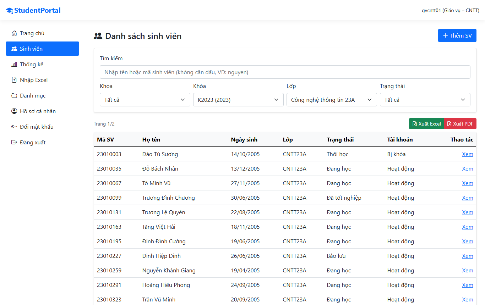
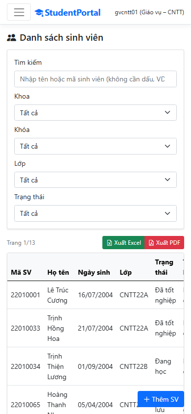
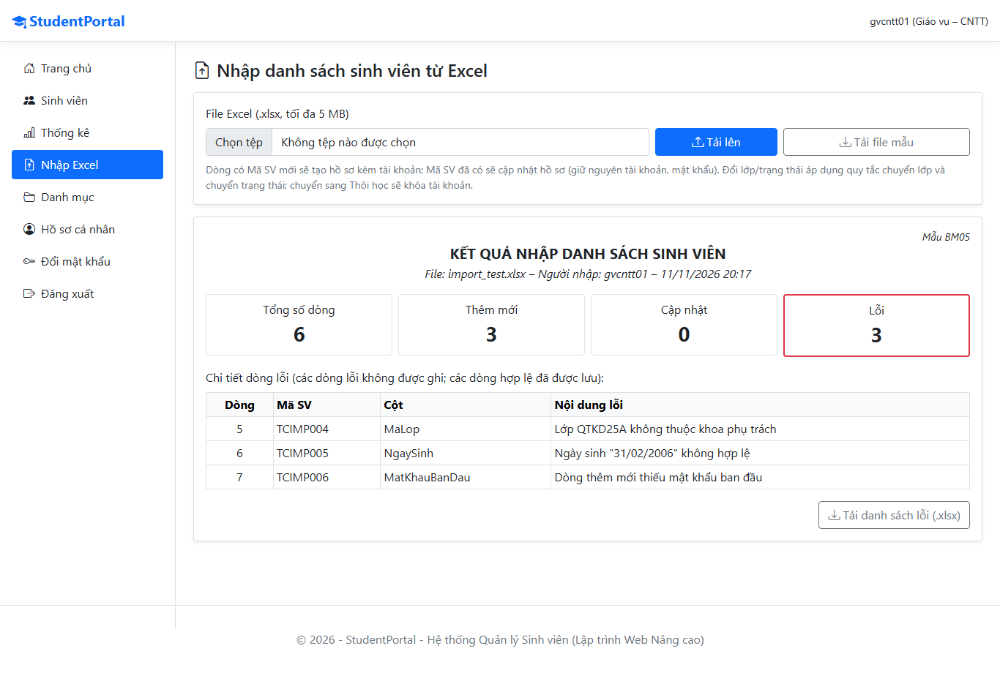
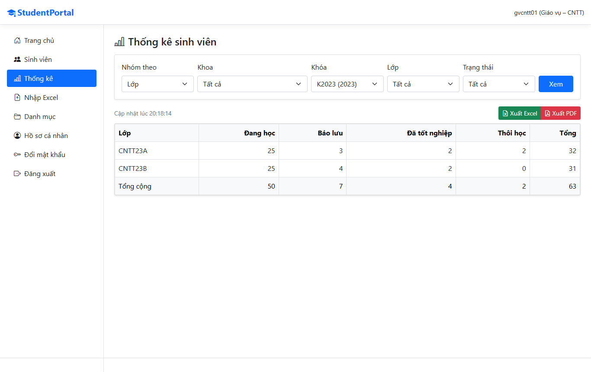

# 05. MỘT SỐ CHỨC NĂNG CHÍNH VÀ KIỂM THỬ

Ứng dụng quản lý sinh viên Student Portal

Môi trường cài đặt, bốn chức năng tiêu biểu (giao diện, mã HTML, CSS, script client, script server, đánh giá), kết quả kiểm thử chức năng và đối chiếu yêu cầu BTL.

Chương này trình bày bốn chức năng tiêu biểu, mỗi thành viên một chức năng theo phân công ở mục 1.4. Mỗi chức năng gồm giao diện, mã HTML (Razor View), mã CSS, mã script phía client, mã script phía server và đánh giá. Các đoạn mã được trích từ kho mã nguồn của nhóm (nhánh main, bản gộp ngày 09/11/2026); phần lược bỏ được thay bằng dấu "// ...". Kết quả kiểm thử của từng chức năng được tổng hợp ở mục 4.5.

## 4.0. Môi trường cài đặt

| **Thành phần** | **Phiên bản / cấu hình** |
|----|----|
| Nền tảng | .NET 8, ASP.NET Core MVC (TargetFramework net8.0); SDK được cố định trong global.json (8.0.426, rollForward latestFeature) |
| CSDL | SQL Server LocalDB (MSSQLLocalDB), Entity Framework Core 8.0.10, một migration InitialCreate |
| Xác thực | ASP.NET Core Identity 8.0.10, cookie .StudentPortal.Auth (HttpOnly, Secure, hết hạn sau 30 phút không hoạt động) |
| Thư viện | ClosedXML 0.104.2 (Excel), QuestPDF 2024.12.3 – giấy phép Community (PDF), Bogus 35.6.1 (dữ liệu mẫu) |
| Giao diện | Bootstrap 5, Bootstrap Icons, jQuery, jQuery Validation Unobtrusive |
| Dữ liệu mẫu | 1 Admin, 3 Giáo vụ, 4 khoa, 4 khóa (K2022 – K2025), 32 lớp, 1.000 hồ sơ sinh viên (10 hồ sơ xóa mềm); mật khẩu mẫu đọc từ cấu hình Seed:AdminPassword, Seed:DemoPassword, không lưu trong mã nguồn |
| Quản lý mã nguồn | GitHub, nhánh theo chức năng, gộp qua Pull Request; phân tích chất lượng bằng SonarCloud Quality Gate |

## 4.1. Đăng nhập, phân quyền và phạm vi dữ liệu theo khoa – Lê Nam Khánh

### 4.1.1. Giao diện

Trang đăng nhập là trang công khai duy nhất của hệ thống, dùng form Razor gửi về AccountController. Khi đăng nhập sai, hệ thống hiển thị một thông báo chung, không cho biết tên đăng nhập có tồn tại hay tài khoản đang bị khóa. Sau khi đăng nhập, menu bên trái hiển thị theo vai trò. Giáo vụ không thấy mục Quản lý tài khoản và Nhật ký thao tác; tên vai trò và khoa phụ trách hiển thị ở góc phải thanh tiêu đề.



Hình 4.1. Trang đăng nhập khi nhập sai mật khẩu



Hình 4.2. Trang chủ của Admin với menu đầy đủ chức năng

### 4.1.2. Mã HTML

Form dùng Tag Helper asp-for để kết gán LoginVm, asp-validation-for để hiển thị lỗi từng trường và asp-validation-summary cho lỗi chung. Token anti-forgery được Tag Helper form tự chèn.

**Views/Account/Login.cshtml**

```cshtml
<form asp-action="Login" method="post" novalidate>
    <input type="hidden" asp-for="ReturnUrl" />
    <div asp-validation-summary="ModelOnly" class="alert alert-danger py-2" role="alert"></div>
    <div class="mb-3">
        <label asp-for="UserName" class="form-label"></label>
        <input asp-for="UserName" class="form-control" autocomplete="username" />
        <span asp-validation-for="UserName" class="text-danger small"></span>
    </div>
    <div class="mb-3">
        <label asp-for="MatKhau" class="form-label"></label>
        <input asp-for="MatKhau" class="form-control" autocomplete="current-password" />
        <span asp-validation-for="MatKhau" class="text-danger small"></span>
    </div>
    <div class="d-grid">
        <button type="submit" class="btn btn-primary">Đăng nhập</button>
    </div>
</form>
```

### 4.1.3. Mã CSS

Bố cục chung (header, menu trái, vùng nội dung) dùng lưới Bootstrap và một số lớp riêng trong site.css. Trên màn hình từ 768 px, menu có độ rộng cố định 15rem; trên điện thoại, menu thu vào nút ☰ ở thanh tiêu đề.

**wwwroot/css/site.css**

```css
/* Layout chung: menu bên trái, vùng nội dung (mục 3.2.3) */
.app-noi-dung {
  min-width: 0;
  padding-bottom: 6rem !important;
}
@media (min-width: 768px) {
  .app-menu {
    flex: 0 0 15rem;
    min-height: calc(100vh - 57px);
  }
}
```

### 4.1.4. Mã ClientSide Script

Form đăng nhập dùng jQuery Validation Unobtrusive để kiểm tra trường bắt buộc ngay trên trình duyệt. Mọi lời gọi Ajax trong hệ thống đi qua hàm dùng chung trong site.js. Hàm này gửi kèm token anti-forgery qua header RequestVerificationToken; khi máy chủ trả 401 (hết phiên), hàm chuyển người dùng về trang đăng nhập và giữ lại địa chỉ đang xem.

**wwwroot/js/site.js**

```javascript
function veTrangDangNhap() {
    const returnUrl = encodeURIComponent(location.pathname + location.search);
    location.href = '/Account/Login?returnUrl=' + returnUrl;
}

function goi(options) {
    return new Promise(function (resolve, reject) {
        $.ajax(Object.assign({
            dataType: 'json',
            headers: {
                'RequestVerificationToken': antiForgeryToken(),
                'X-Requested-With': 'XMLHttpRequest'
            }
        }, options)).done(function (res) {
            resolve(res);
        }).fail(function (xhr) {
            if (xhr.status === 401) veTrangDangNhap();
            reject(taoLoi(xhr));
        });
    });
}
```

### 4.1.5. Mã ServerSide Script

Chính sách mật khẩu, khóa tạm và cookie được cấu hình trong Program.cs. ValidationInterval = 0 buộc Identity kiểm tra lại SecurityStamp ở mọi yêu cầu, nên tài khoản bị khóa hoặc bị đổi vai trò, khoa phụ trách sẽ chịu tác dụng ngay từ yêu cầu kế tiếp.

**Program.cs**

```csharp
builder.Services.AddIdentity<ApplicationUser, IdentityRole>(options =>
{
    options.Password.RequireDigit = true;
    options.Password.RequiredLength = 8;          // + LetterPasswordValidator: bắt buộc có chữ
    options.Lockout.DefaultLockoutTimeSpan = TimeSpan.FromMinutes(15);
    options.Lockout.MaxFailedAccessAttempts = 5;
    options.Lockout.AllowedForNewUsers = true;
})
.AddEntityFrameworkStores<AppDbContext>()
.AddSignInManager<AppSignInManager>()
.AddPasswordValidator<LetterPasswordValidator>()
.AddClaimsPrincipalFactory<AppClaimsPrincipalFactory>();

builder.Services.Configure<SecurityStampValidatorOptions>(o => o.ValidationInterval = TimeSpan.Zero);
builder.Services.ConfigureApplicationCookie(o =>
{
    o.Cookie.HttpOnly = true;
    o.Cookie.SecurePolicy = CookieSecurePolicy.Always;
    o.ExpireTimeSpan = TimeSpan.FromMinutes(30);
    o.SlidingExpiration = true;
});
```

Action Login bật lockoutOnFailure và trả về cùng một thông báo cho mọi trường hợp sai. Tài khoản ở trạng thái BiKhoa bị AppSignInManager từ chối trước bước kiểm tra mật khẩu, nên action tự tăng số lần sai để hành vi giống tài khoản thường.

**Controllers/AccountController.cs**

```csharp
[HttpPost, AllowAnonymous]
public async Task<IActionResult> Login(LoginVm dto)
{
    if (!ModelState.IsValid) return View(dto);
    var result = await _signInManager.PasswordSignInAsync(dto.UserName.Trim(), dto.MatKhau,
        isPersistent: false, lockoutOnFailure: true);
    if (!result.Succeeded)
    {
        if (result.IsNotAllowed)                      // tài khoản BiKhoa
        {
            var biKhoa = await _userManager.FindByNameAsync(dto.UserName.Trim());
            if (biKhoa != null) await _userManager.AccessFailedAsync(biKhoa);
        }
        ModelState.AddModelError(string.Empty, result.IsLockedOut ? LoiKhoaTam : LoiDangNhap);
        dto.MatKhau = string.Empty;
        return View(dto);
    }
    // ... ghi LanDangNhapCuoi, chuyển về returnUrl nội bộ hoặc trang chủ
}
```

Phạm vi dữ liệu (FR-09) được áp dụng tập trung trong ScopeService. Mọi truy vấn sinh viên, kể cả xuất file và nhập Excel, đều đi qua ApplyStudentScope trước khi lọc và phân trang. Admin thấy toàn bộ dữ liệu, Giáo vụ chỉ thấy khoa phụ trách, Sinh viên chỉ thấy hồ sơ của mình.

**Services/ScopeService.cs**

```csharp
public IQueryable<SinhVien> ApplyStudentScope(IQueryable<SinhVien> query)
{
    var scope = GetCurrent();
    if (scope.IsAdmin) return query;
    if (scope.IsCanBo)
    {
        var maKhoa = scope.MaKhoaPhuTrach;
        return query.Where(s => maKhoa != null && s.Lop!.MaKhoa == maKhoa);
    }
    if (scope.IsSinhVien)
    {
        var maSV = scope.MaSV;
        return query.Where(s => maSV != null && s.MaSV == maSV);
    }
    return query.Where(s => false);
}
```

### 4.1.6. Đánh giá

Mục 4.5 có 36 ca của UC01 – UC08, tất cả đều đạt. Một số kết quả tiêu biểu:

- Sai tên đăng nhập, sai mật khẩu hay tài khoản bị khóa đều nhận cùng một thông báo; returnUrl trỏ ra ngoài bị bỏ qua (TC004, TC005, TC007).
- Admin khóa tài khoản Giáo vụ đang đăng nhập ở trình duyệt khác: phiên đó bị đăng xuất ngay ở yêu cầu kế tiếp (TC034).
- Sai mật khẩu 5 lần liên tiếp thì tài khoản bị khóa tạm (TC006).
- Giáo vụ mở trang Quản lý tài khoản bị chuyển đến trang 403 (TC022).
- Giáo vụ khoa CNTT gọi trực tiếp API xem hồ sơ sinh viên khoa QTKD nhận HTTP 403; sinh viên xem hồ sơ người khác cũng nhận 403 (TC048, TC016).
- Admin không thể khóa hay đổi vai trò tài khoản Admin hoạt động cuối cùng (TC036, TC030).
- Admin đổi khoa phụ trách của một Giáo vụ từ CNTT sang QTKD; ngay ở yêu cầu kế tiếp, Giáo vụ đó chỉ còn thấy sinh viên khoa QTKD (TC029).

Kiểm tra phân quyền đặt ở cả thuộc tính \[Authorize(Roles)\] và tầng dịch vụ, nên gọi API trực tiếp, bỏ qua giao diện, vẫn bị chặn.

## 4.2. Thêm hồ sơ sinh viên kèm tài khoản – Từ Đức Anh

### 4.2.1. Giao diện

Chức năng thêm hồ sơ mở bằng nút "Thêm SV" trên trang danh sách và hiển thị trong modal theo phiếu BM01. Dropdown Lớp phụ thuộc vào Khoa và Khóa đang chọn, và chỉ chứa các lớp trong phạm vi của người dùng. Lỗi nhập liệu hiển thị ngay dưới từng trường trước khi gửi. Khi lưu thành công, modal đóng, danh sách tải lại bằng Ajax và một thông báo hiện ở góc phải.



Hình 4.3. Modal thêm hồ sơ hiển thị lỗi kiểm tra phía client



Hình 4.4. Modal thêm hồ sơ với dữ liệu hợp lệ



Hình 4.5. Trang chi tiết hồ sơ vừa tạo, các nút thao tác hiển thị theo vai trò và trạng thái

### 4.2.2. Mã HTML

Modal là partial view \_StudentCreateModal nhận StudentCreateVm. Tag Helper asp-for sinh các thuộc tính data-val-\* từ Data Annotations, nhờ đó quy tắc kiểm tra phía client và phía server dùng chung một nguồn.

**Views/Students/_StudentCreateModal.cshtml**

```cshtml
<form id="formThemSV" class="modal-content" novalidate>
  <div class="modal-body">
    <div class="alert alert-danger d-none loi-modal" role="alert"></div>
    <div class="row g-3">
      <div class="col-12 col-md-6">
        <label asp-for="MaSV" class="form-label"></label>
        <input asp-for="MaSV" class="form-control" maxlength="15" />
        <span asp-validation-for="MaSV" class="text-danger small"></span>
      </div>
      <!-- ... Họ tên, Ngày sinh, Giới tính -->
      <div class="col-12 col-md-4">
        <label for="csKhoa" class="form-label">Khoa</label>
        <select id="csKhoa" class="form-select"><option value="">Tất cả</option></select>
      </div>
      <!-- ... Khóa -->
      <div class="col-12 col-md-4">
        <label asp-for="MaLop" class="form-label"></label>
        <select asp-for="MaLop" class="form-select"><option value="">-- Chọn lớp --</option></select>
        <span asp-validation-for="MaLop" class="text-danger small"></span>
      </div>
      <!-- ... Trạng thái, SĐT, Email, Địa chỉ, Mật khẩu ban đầu -->
    </div>
  </div>
</form>
```

### 4.2.3. Mã CSS

Modal dùng lưới Bootstrap: hai cột từ 768 px trở lên và một cột trên điện thoại. Trên điện thoại, nút thao tác chính (Thêm SV) được cố định ở góc dưới màn hình để luôn trong tầm tay (Hình 4.8 ở mục 4.3).

**wwwroot/css/site.css**

```css
/* Mobile: nút thao tác chính cố định dưới màn hình (Hình 3.7) */
@media (max-width: 767.98px) {
  .app-nut-chinh {
    position: fixed;
    right: 1rem;
    bottom: 1rem;
    z-index: 1020;
  }
}
```

### 4.2.4. Mã ClientSide Script

Validator tùy biến NgaySinhAttribute được đăng ký phía client bằng một adapter trong site.js. Khi gửi form, script kiểm tra hợp lệ, khóa nút Lưu để tránh gửi lặp và gửi JSON qua App.post. Lỗi trùng mã (HTTP 409) được gắn vào đúng trường Mã sinh viên; lỗi 400 được gắn theo từng trường mà server trả về.

**wwwroot/js/site.js**

```javascript
$.validator.addMethod('ngaysinh', function (value, element, minAge) {
    if (this.optional(element)) return true;
    const ngay = new Date(value);
    const moc = new Date();
    moc.setFullYear(moc.getFullYear() - parseInt(minAge, 10));
    return !isNaN(ngay) && ngay <= moc;
});
$.validator.unobtrusive.adapters.addSingleVal('ngaysinh', 'minage');
```

**wwwroot/js/pages/students.js**

```javascript
$formThem.on('submit', function (e) {
    e.preventDefault();
    if (!$formThem.valid()) return;
    const $btn = $formThem.find('button[type="submit"]').prop('disabled', true);
    App.post('/Students/Create', {
        maSV: giaTri('MaSV'), hoTen: giaTri('HoTen'), ngaySinh: giaTri('NgaySinh'),
        gioiTinh: parseInt($('#GioiTinh').val(), 10) || null, maLop: csLop.value,
        trangThai: parseInt($('#TrangThai').val(), 10),
        sdt: giaTri('SDT'), email: giaTri('Email'), diaChi: giaTri('DiaChi'),
        matKhau: $('#MatKhau').val()
    }).then(function (res) {
        bootstrap.Modal.getOrCreateInstance(document.getElementById('modalThemSV')).hide();
        App.toast(res.message);
        loadPage(1);
    }).catch(function (err) {
        const errors = err.status === 409 ? { maSV: [err.message] } : err.errors;
        if (!errors || !App.showFieldErrors($formThem, errors)) {
            $formThem.find('.loi-modal').removeClass('d-none').text(App.errorText(err));
        }
    }).finally(function () { $btn.prop('disabled', false); });
});
```

### 4.2.5. Mã ServerSide Script

Controller chỉ nhận dữ liệu và gọi dịch vụ; ModelState sai được bộ lọc AjaxModelStateFilter chuyển thành JSON 400. Quy tắc nghiệp vụ nằm trong StudentService để chức năng nhập Excel (FR-30) dùng lại:

- Mã sinh viên duy nhất, kể cả so với hồ sơ đã xóa mềm.
- Lớp phải nằm trong phạm vi của người thêm.
- Hồ sơ, tài khoản và nhật ký được ghi trong cùng một giao dịch: tạo tài khoản lỗi thì hồ sơ cũng không được lưu.

**Controllers/StudentsController.cs**

```csharp
[HttpPost]
public async Task<IActionResult> Create([FromBody] StudentCreateVm dto)
{
    await _studentService.CreateAsync(dto);
    return Ok(ApiResponse.Ok(message: $"Đã thêm sinh viên '{dto.MaSV.Trim().ToUpperInvariant()}'."));
}
```

**Services/StudentService.cs**

```csharp
public async Task CreateAsync(StudentCreateVm dto)
{
    var maSV = dto.MaSV.Trim().ToUpperInvariant();
    await KiemTraLopAsync(dto.MaLop);                     // lớp đang dùng, trong phạm vi
    if (await _students.QueryIncludingDeleted().AnyAsync(s => s.MaSV == maSV))
        throw new NghiepVuException("Mã sinh viên đã tồn tại", StatusCodes.Status409Conflict);

    await using var tx = await _context.Database.BeginTransactionAsync();
    _students.Add(new SinhVien { MaSV = maSV, HoTen = dto.HoTen.Trim(),
        HoTenKhongDau = TextHelper.BoDau(dto.HoTen), /* ... */ TrangThai = dto.TrangThai });
    await _auditLog.LogAsync("TaoHoSo", LoaiSinhVien, maSV);
    await _students.SaveChangesAsync();

    var taoTaiKhoan = await _account.CreateStudentAccountAsync(maSV, dto.MatKhau);
    if (!taoTaiKhoan.Succeeded)                           // chưa commit: hồ sơ bị hủy theo
        throw new NghiepVuException("Không tạo được tài khoản sinh viên, hồ sơ chưa được lưu.");
    if (dto.TrangThai == TrangThaiHocTap.ThoiHoc)          // thống nhất với FR-16
        (await _account.SetLockAsync(maSV, true, "Hồ sơ tạo ở trạng thái Thôi học")).ThrowIfFailed();
    await tx.CommitAsync();
}
```

### 4.2.6. Đánh giá

Mục 4.5 có 47 ca của UC09 – UC16, 46/47 ca đạt, gồm thêm hồ sơ, xem, sửa, đổi trạng thái, chuyển lớp, xóa mềm, cấp lại mật khẩu và khóa tài khoản sinh viên. Một số kết quả tiêu biểu:

- Trùng mã, kể cả mã của hồ sơ đã xóa mềm, nhận HTTP 409; dữ liệu sai gửi thẳng lên server nhận HTTP 400 kèm lỗi từng trường (TC040, TC074, TC041).
- Khi tạo tài khoản lỗi (mã SV trùng tên đăng nhập của một Giáo vụ), giao dịch bị hủy và không có hồ sơ nào được lưu (TC043).
- Chuyển sang Thôi học thì tài khoản bị khóa; Admin chuyển Thôi học về Đang học thì tài khoản vẫn khóa, chỉ mở bằng tay (TC056, TC059).
- Giáo vụ chỉ xóa mềm được hồ sơ Đang học, chưa từng đăng nhập và chưa có biến động; các trường hợp khác bị chặn kèm lý do (TC067, TC069, TC070, TC071).

Ca TC045 chưa đạt: khi hai yêu cầu thêm cùng một mã mới đến máy chủ gần như đồng thời, cả hai cùng qua bước kiểm tra trùng, yêu cầu đến sau vi phạm khóa chính và nhận HTTP 500 thay vì 409. Dữ liệu vẫn đúng (chỉ một hồ sơ được lưu), và giao diện đã khóa nút Lưu trong lúc gửi nên người dùng thao tác bình thường khó gặp lỗi này. Cách khắc phục được nêu ở mục 5.3.

## 4.3. Danh sách và tìm kiếm sinh viên không dấu bằng Ajax – Nguyễn Hoàng Quốc Duy

### 4.3.1. Giao diện

Trang danh sách gồm ô tìm kiếm, bốn bộ lọc (Khoa, Khóa, Lớp, Trạng thái), bảng kết quả và phân trang. Kết quả cập nhật sau khi người dùng ngừng gõ 300 ms mà không tải lại trang. Từ khóa không cần dấu: gõ "nguyen" sẽ tìm ra cả "Nguyễn" và "Nguyên". Tiêu chí lọc được ghi lên URL nên khi quay lại trang, bộ lọc vẫn được giữ.



Hình 4.6. Tìm kiếm không dấu với từ khóa "nguyen"



Hình 4.7. Danh sách lọc theo Khóa K2023 và lớp CNTT23A



Hình 4.8. Danh sách sinh viên trên màn hình điện thoại (390 px)

### 4.3.2. Mã HTML

Bảng chỉ có phần đầu cố định; phần thân (tbody) do script dựng từ JSON. Thanh phân trang là partial dùng chung \_Pagination.

**Views/Students/Index.cshtml**

```cshtml
<form id="formDanhSach" class="row g-2 align-items-end">
    <div class="col-12">
        <label for="txtKeyword" class="form-label">Tìm kiếm</label>
        <input type="search" id="txtKeyword" name="keyword" class="form-control" maxlength="100"
               placeholder="Nhập tên hoặc mã sinh viên (không cần dấu, VD: nguyen)" autocomplete="off" />
    </div>
    <div class="col-12 col-md-3">
        <label for="selKhoa" class="form-label">Khoa</label>
        <select id="selKhoa" name="maKhoa" class="form-select"><option value="">Tất cả</option></select>
    </div>
    <!-- ... Khóa, Lớp, Trạng thái -->
</form>
<div class="table-responsive">
    <table class="table table-hover align-middle mb-0">
        <thead class="table-light"><tr><th>Mã SV</th><th>Họ tên</th> ... </tr></thead>
        <tbody id="dsBody"></tbody>
    </table>
</div>
<nav class="card-footer ..." aria-label="Phân trang danh sách">
    <span id="dsTotal" class="fw-semibold"></span>
    <partial name="_Pagination" model='"dsPaging"' />
</nav>
```

### 4.3.3. Mã CSS

Bảng nằm trong khung .table-responsive của Bootstrap. Trên màn hình hẹp, chỉ riêng bảng cuộn ngang, cả trang không bị cuộn ngang (TC139). Các bộ lọc dùng col-12 col-md-3 để xếp dọc trên điện thoại và nằm trên một hàng trên máy tính. Cỡ chữ gốc được giảm trên màn hình nhỏ:

**wwwroot/css/site.css**

```css
html { font-size: 14px; }
@media (min-width: 768px) {
  html { font-size: 16px; }
}
```

### 4.3.4. Mã ClientSide Script

Mỗi lần gõ, script đặt lại bộ đếm 300 ms (debounce). Biến requestSeq bảo đảm chỉ phản hồi của yêu cầu mới nhất được hiển thị, tránh trường hợp phản hồi cũ về sau ghi đè kết quả mới. Dữ liệu được đưa vào bảng bằng textContent nên nội dung từ CSDL không thể chèn mã HTML (chống XSS).

**wwwroot/js/pages/students.js**

```javascript
function loadPage(page) {
    const seq = ++requestSeq;
    const params = filterParams();
    const query = params.toString();
    history.replaceState(null, '', location.pathname + (query ? '?' + query : ''));
    params.set('page', page || 1);
    status.textContent = 'Đang tải...';
    App.get('/Students/Search?' + params.toString()).then(function (res) {
        if (seq !== requestSeq) return;                 // bỏ phản hồi cũ
        const d = res.data;
        renderRows(d.items);
        App.renderPaging(document.getElementById('dsPaging'), d.page, d.totalPages, loadPage);
        total.textContent = 'Tổng: ' + d.totalItems + ' sinh viên';
    });
}
txtKeyword.addEventListener('input', function () {
    clearTimeout(debounceTimer);
    debounceTimer = setTimeout(function () { loadPage(1); }, 300);
});
```

### 4.3.5. Mã ServerSide Script

Cột HoTenKhongDau được tính sẵn khi lưu hồ sơ (bỏ dấu, chữ thường, đ → d). Từ khóa được chuẩn hóa cùng cách rồi so khớp, nên tìm kiếm không phụ thuộc collation của CSDL. Lọc, sắp xếp và phân trang đều thực hiện tại CSDL bằng Skip/Take; pageSize mặc định 20, tối đa 100.

**Services/StudentQueryService.cs**

```csharp
public IQueryable<SinhVien> BuildQuery(StudentFilter filter)
{
    var query = _scope.ApplyStudentScope(_sinhViens.QueryNoTracking());  // FR-09
    if (!string.IsNullOrWhiteSpace(filter.Keyword))
    {
        var kwKhongDau = TextHelper.BoDau(filter.Keyword);
        query = query.Where(s => s.HoTenKhongDau.Contains(kwKhongDau) || s.MaSV.Contains(kwKhongDau));
    }
    if (!string.IsNullOrWhiteSpace(filter.MaKhoa)) query = query.Where(s => s.Lop!.MaKhoa == filter.MaKhoa);
    if (!string.IsNullOrWhiteSpace(filter.MaLop))  query = query.Where(s => s.MaLop == filter.MaLop);
    if (filter.TrangThai.HasValue)                 query = query.Where(s => s.TrangThai == filter.TrangThai.Value);
    return query;
}
```

**Infrastructure/TextHelper.cs**

```csharp
public static string BoDau(string? s)
{
    if (string.IsNullOrWhiteSpace(s)) return "";
    var chuan = s.Trim().ToLowerInvariant().Replace('đ', 'd').Normalize(NormalizationForm.FormD);
    var sb = new StringBuilder();
    foreach (var c in chuan)
        if (CharUnicodeInfo.GetUnicodeCategory(c) != UnicodeCategory.NonSpacingMark) sb.Append(c);
    return Regex.Replace(sb.ToString(), @"\s+", " ", RegexOptions.None, RegexTimeout);
}
```

### 4.3.6. Đánh giá

Mục 4.5 có 11 ca của UC17 – UC18, 10/11 ca đạt: lọc theo Khoa, Khóa, Lớp, Trạng thái, giới hạn theo phạm vi, tìm không dấu (gõ "nguyen", "NGUYỄN" cho cùng kết quả, "do" tìm ra "Đỗ"), thông báo khi không có kết quả và giới hạn 100 dòng/trang. Giao diện không cuộn ngang ở 390 px và 768 px (TC139, TC140). Với khoảng 1.000 sinh viên trên máy phát triển, thời gian phản hồi lâu nhất trong 5 lần gọi của các API danh sách, tìm kiếm, thống kê là 15 ms, 10 ms, 4 ms, 10 ms, thấp hơn nhiều so với ngưỡng 2 giây của NFR-02 (TC138).

Ca TC150 chưa đạt: dữ liệu mẫu có 71 hồ sơ có họ tên viết bằng chữ Ð (U+00D0, chữ Eth) thay cho chữ Đ tiếng Việt (U+0110), ví dụ "Vương Ðức Giang". Hàm TextHelper.BoDau chỉ đổi đ (U+0111) thành d, nên cột HoTenKhongDau lưu "vuong ðuc giang"; tìm "duc giang" hay "Vương Đức Giang" đều không ra hồ sơ này. Cách khắc phục được nêu ở mục 5.3.

Kiểm thử tải với 10, 25 và 50 người dùng đồng thời, mỗi mức 30 giây, không có yêu cầu lỗi; thời gian phản hồi p95 lần lượt 11 ms, 21 ms, 47 ms (TC151, TC152, TC153).

## 4.4. Nhập danh sách từ Excel và xuất báo cáo – Trần Văn Dũng

### 4.4.1. Giao diện

Trang Nhập Excel cho tải file mẫu BM02, chọn file .xlsx (tối đa 5 MB) và hiển thị thanh tiến trình trong lúc xử lý. Kết quả hiển thị ngay trên trang theo mẫu BM05: bốn ô tổng hợp và bảng các dòng lỗi (dòng, mã sinh viên, cột, nội dung lỗi). Các dòng hợp lệ vẫn được lưu; danh sách lỗi tải được dưới dạng file Excel để sửa và nhập lại. Trang Thống kê nhóm số liệu theo Khoa, Khóa hoặc Lớp, có dòng tổng cộng, và xuất được ra Excel hoặc PDF theo mẫu BM04.



Hình 4.9. Kết quả nhập file Excel có 3 dòng lỗi



Hình 4.10. Thống kê sinh viên theo lớp của khóa K2023

### 4.4.2. Mã HTML

**Views/Import/Index.cshtml**

```cshtml
<form id="formImport" class="row g-2 align-items-end" enctype="multipart/form-data">
    <div class="col-12 col-md-7">
        <label for="fileExcel" class="form-label">File Excel (.xlsx, tối đa 5 MB)</label>
        <input type="file" id="fileExcel" name="file" class="form-control" accept=".xlsx" required />
    </div>
    <div class="col-6 col-md-2 d-grid">
        <button type="submit" id="btnImport" class="btn btn-primary">Tải lên</button>
    </div>
    <div class="col-6 col-md-3 d-grid">
        <a class="btn btn-outline-secondary" asp-action="Template">Tải file mẫu</a>
    </div>
</form>
<div id="importResult" class="card shadow-sm d-none mb-3">
    <!-- tiêu đề BM05, 4 ô #soTong #soThem #soSua #soLoi, bảng tbody#importErrors -->
</div>
```

### 4.4.3. Mã CSS

Bảng lỗi đặt trong khung có chiều cao tối đa 320 px và cuộn dọc, để file nhiều dòng lỗi không đẩy các nút thao tác ra khỏi màn hình. Ô "Lỗi" có viền đỏ dày để nổi bật (lớp Bootstrap border-2 border-danger).

**Views/Import/Index.cshtml**

```cshtml
<div class="table-responsive" style="max-height: 320px;">
    <table class="table table-sm table-bordered mb-3"> ... </table>
</div>
<div class="border border-2 border-danger rounded p-2">Lỗi<div class="fs-3 fw-bold" id="soLoi"></div></div>
```

### 4.4.4. Mã ClientSide Script

Script kiểm tra kích thước file trước khi gửi, gửi file bằng FormData qua App.upload, rồi dựng bảng kết quả bằng .text() để tránh chèn mã HTML từ nội dung file.

**wwwroot/js/pages/import.js**

```javascript
$('#formImport').on('submit', function (e) {
    e.preventDefault();
    const file = $('#fileExcel')[0].files[0];
    if (!file) return showError('Vui lòng chọn file Excel.');
    if (file.size > KICH_THUOC_TOI_DA) return showError('File vượt quá 5 MB.');
    const formData = new FormData();
    formData.append('file', file);
    $('#btnImport').prop('disabled', true);
    $('#importProgress').removeClass('d-none');
    App.upload('/Import/Upload', formData).then(function (res) {
        showResult(res.data);                       // BM05
    }).catch(function (err) {
        showError(err.message);
    }).finally(function () {
        $('#btnImport').prop('disabled', false);
        $('#importProgress').addClass('d-none');
    });
});
```

### 4.4.5. Mã ServerSide Script

Controller kiểm tra lại đuôi file và kích thước ở phía server. File chỉ được đọc trong bộ nhớ bằng ClosedXML, không ghi xuống đĩa (NFR-08). Mỗi dòng được xử lý độc lập qua cùng các quy tắc của StudentService: dòng lỗi được ghi vào báo cáo và bộ theo dõi thay đổi được xóa, để lỗi của dòng này không ảnh hưởng dòng sau.

**Controllers/ImportController.cs**

```csharp
[HttpPost]
[RequestSizeLimit(KichThuocToiDa + 64 * 1024)]
public async Task<IActionResult> Upload(IFormFile? file)
{
    if (file == null || file.Length == 0) return BadRequest(ApiResponse.Fail("Vui lòng chọn file Excel."));
    if (!Path.GetExtension(file.FileName).Equals(".xlsx", StringComparison.OrdinalIgnoreCase))
        return BadRequest(ApiResponse.Fail("Chỉ chấp nhận file .xlsx."));
    if (file.Length > KichThuocToiDa) return BadRequest(ApiResponse.Fail("File vượt quá 5 MB."));
    await using var stream = file.OpenReadStream();
    var data = await _importService.ImportAsync(stream, Path.GetFileName(file.FileName));
    return Ok(ApiResponse.Ok(data));
}
```

**Services/ImportService.cs**

```csharp
foreach (var r in cacDong)
{
    var maSV = DocMaSV(ws, r);
    try
    {
        if (dongLap.TryGetValue(maSV, out var cungMa))
            throw new DongLoiException(CotMaSV, $"Mã SV lặp trong file (trùng dòng {...})");
        if (await XuLyDongAsync(ws, r, maSV, lopDangDung, lopDuocPhep)) ketQua.SoThemMoi++;
        else ketQua.SoCapNhat++;
    }
    catch (DongLoiException ex)  { GhiLoi(ketQua, r, maSV, ex.Loi); }
    catch (NghiepVuException ex) { GhiLoi(ketQua, r, maSV, new[] { new LoiCot(ex.Truong ?? CotMaSV, ex.Message) }); }
    finally { _context.ChangeTracker.Clear(); }      // dòng lỗi không để lại thay đổi
}
await _auditLog.LogAsync("Import", "File", tenFile,
    $"Thêm mới: {ketQua.SoThemMoi}, cập nhật: {ketQua.SoCapNhat}, lỗi: {ketQua.SoLoi}");
```

Xuất danh sách dùng lại đúng truy vấn của trang danh sách (BuildQuery), nên file xuất chứa đúng những sinh viên người dùng được phép thấy với cùng tiêu chí lọc, không phân trang.

**Services/ExportService.cs**

```csharp
public async Task<FileXuat?> ExportStudentsAsync(StudentFilter filter, bool pdf)
{
    var ds = await _studentQuery.BuildQuery(filter).OrderBy(s => s.MaSV)
        .Select(s => new { s.MaSV, s.HoTen, s.NgaySinh, /* ... */ s.TrangThai }).ToListAsync();
    if (ds.Count == 0) return null;
    var thoiDiem = DateTime.Now;
    return TaoFile(pdf, new MauBaoCao
    {
        MaMau = "Mẫu BM03", TieuDe = "DANH SÁCH SINH VIÊN", /* ... tiêu chí, cột, dòng */
        TongSo = $"Tổng số: {ds.Count} sinh viên",
        NguoiXuat = _scope.GetCurrent().UserName, ThoiDiem = thoiDiem,
        TenFile = $"DanhSachSinhVien_{thoiDiem:yyyyMMdd_HHmm}" + DuoiFile(pdf)
    });   // ghi nhật ký Xuat bên trong TaoFile
}
```

### 4.4.6. Đánh giá

Mục 4.5 có 29 ca của UC20 – UC23, tất cả đều đạt. Một số kết quả tiêu biểu:

- File thử 6 dòng (3 hợp lệ, 3 lỗi cố ý) cho kết quả tổng 6, thêm mới 3, lỗi 3. Ba lỗi được báo đúng dòng, cột và nội dung: lớp ngoài khoa phụ trách, ngày 31/02 không hợp lệ, dòng thêm mới thiếu mật khẩu (TC119).
- Mã SV lặp trong file, mã trùng hồ sơ đã xóa mềm bị báo lỗi theo dòng; dòng cập nhật để trống ô liên hệ giữ nguyên giá trị cũ (TC122, TC123, TC121).
- File .csv, file quá 5 MB, file sai tiêu đề cột hoặc không đọc được bị từ chối cả file (TC124, TC125, TC126, TC127).
- Số liệu thống kê theo từng trạng thái khớp với danh sách lọc tương ứng; tổng cộng bằng tổng số sinh viên (TC110, TC108). Xuất file khi không có dữ liệu bị chặn, và Giáo vụ không xuất được dữ liệu khoa khác (TC113, TC114).
- Nội dung file xuất được đọc lại và đối chiếu từng ô: file Excel, PDF của danh sách (BM03) có đúng tiêu đề, mã mẫu, 11 cột; số dòng, thứ tự mã SV và nội dung từng dòng khớp với danh sách trên trang; có dòng tổng, người xuất, thời điểm và số trang. Xuất toàn trường cho đủ 990 sinh viên, không bị cắt theo trang 20 dòng. File thống kê (BM04) khớp từng dòng và dòng tổng cộng với bảng trên trang (TC141, TC142, TC147, TC148, TC149).

## 4.5. Kiểm thử chức năng

Bộ kiểm thử được xây dựng từ đặc tả Use Case ở mục 3.1.5: mỗi luồng sự kiện chính và mỗi luồng thay thế (4a, 4b, …) có ít nhất một ca, cộng thêm các ca cho quy tắc nghiệp vụ, nhập Excel, đối chiếu nội dung file xuất với mẫu BM03, BM04 và yêu cầu phi chức năng NFR-01 – NFR-03, NFR-06. Cột "UC / FR" ghi nhánh đặc tả mà ca kiểm tra (ví dụ UC09-4b là luồng thay thế 4b của UC09) và yêu cầu tương ứng.

Nhóm chạy các ca ngày 11 – 12/11/2026 trên bản build từ nhánh main, với một CSDL thử riêng được seed lại từ đầu (1.000 sinh viên). Các ca được thực hiện tự động trên trình duyệt Microsoft Edge (chế độ headless) qua giao thức DevTools: thao tác trên giao diện như người dùng, gọi trực tiếp các API Ajax để thử đường vượt quyền và dữ liệu sai, dùng thêm một trình duyệt thứ hai cho các ca cần hai phiên đăng nhập cùng lúc. File Excel, PDF xuất ra được đọc lại bằng thư viện openpyxl và PyMuPDF để so từng ô. Kiểm thử tải dùng một chương trình Node.js tạo nhiều người dùng ảo gửi yêu cầu song song. Ca hết phiên được chờ thật hơn 30 phút. Toàn bộ 140 ca chức năng được chạy lại trên Google Chrome. Kết quả: 154/156 ca đạt.

| **Nhóm** | **Use Case / yêu cầu** | **Số ca** | **Đạt** |
|----|----|:--:|:--:|
| Tài khoản, xác thực, phân quyền | UC01 – UC08 | 36 | 36 |
| Hồ sơ và tài khoản sinh viên | UC09 – UC16 | 47 | 46 |
| Danh sách, tìm kiếm, danh mục | UC17 – UC19 | 25 | 24 |
| Thống kê, xuất, nhập Excel, nhật ký | UC20 – UC24 | 34 | 34 |
| Bảo mật và phi chức năng | FR-08, NFR-01 – NFR-03, NFR-06 | 14 | 14 |
| Tổng |  | 156 | 154 |

<table>
<thead>
<tr>
<th><strong>Mã</strong></th>
<th><strong>UC / FR</strong></th>
<th><strong>Nội dung kiểm thử</strong></th>
<th><strong>Kết quả mong đợi</strong></th>
<th><strong>Kết quả thực tế</strong></th>
<th><strong>Đạt</strong></th>
</tr>
</thead>
<tbody>
<tr>
<td>TC001</td>
<td><p>UC01</p>
<p>FR-06, FR-08</p></td>
<td>Giáo vụ đăng nhập đúng tên đăng nhập, mật khẩu</td>
<td>Vào trang chủ; menu không có Quản lý tài khoản</td>
<td>Trang /; menu theo vai trò: đúng</td>
<td>Đạt</td>
</tr>
<tr>
<td>TC002</td>
<td><p>UC01</p>
<p>FR-06, FR-08</p></td>
<td>Sinh viên đăng nhập bằng mã SV</td>
<td>Vào trang chủ; menu chỉ có Hồ sơ cá nhân, Đổi mật khẩu</td>
<td>Trang /; menu sinh viên: đúng</td>
<td>Đạt</td>
</tr>
<tr>
<td>TC003</td>
<td><p>UC01</p>
<p>FR-06</p></td>
<td>Đăng nhập kèm returnUrl nội bộ /Students</td>
<td>Chuyển đến /Students</td>
<td>Trang /Students</td>
<td>Đạt</td>
</tr>
<tr>
<td>TC004</td>
<td><p>UC01-4a</p>
<p>FR-06</p></td>
<td>Đăng nhập sai mật khẩu</td>
<td>Thông báo chung "Tên đăng nhập hoặc mật khẩu không đúng"</td>
<td>Tên đăng nhập hoặc mật khẩu không đúng</td>
<td>Đạt</td>
</tr>
<tr>
<td>TC005</td>
<td><p>UC01-4a</p>
<p>FR-06</p></td>
<td>Đăng nhập tên đăng nhập không tồn tại</td>
<td>Cùng thông báo chung như sai mật khẩu</td>
<td>Tên đăng nhập hoặc mật khẩu không đúng</td>
<td>Đạt</td>
</tr>
<tr>
<td>TC006</td>
<td><p>UC01-4b</p>
<p>FR-06, NFR-01</p></td>
<td>Sai mật khẩu 5 lần liên tiếp rồi nhập đúng</td>
<td>Khóa tạm 15 phút, thông báo "Tài khoản tạm khóa"</td>
<td>Tài khoản tạm khóa, vui lòng thử lại sau</td>
<td>Đạt</td>
</tr>
<tr>
<td>TC007</td>
<td><p>UC01-6a</p>
<p>FR-06</p></td>
<td>Đăng nhập kèm returnUrl trỏ ra ngoài (https://example.com)</td>
<td>Bỏ qua returnUrl, về trang chủ</td>
<td>https://localhost:7064/</td>
<td>Đạt</td>
</tr>
<tr>
<td>TC008</td>
<td><p>UC02</p>
<p>FR-07</p></td>
<td>Đăng xuất rồi mở lại /Students</td>
<td>Về trang đăng nhập; /Students bắt đăng nhập lại</td>
<td>Sau đăng xuất: /Account/Login; mở /Students: /Account/Login</td>
<td>Đạt</td>
</tr>
<tr>
<td>TC009</td>
<td><p>UC02-1a</p>
<p>FR-07</p></td>
<td>Phiên đã mất (xóa cookie) rồi bấm Đăng xuất</td>
<td>Chuyển thẳng về trang đăng nhập, không báo lỗi</td>
<td>Trang /Account/Login</td>
<td>Đạt</td>
</tr>
<tr>
<td>TC010</td>
<td><p>UC03-4a</p>
<p>FR-10</p></td>
<td>Đổi mật khẩu với mật khẩu hiện tại sai</td>
<td>Báo lỗi ở trường mật khẩu hiện tại</td>
<td>Mật khẩu hiện tại không đúng.</td>
<td>Đạt</td>
</tr>
<tr>
<td>TC011</td>
<td><p>UC03-4b</p>
<p>FR-10, NFR-01</p></td>
<td>Mật khẩu mới "abcdefgh" (không có số)</td>
<td>Báo lỗi chính sách mật khẩu</td>
<td>Mật khẩu tối thiểu 8 ký tự, gồm cả chữ và số.</td>
<td>Đạt</td>
</tr>
<tr>
<td>TC012</td>
<td><p>UC03-4b</p>
<p>FR-10</p></td>
<td>Xác nhận mật khẩu mới không khớp</td>
<td>Báo lỗi ở trường xác nhận</td>
<td>Xác nhận mật khẩu mới không khớp</td>
<td>Đạt</td>
</tr>
<tr>
<td>TC013</td>
<td><p>UC03-4b</p>
<p>FR-10</p></td>
<td>Mật khẩu mới trùng mật khẩu hiện tại</td>
<td>Báo lỗi mật khẩu mới phải khác</td>
<td>Mật khẩu mới phải khác mật khẩu hiện tại.</td>
<td>Đạt</td>
</tr>
<tr>
<td>TC014</td>
<td><p>UC03</p>
<p>FR-10</p></td>
<td>Sinh viên đổi mật khẩu hợp lệ rồi đăng nhập bằng mật khẩu mới</td>
<td>Thông báo "Đã đổi mật khẩu."; đăng nhập được bằng mật khẩu mới</td>
<td>Thông báo: có; đăng nhập lại: /</td>
<td>Đạt</td>
</tr>
<tr>
<td>TC015</td>
<td><p>UC04</p>
<p>FR-11</p></td>
<td>Sinh viên xem hồ sơ cá nhân</td>
<td>Hiển thị mã SV, họ tên, lớp, trạng thái của chính mình</td>
<td>Có mã TK26B01 và lớp CNTT25A</td>
<td>Đạt</td>
</tr>
<tr>
<td>TC016</td>
<td><p>UC04-2a</p>
<p>FR-11, FR-09</p></td>
<td>Sinh viên mở /Account/Profile?maSV=&lt;mã người khác&gt;</td>
<td>HTTP 403</td>
<td>HTTP 403</td>
<td>Đạt</td>
</tr>
<tr>
<td>TC017</td>
<td><p>UC05</p>
<p>FR-12</p></td>
<td>Sinh viên cập nhật SĐT, Email, Địa chỉ rồi mở lại hồ sơ</td>
<td>Lưu thành công, hồ sơ hiển thị giá trị mới</td>
<td>HTTP 200; hồ sơ có SĐT mới: có</td>
<td>Đạt</td>
</tr>
<tr>
<td>TC018</td>
<td><p>UC05-4a</p>
<p>FR-12, NFR-05</p></td>
<td>Cập nhật liên hệ với SĐT "123", email "abc"</td>
<td>HTTP 400 kèm lỗi từng trường</td>
<td>HTTP 400; trường lỗi: sdt, email</td>
<td>Đạt</td>
</tr>
<tr>
<td>TC019</td>
<td><p>UC05-4b</p>
<p>FR-12</p></td>
<td>Gửi thêm trường hoTen ngoài ba trường được phép</td>
<td>Từ chối yêu cầu</td>
<td>HTTP 400</td>
<td>Đạt</td>
</tr>
<tr>
<td>TC020</td>
<td><p>UC04</p>
<p>FR-11</p></td>
<td>Giáo vụ xem hồ sơ cá nhân</td>
<td>Hiển thị tên đăng nhập, vai trò, khoa phụ trách</td>
<td>Có gvcntt01, vai trò Giáo vụ</td>
<td>Đạt</td>
</tr>
<tr>
<td>TC021</td>
<td><p>UC05-4b</p>
<p>FR-12, FR-08</p></td>
<td>Giáo vụ gọi API cập nhật liên hệ (chỉ dành cho sinh viên)</td>
<td>HTTP 403</td>
<td>HTTP 403</td>
<td>Đạt</td>
</tr>
<tr>
<td>TC022</td>
<td><p>UC06-2a</p>
<p>FR-01, FR-08</p></td>
<td>Giáo vụ mở /Users và gọi /Users/List</td>
<td>Trang 403; API trả HTTP 403</td>
<td>Trang /Account/AccessDenied; API HTTP 403</td>
<td>Đạt</td>
</tr>
<tr>
<td>TC023</td>
<td><p>UC06</p>
<p>FR-01</p></td>
<td>Admin xem danh sách tài khoản, lọc vai trò Giáo vụ và khoa CNTT</td>
<td>Lọc đúng vai trò và khoa, có phân trang</td>
<td>Giáo vụ: 3; Giáo vụ CNTT: 1</td>
<td>Đạt</td>
</tr>
<tr>
<td>TC024</td>
<td><p>UC06</p>
<p>FR-02</p></td>
<td>Admin tạo tài khoản Giáo vụ gvtest01, khoa CNTT</td>
<td>Tạo thành công, quay về danh sách</td>
<td>Thông báo: Đã tạo tài khoản 'gvtest01'</td>
<td>Đạt</td>
</tr>
<tr>
<td>TC025</td>
<td><p>UC06-6a</p>
<p>FR-02</p></td>
<td>Tạo tài khoản trùng tên đăng nhập gvtest01</td>
<td>Báo lỗi trùng, giữ biểu mẫu</td>
<td>Tên đăng nhập 'gvtest01' đã tồn tại.</td>
<td>Đạt</td>
</tr>
<tr>
<td>TC026</td>
<td><p>UC06-6a</p>
<p>FR-02</p></td>
<td>Tạo Giáo vụ không chọn khoa phụ trách</td>
<td>Báo lỗi thiếu khoa</td>
<td>Giáo vụ bắt buộc có khoa phụ trách.</td>
<td>Đạt</td>
</tr>
<tr>
<td>TC027</td>
<td><p>UC06-6a</p>
<p>FR-02, NFR-01</p></td>
<td>Tạo tài khoản với mật khẩu "1234567"</td>
<td>Báo lỗi mật khẩu không đạt chính sách</td>
<td>Mật khẩu tối thiểu 8 ký tự, gồm cả chữ và số.</td>
<td>Đạt</td>
</tr>
<tr>
<td>TC028</td>
<td><p>UC06-6a</p>
<p>FR-02, NFR-05</p></td>
<td>Tạo tài khoản tên đăng nhập "gv test" (có khoảng trắng)</td>
<td>Báo lỗi định dạng tên đăng nhập</td>
<td>Mã gồm 6–15 ký tự chữ và số, không dấu, không khoảng trắng.</td>
<td>Đạt</td>
</tr>
<tr>
<td>TC029</td>
<td><p>UC06-3a</p>
<p>FR-03, FR-08</p></td>
<td>Admin đổi khoa phụ trách gvtest01 từ CNTT sang QTKD</td>
<td>Cập nhật thành công; gvtest01 chỉ thấy sinh viên khoa QTKD</td>
<td>Thông báo: có; thấy QTKD 242, CNTT 0</td>
<td>Đạt</td>
</tr>
<tr>
<td>TC030</td>
<td><p>UC06-3b</p>
<p>FR-03</p></td>
<td>Đổi vai trò Admin duy nhất (admin01) thành Giáo vụ</td>
<td>Từ chối, nêu lý do; admin01 vẫn là Admin</td>
<td>Không thể đổi vai trò Admin hoạt động cuối cùng của hệ thống.; vai trò hiện tại: Admin</td>
<td>Đạt</td>
</tr>
<tr>
<td>TC031</td>
<td><p>UC07-4a</p>
<p>FR-04</p></td>
<td>Cấp lại mật khẩu gvtest01 với xác nhận không khớp</td>
<td>HTTP 400, báo lỗi</td>
<td>HTTP 400</td>
<td>Đạt</td>
</tr>
<tr>
<td>TC032</td>
<td><p>UC07</p>
<p>FR-04</p></td>
<td>Cấp lại mật khẩu gvtest01 rồi đăng nhập bằng mật khẩu mới</td>
<td>Đăng nhập được bằng mật khẩu mới</td>
<td>Cấp lại: HTTP 200; đăng nhập: /</td>
<td>Đạt</td>
</tr>
<tr>
<td>TC033</td>
<td><p>UC08-4a</p>
<p>FR-05</p></td>
<td>Khóa tài khoản gvtest01 không nhập lý do</td>
<td>HTTP 400, báo thiếu lý do</td>
<td>HTTP 400</td>
<td>Đạt</td>
</tr>
<tr>
<td>TC034</td>
<td><p>UC08</p>
<p>FR-05, FR-08</p></td>
<td>Khóa gvtest01 khi tài khoản này đang đăng nhập ở trình duyệt khác</td>
<td>Khóa thành công; phiên đang mở bị đăng xuất ở yêu cầu kế tiếp; đăng nhập lại bị từ chối</td>
<td>Khóa: HTTP 200; trước: /Students, sau: /Account/Login; đăng nhập lại: Tên đăng nhập hoặc mật khẩu không đúng</td>
<td>Đạt</td>
</tr>
<tr>
<td>TC035</td>
<td><p>UC08</p>
<p>FR-05</p></td>
<td>Mở khóa gvtest01 rồi đăng nhập</td>
<td>Mở khóa thành công, đăng nhập được</td>
<td>HTTP 200; đăng nhập: /</td>
<td>Đạt</td>
</tr>
<tr>
<td>TC036</td>
<td><p>UC08-4b</p>
<p>FR-05</p></td>
<td>Admin tự khóa tài khoản Admin duy nhất</td>
<td>Từ chối</td>
<td>HTTP 400: Không thể khóa Admin hoạt động cuối cùng của hệ thống.</td>
<td>Đạt</td>
</tr>
<tr>
<td>TC037</td>
<td><p>UC09</p>
<p>FR-13</p></td>
<td>Thêm hồ sơ TK26A01 qua modal trên trang danh sách</td>
<td>Lưu hồ sơ và tài khoản, đóng modal, danh sách tải lại</td>
<td>Đã thêm sinh viên 'TK26A01'.</td>
<td>Đạt</td>
</tr>
<tr>
<td>TC038</td>
<td><p>UC09</p>
<p>FR-13, FR-06</p></td>
<td>Sinh viên TK26A01 vừa tạo đăng nhập bằng mã SV và mật khẩu ban đầu</td>
<td>Đăng nhập được</td>
<td>Trang /</td>
<td>Đạt</td>
</tr>
<tr>
<td>TC039</td>
<td><p>UC09-4a</p>
<p>FR-13, FR-09</p></td>
<td>Giáo vụ CNTT thêm hồ sơ vào lớp QTKD25A</td>
<td>HTTP 403</td>
<td>HTTP 403</td>
<td>Đạt</td>
</tr>
<tr>
<td>TC040</td>
<td><p>UC09-4b</p>
<p>FR-13</p></td>
<td>Thêm hồ sơ trùng mã TK26A01</td>
<td>HTTP 409 "Mã sinh viên đã tồn tại"</td>
<td>HTTP 409: Mã sinh viên đã tồn tại</td>
<td>Đạt</td>
</tr>
<tr>
<td>TC041</td>
<td><p>UC09-4c</p>
<p>FR-13, NFR-05</p></td>
<td>Gửi thẳng dữ liệu sai lên server (họ tên 2 ký tự có số, ngày sinh tương lai, SĐT, email, mật khẩu sai)</td>
<td>HTTP 400 kèm lỗi từng trường</td>
<td>HTTP 400; trường lỗi: sdt, email, hoTen, matKhau, ngaySinh</td>
<td>Đạt</td>
</tr>
<tr>
<td>TC042</td>
<td><p>UC09-4c</p>
<p>FR-13, NFR-05</p></td>
<td>Thêm hồ sơ mã SV "TK 26" (có khoảng trắng, quá ngắn)</td>
<td>HTTP 400, lỗi ở trường mã SV</td>
<td>HTTP 400; {"maSV":["Mã gồm 6–15 ký tự chữ và số, không dấu, không khoảng trắng."]}</td>
<td>Đạt</td>
</tr>
<tr>
<td>TC043</td>
<td><p>UC09-5a</p>
<p>FR-13</p></td>
<td>Thêm hồ sơ mã GVTEST01 (trùng tên đăng nhập Giáo vụ nên tạo tài khoản lỗi)</td>
<td>Báo lỗi; giao dịch bị hủy, không có hồ sơ GVTEST01</td>
<td>HTTP 409: Tên đăng nhập (Mã SV) đã tồn tại.; hồ sơ tìm thấy: 0</td>
<td>Đạt</td>
</tr>
<tr>
<td>TC044</td>
<td><p>UC09</p>
<p>FR-13, FR-16</p></td>
<td>Thêm hồ sơ ở trạng thái Thôi học</td>
<td>Tài khoản được tạo ở trạng thái khóa</td>
<td>Trạng thái tài khoản: Bị khóa</td>
<td>Đạt</td>
</tr>
<tr>
<td>TC045</td>
<td><p>UC09-4b</p>
<p>FR-13</p></td>
<td>Gửi đồng thời 2 yêu cầu thêm cùng mã TK26R01</td>
<td>Một yêu cầu thành công, yêu cầu còn lại HTTP 409</td>
<td>HTTP 200 và 500; số hồ sơ: 1</td>
<td>Không đạt</td>
</tr>
<tr>
<td>TC046</td>
<td><p>UC10</p>
<p>FR-14</p></td>
<td>Giáo vụ xem chi tiết hồ sơ TK26G01 (Đang học, chưa đăng nhập)</td>
<td>Hiển thị đầy đủ thông tin và nút thao tác theo vai trò</td>
<td>Có họ tên, lớp: có; nút hiển thị: Danh sách, Sửa, Đổi trạng thái, Chuyển lớp, Cấp lại mật khẩu, Khóa, Xóa</td>
<td>Đạt</td>
</tr>
<tr>
<td>TC047</td>
<td><p>UC10-2a</p>
<p>FR-14</p></td>
<td>Mở chi tiết mã không tồn tại KHONGCO99</td>
<td>Trang "Không tìm thấy sinh viên" (HTTP 404)</td>
<td>Hiển thị: Không tìm thấy sinh viên</td>
<td>Đạt</td>
</tr>
<tr>
<td>TC048</td>
<td><p>UC10-2b</p>
<p>FR-14, FR-09</p></td>
<td>Giáo vụ CNTT mở chi tiết hồ sơ khoa QTKD</td>
<td>HTTP 403</td>
<td>HTTP 403</td>
<td>Đạt</td>
</tr>
<tr>
<td>TC049</td>
<td><p>UC11</p>
<p>FR-15, FR-22</p></td>
<td>Sửa họ tên TK26A01 thành "Lê Thị Kiểm Định" rồi tìm "kiem dinh"</td>
<td>Lưu thành công; cột không dấu được cập nhật nên tìm thấy</td>
<td>HTTP 200; tìm "kiem dinh": 1 kết quả</td>
<td>Đạt</td>
</tr>
<tr>
<td>TC050</td>
<td><p>UC11-4a</p>
<p>FR-15, NFR-05</p></td>
<td>Sửa hồ sơ với họ tên "Nguyễn 123"</td>
<td>HTTP 400, lỗi ở trường họ tên</td>
<td>HTTP 400; hoTen</td>
<td>Đạt</td>
</tr>
<tr>
<td>TC051</td>
<td><p>UC11-4b</p>
<p>FR-15, FR-09</p></td>
<td>Giáo vụ CNTT sửa hồ sơ khoa QTKD</td>
<td>HTTP 403</td>
<td>HTTP 403</td>
<td>Đạt</td>
</tr>
<tr>
<td>TC052</td>
<td><p>UC11</p>
<p>FR-15</p></td>
<td>Gửi kèm maLop, trangThai khi sửa hồ sơ (các trường chỉ hiển thị)</td>
<td>Lớp và trạng thái không bị đổi</td>
<td>HTTP 200; lớp CNTT25A, trạng thái Đang học</td>
<td>Đạt</td>
</tr>
<tr>
<td>TC053</td>
<td><p>UC12</p>
<p>FR-16</p></td>
<td>Xem danh sách trạng thái được chuyển của hồ sơ Đang học (Giáo vụ)</td>
<td>Bảo lưu, Đã tốt nghiệp, Thôi học</td>
<td>Bảo lưu, Đã tốt nghiệp, Thôi học</td>
<td>Đạt</td>
</tr>
<tr>
<td>TC054</td>
<td><p>UC12</p>
<p>FR-16</p></td>
<td>Đổi trạng thái Đang học → Bảo lưu</td>
<td>Thành công</td>
<td>HTTP 200: Đã đổi trạng thái học tập.</td>
<td>Đạt</td>
</tr>
<tr>
<td>TC055</td>
<td><p>UC12-4a</p>
<p>FR-16</p></td>
<td>Đổi trạng thái Bảo lưu → Đã tốt nghiệp</td>
<td>Chặn và nêu lý do</td>
<td>HTTP 400: Không được chuyển từ Bảo lưu sang Đã tốt nghiệp.</td>
<td>Đạt</td>
</tr>
<tr>
<td>TC056</td>
<td><p>UC12</p>
<p>FR-16</p></td>
<td>Đổi trạng thái Đang học → Thôi học</td>
<td>Thành công; tài khoản sinh viên bị khóa</td>
<td>HTTP 200; tài khoản: Bị khóa</td>
<td>Đạt</td>
</tr>
<tr>
<td>TC057</td>
<td><p>UC12-4b</p>
<p>FR-16</p></td>
<td>Giáo vụ đổi Thôi học → Đang học</td>
<td>HTTP 403 (chỉ Admin)</td>
<td>HTTP 403: Chỉ Admin được thực hiện chuyển trạng thái này.</td>
<td>Đạt</td>
</tr>
<tr>
<td>TC058</td>
<td><p>UC12-4b</p>
<p>FR-16</p></td>
<td>Giáo vụ đổi trạng thái hồ sơ Đã tốt nghiệp</td>
<td>HTTP 403</td>
<td>HTTP 403</td>
<td>Đạt</td>
</tr>
<tr>
<td>TC059</td>
<td><p>UC12</p>
<p>FR-16, FR-20</p></td>
<td>Admin đổi Thôi học → Đang học</td>
<td>Thành công; tài khoản vẫn khóa, chỉ mở thủ công</td>
<td>HTTP 200; tài khoản: Bị khóa</td>
<td>Đạt</td>
</tr>
<tr>
<td>TC060</td>
<td><p>UC12-4c</p>
<p>FR-16</p></td>
<td>Admin đổi hồ sơ Đã tốt nghiệp mà không nhập lý do</td>
<td>Báo lỗi thiếu lý do</td>
<td>HTTP 400: Sửa trạng thái hồ sơ Đã tốt nghiệp bắt buộc nhập lý do.</td>
<td>Đạt</td>
</tr>
<tr>
<td>TC061</td>
<td><p>UC12</p>
<p>FR-16</p></td>
<td>Admin đổi hồ sơ Đã tốt nghiệp → Đang học có lý do</td>
<td>Thành công</td>
<td>HTTP 200</td>
<td>Đạt</td>
</tr>
<tr>
<td>TC062</td>
<td><p>UC13</p>
<p>FR-17</p></td>
<td>Chuyển TK26D01 từ CNTT25A sang CNTT25B</td>
<td>Thành công, lớp mới là CNTT25B</td>
<td>HTTP 200; lớp hiện tại CNTT25B</td>
<td>Đạt</td>
</tr>
<tr>
<td>TC063</td>
<td><p>UC13-4a</p>
<p>FR-17</p></td>
<td>Chuyển sang lớp không tồn tại KHONGCO</td>
<td>Báo lỗi lớp đích</td>
<td>HTTP 400: Lớp không tồn tại hoặc đã ngừng sử dụng.</td>
<td>Đạt</td>
</tr>
<tr>
<td>TC064</td>
<td><p>UC13-4a</p>
<p>FR-17</p></td>
<td>Chuyển sang lớp đã xóa mềm CNTT25X</td>
<td>Báo lỗi lớp đích</td>
<td>HTTP 400: Lớp không tồn tại hoặc đã ngừng sử dụng.</td>
<td>Đạt</td>
</tr>
<tr>
<td>TC065</td>
<td><p>UC13</p>
<p>FR-17</p></td>
<td>Chuyển sang chính lớp hiện tại CNTT25B</td>
<td>Báo lỗi lớp đích phải khác lớp hiện tại</td>
<td>HTTP 400: Lớp đích phải khác lớp hiện tại.</td>
<td>Đạt</td>
</tr>
<tr>
<td>TC066</td>
<td><p>UC13-4b</p>
<p>FR-17, FR-09</p></td>
<td>Giáo vụ CNTT chuyển sinh viên sang lớp QTKD25A</td>
<td>HTTP 403</td>
<td>HTTP 403</td>
<td>Đạt</td>
</tr>
<tr>
<td>TC067</td>
<td><p>UC14</p>
<p>FR-18</p></td>
<td>Giáo vụ xóa mềm hồ sơ Đang học, chưa từng đăng nhập, chưa có biến động (TK26C03)</td>
<td>Xóa thành công; hồ sơ không còn trong danh sách</td>
<td>HTTP 200; tìm lại: 0</td>
<td>Đạt</td>
</tr>
<tr>
<td>TC068</td>
<td><p>UC14-4a</p>
<p>FR-18</p></td>
<td>Xóa mềm không nhập lý do</td>
<td>HTTP 400, báo thiếu lý do</td>
<td>HTTP 400</td>
<td>Đạt</td>
</tr>
<tr>
<td>TC069</td>
<td><p>UC14-4b</p>
<p>FR-18</p></td>
<td>Giáo vụ xóa hồ sơ sinh viên đã từng đăng nhập (TK26A01)</td>
<td>Chặn, nêu "Sinh viên đã từng đăng nhập"</td>
<td>HTTP 400: Sinh viên đã từng đăng nhập.</td>
<td>Đạt</td>
</tr>
<tr>
<td>TC070</td>
<td><p>UC14-4b</p>
<p>FR-18</p></td>
<td>Giáo vụ xóa hồ sơ đã chuyển lớp (TK26D01)</td>
<td>Chặn, nêu lý do có biến động</td>
<td>HTTP 400: Hồ sơ đã có thao tác đổi trạng thái hoặc chuyển lớp.</td>
<td>Đạt</td>
</tr>
<tr>
<td>TC071</td>
<td><p>UC14-4b</p>
<p>FR-18</p></td>
<td>Giáo vụ xóa hồ sơ Bảo lưu (TK26C01)</td>
<td>Chặn, chỉ xóa hồ sơ Đang học</td>
<td>HTTP 400: Giáo vụ chỉ được xóa hồ sơ ở trạng thái Đang học.</td>
<td>Đạt</td>
</tr>
<tr>
<td>TC072</td>
<td><p>UC10-2a</p>
<p>FR-14, FR-18</p></td>
<td>Mở chi tiết hồ sơ vừa xóa mềm TK26C03</td>
<td>HTTP 404</td>
<td>HTTP 404</td>
<td>Đạt</td>
</tr>
<tr>
<td>TC073</td>
<td><p>UC11-4b</p>
<p>FR-15, FR-18</p></td>
<td>Sửa hồ sơ đã xóa mềm TK26C03</td>
<td>Từ chối (HTTP 404)</td>
<td>HTTP 404</td>
<td>Đạt</td>
</tr>
<tr>
<td>TC074</td>
<td><p>UC09-4b</p>
<p>FR-13</p></td>
<td>Thêm hồ sơ trùng mã đã xóa mềm TK26C03</td>
<td>HTTP 409, mã không được dùng lại</td>
<td>HTTP 409: Mã sinh viên đã tồn tại</td>
<td>Đạt</td>
</tr>
<tr>
<td>TC075</td>
<td><p>UC14</p>
<p>FR-18</p></td>
<td>Admin xóa mềm hồ sơ sinh viên đã từng đăng nhập (TK26A01)</td>
<td>Xóa thành công</td>
<td>HTTP 200</td>
<td>Đạt</td>
</tr>
<tr>
<td>TC076</td>
<td><p>UC14-4b</p>
<p>FR-18</p></td>
<td>Admin xóa hồ sơ Đã tốt nghiệp</td>
<td>Chặn, không xóa hồ sơ Đã tốt nghiệp</td>
<td>HTTP 400: Không được xóa hồ sơ Đã tốt nghiệp.</td>
<td>Đạt</td>
</tr>
<tr>
<td>TC077</td>
<td><p>UC15</p>
<p>FR-19</p></td>
<td>Giáo vụ cấp lại mật khẩu TK26E01, sinh viên đăng nhập bằng mật khẩu mới</td>
<td>Đăng nhập được bằng mật khẩu mới</td>
<td>HTTP 200; đăng nhập: /</td>
<td>Đạt</td>
</tr>
<tr>
<td>TC078</td>
<td><p>UC15-4a</p>
<p>FR-19</p></td>
<td>Cấp lại mật khẩu sinh viên với xác nhận không khớp</td>
<td>HTTP 400</td>
<td>HTTP 400</td>
<td>Đạt</td>
</tr>
<tr>
<td>TC079</td>
<td><p>UC15-4b</p>
<p>FR-19, FR-09</p></td>
<td>Giáo vụ CNTT cấp lại mật khẩu sinh viên khoa QTKD</td>
<td>HTTP 403</td>
<td>HTTP 403</td>
<td>Đạt</td>
</tr>
<tr>
<td>TC080</td>
<td><p>UC16</p>
<p>FR-20</p></td>
<td>Khóa TK26E01 rồi đăng nhập; mở khóa rồi đăng nhập lại</td>
<td>Khi khóa: đăng nhập bị từ chối; sau mở khóa: đăng nhập được</td>
<td>Khóa 200: "Tên đăng nhập hoặc mật khẩu không đúng"; mở 200: /</td>
<td>Đạt</td>
</tr>
<tr>
<td>TC081</td>
<td><p>UC16-4a</p>
<p>FR-20</p></td>
<td>Khóa tài khoản sinh viên không nhập lý do</td>
<td>HTTP 400</td>
<td>HTTP 400</td>
<td>Đạt</td>
</tr>
<tr>
<td>TC082</td>
<td><p>UC16-4b</p>
<p>FR-20</p></td>
<td>Giáo vụ mở khóa tài khoản sinh viên Thôi học</td>
<td>HTTP 403 (chỉ Admin)</td>
<td>HTTP 403: Chỉ Admin được mở khóa tài khoản sinh viên Thôi học.</td>
<td>Đạt</td>
</tr>
<tr>
<td>TC083</td>
<td><p>UC16-4c</p>
<p>FR-20, FR-18</p></td>
<td>Mở khóa tài khoản của hồ sơ đã xóa mềm TK26C03</td>
<td>Từ chối</td>
<td>HTTP 400</td>
<td>Đạt</td>
</tr>
<tr>
<td>TC084</td>
<td><p>UC17</p>
<p>FR-21</p></td>
<td>Lập danh sách lớp CNTT23A</td>
<td>Chỉ sinh viên CNTT23A, sắp theo mã SV, trang mặc định 20 dòng</td>
<td>32 SV; trang 20 dòng; đúng lớp: có; đúng thứ tự: có</td>
<td>Đạt</td>
</tr>
<tr>
<td>TC085</td>
<td><p>UC17</p>
<p>FR-21</p></td>
<td>Kết hợp lọc Khóa K2024 và trạng thái Bảo lưu</td>
<td>Mọi dòng thuộc khóa 2024 và đang Bảo lưu</td>
<td>6 SV; đúng tiêu chí: có</td>
<td>Đạt</td>
</tr>
<tr>
<td>TC086</td>
<td><p>UC17</p>
<p>FR-21, FR-09</p></td>
<td>So sánh tổng số sinh viên Giáo vụ CNTT thấy với Admin thấy</td>
<td>Giáo vụ thấy đúng số sinh viên khoa CNTT; Admin thấy toàn trường</td>
<td>Giáo vụ: 264; Admin: 1002 (khoa CNTT: 264)</td>
<td>Đạt</td>
</tr>
<tr>
<td>TC087</td>
<td><p>UC17-5a</p>
<p>FR-21</p></td>
<td>Lọc lớp chưa có sinh viên (Admin tạo lớp CNTT25C)</td>
<td>Bảng hiển thị "Không có dữ liệu"</td>
<td>Không có dữ liệu</td>
<td>Đạt</td>
</tr>
<tr>
<td>TC088</td>
<td><p>UC18</p>
<p>FR-22</p></td>
<td>Tìm "nguyen" (không dấu) trên giao diện</td>
<td>Mọi kết quả có họ tên chứa "nguyen" khi bỏ dấu; từ khóa giữ trên URL</td>
<td>12 dòng; URL ?keyword=nguyen</td>
<td>Đạt</td>
</tr>
<tr>
<td>TC089</td>
<td><p>UC18</p>
<p>FR-22</p></td>
<td>Tìm "NGUYỄN" (chữ hoa, có dấu) so với "nguyen"</td>
<td>Cùng số kết quả</td>
<td>"NGUYỄN": 12; "nguyen": 12</td>
<td>Đạt</td>
</tr>
<tr>
<td>TC090</td>
<td><p>UC18</p>
<p>FR-22</p></td>
<td>Tìm "do" để ra họ "Đỗ"</td>
<td>Có kết quả họ tên chứa "Đỗ"</td>
<td>12 kết quả; có "Đỗ": có</td>
<td>Đạt</td>
</tr>
<tr>
<td>TC091</td>
<td><p>UC18</p>
<p>FR-22</p></td>
<td>Tìm theo một phần mã sinh viên "TK26B"</td>
<td>Ra hồ sơ TK26B01</td>
<td>TK26B01</td>
<td>Đạt</td>
</tr>
<tr>
<td>TC092</td>
<td><p>UC18-4a</p>
<p>FR-22</p></td>
<td>Tìm từ khóa không khớp "zzqqxx" trên giao diện</td>
<td>Hiển thị "Không tìm thấy sinh viên phù hợp"</td>
<td>Không tìm thấy sinh viên phù hợp</td>
<td>Đạt</td>
</tr>
<tr>
<td>TC093</td>
<td><p>UC18-3a</p>
<p>FR-22</p></td>
<td>Yêu cầu pageSize=500</td>
<td>Tự giới hạn 100 dòng/trang</td>
<td>pageSize 100, trả 100 dòng</td>
<td>Đạt</td>
</tr>
<tr>
<td>TC094</td>
<td><p>UC19</p>
<p>FR-23</p></td>
<td>Giáo vụ xem danh mục Khoa, Khóa, Lớp</td>
<td>Hiển thị danh mục trong phạm vi; Lớp chỉ thuộc khoa CNTT</td>
<td>Khoa 1, Khóa 4, Lớp 9 (đều CNTT: có)</td>
<td>Đạt</td>
</tr>
<tr>
<td>TC095</td>
<td><p>UC19-4c</p>
<p>FR-24, FR-08</p></td>
<td>Giáo vụ thêm Khoa mới</td>
<td>HTTP 403 (chỉ Admin)</td>
<td>HTTP 403</td>
<td>Đạt</td>
</tr>
<tr>
<td>TC096</td>
<td><p>UC19-4c</p>
<p>FR-24, FR-09</p></td>
<td>Giáo vụ CNTT thêm lớp thuộc khoa QTKD</td>
<td>HTTP 403</td>
<td>HTTP 403</td>
<td>Đạt</td>
</tr>
<tr>
<td>TC097</td>
<td><p>UC19</p>
<p>FR-24</p></td>
<td>Giáo vụ CNTT thêm lớp CNTT25D thuộc khoa mình</td>
<td>Thêm thành công</td>
<td>HTTP 200</td>
<td>Đạt</td>
</tr>
<tr>
<td>TC098</td>
<td><p>UC19-4a</p>
<p>FR-24</p></td>
<td>Thêm lớp CNTT25E trùng tên lớp CNTT25D trong cùng Khoa, Khóa</td>
<td>Báo lỗi trùng tên</td>
<td>HTTP 409: Tên lớp 'Công nghệ thông tin 25D' đã có trong cùng Khoa và Khóa.</td>
<td>Đạt</td>
</tr>
<tr>
<td>TC099</td>
<td><p>UC19-3b</p>
<p>FR-26</p></td>
<td>Xóa lớp CNTT23A còn sinh viên</td>
<td>Chặn, nêu lý do</td>
<td>HTTP 400: Không thể xóa: lớp còn hồ sơ sinh viên.</td>
<td>Đạt</td>
</tr>
<tr>
<td>TC100</td>
<td><p>UC19-3a</p>
<p>FR-26</p></td>
<td>Xóa mềm lớp trống CNTT25D</td>
<td>Xóa thành công</td>
<td>HTTP 200</td>
<td>Đạt</td>
</tr>
<tr>
<td>TC101</td>
<td><p>UC19</p>
<p>FR-24</p></td>
<td>Admin thêm Khoa TEST, Khóa K2026</td>
<td>Cả hai thành công</td>
<td>Khoa: HTTP 200; Khóa: HTTP 200</td>
<td>Đạt</td>
</tr>
<tr>
<td>TC102</td>
<td><p>UC19-4a</p>
<p>FR-24</p></td>
<td>Thêm Khoa trùng mã TEST</td>
<td>Báo lỗi trùng mã</td>
<td>HTTP 409: Mã khoa 'TEST' đã tồn tại hoặc đã từng được sử dụng.</td>
<td>Đạt</td>
</tr>
<tr>
<td>TC103</td>
<td><p>UC19</p>
<p>FR-25</p></td>
<td>Admin sửa tên Khoa TEST</td>
<td>Tên mới được lưu</td>
<td>HTTP 200; tên hiện tại: Khoa kiểm thử (đã sửa)</td>
<td>Đạt</td>
</tr>
<tr>
<td>TC104</td>
<td><p>UC19-4b</p>
<p>FR-25</p></td>
<td>Sửa năm nhập học Khóa K2023 (đã có lớp chứa sinh viên) từ 2023 thành 2024; đối chứng sửa Khóa K2026 chưa có lớp</td>
<td>K2023 không đổi được năm nhập học; K2026 sửa được</td>
<td>K2023: HTTP 400 (Khóa đã có lớp chứa sinh viên: giữ cố định năm nhập học.), năm hiện tại 2023; K2026: HTTP 200, năm hiện tại 2027</td>
<td>Đạt</td>
</tr>
<tr>
<td>TC105</td>
<td><p>UC19-3b</p>
<p>FR-26</p></td>
<td>Xóa Khoa CNTT còn lớp và Giáo vụ</td>
<td>Chặn, nêu lý do</td>
<td>HTTP 400: Không thể xóa: khoa còn lớp đang sử dụng.</td>
<td>Đạt</td>
</tr>
<tr>
<td>TC106</td>
<td><p>UC19-3a</p>
<p>FR-26</p></td>
<td>Xóa mềm Khoa TEST (chưa có lớp)</td>
<td>Xóa thành công</td>
<td>HTTP 200</td>
<td>Đạt</td>
</tr>
<tr>
<td>TC107</td>
<td><p>UC19-4a</p>
<p>FR-24</p></td>
<td>Thêm lại Khoa mã TEST (đã xóa mềm)</td>
<td>Báo lỗi, mã không được dùng lại</td>
<td>HTTP 409: Mã khoa 'TEST' đã tồn tại hoặc đã từng được sử dụng.</td>
<td>Đạt</td>
</tr>
<tr>
<td>TC108</td>
<td><p>UC20</p>
<p>FR-27</p></td>
<td>Admin thống kê theo Khoa</td>
<td>Tổng cộng bằng tổng số sinh viên chưa xóa mềm</td>
<td>4 khoa; tổng cộng 1002; tổng các dòng 1002; danh sách 1002</td>
<td>Đạt</td>
</tr>
<tr>
<td>TC109</td>
<td><p>UC20</p>
<p>FR-27</p></td>
<td>Giáo vụ CNTT thống kê theo lớp</td>
<td>Chỉ lớp CNTT; tổng cộng bằng số sinh viên Giáo vụ thấy</td>
<td>8 lớp; tổng 264; danh sách 264</td>
<td>Đạt</td>
</tr>
<tr>
<td>TC110</td>
<td><p>UC20</p>
<p>FR-27</p></td>
<td>Kiểm tra cột trạng thái của lớp CNTT23A</td>
<td>Số Đang học, Bảo lưu, Đã tốt nghiệp, Thôi học khớp với danh sách lọc</td>
<td>Thống kê 25/3/2/2; danh sách 25/3/2/2</td>
<td>Đạt</td>
</tr>
<tr>
<td>TC111</td>
<td><p>UC20-5a</p>
<p>FR-27</p></td>
<td>Thống kê lớp chưa có sinh viên CNTT25C trên giao diện</td>
<td>Bảng trống kèm ghi chú; nút xuất file bị vô hiệu</td>
<td>"Không có sinh viên phù hợp với tiêu chí đã chọn."; nút xuất vô hiệu: có</td>
<td>Đạt</td>
</tr>
<tr>
<td>TC112</td>
<td><p>UC21</p>
<p>FR-28</p></td>
<td>Xuất danh sách lớp CNTT23A ra Excel và PDF</td>
<td>Tải file .xlsx, .pdf tên DanhSachSinhVien_yyyyMMdd_HHmm</td>
<td>Excel 200, 10042 byte, DanhSachSinhVien_20261111_2224.xlsx; PDF 200, 102184 byte</td>
<td>Đạt</td>
</tr>
<tr>
<td>TC113</td>
<td><p>UC21-2a</p>
<p>FR-28</p></td>
<td>Xuất danh sách khi không có kết quả (lớp CNTT25C)</td>
<td>Không tạo file, báo cảnh báo</td>
<td>HTTP 400: Không có sinh viên nào để xuất.</td>
<td>Đạt</td>
</tr>
<tr>
<td>TC114</td>
<td><p>UC21</p>
<p>FR-28, FR-09, NFR-08</p></td>
<td>Giáo vụ CNTT xuất danh sách với maKhoa=QTKD</td>
<td>Không lộ dữ liệu khoa khác (không có file)</td>
<td>HTTP 400: Không có sinh viên nào để xuất.</td>
<td>Đạt</td>
</tr>
<tr>
<td>TC115</td>
<td><p>UC22</p>
<p>FR-29</p></td>
<td>Xuất báo cáo thống kê theo lớp ra PDF và Excel</td>
<td>Tải file tên ThongKeSinhVien_yyyyMMdd_HHmm</td>
<td>PDF 200, ThongKeSinhVien_20261111_2224.pdf; Excel 200, 7533 byte</td>
<td>Đạt</td>
</tr>
<tr>
<td>TC116</td>
<td><p>UC22-2a</p>
<p>FR-29</p></td>
<td>Xuất thống kê khi không có số liệu (lớp CNTT25C)</td>
<td>Không tạo file, báo cảnh báo</td>
<td>HTTP 400: Không có dữ liệu thống kê để xuất.</td>
<td>Đạt</td>
</tr>
<tr>
<td>TC117</td>
<td><p>UC21</p>
<p>FR-28, NFR-07</p></td>
<td>Kiểm tra nhật ký sau khi xuất file</td>
<td>Có bản ghi XuatDanhSach và XuatThongKe của gvcntt01</td>
<td>XuatThongKe, XuatDanhSach</td>
<td>Đạt</td>
</tr>
<tr>
<td>TC118</td>
<td><p>UC23</p>
<p>FR-30</p></td>
<td>Tải file mẫu BM02</td>
<td>Tải về file MauNhapSinhVien.xlsx</td>
<td>HTTP 200, 6851 byte, MauNhapSinhVien.xlsx</td>
<td>Đạt</td>
</tr>
<tr>
<td>TC119</td>
<td><p>UC23</p>
<p>FR-30</p></td>
<td>Nhập file 6 dòng: 3 hợp lệ, 3 lỗi cố ý (lớp ngoài khoa, ngày 31/02, thiếu mật khẩu)</td>
<td>Tổng 6, thêm mới 3, lỗi 3; báo đúng dòng, cột, nội dung lỗi</td>
<td>Tổng 6, thêm 3, cập nhật 0, lỗi 3</td>
<td>Đạt</td>
</tr>
<tr>
<td>TC120</td>
<td><p>UC23</p>
<p>FR-30, FR-06</p></td>
<td>Sinh viên vừa nhập TCIMP001 đăng nhập bằng mật khẩu trong file</td>
<td>Đăng nhập được</td>
<td>Trang /</td>
<td>Đạt</td>
</tr>
<tr>
<td>TC121</td>
<td><p>UC23</p>
<p>FR-30</p></td>
<td>Nhập lại TCIMP002 với họ tên mới, ô SĐT, Email để trống</td>
<td>Cập nhật 1 dòng; họ tên mới; SĐT, Email giữ giá trị cũ</td>
<td>Cập nhật 1; họ tên Vũ Thị Lan Anh Cập Nhật; còn SĐT cũ: có</td>
<td>Đạt</td>
</tr>
<tr>
<td>TC122</td>
<td><p>UC23</p>
<p>FR-30</p></td>
<td>Nhập file có mã SV lặp ở 2 dòng</td>
<td>Cả 2 dòng lặp bị báo lỗi, không lưu</td>
<td>Tổng 2, thêm 0, lỗi 2: 2 Mã SV lặp trong file (trùng dòng 3); 3 Mã SV lặp trong file (trùng dòng 2)</td>
<td>Đạt</td>
</tr>
<tr>
<td>TC123</td>
<td><p>UC23-5a</p>
<p>FR-30</p></td>
<td>Nhập dòng có mã SV đã xóa mềm (TK26C03)</td>
<td>Ghi lỗi dòng đó, không khôi phục hồ sơ</td>
<td>Lỗi 1: Mã SV trùng với hồ sơ đã xóa mềm, không được dùng lại</td>
<td>Đạt</td>
</tr>
<tr>
<td>TC124</td>
<td><p>UC23-3a</p>
<p>FR-30</p></td>
<td>Tải lên file .csv</td>
<td>Từ chối cả file</td>
<td>HTTP 400: Chỉ chấp nhận file .xlsx.</td>
<td>Đạt</td>
</tr>
<tr>
<td>TC125</td>
<td><p>UC23-3a</p>
<p>FR-30</p></td>
<td>Tải lên file .xlsx 6 MB</td>
<td>Từ chối file vượt 5 MB</td>
<td>HTTP 400: Dữ liệu không hợp lệ.</td>
<td>Đạt</td>
</tr>
<tr>
<td>TC126</td>
<td><p>UC23-3a</p>
<p>FR-30</p></td>
<td>Tải lên file .xlsx sai tiêu đề cột</td>
<td>Từ chối cả file, nêu cột sai</td>
<td>HTTP 400: File sai mẫu: cột 1 phải là 'MaSV'.</td>
<td>Đạt</td>
</tr>
<tr>
<td>TC127</td>
<td><p>UC23-3a</p>
<p>FR-30</p></td>
<td>Tải lên file đuôi .xlsx nhưng nội dung không phải Excel</td>
<td>Từ chối, báo sai định dạng</td>
<td>HTTP 400: File không đúng định dạng .xlsx.</td>
<td>Đạt</td>
</tr>
<tr>
<td>TC128</td>
<td><p>UC24-4a</p>
<p>FR-31, FR-08</p></td>
<td>Giáo vụ gọi API nhật ký</td>
<td>HTTP 403</td>
<td>HTTP 403</td>
<td>Đạt</td>
</tr>
<tr>
<td>TC129</td>
<td><p>UC24</p>
<p>FR-31, NFR-07</p></td>
<td>Admin lọc nhật ký theo đối tượng TK26C02</td>
<td>Có đủ các hành động TaoHoSo, TaoTaiKhoan, DoiTrangThai, KhoaTaiKhoan đã thực hiện trên hồ sơ</td>
<td>DoiTrangThai, KhoaTaiKhoan, TaoTaiKhoan, TaoHoSo</td>
<td>Đạt</td>
</tr>
<tr>
<td>TC130</td>
<td><p>UC24</p>
<p>FR-31</p></td>
<td>Lọc nhật ký theo người thực hiện gvcntt01 và hành động TaoHoSo</td>
<td>Chỉ bản ghi đúng người và hành động</td>
<td>16 bản ghi; đúng tiêu chí: có</td>
<td>Đạt</td>
</tr>
<tr>
<td>TC131</td>
<td><p>UC24-5a</p>
<p>FR-31</p></td>
<td>Lọc nhật ký khoảng ngày 01/01/2020 – 02/01/2020</td>
<td>Không có bản ghi</td>
<td>0 bản ghi</td>
<td>Đạt</td>
</tr>
<tr>
<td>TC132</td>
<td><p>UC24</p>
<p>NFR-07, NFR-08</p></td>
<td>Tìm mật khẩu thử trong nội dung nhật ký</td>
<td>Nhật ký không chứa mật khẩu</td>
<td>77 bản ghi mới nhất; chứa mật khẩu: 0</td>
<td>Đạt</td>
</tr>
<tr>
<td>TC133</td>
<td>NFR-01</td>
<td>Gửi POST /Students/Create thiếu token anti-forgery</td>
<td>Từ chối (HTTP 400)</td>
<td>HTTP 400</td>
<td>Đạt</td>
</tr>
<tr>
<td>TC134</td>
<td>NFR-01</td>
<td>Kiểm tra cờ cookie xác thực</td>
<td>HttpOnly, Secure, không lưu lâu dài</td>
<td>HttpOnly có, Secure có, phiên trình duyệt có</td>
<td>Đạt</td>
</tr>
<tr>
<td>TC135</td>
<td>NFR-01</td>
<td>Kiểm tra cột PasswordHash trong CSDL</td>
<td>Mọi mật khẩu được băm (định dạng Identity v3), không lưu bản rõ</td>
<td>1022/1022 tài khoản có hash dạng AQAAAA...</td>
<td>Đạt</td>
</tr>
<tr>
<td>TC136</td>
<td><p>NFR-01</p>
<p>NFR-01, FR-15</p></td>
<td>Nhập địa chỉ chứa thẻ &lt;img onerror&gt; rồi mở trang chi tiết</td>
<td>Nội dung hiển thị dạng chữ, không chạy mã</td>
<td>Phần tử chèn được: 0; hiển thị nguyên văn: có</td>
<td>Đạt</td>
</tr>
<tr>
<td>TC137</td>
<td><p>FR-08</p>
<p>FR-08, NFR-01</p></td>
<td>Mở trang không có quyền và trang không tồn tại</td>
<td>Trang 403, 404 thân thiện, không lộ thông tin kỹ thuật</td>
<td>403: có; 404: có; lộ chi tiết lỗi: không</td>
<td>Đạt</td>
</tr>
<tr>
<td>TC138</td>
<td>NFR-02</td>
<td>Đo thời gian phản hồi danh sách và thống kê với khoảng 1.000 sinh viên (Admin)</td>
<td>Mọi yêu cầu dưới 2 giây</td>
<td>Lâu nhất (trong 5 lần) của 4 API: 15 ms, 10 ms, 4 ms, 10 ms</td>
<td>Đạt</td>
</tr>
<tr>
<td>TC139</td>
<td>NFR-03</td>
<td>Mở danh sách sinh viên trên điện thoại 390 px</td>
<td>Không cuộn ngang toàn trang; menu thu gọn trên điện thoại</td>
<td>Chiều rộng trang 390 px; menu: none</td>
<td>Đạt</td>
</tr>
<tr>
<td>TC140</td>
<td>NFR-03</td>
<td>Mở danh sách sinh viên trên máy tính bảng 768 px</td>
<td>Không cuộn ngang toàn trang; menu thu gọn trên điện thoại</td>
<td>Chiều rộng trang 768 px; menu: block</td>
<td>Đạt</td>
</tr>
<tr>
<td>TC141</td>
<td><p>UC21</p>
<p>FR-28</p></td>
<td>Đối chiếu file Excel BM03 – lọc lớp CNTT23A</td>
<td>Đúng tiêu đề, mã mẫu, 11 cột theo BM03; số dòng, thứ tự mã SV và nội dung từng dòng khớp danh sách trên trang; có dòng tổng, người xuất, thời điểm</td>
<td>32 dòng dữ liệu (API 32); cột đúng mẫu; thứ tự mã SV khớp: có; nội dung khớp: có; "Tổng số: 32 sinh viên"; tên file DanhSachSinhVien_20261112_0622.xlsx</td>
<td>Đạt</td>
</tr>
<tr>
<td>TC142</td>
<td><p>UC21</p>
<p>FR-28</p></td>
<td>Đối chiếu file PDF BM03 – lọc lớp CNTT23A</td>
<td>Đúng tiêu đề, mã mẫu, cột BM03; đủ mọi mã SV của file Excel; dòng tổng; số trang "Trang x/y" ở mọi trang</td>
<td>2 trang; thiếu 0 mã SV; số trang ở mọi trang: có; tổng số đúng: có</td>
<td>Đạt</td>
</tr>
<tr>
<td>TC143</td>
<td><p>UC21</p>
<p>FR-28</p></td>
<td>Đối chiếu file Excel BM03 – từ khóa "nguyen", khoa CNTT</td>
<td>Đúng tiêu đề, mã mẫu, 11 cột theo BM03; số dòng, thứ tự mã SV và nội dung từng dòng khớp danh sách trên trang; có dòng tổng, người xuất, thời điểm</td>
<td>12 dòng dữ liệu (API 12); cột đúng mẫu; thứ tự mã SV khớp: có; nội dung khớp: có; "Tổng số: 12 sinh viên"; tên file DanhSachSinhVien_20261112_0622.xlsx</td>
<td>Đạt</td>
</tr>
<tr>
<td>TC144</td>
<td><p>UC21</p>
<p>FR-28</p></td>
<td>Đối chiếu file PDF BM03 – từ khóa "nguyen", khoa CNTT</td>
<td>Đúng tiêu đề, mã mẫu, cột BM03; đủ mọi mã SV của file Excel; dòng tổng; số trang "Trang x/y" ở mọi trang</td>
<td>1 trang; thiếu 0 mã SV; số trang ở mọi trang: có; tổng số đúng: có</td>
<td>Đạt</td>
</tr>
<tr>
<td>TC145</td>
<td><p>UC21</p>
<p>FR-28</p></td>
<td>Đối chiếu file Excel BM03 – khoa QTKD, khóa K2024, Bảo lưu</td>
<td>Đúng tiêu đề, mã mẫu, 11 cột theo BM03; số dòng, thứ tự mã SV và nội dung từng dòng khớp danh sách trên trang; có dòng tổng, người xuất, thời điểm</td>
<td>5 dòng dữ liệu (API 5); cột đúng mẫu; thứ tự mã SV khớp: có; nội dung khớp: có; "Tổng số: 5 sinh viên"; tên file DanhSachSinhVien_20261112_0622.xlsx</td>
<td>Đạt</td>
</tr>
<tr>
<td>TC146</td>
<td><p>UC21</p>
<p>FR-28</p></td>
<td>Đối chiếu file PDF BM03 – khoa QTKD, khóa K2024, Bảo lưu</td>
<td>Đúng tiêu đề, mã mẫu, cột BM03; đủ mọi mã SV của file Excel; dòng tổng; số trang "Trang x/y" ở mọi trang</td>
<td>1 trang; thiếu 0 mã SV; số trang ở mọi trang: có; tổng số đúng: có</td>
<td>Đạt</td>
</tr>
<tr>
<td>TC147</td>
<td><p>UC21</p>
<p>FR-28</p></td>
<td>Xuất toàn bộ danh sách (Admin, không lọc)</td>
<td>File chứa toàn bộ sinh viên, không bị cắt theo trang 20 dòng; PDF tự sang trang có số trang</td>
<td>Excel 990 dòng / API 990; PDF 33 trang, trang cuối ghi "Trang 33/33": có</td>
<td>Đạt</td>
</tr>
<tr>
<td>TC148</td>
<td><p>UC22</p>
<p>FR-29</p></td>
<td>Đối chiếu file Excel và PDF BM04 – theo lớp, khoa CNTT</td>
<td>Đúng tiêu đề, mã mẫu, cột BM04; từng dòng và dòng tổng cộng khớp bảng thống kê trên trang; mỗi dòng Đang học + Bảo lưu + Đã tốt nghiệp + Thôi học = Tổng</td>
<td>8 dòng + tổng cộng; Excel khớp: có; cộng ngang đúng: có; PDF khớp: có; tên file ThongKeSinhVien_20261112_0622.xlsx, ThongKeSinhVien_20261112_0622.pdf</td>
<td>Đạt</td>
</tr>
<tr>
<td>TC149</td>
<td><p>UC22</p>
<p>FR-29</p></td>
<td>Đối chiếu file Excel và PDF BM04 – theo khoa, toàn trường</td>
<td>Đúng tiêu đề, mã mẫu, cột BM04; từng dòng và dòng tổng cộng khớp bảng thống kê trên trang; mỗi dòng Đang học + Bảo lưu + Đã tốt nghiệp + Thôi học = Tổng</td>
<td>4 dòng + tổng cộng; Excel khớp: có; cộng ngang đúng: có; PDF khớp: có; tên file ThongKeSinhVien_20261112_0622.xlsx, ThongKeSinhVien_20261112_0622.pdf</td>
<td>Đạt</td>
</tr>
<tr>
<td>TC150</td>
<td><p>UC18</p>
<p>FR-22</p></td>
<td>Tìm "duc giang" và "Vương Đức Giang" (chữ Đ tiếng Việt) để ra hồ sơ "Vương Ðức Giang" trong dữ liệu mẫu (chữ Ð U+00D0)</td>
<td>Tìm thấy hồ sơ 22010993</td>
<td>"duc giang": 0 kết quả; "Vương Đức Giang": 0 kết quả; tìm "vuong" thấy hồ sơ: 22010993 Vương Ðức Giang</td>
<td>Không đạt</td>
</tr>
<tr>
<td>TC151</td>
<td>NFR-02</td>
<td>Kiểm thử tải: 10 người dùng đồng thời trong 30 giây gọi danh sách, tìm kiếm, thống kê, chi tiết</td>
<td>Không có yêu cầu lỗi; thời gian phản hồi p95 dưới 2 giây</td>
<td>38.562 yêu cầu (1285,4 yêu cầu/giây), 0 lỗi; p50 6 ms, p95 11 ms, lâu nhất 288 ms</td>
<td>Đạt</td>
</tr>
<tr>
<td>TC152</td>
<td>NFR-02</td>
<td>Kiểm thử tải: 25 người dùng đồng thời trong 30 giây gọi danh sách, tìm kiếm, thống kê, chi tiết</td>
<td>Không có yêu cầu lỗi; thời gian phản hồi p95 dưới 2 giây</td>
<td>45.450 yêu cầu (1515/giây), 0 lỗi; p50 11 ms, p95 21 ms, lâu nhất 396 ms</td>
<td>Đạt</td>
</tr>
<tr>
<td>TC153</td>
<td>NFR-02</td>
<td>Kiểm thử tải: 50 người dùng đồng thời trong 30 giây gọi danh sách, tìm kiếm, thống kê, chi tiết</td>
<td>Không có yêu cầu lỗi; thời gian phản hồi p95 dưới 2 giây</td>
<td>48.937 yêu cầu (1631,2 yêu cầu/giây), 0 lỗi; p50 21 ms, p95 47 ms, lâu nhất 474 ms</td>
<td>Đạt</td>
</tr>
<tr>
<td>TC154</td>
<td><p>NFR-01</p>
<p>NFR-01, FR-07</p></td>
<td>Đăng nhập rồi để yên không thao tác 31,5 phút</td>
<td>Hết phiên: API trả 401, mở trang bị chuyển về trang đăng nhập</td>
<td>Sau 31,6 phút: API HTTP 401; mở /Students: /Account/Login</td>
<td>Đạt</td>
</tr>
<tr>
<td>TC155</td>
<td>NFR-01</td>
<td>Đăng nhập, thao tác mỗi 10 phút (phút 10, 20, 30), kiểm tra ở phút 31,5</td>
<td>Phiên được gia hạn theo thao tác (sliding), vẫn còn đăng nhập</td>
<td>Thao tác phút 10/20/30: HTTP 200/200/200; mở /Students ở phút 31,6: /Students</td>
<td>Đạt</td>
</tr>
<tr>
<td>TC156</td>
<td>NFR-06</td>
<td>Chạy lại toàn bộ 140 ca TC001 – TC140 trên Google Chrome</td>
<td>Kết quả giống trên Microsoft Edge</td>
<td>Chrome: 139/140 ca đạt; kết quả từng ca giống Edge: có</td>
<td>Đạt</td>
</tr>
</tbody>
</table>

Kết quả kiểm thử tải (máy phát triển, ứng dụng và chương trình tạo tải chạy trên cùng một máy, CSDL LocalDB):

| **Người dùng đồng thời** | **Số yêu cầu / 30 giây** | **Yêu cầu / giây** | **Lỗi** | **p50 (ms)** | **p95 (ms)** | **Lâu nhất (ms)** |
|:--:|:--:|:--:|:--:|:--:|:--:|:--:|
| 10 | 38.562 | 1285,4 | 0 | 6 | 11 | 288 |
| 25 | 45.450 | 1515 | 0 | 11 | 21 | 396 |
| 50 | 48.937 | 1631,2 | 0 | 21 | 47 | 474 |

Phạm vi kiểm thử còn thiếu:

- Chưa kiểm thử trên Firefox (NFR-06) vì máy kiểm thử chưa cài Firefox; mới chạy trên Edge và Chrome, cùng nhân Chromium.
- Kiểm thử tải chạy trên máy phát triển, chưa chạy trên máy demo hay máy chủ triển khai thật.
- Mã nguồn chưa có project kiểm thử đơn vị hoặc kiểm thử tích hợp chạy tự động trong quy trình build.

## 4.6. Đáp ứng các yêu cầu

Bảng sau đối chiếu các yêu cầu kỹ thuật của bài tập lớn (mục 1.3) với sản phẩm đã xây dựng.

| **Yêu cầu của BTL** | **Minh chứng trong sản phẩm** | **Kết quả** |
|----|----|----|
| Công nghệ ASP.NET Core MVC, HTML, CSS | ASP.NET Core MVC trên .NET 8, Razor View, Bootstrap 5, site.css (mục 4.0 – 4.4). | Đạt |
| Sử dụng các điều khiển Validator | Data Annotations và validator tùy biến MaSo, HoTen, NgaySinh, SoDienThoai, MatKhauManh có adapter phía client (mục 4.2.4); server từ chối dữ liệu sai gửi thẳng (TC041, TC050, TC018). | Đạt |
| Khai thác CSDL và kết gán dữ liệu | EF Core + SQL Server, Tag Helper asp-for; dropdown Khoa → Khóa → Lớp phụ thuộc nhau; lọc và phân trang tại CSDL (mục 4.3.5). | Đạt |
| Xử lý bằng kỹ thuật AJAX | Danh sách, tìm kiếm, thêm/sửa/đổi trạng thái/chuyển lớp/xóa mềm, danh mục, thống kê, nhập Excel, nhật ký đều gọi Ajax trả JSON qua App trong site.js (mục 4.1.4). | Đạt |
| Xác thực và phân quyền | Identity, \[Authorize(Roles)\], ScopeService giới hạn theo khoa và chủ hồ sơ (TC022, TC048, TC016, TC066, TC095, TC029). | Đạt |
| An toàn thông tin | HTTPS; cookie HttpOnly, Secure (TC134); mật khẩu băm (TC135); khóa tạm 15 phút sau 5 lần sai (TC006); anti-forgery toàn cục (TC133); thông báo đăng nhập chung (TC004, TC005); nội dung người dùng nhập không chạy được mã (TC136); nhật ký không chứa mật khẩu (TC132). | Đạt |
| Responsive, SEO | Bố cục co giãn, menu thu gọn trên điện thoại, không cuộn ngang ở 390 px và 768 px (TC139, TC140). Trang đăng nhập có title và meta description; các trang nội bộ đặt noindex, nofollow; HTML5 ngữ nghĩa header/nav/main/footer. | Đạt |
